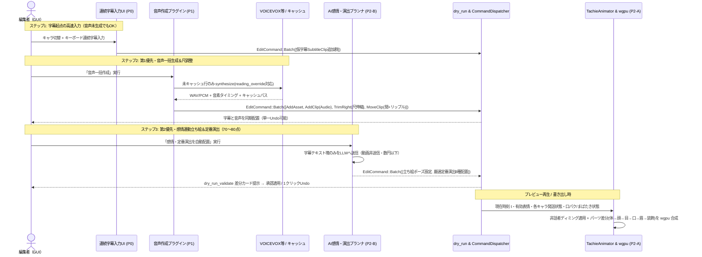

# [001] ゆっくり実況向け専用モジュール（Yukkuri Live & Tachie Module）

- **ステータス**: Draft
- **作成日**: 2026-11-15
- **更新日**: 2026-11-18
- **関連ドキュメント**:
  - 市場調査・開発戦略レポート: [`loadmap/Market Research.md`](loadmap/Market%20Research.md)
  - プラグイン開発ロードマップ: [`loadmap/Plugin Loadmap.md`](loadmap/Plugin%20Loadmap.md)
  - 各フェーズ個別設計書: [`004-phase-p0-core-prerequisites.md`](004-phase-p0-core-prerequisites.md)（P0）、[`005-phase-p1-tts-voice-plugin.md`](005-phase-p1-tts-voice-plugin.md)（P1）、[`006-phase-p2-tachie-ai-effects-plugin.md`](006-phase-p2-tachie-ai-effects-plugin.md)（P2）
  - 全体基本設計書（Phase A〜C 完了済み）: [`completed/draft.md`](completed/draft.md)
  - 初期実装（前提基盤・完了済み）: [`completed/initial-implementation/PhaseA.md`](completed/initial-implementation/PhaseA.md), [`completed/initial-implementation/PhaseB.md`](completed/initial-implementation/PhaseB.md), [`completed/initial-implementation/PhaseC.md`](completed/initial-implementation/PhaseC.md)
  - AviUtl 準拠 UI 設計書（Phase D-1〜D-6 完了済み）: [`completed/002-aviutl-ui-redesign/README.md`](completed/002-aviutl-ui-redesign/README.md)

> [!NOTE]
> 本設計書は初期実装（Phase A〜C）および AviUtl 準拠 UI 刷新（`002`: Phase D-1〜D-6）が完了した前提で実装する **ゆっくり／ずんだもん実況ドメイン共通のコア設計（`src/yukkuri/`）** です。各フェーズの具体的なワークフロー・UI・プラグイン仕様は [`004`](004-phase-p0-core-prerequisites.md)（Phase P0）・[`005`](005-phase-p1-tts-voice-plugin.md)（Phase P1）・[`006`](006-phase-p2-tachie-ai-effects-plugin.md)（Phase P2）へ分割されています。

---

## 1. 概要・目的

- **解決したい課題・目的**:
  - 従来の AviUtl 拡張機能（32bit Win32 DLL ベースのゆっくり実況支援・立ち絵プラグイン等）を直接取り込む代わりに、`sea-movie-creator` のマルチ OS・GPU 合成・AI ネイティブ基盤を最大限に活かし、**YukkuriMovieMaker（YMM4 等）と同等以上の快適なゆっくり／ずんだもん実況制作ワークフロー** を提供する。
  - [`Market Research.md`](loadmap/Market%20Research.md) の戦略に基づき、**「編集者が入力した字幕（＋キャラクタープリセット）を起点に、音声生成・尺伸縮・立ち絵の口パク／まばたき／非話者減光／感情表情・定番演出を 70〜80 点の品質で一括生成し、タイムライン上の個別部品として後から自由に微調整できる」** 合理的・低コストな編集体験を実現する。
- **対象ユーザー / 利用シーン**:
  - 録画済みゲーム映像（特に配信者の肉声が入っていないゲーム音のみの映像）から、ゆっくり実況・ずんだもん実況・解説動画を作成する個人クリエイター。
  - キーボード操作のみで字幕をテンポ良く連続入力したうえで一括音声生成・AI 演出配置を行うクリエイター、および AI チャットへ掛け合い台本を提案させ差分プレビュー確認後に適用したいクリエイター。

---

## 2. スコープ

### 対象（In Scope）
- **Phase P0（本体側前提）**:
  - キャラクタープリセット管理（音声設定、`SubtitleProperties` ベースの字幕スタイル、立ち絵テンプレート、標準 `VisualProperties`、モーション・非話者減光設定）
  - キーボード完結の連続字幕入力 UI（プリセット切替と次枠入力を高速連続実行し、音声未合成の仮字幕からワークフローを始められる仕組み）
- **Phase P1（音声作成プラグイン・TTS 連携）**:
  - 音声合成（TTS）アダプタ基盤（商用無料・要クレジット表記の **VOICEVOX / COEIROINK / AivisSpeech** を最優先標準対応とし、**AquesTalk 外部ブリッジ / 棒読みちゃん等** はユーザー導入外部プラグイン `plugins/tts/` として分離、加えて OS 標準 TTS フォールバック）
  - **字幕起点の一括＆差分音声合成**：入力済み字幕から音声を生成し、実音声長に合わせて字幕尺を自動伸縮、自然な「間（ま）」の無音挿入、後続クリップの自動リップルシフト、生成音声キャッシュ、概要欄向けクレジット一覧出力補助を提供
- **Phase P2（感情連動の立ち絵・定番演出自動配置）**:
  - パーツ分け立ち絵システム（目・口・眉・顔・体・装飾等のレイヤー差分合成、PNG パーツフォルダ＆PSD レイヤー読み込み対応）
  - ローカル自動アニメーション（音量エンベロープ＋母音/音素ベース口パク、約 3 秒周期まばたき、発話中の自動揺れ・跳ね、**非話者を少し暗くする話者強調ディミング演出**）
  - **AI バッチ感情・定番演出プランナ連携**：動画映像を送信せず字幕テキスト塊のみを LLM へ渡して JSON で一括判定させ（1 本数円以下）、感情表情切替および厳選した定番演出（5〜10 種：集中線・画面揺れ・ズーム・暗転・フラッシュ・モノクロ・字幕ポップ・SE 枠等）を差分プレビュー＋単一 Undo 付きで個別部品として自動配置
- **単一ダイアログ同期＆統合編集**:
  - 1 行単位の編集・再合成時にも音声・字幕・立ち絵・カット境界計算を追従同期する仕組み（`EditCommand::Batch` へのコンパイル）

### 対象外（Out of Scope）
- 特定のプロプライエタリ／有償再配布禁止音声 DLL（例：AquesTalk バイナリ本体）のアプリ本体への同梱・直接組込（YMM4 Lite と同様にユーザーが外部導入してアダプタ連携する）
- 32bit AviUtl 用の既存 `.auf` / `.anm` バイナリ互換実行
- 無音カット（Phase P3）・肉声自動字幕／外部台本インポート（Phase P4）・YMM4/AviUtl プロジェクト書き出し（Phase P5）の個別仕様（[`Plugin Loadmap.md`](loadmap/Plugin%20Loadmap.md) で別プラグインとして設計）

---

## 3. 要件・制約

- **前提条件（Phase A〜D の完了基盤を利用）**:
  - `ProjectDocument` / `Layer` / `Clip` (`Video` / `Audio` / `Image` / `Subtitle`) / `EditCommand` / `CommandDispatcher` / 単一 `Undo/Redo`（Phase A・`002`）
  - `AnimatedParameter`（`f(t)`・`Easing`・`Keyframes`）・`Clip.midpoints` と `source_in` / `effect_offset_frames` によるカット途中継続（Phase A〜B・`002`）
  - `wgpu` 合成シェーダ（[`layer_composite.wgsl`](../src/media/compositor/shaders/layer_composite.wgsl)）・`VisualProperties`・`SubtitleProperties`・AviUtl 準拠タイムライン/設定ダイアログ（Phase B・`002`）
  - AI チャット・`dry_run_validate` 差分プレビュー・`AiProvider` / `plugins/ai/*` / `sea-movie-creator mcp`（Phase C）
- **機能要件**:
  1. **字幕起点の段階実行とライブ追従の両立**: 字幕だけを先にキーボードで連続入力し後から P1（一括音声生成）→ P2（立ち絵・AI 感情/演出配置）を流せること、かつ生成済みセリフを後から編集した際も個別再合成と尺・後続追従が行えること。
  2. **個別部品としての編集性（70〜80 点主義）**: 自動生成された音声・字幕・立ち絵・定番演出は 1 枚の映像へ焼き込まず、タイムライン上の独立した `Clip`・`AnimatedParameter` として配置され、AviUtl 風 UI で 1 コマ単位に微調整できること。
  3. **自然な立ち絵制御**: 立ち絵の口パクは「音声音量エンベロープ」と「母音/音素タイミング」の双方に対応し、待機中（無音区間）も約 3 秒周期のまばたき・別表情維持・**非話者の減光（ディミング）**を自然に制御できること。
  4. **カット分割時の完全連続性**: セリフや立ち絵クリップを途中でカット分割した場合、後半ブロックは「音声・字幕・口パク・まばたき・揺れアニメーションの途中」から連続して再生されること（[`src/timeline/document.rs`](../src/timeline/document.rs) の整数フレーム境界・有理 `PlaybackRate`・`source_in` / `effect_offset_frames` モデルをそのまま継承）。
  5. **座標・アンカー規約準拠**: 立ち絵座標・回転アンカーは [`src/media/visual_properties.rs`](../src/media/visual_properties.rs) および [`completed/002-aviutl-ui-redesign/README.md`](completed/002-aviutl-ui-redesign/README.md) §6 に従い、キャンバス中央原点 `(0.0, 0.0)`・論理ピクセル `px` 単位・`anchor_x/y` は要素中心 `(0.0, 0.0)` 基準のピクセルオフセットとする。
  6. **安全な適用と API コスト最小化**: LLM へは動画映像を送らず字幕テキスト塊（JSON）のみを送信して 1 本数円以下に抑え、AI による表情・演出変更案は必ず `dry_run_validate` による差分確認後に `EditCommand::Batch` で適用し、1 クリック Undo 可能とすること。
- **非機能要件・ライセンス・OS 制約**:
  - Windows / macOS / Linux のすべてで動作するよう、音声合成エンジン連携は **ローカル HTTP API / 外部 CLI / ユーザー導入外部アダプタ（`plugins/tts/`）** としてプロセス分離し、特定 OS 専用や再配布禁止 DLL へ依存しない。
  - **商用利用ルールへの配慮**: VOICEVOX / COEIROINK / AivisSpeech を第 1 優先とし、AquesTalk はアプリ本体へ同梱せず外部連携専用として扱うとともに、UI 上で利用規約・クレジット表記／商用ライセンスの注意を分かりやすく表示する。
  - PSD ファイル読み込みは純粋 Rust パーサ（MIT/Apache-2.0 系）等を用い、外部プロプライエタリ SDK に依存しない。
  - 多数のパーツレイヤーを合成しても GPU（`wgpu`）上で事前統合またはアトラス化し、プレビュー 60fps を維持する。

---

## 4. アーキテクチャ / 設計詳細

### 4.1 モジュール構成と責務分担

本モジュール群は独立した `src/yukkuri/`（および必要に応じた別プロセス外部プラグインクレート `plugins_src/sea-tts-*`）として実装し、タイムラインやコンポジタへ [`EditCommand`](../src/timeline/command.rs) 経由で疎結合に接続する。

- `character.rs`（Phase P0）: `CharacterPreset`（話者設定、`SubtitleProperties` 準拠スタイル、立ち絵リグ参照、デフォルト `VisualProperties`、モーション＆非話者減光ルール `TachieMotionRules`）管理
- `tts/mod.rs` + `tts/providers/`（Phase P1）: `TtsProvider` トレイトと各エンジンアダプタ（VOICEVOX / COEIROINK / AivisSpeech HTTP 最優先、外部 CLI / `plugins/tts/` プラグイン、OS TTS フォールバック）、合成音声キャッシュ（ハッシュキー：プロバイダ＋話者＋テキスト/読み＋話速/音高/抑揚/音量）、使用エンジン・話者のクレジット文字列集計
- `dialogue/item.rs` + `dialogue/batch_sync.rs`（Phase P0〜P1）: セリフ項目（`DialogueLine`）管理、仮字幕の連続入力支援、一括/差分音声生成時の字幕尺自動伸縮・自然な「間」挿入・対象レイヤー選択的リップルシフト、`EditCommand::Batch` ビルダー
- `tachie/loader.rs`（Phase P2-A）: PNG パーツフォルダ定義（`tachie.json`）および PSD レイヤー構造の解析・GPU テクスチャキャッシュ
- `tachie/lipsync.rs`（Phase P2-A）: 生成音声 PCM からのエンベロープ／母音開口度タイムライン（`LipSyncTrack`）解析
- `tachie/animator.rs`（Phase P2-A）: 口パク・約 3 秒周期まばたき・発話揺れ（`f(t)` 連携）・**非話者ディミング**および指定時刻におけるパーツ合成リスト解決
- `director/emotion_effects.rs`（Phase P2-B）: 字幕テキストバッチから LLM へ感情＆厳選定番演出（5〜10 種）の JSON 提案を要求し、`EditCommand::Batch`＋`dry_run_validate` 差分カードへ変換するプランナ

### 4.2 データ構造（AI-Native & `002` モデル整合設計）

```rust
// 設計イメージ（src/media/visual_properties.rs & src/timeline/document.rs との整合版）
pub struct CharacterPreset {
    pub id: CharacterId,
    pub display_name: String,
    pub voice: VoiceConfig,                    // TtsProviderId, speaker_id, speed, pitch, intonation, volume
    pub subtitle_template: SubtitleProperties, // 既存の SubtitleProperties (font, size, colors, alignment, visual) をそのまま継承
    pub tachie_rig_id: Option<TachieRigId>,    // 立ち絵パーツセット参照
    pub default_transform: VisualProperties,   // 立ち絵の基準配置・拡大率・アンカー
    pub motion_rules: TachieMotionRules,       // まばたき周期(既定~3.0s)、口パク感度、発話揺れ振幅、非話者減光オフセット
}

pub struct TachieMotionRules {
    pub blink_interval_sec: f64,               // 既定: 3.0 秒前後
    pub lip_sync_sensitivity: f64,             // 口パク感度
    pub talk_bounce_px: f64,                   // 発話時揺れ・跳ね振幅
    pub inactive_brightness_offset: f64,       // 非話者の減光値（例: -0.15 で少し暗くする、0.0 で無効）
}

pub struct DialogueLine {
    pub id: DialogueId,
    pub character_id: CharacterId,
    pub text: String,                          // セリフ本文（字幕兼読み上げ元）
    pub reading_override: Option<String>,      // 音声合成専用の読み仮名・アクセント調整用
    pub emotion_tag: Option<String>,           // AI または手動で割り当てた感情ラベル (happy, surprised 等)
    pub expression_override: TachiePose,       // 目/眉/口/体/装飾パーツの表情指定
    pub audio_clip_id: Option<ClipId>,         // 音声未合成の仮字幕状態では None、P1 生成後に紐付け
    pub subtitle_clip_id: ClipId,              // タイムライン上の Subtitle クリップ参照
    pub cached_audio_hash: Option<String>,     // 音声キャッシュ一致判定用ハッシュ
    pub lip_sync_frames: Vec<MouthShapeSample>,
}
```

### 4.3 処理フロー（字幕起点の段階的ワークフロー）



---

## 5. インターフェース / API 仕様

### 5.1 音声合成アダプタ（`TtsProvider`）と権利配慮

- **トレイト責務**:
  - `list_speakers() -> Result<Vec<SpeakerInfo>, TtsError>`
  - `synthesize(request: &SynthesisRequest) -> Result<SynthesisOutput, TtsError>`（生成 PCM / 音声ファイルパス / 任意でモーラ・音素タイムライン `Vec<PhonemeSpan>` を返す）
- **対応アダプタ優先順位**:
  1. **標準最優先（ローカル HTTP 互換アダプタ）**: **VOICEVOX Engine / COEIROINK / AivisSpeech**（ポート設定可能・無料かつクレジット表記で商用利用可能なため新規層向けに最優先サポート）。プロジェクト内で使用した話者から概要欄向けクレジット文を自動生成するヘルパーを提供。
  2. **ユーザー導入外部アダプタ（`plugins/tts/` 拡張）**: **AquesTalk 外部ブリッジ（ゆっくりボイス）・棒読みちゃん連携・任意ローカル TTS CLI**（ライセンス規約を遵守するためバイナリはアプリ本体へ同梱せず、ユーザーが導入した外部実行ファイルを指定して連携）。
  3. **OS 標準 TTS フォールバック**: 外部エンジン未起動時でも仮尺確認・下書きができるよう OS 音声合成 API 経由のフォールバックを用意。

### 5.2 立ち絵（Tachie）パーツ規約＆定番演出・コマンド統合

- **フォルダ形式 & PSD 互換**:
  - `体` / `顔` / `目`（開・閉・半目・笑い等）/ `口`（閉・あ・い・う・え・お・小・大等）/ `眉` / `他（髪・装飾）` のパーツグループを認識。
  - **PSD 読み込み**: PSD のレイヤーフォルダ階層（例：`*目/`, `!口/` 等の YMM/AviUtl 系慣習プレフィックスや明示的なマッピング定義 `tachie.json`）を読み取り、必須パーツ・択一パーツ・多選パーツを解析・キャッシュする。
- **統一コマンド `EditCommand::Batch` へのコンパイル方針**:
  - 単体パラメータ変更は既存の `EditCommand::SetParameter { target, path, value }` をそのまま利用する。
  - 音声一括生成・リップル調整・AI 感情/定番演出配置・会話台本一括配置（ワークフロー層または `GenerateDialogueScript { lines, start_frame, gap_frames }` のような高水準入力）は、最終的に **既存の標準 `EditCommand::Batch`（`AddAsset`, `AddLayer`, `AddClip`, `TrimRight`, `MoveClip`, `SetParameter`）へ展開・検証** する設計とし、`dry_run_validate`・`CommandDispatcher`・単一 Undo/Redo・`mcp_server` との完全な互換性を保つ。
- **AI が配置できる定番演出（厳選 5〜10 種）**:
  - AI 判定精度の維持と開発スコープ抑制のため、定番演出は [`Plugin Loadmap.md`](loadmap/Plugin%20Loadmap.md) で定めた 8 種（集中線 / 画面揺れ / ズーム / 暗転 / フラッシュ / モノクロ・セピア / テロップポップ / 定番 SE 枠）に限定し、既存の `VisualProperties` / `SubtitleProperties` / `AnimatedParameter`（`Easing`, `Expression`）＋最小限のオーバーレイ／フィルタ拡張で表現する。

---

## 6. エラーハンドリング・エッジケース

- **外部 TTS エンジン未起動・接続エラー**:
  - タイムアウト（既定 5 秒）で安全に失敗し、プロジェクト破損や無音化を防ぐ。接続先確認案内・再試行・OS TTS 下書き切替ボタンを UI に表示し、既存の合成キャッシュ済みセリフはオフラインのまま再生可能にする。
- **キャッシュ整合性と選択的リップル調整**:
  - テキスト・読み仮名・話者・話速等のハッシュ値で生成 WAV を管理し、未変更セリフの再合成をスキップして軽快さを保つ。
  - テキスト編集による差分再合成で尺が伸縮した際、後続クリップを自動シフトする「会話レイヤーグループ（リップル対象）」と「巻き込まない背景レイヤー（ゲーム録画・BGM 等）」を区別する。ロック中レイヤーや手動配置クリップとの衝突が発生する場合は自動変更を中止して衝突箇所を明示し、ドキュメント不変条件（同一レイヤー重なり禁止）を守る。
- **カット編集時の挙動**:
  - セリフまたは立ち絵クリップをカット分割した場合も、Phase A で導入した `source_in` と `effect_offset_frames` をそのまま利用することで、後半パーツの音声・字幕表示・口パク波形・まばたき・揺れアニメーションすべてが途切れることなく途中から継続される。
- **LLM 感情・演出提案の異常応答**:
  - LLM が未知の感情名や対象外のエフェクト名・不正フレーム範囲を返した場合も、パーサ段階および `dry_run_validate` によって適用前に安全に弾く（既知表情へのフォールバックまたは警告表示を行い、タイムラインを壊さない）。
- **立ち絵 PSD の欠損・巨大解像度**:
  - 4000px 超の高解像度立ち絵 PSD を読み込んだ場合でも、プレビュー用と書き出し用の 2 段階テクスチャミップまたは最大境界ボックス正規化を行い、VRAM 枯渇を防ぐ。

---

## 7. テスト計画・受け入れ基準

本モジュール実装時は [`.github/copilot-instructions.md`](../.github/copilot-instructions.md) のルールに従い、単体テストを各 `.rs` ファイル末尾、結合テストを `tests/yukkuri_live_module.rs` ＋ `tests/yukkuri_live_module/mod.rs` ＋ `tests/yukkuri_live_module/<テスト名>.rs` へ配置する。

- **単体テスト**:
  - 音声 PCM からの口開きエンベロープ抽出（無音区間が必ず「閉じ」口形になること、大音量で「大開き」になること）のテスト。
  - まばたき周期タイマー（約 3 秒周期）・発話揺れ関数（カット分割時の `effect_offset_frames` 加算後も位相が跳ばないこと）・非話者ディミング（発話中キャラが基準明度、待機中キャラが減光値になること）のテスト。
  - 字幕尺自動伸縮＆選択的リップル計算（自然な「間」の挿入、BGM レイヤー非干渉、ロック中レイヤー衝突検出）および TTS 音声キャッシュキー一致/無効化テスト。
  - パーツ組み合わせ解決ロジック（択一パーツ切替時に同グループの他パーツが非表示になること、複数選択パーツの重ね順維持）。
  - PSD / パーツフォルダマッピングパーサおよび AI 感情・演出 JSON パーサの異常系テスト。
- **結合テスト**:
  - Mock `TtsProvider`（固定周波数＋無音区間入り正弦波 WAV と音素スパンを返すテストモック）＋ Mock `AiProvider` を用い、連続字幕入力 → 一括音声生成・尺伸縮・リップル・キャッシュ再利用 → AI 感情/定番演出 JSON 提案 → `dry_run_validate` → `EditCommand::Batch` 適用 → 途中カット編集 → 単一 Undo を通して検証。
  - 実際の外部ローカル TTS サーバー（VOICEVOX 等）や実 `wgpu` アダプタを用いるピクセルテストは `#[ignore = "requires local TTS server / wgpu adapter"]` とし、通常時は純粋ロジック・Mock テストが環境非依存で全通過することを保証する。
- **完了条件（Definition of Done）**:
  - `cargo fmt --check`、`cargo clippy --workspace --all-targets --all-features -- -D warnings`、`cargo build --workspace --all-targets`、`cargo test --workspace --all-targets --all-features` が警告・エラーゼロで通過すること。
  - ローカル TTS エンジン接続およびダミー立ち絵セットでの手動実動画再生・書き出し確認（`cargo test -- --ignored` 含む）が完了していること。

---

## 8. 未決事項・検討メモ（Open Questions）

- [x] **TTS 連携の優先順位とライセンス分離方針（ADR 2026-11-18）**: [`Market Research.md`](loadmap/Market%20Research.md) §3 に基づき、商用無料（要クレジット）の VOICEVOX / COEIROINK / AivisSpeech を第 1 優先とし、AquesTalk はアプリ本体に同梱せずユーザー導入外部アダプタとして分離する方針に決定。
- [x] **字幕起点の一括処理と厳選エフェクト範囲（ADR 2026-11-18）**: 1 行ライブ同期だけでなく、キーボード連続字幕入力 → 一括 TTS 合成・リップル調整 → 字幕バッチ JSON による低コスト感情＆定番演出 8 種配置（70〜80 点主義）を中核フローとして採用。
- [ ] **PSD パーサ選定**: 純粋 Rust 製 PSD クレート（例：`psd` クレート等）の最新メンテナンス状況とブレンドモード（通常・乗算・スクリーン・クリッピングマスク）のサポート範囲を、実装着手時点で再評価して採用クレートを決定する。
- [ ] **立ち絵レイヤー名の慣習互換**: YMM4 / ゆっくりキャラ素材規約（`*` / `!` プレフィックス等）をどこまで自動推定し、どこから `tachie.json` マッピングで補うかの UI ウィザード設計を詰める。
- [ ] **リップル対象グループのデフォルト UX**: セリフ文字数を増やして音声が長くなった際、「会話関連トラック（音声＋字幕＋立ち絵）のみ自動シフトし、ゲーム動画・BGM レイヤーは固定する」既定ルールをユーザーがタイムライン上でどう視認・切替できるか詳細化する。
- [ ] **集中線など一部定番演出の表現手段**: 8 種の定番演出のうち、既存 `VisualProperties` のみで完結しない「集中線」等について、同梱プロシージャルベクタ/画像素材で済ませるか、[`layer_composite.wgsl`](../src/media/compositor/shaders/layer_composite.wgsl) への軽量フィルタ追加とするかを Phase P2 実装着手時に確定する。
