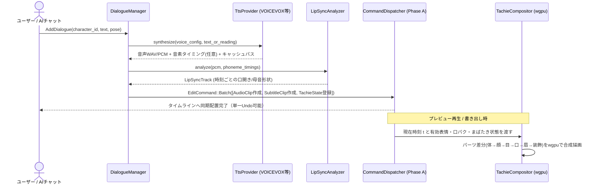

# [001] ゆっくり実況向け専用モジュール（Yukkuri Live & Tachie Module）

- **ステータス**: Draft
- **作成日**: 2026-11-15
- **更新日**: 2026-11-15
- **関連ドキュメント**:
  - 全体基本設計書: [`draft.md`](draft.md)
  - 初期実装（前提基盤）: [`initial-implementation/PhaseA.md`](initial-implementation/PhaseA.md), [`initial-implementation/PhaseB.md`](initial-implementation/PhaseB.md), [`initial-implementation/PhaseC.md`](initial-implementation/PhaseC.md)

> [!NOTE]
> 本設計書は **初期実装（Phase A〜C）がすべて完了した前提** で追加する将来機能モジュールの新規設計です。初期実装フェーズ（Phase A〜C）には含めず、Phase C 完了後に独立した機能単位として設計レビュー・実装を行います。

---

## 1. 概要・目的

- **解決したい課題・目的**:
  - 従来の AviUtl 拡張機能（32bit Win32 DLL ベースのゆっくり実況支援・立ち絵プラグイン等）を直接取り込む代わりに、`sea-movie-creator` のマルチ OS・GPU 合成・AI ネイティブ基盤を最大限に活かし、**YukkuriMovieMaker（YMM4 等）と同等の快適なゆっくり実況制作ワークフロー** を標準モジュール（または公式機能拡張）として提供する。
  - テキストでセリフを入力する（あるいは AI チャットへ会話台本を依頼する）だけで、**合成音声の生成・発話長に合わせた字幕の自動配置・立ち絵の口パク／まばたき／感情表情／揺れアニメーション** を一括生成・追従編集できるようにする。
- **対象ユーザー / 利用シーン**:
  - ゆっくり実況動画・解説動画・ボイスロイド/合成音声解説動画の制作者。
  - AI チャットに「2 人のキャラで 1 分の解説掛け合い台本を作ってタイムラインに並べて」と指示して素早く下書きを組み、細部を手動 UI で微調整したいクリエイター。

---

## 2. スコープ

### 対象（In Scope）
- キャラクタープリセット管理（音声設定、字幕スタイル、立ち絵テンプレート、標準配置・動き設定）
- 音声合成（TTS）アダプタ基盤（外部エンジン連携：VOICEVOX / AivisSpeech / COEIROINK / 棒読みちゃん連携 / OS 標準 TTS / ユーザー導入外部 CLI・エンジン）
- パーツ分け立ち絵システム（目・口・眉・顔・体・装飾等のレイヤー差分合成、PNG パーツフォルダ＆PSD レイヤー読み込み対応）
- 口パク（音量エンベロープ連動＋母音/音素ベース開閉パターン）、周期的まばたき、発話中の自動揺れ・跳ねアニメーション
- セリフアイテム（ボイスアイテム）による「音声＋自動字幕＋立ち絵状態」の同期配置・テキスト変更時の自動長さ再計算・後続セリフ追従（リップル）編集
- AI チャットとの連携（キャラクター指定のセリフ生成・感情タグ付け・一括タイムライン配置用 `EditCommand`）

### 対象外（Out of Scope）
- 特定のプロプライエタリ音声合成 DLL（例：有償・再配布禁止ライセンスの商用音声ライブラリバイナリ等）のアプリ本体への同梱・直接組込
- 32bit AviUtl 用の既存 `.auf` / `.anm` バイナリ互換実行

---

## 3. 要件・制約

- **前提条件（Phase A〜C の完了基盤を利用）**:
  - `ProjectDocument` / `Layer` / `Clip` / `EditCommand` / `Undo/Redo`（Phase A）
  - `AnimatedParameter`（`f(t)` ＆ツマミ調整）と `source_offset` / `effect_offset_frames` によるカット途中継続（Phase A〜B）
  - `wgpu` 合成シェーダ・`VisualProperties`・マルチレイヤータイムライン（Phase B）
  - AI チャット＆エンドポイントプラグイン基盤（Phase C）
- **機能要件**:
  1. セリフを 1 行入力／編集すると、音声合成・字幕表示・口パクアニメーション・立ち絵表情が 1 つの論理グループとして連動すること。
  2. 立ち絵の口パクは「音声の音量に応じた開閉」と「母音・音素タイミング（または発話区間解析）に応じた口形状変化」の両方に対応し、さらにまばたき・揺れを無声区間も含めて自然に制御できること。
  3. 発話していない待機中（無音区間）も、立ち絵の待機表示・まばたき・別表情の維持を継続できること。
  4. セリフブロックを途中でカット分割した場合、後半ブロックは「音声・字幕・口パク・揺れアニメーションの途中」から連続して再生されること（Phase A の整数フレーム境界・有理 `PlaybackRate`・`source_offset` / `effect_offset_frames` モデルをそのまま継承）。
  5. 立ち絵座標・回転アンカーは [`draft.md`](draft.md) §5.4 のキャンバス中央原点 `(0.0, 0.0)`・論理ピクセル単位・`anchor_x/y` 規約に従うこと。
- **非機能要件・特許・ライセンス・OS 制約**:
  - Windows / macOS / Linux のすべてで動作するよう、音声合成エンジン連携は **ローカル HTTP API / CLI / ユーザー導入外部アダプタ** としてプロセス分離し、特定 OS 専用や再配布禁止 DLL へ依存しない。
  - PSD ファイル読み込みは純粋 Rust パーサ（MIT/Apache-2.0 系）等を用い、外部プロプライエタリ SDK に依存しない。
  - 多数のパーツレイヤーを合成しても GPU（`wgpu`）上で事前統合またはアトラス化し、プレビュー 60fps を維持する。

---

## 4. アーキテクチャ / 設計詳細

### 4.1 モジュール構成と責務分担

本モジュールは独立した `src/yukkuri/`（または機能別プラグインクレート `yukkuri_live`）として実装し、タイムラインやコンポジタへ疎結合で接続する。

- `character.rs`: `CharacterPreset`（話者設定、字幕スタイル、立ち絵構造、デフォルト `VisualProperties`、モーション設定）管理
- `tts/mod.rs` + `tts/providers/`: `TtsProvider` トレイトと各エンジンアダプタ（HTTP API / CLI / OS TTS）、合成音声キャッシュ（ハッシュキー：話者＋テキスト＋話速/音高/抑揚）
- `tachie/loader.rs`: PNG パーツフォルダ定義（`tachie.json`）および PSD レイヤー構造の解析・GPU テクスチャキャッシュ
- `tachie/lipsync.rs`: 生成音声 PCM からのエンベロープ／母音開口度タイムライン（`LipSyncTrack`）解析
- `tachie/animator.rs`: 口パク・まばたき・発話揺れ（`f(t)` 連携）および指定時刻におけるパーツ合成リスト解決
- `dialogue/item.rs`: セリフ項目（`DialogueClip` / 論理グループ）と音声・字幕・立ち絵・カット境界計算の同期管理

### 4.2 データ構造（AI-Native 設計）

```rust
// 設計イメージ（初期実装完了後に実装）
pub struct CharacterPreset {
    pub id: CharacterId,
    pub display_name: String,
    pub voice: VoiceConfig,                // TtsProviderId, speaker_id, speed, pitch, intonation, volume
    pub subtitle_style: SubtitleStyle,     // フォント、文字色、縁取り色・太さ、配置基準
    pub tachie_rig_id: Option<TachieRigId>,// 立ち絵パーツセット参照
    pub default_transform: VisualProperties,
    pub motion_rules: TachieMotionRules,   // まばたき周期、口パク感度、発話時揺れ振幅
}

pub struct DialogueLine {
    pub id: DialogueId,
    pub character_id: CharacterId,
    pub text: String,                      // セリフ本文（字幕兼読み上げ元）
    pub reading_override: Option<String>,  // 音声合成専用の読み仮名・アクセント調整用
    pub expression_override: TachiePose,   // 目/眉/口/体/装飾パーツの表情指定
    pub audio_clip_id: ClipId,             // タイムライン上の音声クリップ参照
    pub subtitle_clip_id: ClipId,          // 同期生成された字幕クリップ参照
    pub lip_sync_frames: Vec<MouthShapeSample>,
}
```

### 4.3 処理フロー（セリフ生成〜タイムライン配置〜フレーム描画）



---

## 5. インターフェース / API 仕様

### 5.1 音声合成アダプタ（`TtsProvider`）

- **トレイト責務**:
  - `list_speakers() -> Result<Vec<SpeakerInfo>, TtsError>`
  - `synthesize(request: &SynthesisRequest) -> Result<SynthesisOutput, TtsError>`（生成 PCM / 音声ファイルパス / 任意でモーラ・音素タイムライン `Vec<PhonemeSpan>` を返す）
- **対応アダプタ計画**:
  - **ローカル HTTP 互換アダプタ**: VOICEVOX Engine / AivisSpeech / COEIROINK 等のローカルサーバー API（ポート設定可能）
  - **外部 CLI / プラグインアダプタ**: 棒読みちゃん連携ツールやユーザー導入済みローカル TTS CLI（`plugins/tts/` プラグイン形式で拡張可能）
  - **OS 標準 TTS フォールバック**: 外部エンジン未起動時でも動作確認・下書きができるよう OS 音声合成 API 経由のフォールバックを用意

### 5.2 立ち絵（Tachie）パーツ規約

- **フォルダ形式 & PSD 互換**:
  - `体` / `顔` / `目`（開・閉・半目・笑い等）/ `口`（閉・あ・い・う・え・お・小・大等）/ `眉` / `他（髪・装飾）` のパーツグループを認識。
  - **PSD 読み込み**: PSD のレイヤーフォルダ階層（例：`*目/`, `!口/` 等の YMM/AviUtl 系慣習プレフィックスや明示的なマッピング定義 `tachie.json`）を読み取り、どのレイヤーが必須パーツ・択一パーツ・多選パーツかを解析・キャッシュする。
- **AI が操作可能な表情・パラメータコマンド**:
  - 立ち絵ポーズや口パク感度の単体変更は統一コマンド `EditCommand::SetParameter { target, path, value }` を利用し、スクリプト一括生成用に専用バッチまたは複合コマンドを提供する。
  - `GenerateDialogueScript { lines: Vec<DialogueScriptLine>, start_frame: FrameIndex, gap_frames: FrameCount }`（AI チャットが掛け合い台本を一発でタイムラインへ流し込む宣言的コマンド、`schemars::JsonSchema` 対応）。

---

## 6. エラーハンドリング・エッジケース

- **外部 TTS エンジン未起動・接続エラー**:
  - タイムアウト（既定 5 秒）で安全に失敗し、プロジェクト破損や無音化を防ぐ。接続先確認案内または再試行ボタンを UI に表示し、既存の合成キャッシュ済みセリフはオフラインのまま再生可能にする。
- **キャッシュ整合性**:
  - テキスト・読み仮名・話者・話速のハッシュ値で生成 WAV を管理し、未変更セリフの再合成をスキップして軽快さを保つ。テキスト編集時のみ差分再合成し、タイムライン上のクリップ長（`duration_frames`）と後続クリップとの間隔を更新する（手動トリム・ロック中クリップがある場合は衝突警告または自動調整ポリシー設定に従う）。
- **カット編集時の挙動**:
  - セリフまたは立ち絵クリップをカット分割した場合も、`Phase A` で導入した `source_offset` と `effect_offset_frames` をそのまま利用することで、後半パーツの音声・字幕表示・口パク波形・まばたき・揺れアニメーションすべてが途切れることなく途中から継続される。
- **立ち絵 PSD の欠損・巨大解像度**:
  - 4000px 超の高解像度立ち絵 PSD を読み込んだ場合でも、プレビュー用と書き出し用の 2 段階テクスチャミップまたは最大境界ボックス正規化を行い、VRAM 枯渇を防ぐ。

---

## 7. テスト計画・受け入れ基準

本モジュール実装時は [`.github/copilot-instructions.md`](../.github/copilot-instructions.md) のルールに従い、単体テストを各 `.rs` ファイル末尾、結合テストを `tests/yukkuri_live_module.rs` ＋ `tests/yukkuri_live_module/mod.rs` ＋ `tests/yukkuri_live_module/<テスト名>.rs` へ配置する。

- **単体テスト**:
  - 音声 PCM からの口開きエンベロープ抽出（無音区間が必ず「閉じ」口形になること、大音量で「大開き」になること）のテスト。
  - まばたき周期タイマーおよび発話揺れ関数の連続性テスト（カット分割時の `effect_offset_frames` 加算後も位相が跳ばないこと）。
  - パーツ組み合わせ解決ロジック（択一パーツ切替時に同グループの他パーツが非表示になること、複数選択パーツの重ね順維持）。
  - PSD / パーツフォルダマッピングパーサの異常系（壊れたヘッダ、パーツ欠損時フォールバック）テスト。
- **結合テスト**:
  - Mock `TtsProvider`（固定周波数＋無音区間入り正弦波 WAV と音素スパンを返すテストモック）を用い、セリフ 2 件追加→音声/字幕/口パク同期生成→セリフ文言更新による長さ再計算→途中カット編集→単一 Undo を通して検証。
  - 実際の外部ローカル TTS サーバー（VOICEVOX 等）や実 `wgpu` アダプタを用いるピクセルテストは `#[ignore = "requires local TTS server / wgpu adapter"]` とし、通常時は純粋ロジック・Mock テストが環境非依存で全通過することを保証する。
- **完了条件（Definition of Done）**:
  - `cargo fmt --check`、`cargo clippy --workspace --all-targets --all-features -- -D warnings`、`cargo build --workspace --all-targets`、`cargo test --workspace --all-targets --all-features` が警告・エラーゼロで通過すること。
  - ローカル TTS エンジン接続およびダミー立ち絵セットでの手動実動画再生・書き出し確認（`cargo test -- --ignored` 含む）が完了していること。

---

## 8. 未決事項・検討メモ（Open Questions）

- [ ] **PSD パーサ選定**: 純粋 Rust 製 PSD クレート（例：`psd` クレート等）の最新メンテナンス状況とブレンドモード（通常・乗算・スクリーン・クリッピングマスク）のサポート範囲を、実装着手時点（Phase C 完了後）で再評価して採用クレートを決定する。
- [ ] **立ち絵レイヤー名の慣習互換**: YMM4 / ゆっくりキャラ素材規約（`*` / `!` プレフィックス等）をどこまで自動推定し、どこから `tachie.json` マッピングで補うかの UI ウィザード設計を詰める。
- [ ] **リップル編集の既定挙動**: セリフ文字数を増やして音声が長くなった際、後続の同キャラセリフや全レイヤーの掛け合いを自動シフトするモードの切り替え UX を詰める。
