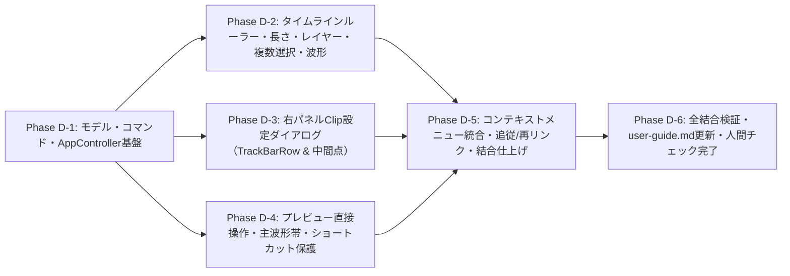

# [002-05] AviUtl 準拠 UI 段階的実装計画（Phase D-1 〜 D-6）

- **ステータス**: Draft
- **作成日**: 2026-11-16
- **更新日**: 2026-11-16
- **関連ドキュメント**:
  - 概要設計書: [`README.md`](README.md)
  - データモデル＆コマンド仕様: [`01-data-model-and-commands.md`](01-data-model-and-commands.md)
  - タイムライン仕様: [`02-timeline-spec.md`](02-timeline-spec.md)
  - 設定ダイアログ仕様: [`03-inspector-dialog-spec.md`](03-inspector-dialog-spec.md)
  - プレビュー＆ショートカット仕様: [`04-preview-and-shortcuts-spec.md`](04-preview-and-shortcuts-spec.md)
  - 開発規約: [`../../.github/copilot-instructions.md`](../../.github/copilot-instructions.md), [`../../.github/instructions/general.instructions.md`](../../.github/instructions/general.instructions.md)

---

## 1. 概要・目的

本ドキュメントは [`01-data-model-and-commands.md`](01-data-model-and-commands.md) 〜 [`04-preview-and-shortcuts-spec.md`](04-preview-and-shortcuts-spec.md) で定義した UI 大幅刷新を、コンパイルとテストを常時通しながら安全かつ段階的に実装するための **Phase D-1 〜 D-6** 実行計画を定める。

各 Phase は独立してテスト可能（完了基準 = Definition of Done を満たすごとに `cargo test --workspace` と `cargo clippy` が通る）な単位に分割する。

---

## 2. スコープ

### 対象（In Scope）
- Phase D-1 〜 D-6 の依存順序、変更対象ファイル一覧、モジュール分割方針。
- 各 Phase の自動テスト（単体・結合テスト配置規約準拠）、Lint ゲート、手動 GUI 目視確認チェックリスト。
- 最終フェーズでのユーザーガイド（[`../../docs/user-guide.md`](../../docs/user-guide.md)）同期計画。

### 対象外（Out of Scope）
- 将来機能であるカメラ制御／グループ制御シェーダやゆっくり実況専用モジュール（[`../001-yukkuri-live-module.md`](../001-yukkuri-live-module.md)）自体の実装。

---

## 3. 要件・制約

1. **テスト配置規約（必須）**:
   - 単体テストは変更対象の `.rs` ファイル末尾 `#[cfg(test)] mod tests` へ配置する。
   - 結合テストは `tests/<統合テスト名>.rs`（エントリ）＋ `tests/<統合テスト名>/mod.rs`（サブテスト群）規約で追加する。
2. **GUI 非自動起動原則**:
   - AI による検証で GPUI 実ウィンドウを自動起動・スクリーンショット撮影する無限待ちテストを組まない。すべての編集状態・座標変換・コマンド構築ロジックを純粋関数／`AppController` メソッドとして切り出して自動テストし、視覚・インタラクション最終確認のみチェックリストで人間が確認する。
3. **ワークスペース Lint 厳守（[`Cargo.toml`](../../Cargo.toml)）**:
   - `unsafe_code = "deny"`、`unwrap_used` / `expect_used` / `panic` = `"deny"`、Clippy Pedantic 準拠（`cargo clippy --workspace --all-targets --all-features -- -D warnings`）。

---

## 4. アーキテクチャ / フェーズ依存関係

- **並列着手の可否**: Phase D-1 完了後は、Phase D-2（タイムライン）・D-3（設定ダイアログ）・D-4（プレビュー）の 3 系統をそれぞれ独立 PR / ブランチ／エージェント分担で並列開発できる。

---

## 5. 各フェーズ詳細計画（Phase D-1 〜 D-6）

### Phase D-1：データモデル・編集コマンド・`AppController` 拡張基盤

- **参照仕様**: [`01-data-model-and-commands.md`](01-data-model-and-commands.md)
- **変更対象ファイル**:
  - [`src/timeline/document.rs`](../../src/timeline/document.rs): `TimelineLengthMode`, `FrameRange`, `ProjectDocument::{timeline_length, selection_range}`, `clips_end_frame()`, `total_duration_frames()`, `ruler_display_span_frames()`, `validate()` 拡張。
  - [`src/timeline/command.rs`](../../src/timeline/command.rs) / `src/timeline/operations.rs` / `src/timeline/dispatcher.rs`: `EditCommand::{SetTimelineLength, SetSelectionRange}` 実装＋Undo/Redo、複数クリップ一括移動トポロジカル順序解決ヘルパー。
  - [`src/ui/app_controller.rs`](../../src/ui/app_controller.rs): `selected_clip_ids`, `selected_segment_index`, `time_display_unit`, `timeline_row_density`, `preview_zoom`, `scale_aspect_locked`, `follow_selected_on_seek`, `show_preview_*`, 中間点ヘルパー（`clip_midpoint_effect_frames`, `add/move/remove_midpoint`）, `select_*`, `add_subtitle_clip_at`, `MIN_RIGHT_PANEL_WIDTH = 240.0`。
  - AI ツール / MCP スキーマ確認: `schemars::schema_for!(EditCommand)`・`ProjectDocument` 互換チェック。
- **単体テスト（各ファイル末尾）**: `serde` 後方互換読込、`FrameRange` 境界エラー、Undo/Redo、複数クリップ隣接移動、中間点挿入前後連続性テスト。
- **結合テスト**: `tests/phase_d_timeline_model.rs` + `tests/phase_d_timeline_model/mod.rs`（空プロジェクト長さ設定 → 字幕配置 → 中間点追加/分割 → Undo/Redo 往復）。
- **完了条件（DoD）**: 既存全テストが壊れず、新規追加テスト含め `cargo test --workspace` および `cargo clippy` が通過すること。

---

### Phase D-2：AviUtl 準拠タイムラインパネル刷新

- **参照仕様**: [`02-timeline-spec.md`](02-timeline-spec.md)
- **変更対象ファイル**:
  - [`src/ui/timeline_panel.rs`](../../src/ui/timeline_panel.rs)（規模が大きくなる場合は `src/ui/timeline/` サブモジュール分割も可：`ruler.rs`, `track_view.rs`, `waveform_view.rs`, `context_menu.rs`）。
  - [`src/ui/window.rs`](../../src/ui/window.rs): タイムラインドラッグ時のウィンドウ横断 `on_mouse_move` / `on_mouse_up` キャプチャ連携、`TimelineRowDensity` と行高さ連動。
- **主な実装項目**:
  1. **ヘッダ＋動的ルーラー＋左クリック/ドラッグシーク**: [`timeline_panel.rs#L153`](../../src/ui/timeline_panel.rs#L153) バグ修正（`scroll_x`＋パネル原点オフセット考慮）、連続スクラブ、`Shift+ドラッグ` 範囲指定。
  2. **長さ変更 2 軸**: 左上青いズームバー + `Ctrl+ホイール`（カーソル位置固定）+ `^`/`\` ズーム + 横スクロールバー；最終フレーム灰色境界線の直接ドラッグ・暗色マスク・長さ変更モーダル。
  3. **高密度レイヤー（22/30/44px）と仮想スクロール**: `v_virtual_list`（または累積高カリング）、表示/ミュート/ロック切替、インライン名変更、レイヤー増減操作。
  4. **クリップ＋中間点 `|`＋音声波形＋複数選択**: `AudioMixer::waveform_peaks` 波形描画、中間点 `|` 描画・区間クリック選択・中間点ドラッグ移動、マーキー囲み選択、`Ctrl+ドラッグ` 一括複製、[`src/timeline/snap.rs`](../../src/timeline/snap.rs) ガイド表示。
- **単体テスト**: `frame_from_window_x` / `canvas_x_from_frame` 往復、`compute_ruler_ticks` ラベル非重複、`segment_index_for_timeline_frame`、ズーム中心不変計算、マーキー矩形内包クリップ判定。
- **結合テスト**: `tests/phase_d_timeline_ui.rs` + `tests/phase_d_timeline_ui/mod.rs`。

---

### Phase D-3：右パネル「Clip 設定ダイアログ」刷新

- **参照仕様**: [`03-inspector-dialog-spec.md`](03-inspector-dialog-spec.md)
- **変更対象ファイル**:
  - [`src/ui/inspector_panel.rs`](../../src/ui/inspector_panel.rs)（必要に応じ `src/ui/inspector/` 配下に `trackbar_row.rs`, `midpoint_bar.rs`, `sections.rs` 等へ整理分割）。
  - [`src/ui/right_panel.rs`](../../src/ui/right_panel.rs): `MIN_RIGHT_PANEL_WIDTH = 240.0` 反映、セクション折りたたみ状態保持、`Project` タブへのタイムライン長設定欄追加、`Layers` タブとの双方向同期確認。
- **主な実装項目**:
  1. オブジェクトヘッダ＋**中間点バー**（`◀ [====青色区間バー====] ▶ [+][-]` ＆ バー内区間直接クリック）。
  2. **`TrackBarRow`** 専用ウィジェット（パネル幅 `240..379px` 2 段 / `>= 380px` 1 行横並び自動切替、左右スライダ・`<`/`>` 微調ボタン・`NumberInput` / `InputState` 直接数値入力、`Shift+ドラッグ` `1/10` 精度）。
  3. 中央移動方法選択ボタン＋`PopupMenu`（`移動なし`/`直線`/`加減速`/`加速`/`減速`/`ベジェ`/`中間点`/`数式 f(t)`）と [`AnimatedParameter`](../../src/core/animation.rs) 無損失変換、右欄直接入力での自動アニメ開始、`拡大率` 縦横連動 `[🔒]` トグル。
  4. 折りたたみセクション群（`標準描画` / `色調補正` / `字幕設定` / `音声再生` / `数式 f(t)` エディタ＆折れ線グラフ）。
  5. `16ms` 更新ループ下でのフォーカス中 `InputState` 上書き保護（[`window.rs`](../../src/ui/window.rs) 同期修正）。
- **単体テスト**: 単位変換（拡大率 `%`・透明度 `(1-opacity)*100`・Pan）、区間エンドポイント読取/書換コマンド構築、Constant→Linear 自動昇格、縦横ロック `Batch`。
- **結合テスト**: `tests/phase_d_inspector_dialog.rs` + `tests/phase_d_inspector_dialog/mod.rs`。

---

### Phase D-4：プレビュー直接操作・主音声波形・メニュー＆ショートカット完全対応

- **参照仕様**: [`04-preview-and-shortcuts-spec.md`](04-preview-and-shortcuts-spec.md)
- **変更対象ファイル**:
  - [`src/ui/preview_panel.rs`](../../src/ui/preview_panel.rs): ヘッダ時刻/倍率/ガイドトグル、キャンバス直接操作（`RenderLayerItem::quad_vertices` 逆順ヒットテスト、X/Y ドラッグ、`Shift` 軸ロック、`Alt+ドラッグ` 拡大、回転ハンドル、中心アンカー `⊕`＆バウンディング枠描画、Media Offline 再リンク導線）、直下の主音声波形ストリップ（[`AudioMixer::mix_timeline_window`](../../src/audio/mixer.rs)）、`1f` ステップ付きトランスポートバー。
  - [`src/ui/menu_bar.rs`](../../src/ui/menu_bar.rs): ファイル・編集・タイムライン・表示・再生・書き出しメニュー拡充（全アクション登録）。
  - [`src/ui/window.rs`](../../src/ui/window.rs): AviUtl 準拠ショートカットバインド（`Space`, `Left/Right`, `Home/End`, `,`, `.`, `S`, `P`, `[`, `]`, `^`, `\`, `Delete`, `Tab`, `Alt+Arrow`, `*`, `/`）＋ **`is_any_text_input_focused()` フォーカスガード実装**。
- **単体テスト**: 回転・拡大含む `hit_test_preview_layers` 最前面判定＆ロック貫通判定、`screen_delta_to_canvas_delta`、Shift 軸固定、`Alt` スケール演算。
- **結合テスト**: `tests/phase_d_preview_ops.rs` + `tests/phase_d_preview_ops/mod.rs`。

---

### Phase D-5：右クリックメニュー・書き出し選択範囲連携・統合研磨

- **参照仕様**: [`02-timeline-spec.md`](02-timeline-spec.md) §4.6, [`03-inspector-dialog-spec.md`](03-inspector-dialog-spec.md) §4.6, [`04-preview-and-shortcuts-spec.md`](04-preview-and-shortcuts-spec.md) §4.3
- **変更対象ファイル**:
  - [`src/ui/timeline_panel.rs`](../../src/ui/timeline_panel.rs): `ContextMenuExt` による空白レーン・クリップ・中間点・ルーラー・レイヤーヘッダ別右クリックメニュー実装（「新規テキスト字幕追加」「最後のオブジェクト位置を最終フレーム」「貼り付け」「中間点追加/削除」等）。
  - [`src/ui/export_dialog.rs`](../../src/ui/export_dialog.rs): `ProjectDocument.selection_range` 存在時の「選択範囲 (`[`〜`]`) のみ書き出し / プロジェクト全体」チェック連動。
  - [`src/ui/app_controller.rs`](../../src/ui/app_controller.rs): `follow_selected_on_seek`（再生ヘッド移動時の自動オブジェクト選択追従）、AI チャットからの選択・時間長変更ツール案内確認。
- **検証**: 全手動 UI アクション⇔`EditCommand` 履歴の `Undo/Redo` 整合監査（全操作後 `Ctrl+Z` で初期状態へ戻ること）。

---

### Phase D-6：総合検証・ドキュメント整備・リリース準備

- **変更対象ファイル**:
  - [`docs/user-guide.md`](../../docs/user-guide.md): 新タイムライン操作・設定ダイアログ・プレビュー直接操作・ショートカット一覧を反映更新。
  - 各設計書（`dev-doc/002-aviutl-ui-redesign/`）のステータス更新。
- **最終品質ゲート**:
  1. `cargo fmt --all --check`
  2. `cargo clippy --workspace --all-targets --all-features -- -D warnings`
  3. `cargo test --workspace`（全単体テスト・結合テスト・既存フェーズ A/B/C リグレッション全通過）

---

## 6. エラーハンドリング・移行リスクと対策

| リスク | 影響 | 軽減策（Phase 内ルール） |
| --- | --- | --- |
| `src/ui/` の単一ファイル肥大化 | 保守性・コンパイル視認性低下 | `timeline_panel.rs`（955 行）・`inspector_panel.rs`（1574 行）を Phase D-2 / D-3 で機能別モジュールへ安全分割（1 ファイル目安 300〜600 行） |
| `gpui_component` ウィジェットとマウスキャプチャ競合 | スライダ・テキスト欄のフォーカス抜けやスクラブ張り付き | Window レベル `on_mouse_up` 保険フック＋`is_any_text_input_focused()` による全テキスト欄保護 |
| 右パネル初期幅（`256px @ 1280px`）での窮屈さ | 初回起動時の設定ダイアログ操作性悪化 | `240..379px` 用の専用 2 段コンパクトレイアウトを最初から最優先実装し、スプリッタ境界も強調表示 |
| 既存プロジェクト `.smc.json` 互換破壊 | 過去保存ファイルが開けない | `ProjectDocument` 拡張全フィールドへ `#[serde(default)]` を必須付与し互換読込テストを追加 |

---

## 7. 人間による手動 GUI 確認チェックリスト（Phase D-6 実施）

AI テストでは GUI 実ウィンドウを起動しないため、開発者・レビューアが実機で以下を手動確認する。

- [ ] **タイムラインルーラー**：時間表示（`00:00:02.00` 等）が表示され、スクロール状態でもクリック＆ドラッグ位置に青い再生ヘッドが 1px のずれなく追従する。
- [ ] **タイムライン長さ変更**：左上青いズームバー・`Ctrl+ホイール` で滑らかに拡縮でき、最終フレームの灰縦線をドラッグまたは右クリック「最後のオブジェクト位置を最終フレーム」で尺と暗色領域が切り替わる。
- [ ] **右クリック操作**：空トラック右クリック→「テキスト追加」、クリップ右クリック→「中間点を追加 (`P`)」が動作し、中間点 `|` の左右クリックで設定ダイアログの区間が切り替わる。
- [ ] **設定ダイアログ**：`Clip` タブ内で `X / Y / 拡大率 / 透明度 / 回転` が一覧表示され、左右トラックバー・中央移動モードメニュー・数値直接入力・`Shift+ドラッグ` 微調整ができ、`1280x800` でも幅拡大時でも崩れない。
- [ ] **プレビュー直接操作＆波形**：プレビュー上の画像・字幕を左ドラッグで移動、`Alt+ドラッグ` で拡大、回転ハンドルで回転でき、下に緑色の主音声波形と `1f` 送りボタンが表示される。
- [ ] **ショートカット保護**：字幕テキスト欄や `f(t)` 欄へ `"space s p"` と入力しても再生・分割・中間点が誤爆しない。
