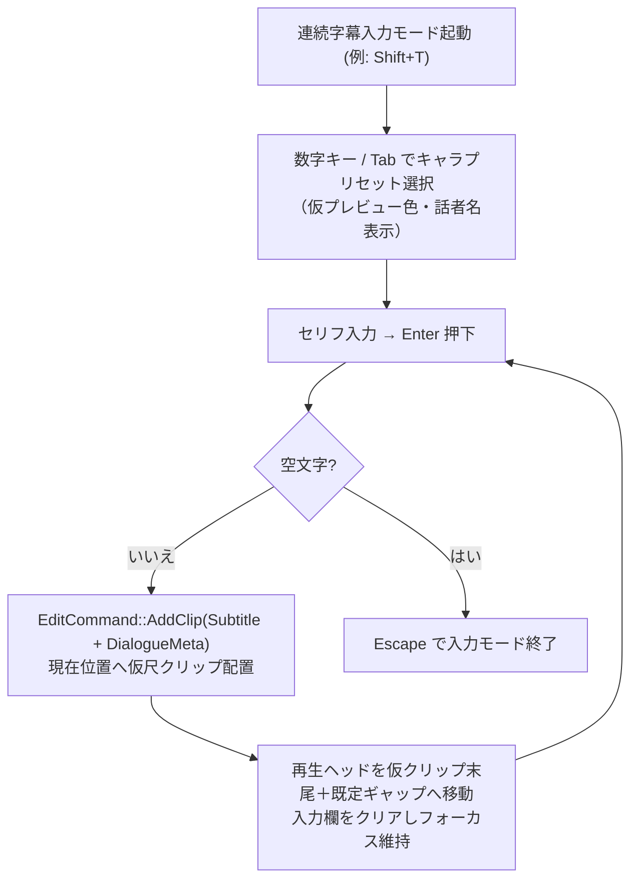

# [004] Phase P0 設計書：本体前提基盤機能モジュール（キャラプリセット・連続字幕入力・API キーガイド・プラグイン統合窓口）

- **ステータス**: Draft
- **作成日**: 2026-11-18
- **更新日**: 2026-11-18
- **関連ドキュメント**:
  - 機能モジュール・プラグイン開発ロードマップ: [`loadmap/Plugin Loadmap.md`](loadmap/Plugin%20Loadmap.md)
  - 市場調査・開発戦略レポート: [`loadmap/Market Research.md`](loadmap/Market%20Research.md)
  - ゆっくり実況向け専用モジュール（ドメイン共通設計）: [`001-yukkuri-live-module.md`](001-yukkuri-live-module.md)
  - 全体基本設計書（完了済み）: [`completed/draft.md`](completed/draft.md)
  - AviUtl 準拠 UI 設計書（完了済み）: [`completed/002-aviutl-ui-redesign/README.md`](completed/002-aviutl-ui-redesign/README.md)

---

## 1. 概要・目的

- **解決したい課題・達成したいこと**:
  - 後続の音声作成（Phase P1）・感情連動立ち絵＆演出（Phase P2）・拡張入力（Phase P4）の各機能モジュール／プラグインが共通で前提とする **「字幕起点」ワークフローの出発点（キャラクタープリセット＋連続字幕入力 UI）** を本体側の機能モジュールとして構築する。
  - 同時に、一般クリエイターの離脱要因となる **「AI API キー設定の分かりにくさ（ターミナル設定・月額プランとの混同）」** を GUI モーダル＋図解ガイドで解消し、既存の別プロセスプラグイン群（書き出し・AI・音声）および今後の拡張プラグインを黒い画面なしで管理・実行できる **共通プラグイン窓口・メニュー導線** を整備する。
  - ※ 本書における用語区分として、**無くても core 本体（`sea-movie-creator`）が立ち上がる拡張を「プラグイン」**、**core 本体が依存して組み込む機能を「機能モジュール」** として明確に分離する。
- **対象ユーザー / 利用シーン**:
  - 録画済みゲーム映像をタイムラインに並べたあと、キーボードだけでキャラクターを切り替えながらテンポ良くセリフ字幕を入力したいクリエイター。
  - 初めて Gemini / OpenAI / Anthropic 等の API キーを取得してアプリに接続するクリエイター。

---

## 2. スコープ

### 対象（In Scope）
- **P0-1：キャラクタープリセット（`CharacterPreset`）とキーボード完結の連続字幕入力 UI（本体機能モジュール）**
  - 立ち絵参照・TTS 設定・`SubtitleProperties` テンプレート・既定配置・モーション規則を 1 セットとして管理・永続化する機能。
  - プロジェクトファイル（`.smc.json`）における字幕クリップとキャラクター ID の後方互換紐付け。
  - キーボード操作のみでキャラクター切替→セリフ入力→確定→次枠移動を繰り返せる連続入力バー／ショートカット。
- **P0-2：GUI 上の API キー設定モーダル＆画像付き取得ガイド（本体機能モジュール）**
  - [`src/ai/providers/credentials.rs`](../src/ai/providers/credentials.rs) に実装済みの `save_secret_to_keyring` / `resolve_api_key`（および [`src/ui/ai_chat_panel.rs`](../src/ui/ai_chat_panel.rs) の認証状態表示）に接続する GUI モーダル（削除／クリア、疎通テスト、画像付きステップ解説）。
- **P0-3：既存プラグイン基盤の横断統合窓口と GUI メニュー導線（本体ホスト層）**
  - すでに実装済みのプラグイン機構（動画書き出し [`src/export/registry.rs`](../src/export/registry.rs) / `plugins/export/*`、AI CLI [`src/ai/plugin_host.rs`](../src/ai/plugin_host.rs) / `plugins/ai/*`、音声隔離ホスト [`src/audio/plugins/`](../src/audio/plugins/mod.rs) / `plugins/audio/sea-audio-host`）を置き換えず横断参照し、今後のプラグイン種別（`tts` / `asr` / `project_export`）も一貫して状態確認・管理できる共通カタログと `プラグイン` メニュー導線を整理する（本体内蔵の機能モジュール実行導線は各担当メニューへ整理し、プラグインとは混同しない）。

### 対象外（Out of Scope）
- 実際の TTS 音声合成処理と尺自動伸縮・リップル処理（Phase P1: [`005-phase-p1-tts-voice-plugin.md`](005-phase-p1-tts-voice-plugin.md)）
- 立ち絵の PSD/PNG パーツ合成と LLM 感情・演出配置ロジック（Phase P2: [`006-phase-p2-tachie-ai-effects-plugin.md`](006-phase-p2-tachie-ai-effects-plugin.md)）
- 録画の無音カット（Phase P3）・ローカル ASR / 外部台本読込（Phase P4）・他ソフト形式書き出し（Phase P5）

---

## 3. 要件・制約

- **機能要件**:
  1. **プリセット一括適用**: キャラクタープリセットを選択して字幕を追加すると、そのキャラ用のフォント・文字色・縁取り・配置（`SubtitleProperties`）および `character_id` が自動設定されること。
  2. **キーボード完結の入力テンポ**: 連続入力モード中はマウスクリック不要で、文字入力 → `Enter` で確定 → 再生ヘッドを仮尺分だけ自動前進させ次の入力へ即移行できること。また数字キー＋修飾キーや専用切替キーでキャラプリセットを瞬時に切り替えられること。
  3. **GUI 完結の API キー管理**: 環境変数やコマンドラインを一切使わずに、GUI から API キーを OS 資格情報ストアへ保存・削除・テストでき、月額チャットプランと API 契約の違いが図解で理解できること。
  4. **プラグイン導線の統一と起動非依存性**: メニューバーや AI チャット・書き出し・タイムラインからプラグインおよび本体機能モジュールを呼び出せ、未ビルド／未導入の外部プラグインや外部ツールが欠損していても本体は正常に起動し設定案内を出せること。
- **非機能要件・互換性・セキュリティ**:
  - 既存の `.smc.json` プロジェクトファイルを破壊しないよう、ドキュメント追加フィールドには `#[serde(default, skip_serializing_if = "...")]` を必ず付与する。
  - API キーは引き続きプロジェクト JSON へ絶対保存せず、OS 資格情報ストア（`sea-movie-creator` サービス）またはメモリ上の一時保持（`runtime_api_key`）のみとする。
  - テキスト入力欄フォーカス時は単キーショートカット（`Space`, `S`, `T`, `Left`, `Right` 等）が誤発火しない既存の `"Input"` vs `"EditorMain"` コンテキスト分離（[`src/ui/menu_bar.rs`](../src/ui/menu_bar.rs)）を厳守する。

---

## 4. アーキテクチャ / 設計詳細

### 4.1 モジュール構成・責務分担

- **データ・永続化層（純粋 Rust）**:
  - `src/yukkuri/character.rs`（新規・[`001-yukkuri-live-module.md`](001-yukkuri-live-module.md) §4.1 準拠）: `CharacterPreset`, `CharacterPresetStore`（`user_config_file_path("character_presets.json")` への読込・保存・既定テンプレート生成）
  - [`src/timeline/document.rs`](../src/timeline/document.rs) & [`src/timeline/command.rs`](../src/timeline/command.rs):
    - `SubtitleProperties` または `DialogueMetadata`（`character_id: Option<String>`, `reading_override: Option<String>`, `emotion_tag: Option<String>`）の任意拡張フィールド追加（`#[serde(default)]`）
    - `ProjectDocument` へ `character_presets: Vec<CharacterPreset>`（プロジェクト内スナップショット。別環境へ `.smc.json` を持っていってもフォント・色・キャラ紐付けが保たれる）を任意保持し、`EditCommand::UpsertCharacterPreset` / `RemoveCharacterPreset` を追加、または `SetParameter` を拡張
- **認証管理層（機能モジュール）**:
  - [`src/ai/providers/credentials.rs`](../src/ai/providers/credentials.rs): 既存の `resolve_api_key` / `save_secret_to_keyring` に加え、`delete_secret_from_keyring(account)`・`has_stored_secret(kind)`・簡易接続チェック用非同期ヘルパーを追加
- **プラグイン横断カタログ（既存プラグイン基盤の上位統合窓口）**:
  - `src/plugins/mod.rs`（新規統合窓口。すでに実装済みの書き出しプラグイン [`src/export/registry.rs`](../src/export/registry.rs)、AI プラグイン [`src/ai/plugin_host.rs`](../src/ai/plugin_host.rs)、音声プラグイン隔離ホスト [`src/audio/plugins/scanner.rs`](../src/audio/plugins/scanner.rs) を置き換えず横断参照する）: 無くても本体起動可能な外部プラグイン種別（`Export` / `Ai` / `AudioHost`、および今後の `Tts` / `Asr` / `ProjectExport`）のメタ情報・導入状態（有効 / 外部依存未設定 / バイナリ欠損）を統一的に取得し、UI メニューやプラグイン管理モーダルへ供給
- **UI 層（GPUI・機能モジュール）**:
  - `src/ui/subtitle_quick_entry.rs`: タイムライン上部またはプレビュー下部に展開できる「連続字幕入力バー」＋ キャラクタープリセット編集モーダル
  - `src/ui/api_keys_modal.rs`: [`src/ui/external_tools_modal.rs`](../src/ui/external_tools_modal.rs) と同一デザイン方針の API キー設定＆画像付き取得ガイドモーダル
  - [`src/ui/ai_chat_panel.rs`](../src/ui/ai_chat_panel.rs) & [`src/ui/menu_bar.rs`](../src/ui/menu_bar.rs): 既存のヘッダ認証状態ラベル（`認証: OK` / `未設定`）をボタン化して `api_keys_modal` を直接開く導線、`プラグイン` メニュー（プラグイン一覧・状態管理）と本体機能モジュール用メニュー導線の整理

### 4.2 データ構造と互換設計

```rust
// src/timeline/document.rs / src/media/visual_properties.rs との連携イメージ
#[derive(Debug, Clone, PartialEq, Serialize, Deserialize, JsonSchema)]
pub struct SubtitleDialogueMeta {
    /// 紐づく CharacterPreset の ID（例: "zundamon", "reimu"）
    #[serde(default, skip_serializing_if = "Option::is_none")]
    pub character_id: Option<String>,
    /// 音声合成専用の読み仮名上書き（P1 で使用）
    #[serde(default, skip_serializing_if = "Option::is_none")]
    pub reading_override: Option<String>,
    /// 感情タグ（P2 で使用: "happy", "surprised" 等）
    #[serde(default, skip_serializing_if = "Option::is_none")]
    pub emotion_tag: Option<String>,
    /// 紐づけられた生成済み Audio クリップ ID（P1 生成後に設定）
    #[serde(default, skip_serializing_if = "Option::is_none")]
    pub linked_audio_clip_id: Option<ClipId>,
}
```

- 連続字幕入力時の仮尺計算式（純粋関数）：
  - `estimated_frames = clamp(char_count * frames_per_char + base_padding_frames, min_frames, max_frames)`（例：60fps 基準で `min = 60f (1.0s)`, `1文字あたり ~10f (約 6文字/秒)`）。
  - 入力確定時、`timeline_start`（現在再生ヘッド位置、衝突時は同キャラ字幕レイヤーの末尾または空き解放レイヤーを自動選択）へ `EditCommand::AddClip` を発行し、成功後に `playhead` を `clip_end + default_gap_frames` へ進める。

### 4.3 処理フロー（連続字幕入力 ＆ API キー設定）



---

## 5. インターフェース / API 仕様

- **ユーザー設定永続化パス**:
  - `character_presets.json`: `crate::core::user_config_file_path("character_presets.json")`（`%APPDATA%\sea-movie-creator\character_presets.json` 等）
  - API キー：OS 資格情報ストア（service 名 `sea-movie-creator`、account 名 `AiProviderKind::keyring_account()`）
- **追加ショートカットアクション（[`src/ui/key_config.rs`](../src/ui/key_config.rs) `ShortcutAction`）**:
  - `ToggleContinuousSubtitleEntry`: 連続字幕入力バーの表示／フォーカス切替
  - `OpenCharacterPresetManager`: キャラクタープリセット管理モーダルを開く
  - `OpenApiKeysGuide`: API キー設定＆画像付きガイドモーダルを開く
- **連続入力バー内ローカルキー処理**:
  - `Enter`（Shift なし）：現在文字を字幕クリップ確定して次へ進む
  - `Shift+Enter`：字幕内の改行挿入
  - `Alt+1..9`（または `Ctrl+Up/Down`）：登録済みキャラクタープリセットを即切替
  - `Escape`：連続入力バーを閉じて `workspace_focus` へ戻す

---

## 6. エラーハンドリング・エッジケース

- **OS 資格情報ストア非対応・ロック環境（Linux ヘッドレス等）**:
  - `save_secret_to_keyring` が失敗してもクラッシュさせず、エラー理由をモーダル内に表示したうえで「このセッション中のみ有効にする（メモリ保持 `set_runtime_api_key`）」フォールバック選択肢を提示する。
- **仮字幕配置先のクリップ重複**:
  - 再生ヘッド位置に既存字幕がある場合、自動的に次の空きフレーム（重なり直後）または別空き字幕レイヤーへ配置するオプションを提供し、`CommandDispatcher` の `OverlapError` で入力作業が止まらないようにする。
- **図解ガイド画像アセットの欠損**:
  - ガイド用画像ファイル（`assets/guides/*.png` 等）が配布配置から欠落している場合でも、テキスト＋手順ステップカードのみでガイドモーダルが正常描画されパニックしないこと。

---

## 7. テスト計画・受け入れ基準

- **単体テスト（各 `.rs` 末尾）**:
  - `CharacterPresetStore` の JSON シリアライズ／デシリアライズ往復および破損 JSON 時フォールバック。
  - `SubtitleDialogueMeta` 付き `ProjectDocument` の後方互換読込（既存 `.smc.json` に新フィールドがなくても `None` で読み込めること）。
  - 文字数からの仮尺計算（0 文字、長文上限クランプ、29.97fps / 60fps 対応）。
  - 連続確定時の配置フレーム・再生ヘッド自動前進・既存クリップ重複回避計算。
- **結合テスト（`tests/phase_p0_prerequisites.rs` + `tests/phase_p0_prerequisites/mod.rs`）**:
  - `AppController` を用い、キャラ 2 種切替 → 連続 3 セリフ確定 → `EditCommand` Undo/Redo 往復 → `.smc.json` 保存・再読込整合性検証。
  - `credentials.rs` のセッション内オーバーライド・削除・未設定エラー分岐検証（OS keyring 実書込を伴うテストは `#[ignore]` 分離）。
- **完了条件（Definition of Done）**:
  - `cargo fmt --check`、`cargo clippy --workspace --all-targets --all-features -- -D warnings`、`cargo build --workspace --all-targets`、`cargo test --workspace --all-targets --all-features` が警告・エラーゼロで通過すること。
  - 連続入力 UI・キャラプリセット編集・API キーガイドモーダルの手動操作確認が完了していること。

---

## 8. 未決事項・検討メモ（Open Questions）

- [ ] **プリセット保存の二層構造**: アプリ共通の `character_presets.json` とプロジェクトファイル内の `character_presets` が編集によりズレた場合、「プロジェクト優先で上書き読込／アプリ共通へ書き戻しボタン」の UX を詰める。
- [ ] **画像付きガイドアセットの生成・格納形式**: API キー取得手順スクリーンショットをアプリバイナリへ `include_bytes!` 埋め込みするか、配布物 `assets/guides/` へ同梱するかを配布サイズと更新しやすさから決定する。
