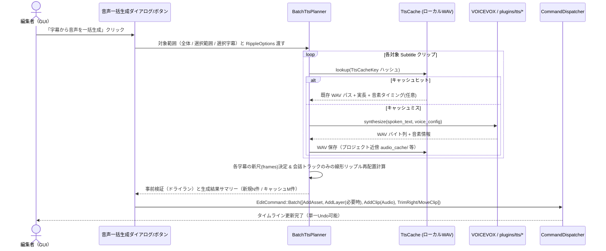

# [005] Phase P1 設計書：音声作成機能モジュール＆外部 TTS プラグイン（TTS 連携・尺自動伸縮・リップル・間・キャッシュ）

- **ステータス**: Draft
- **作成日**: 2026-11-18
- **更新日**: 2026-11-18
- **関連ドキュメント**:
  - 機能モジュール・プラグイン開発ロードマップ: [`loadmap/Plugin Loadmap.md`](loadmap/Plugin%20Loadmap.md)
  - 市場調査・開発戦略レポート: [`loadmap/Market Research.md`](loadmap/Market%20Research.md)
  - ゆっくり実況向け専用モジュール（ドメイン共通設計）: [`001-yukkuri-live-module.md`](001-yukkuri-live-module.md)
  - 前提基盤機能モジュール（Phase P0）: [`004-phase-p0-core-prerequisites.md`](004-phase-p0-core-prerequisites.md)

---

## 1. 概要・目的

- **解決したい課題・達成したいこと**:
  - Phase P0 で入力された字幕（＋`CharacterPreset`）をもとに、外部合成音声エンジンと連携して音声 WAV を一括生成し、**「生成音声の実長に合わせた字幕尺の自動伸縮」「後続クリップの重なりを防ぐ自動スライド（リップル）」「自然な『間』の挿入」「音声データキャッシュ」** をワンアクションで実行する。
  - 市場調査で判明したライセンス構造を踏まえ、無料で収益化しやすい **VOICEVOX / COEIROINK / AivisSpeech** を本体側の標準 HTTP アダプタ（機能モジュール）として最優先サポートし、**AquesTalk（ゆっくりボイス）** 等は無くても本体が起動する別プロセス外部プラグイン（`plugins/tts/`）として安全に分離連携する。
- **対象ユーザー / 利用シーン**:
  - 連続字幕入力や台本読込で並べた仮字幕から、一気に掛け合い音声タイムラインを生成したい個人クリエイター。
  - 1〜2 行の誤字や言い回しを直したあとに、未変更の音声を再合成せず素早く尺と後続タイミングだけ再調整したい編集者。

---

## 2. スコープ

### 対象（In Scope）
- **本体機能モジュール（`src/yukkuri/tts/`・`src/yukkuri/dialogue/`）**:
  - `TtsProvider` 抽象化、ローカル HTTP 標準アダプタ（VOICEVOX Engine / COEIROINK / AivisSpeech）、OS 標準 TTS フォールバック
  - 字幕クリップ群を対象とした **一括／選択範囲／差分音声生成ワークフロー（`BatchTtsPlanner`）**
  - 音声キャッシュ管理（`tts_cache/` への WAV 保存とハッシュ管理）
  - 字幕尺自動伸縮・自然な「間」挿入・選択的リップルシフト（`EditCommand::Batch` 生成）
  - プロジェクト内使用話者・エンジンからの **概要欄向けクレジット文字列自動生成＆コピー UI**
- **外部プラグイン機構（`plugins/tts/<id>/tts-plugin.json`）**:
  - 無くても本体が起動できる別プロセス外部アダプタ（ユーザー導入の AquesTalk 外部ブリッジ、棒読みちゃん連携、任意ローカル TTS CLI）

### 対象外（Out of Scope）
- AquesTalk 等の商用・再配布制約 DLL のアプリ本体同梱
- 立ち絵の口パク・まばたき・感情表現・AI 定番演出配置（Phase P2: [`006-phase-p2-tachie-ai-effects-plugin.md`](006-phase-p2-tachie-ai-effects-plugin.md)）
- 動画ファイル自体の無音カット（Phase P3）

---

## 3. 要件・制約

- **機能要件**:
  1. **字幕からの音声生成と同期配置**: 対象字幕の `text`（または `reading_override`）と `CharacterPreset.voice` で音声を生成し、プロジェクトの資産（`AssetKind::Audio`）として登録しつつ、字幕と同一 `timeline_start` へ `ClipKind::Audio` を配置・リンクすること。
  2. **尺自動伸縮（Auto-Fit）**: 生成された WAV の実長（サンプル数 ÷ サンプルレート）からプロジェクト FPS 基準の整数フレーム数（切り上げ等）を算出し、末尾余白（既定例：`0.05s`）を加えて元 `Subtitle` クリップの `duration` と `Audio` クリップの `duration` を一致させること。
  3. **自然な「間」と選択的リップルシフト**:
     - セリフ間の間隔（同一話者連続時の短い間 vs 話者交代時のやや長い間）を設定でき、尺伸縮によって後続セリフと重なる・間が詰まりすぎる場合は後続を後ろへスライドすること。
     - **非対象トラック保護**: ゲーム録画映像レイヤーや BGM レイヤーを不用意に動かさないよう、リップル対象を「会話レイヤーグループ（字幕・音声・連動立ち絵）のみ」に限定できること。
  4. **キャッシュによる高速差分再生成**: 変更のないセリフは再合成 API を呼ばずキャッシュ WAV を即再利用し、編集中のセリフだけを再生成すること。
  5. **単一 Undo 保証**: 一括生成による全クリップ追加・尺調整・移動を 1 つの `EditCommand::Batch` にまとめ、1 クリックで元に戻せること。
- **非機能要件・ライセンス制約**:
  - ローカル HTTP 通信や外部 CLI 実行は UI スレッドをブロックせずバックグラウンドスレッドで進捗通知付きで実行し、タイムアウト（既定 5 秒／長文時延長可）およびキャンセルを保証する。
  - `plugins/tts/` 外部アダプタは `plugins/ai/`（[`src/ai/plugin_host.rs`](../src/ai/plugin_host.rs)）と同様のマニフェスト＋別プロセス stdio JSON-RPC / NDJSON 通信で隔離する。
  - AquesTalk 連携設定画面には商用利用時のライセンス購入注意を、VOICEVOX / COEIROINK 選択時にはクレジット表記ガイドを表示する。

---

## 4. アーキテクチャ / 設計詳細

### 4.1 機能モジュール・外部プラグイン構成

- **本体側機能モジュール（`src/yukkuri/`）**:
  - `src/yukkuri/tts/mod.rs`: `TtsProvider` トレイト、`SynthesisRequest` / `SynthesisOutput` / `PhonemeSpan`、`TtsCache`
  - `src/yukkuri/tts/http_engines.rs`: VOICEVOX Engine互換 API（`/speakers`, `/audio_query`, `/synthesis`）、COEIROINK（v1/v2）、AivisSpeech の HTTP クライアント（既存依存 `ureq` を活用）
  - `src/yukkuri/tts/plugin_host.rs`: `plugins/tts/<id>/tts-plugin.json` の検出・別プロセス起動ホスト（`sea_tts_v1` NDJSON stdio プロトコル）
  - `src/yukkuri/tts/os_fallback.rs`: Windows SAPI / macOS `say` / Linux `speech-dispatcher` 等の非必須フォールバック（ヘッドレス環境や未対応時は安全にエラー返却）
  - `src/yukkuri/dialogue/batch_sync.rs`: 一括音声生成オーケストレータ（対象字幕抽出 → 未キャッシュ合成 → 尺算出 → 選択的リップル位置解決 → `EditCommand::Batch` 構築）
  - `src/yukkuri/tts/credits.rs`: 使用話者・エンジンをドキュメントから集計し、`"VOICEVOX:ずんだもん\nVOICEVOX:四国めたん"` 形式のクレジット文字列を生成
- **外部プラグイン（`plugins/tts/<id>/`・無くても本体起動可能）**:
  - `plugins/tts/<id>/tts-plugin.json` ＋ 別プロセスワーカー（例: `sea-tts-bridge` による AquesTalk / 棒読みちゃん / 任意ローカル TTS CLI 連携）

### 4.2 キャッシュとリップル調整のデータ構造

```rust
pub struct TtsCacheKey {
    pub provider_id: String,
    pub speaker_id: String,
    pub spoken_text: String, // reading_override.unwrap_or(subtitle.text)
    pub speed_scale_milli: i32,
    pub pitch_scale_milli: i32,
    pub intonation_scale_milli: i32,
    pub volume_scale_milli: i32,
}

pub struct RippleOptions {
    /// 会話間ギャップ設定（同一話者 / 話者交代）
    pub same_speaker_gap_frames: u64,
    pub speaker_change_gap_frames: u64,
    /// 音声末尾に付与する最小余白フレーム
    pub tail_padding_frames: u64,
    /// リップル移動対象とするレイヤー ID 群（空指定時は字幕・連動音声レイヤーのみ自動抽出）
    pub target_layer_ids: Vec<LayerId>,
    /// 既存の隙間が設定ギャップより広い場合に詰めるか（true=詰める, false=衝突回避のみ後退）
    pub compact_wider_gaps: bool,
}
```

### 4.3 処理フロー（字幕 → 音声・尺調整・リップル）



---

## 5. インターフェース / API 仕様

### 5.1 VOICEVOX 互換ローカル HTTP エンドポイント

- 既定エンドポイント（UI でポート・ホスト変更可、`127.0.0.1` 限定を推奨）：
  - VOICEVOX: `http://127.0.0.1:50021`（`GET /speakers`, `POST /audio_query?text=...&speaker=...`, `POST /synthesis?speaker=...`）
  - AivisSpeech: VOICEVOX 互換 API 準拠（既定ポート `10101`）
  - COEIROINK v2: `http://127.0.0.1:50032`（話者一覧・予測・合成エンドポイント）
- 音素・モーラタイミング抽出：`/audio_query` 応答の `accent_phrases[].moras[]`（`consonant_length`, `vowel`, `vowel_length`）をそのまま保持し、Phase P2 の精密な母音口パクに再利用できるようキャッシュメタデータ（`.meta.json`）へ同時保存する。

### 5.2 外部 TTS プラグインマニフェスト（`plugins/tts/<id>/tts-plugin.json`）

```json
{
  "schema_version": 1,
  "id": "sea.tts.external_bridge",
  "name": "外部 TTS CLI / AquesTalk ブリッジ",
  "version": "0.1.0",
  "entrypoint": "sea-tts-bridge",
  "protocol": "sea_tts_v1",
  "license_notice": "外部音声エンジン（AquesTalk 等）を商用利用する場合は開発元のライセンス規約をご確認ください。",
  "default_timeout_ms": 5000
}
```

- `sea_tts_v1`（標準入出力 NDJSON）：
  - リクエスト：`{"method":"list_speakers"}` / `{"method":"synthesize","params":{...}}`
  - レスポンス：`{"ok":true,"wav_path":"...","duration_sec":1.85,"phonemes":[...]}`

### 5.3 リップル再配置アルゴリズム仕様

1. 対象レイヤー上の字幕クリップおよび既に紐づいている音声クリップを「会話ブロック（`start_frame` 昇順）」としてペア化する。
2. ブロック $i$ の新長さ $D'_i = \text{audio\_frames}_i + \text{tail\_padding\_frames}$ を算出する。
3. ブロック $i+1$ の新開始位置は、直前ブロック終端 `prev_end = new_start_i + D'_i` とギャップ $G_i$（同話者か異話者かで切替）を用いて：
   - `compact_wider_gaps == false` 時：`max(orig_start_{i+1}, prev_end + G_i)`（既存の広い間は維持し、衝突時だけ後ろへ押し出す）
   - `compact_wider_gaps == true` 時：`prev_end + G_i`（全体を指定間隔で綺麗に整列し直す）
4. 移動・伸縮はすべて `EditCommand::MoveClip` / `TrimRight`（延長時は一時的な衝突を避けるため、後ろのブロックから逆順に移動するトポロジカル順序で `EditCommand::Batch` を組む — Phase D-1 で導入済みの順序解決パターンを踏襲）。

---

## 6. エラーハンドリング・エッジケース

- **外部 TTS エンジン未起動時**:
  - HTTP 接続拒否（`ConnectionRefused`）時は「VOICEVOX が起動していません（接続先: `127.0.0.1:50021`）。起動後に再試行するか、下書き用に OS 標準 TTS へ切り替えてください」と GUI に分かりやすく表示し、タイムラインは一切変更しない。
- **ロック済みレイヤー／固定クリップとの衝突**:
  - 対象レイヤーが `locked == true`、または対象外の非会話クリップが同じレイヤーに混在してリップル移動先に衝突する場合は、ドライラン段階で衝突先クリップ名・フレーム位置を報告し、部分適用せず安全にロールバックする。
- **音声の極端な短尺・無音生成**:
  - 記号のみの字幕（例：「……」「！？」）で TTS が空または 1 フレーム未満を返した場合、`FrameCount >= 1`（最小 15 フレーム＝0.25 秒等）の下限クランプを設け、`duration == 0` 禁止不変条件を守る。
- **プロジェクト移動時の WAV パス耐性**:
  - 生成 WAV はプロジェクトファイル同階層の `<project_name>_audio/`（未保存プロジェクト時はアプリキャッシュフォルダ）へ配置し、`AssetPath { relative: Some(...), fallback_absolute }` として登録する。

---

## 7. テスト計画・受け入れ基準

- **単体テスト（各 `.rs` 末尾）**:
  - `TtsCacheKey` ハッシュ計算（テキスト変更・`reading_override` 指定・話速変更で確実にキャッシュキーが変化すること、未変更時は完全一致すること）。
  - 音声秒数（`f64` / サンプル数）→ プロジェクト FPS（`60/1`, `30000/1001`）フレーム数への端数切り上げ変換テスト。
  - リップル再配置アルゴリズム（後ろへの押し出し、逆順トポロジカル移動コマンド生成、`compact_wider_gaps` の ON/OFF、BGM レイヤー非干渉、ロックレイヤー衝突検出）。
  - VOICEVOX `/audio_query` JSON モーラ配列からの `PhonemeSpan` 抽出とクレジット重複排除・整形テスト。
- **結合テスト（`tests/phase_p1_tts_voice.rs` + `tests/phase_p1_tts_voice/mod.rs`）**:
  - Mock `TtsProvider`（決定論的な正弦波 WAV＋モック音素配列を生成）を使い、
    1. P0 で作った仮字幕 3 件（キャラ A → A → B）へ一括音声生成 → 実尺伸縮・同キャラ/異キャラ間ギャップ・音声クリップ同期配置検証
    2. 2 件目のセリフ文言のみ変更し再実行 → 1・3 件目がキャッシュヒットし、2 件目の伸びに合わせて 3 件目以降だけが後退（BGM レイヤーは不変）することを検証
    3. 単一 `Undo` で一括生成前の仮字幕状態へ完全復帰することを検証
  - 実 VOICEVOX サーバー接続テストは `#[ignore = "requires local VOICEVOX server"]` として分離。
- **完了条件（Definition of Done）**:
  - `cargo fmt --check`、`cargo clippy --workspace --all-targets --all-features -- -D warnings`、`cargo build --workspace --all-targets`、`cargo test --workspace --all-targets --all-features` が警告・エラーゼロで通過すること。
  - ローカルで起動した VOICEVOX Engine を用いた実音声生成・再生・クレジットコピーが手動確認できること。

---

## 8. 未決事項・検討メモ（Open Questions）

- [ ] **未保存プロジェクト時の音声ファイル保存先**: まだ `.smc.json` として名前保存されていないプロジェクトで一括音声生成した場合、一時ディレクトリに溜めた WAV を初回プロジェクト保存時に `<project>_audio/` へ自動コピー＋`AssetPath` 相対化するフローを `serialization.rs` と連携して詰める。
- [ ] **複数行字幕・長文分割**: 1 つの字幕が長すぎる場合に句点等で自動分割してから TTS へ渡す補助機能を P1 に含めるか、P4（外部台本インポート）側の整形機能へ委ねるかを決定する。
