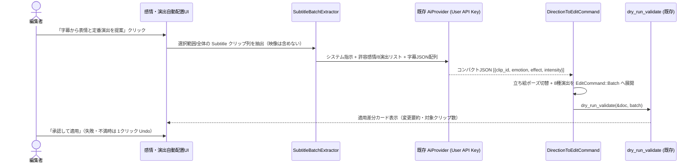

# [006] Phase P2 設計書：感情連動立ち絵・定番演出自動配置プラグイン

- **ステータス**: Draft
- **作成日**: 2026-11-18
- **更新日**: 2026-11-18
- **関連ドキュメント**:
  - プラグイン開発ロードマップ: [`loadmap/Plugin Loadmap.md`](loadmap/Plugin%20Loadmap.md)
  - 市場調査・開発戦略レポート: [`loadmap/Market Research.md`](loadmap/Market%20Research.md)
  - ゆっくり実況向け専用モジュール（ドメイン共通設計）: [`001-yukkuri-live-module.md`](001-yukkuri-live-module.md)
  - 前提基盤（Phase P0）: [`004-phase-p0-core-prerequisites.md`](004-phase-p0-core-prerequisites.md)
  - 音声作成プラグイン（Phase P1）: [`005-phase-p1-tts-voice-plugin.md`](005-phase-p1-tts-voice-plugin.md)

---

## 1. 概要・目的

- **解決したい課題・達成したいこと**:
  - Phase P1 で生成された「字幕＋音声」のタイムラインに対し、編集者の手作業だと 30 分〜1 時間以上かかる **「立ち絵の表情切り替え・口パク・まばたき・話者強調」** と **「実況向け定番演出（集中線・揺れ・ズーム・暗転等）の配置」** を一括で 70〜80 点の完成度まで自動化する。
  - 動画映像を AI に渡さず **字幕テキストの塊（JSON）だけを LLM へ送信** することで 1 動画あたりの API コストを数円以下に抑えつつ、生成結果はすべてタイムライン上の個別クリップ・パラメータとして編集可能にする。
- **対象ユーザー / 利用シーン**:
  - 字幕と合成音声を並べ終えたあと、立ち絵アニメーションとテンポの良い演出を一気に加えてから細部を手動調整したいクリエイター。
  - Phase P4（肉声実況の自動字幕化）で生成した字幕をもとに、相槌キャラの立ち絵と演出を自動付与したい配信者。

---

## 2. スコープ

### 対象（In Scope）
- **P2-A：ローカル立ち絵リグ＆自動基本モーション（API コスト 0）**
  - PNG パーツフォルダ（`tachie.json`）および PSD レイヤー（純粋 Rust パーサ）読み込み・テクスチャキャッシュ
  - 音声 PCM 音量エンベロープ＋TTS 音素（`PhonemeSpan`）連動の口パク（`LipSyncTrack`）
  - 約 3 秒周期まばたき、発話中揺れ・跳ねアニメーション（`effect_offset_frames` によるカット連続性保持）
  - **非話者の減光制御（話者強調ディミング）**
- **P2-B：AI 文脈連動「表情・定番演出」自動配置プラグイン（LLM 連携）**
  - タイムライン上の字幕テキスト塊＋キャラ設定を LLM（既存 `AiProvider`）へバッチ送信し、感情タグ＋定番演出候補を JSON 一括返答させるプロンプト／スキーマ設計
  - 定番演出を **厳選 8 種** に限定した `EditCommand::Batch` コンパイラ（既存の [`VisualProperties`](../src/media/visual_properties.rs)・[`AnimatedParameter`](../src/core/animation.rs)・[`SubtitleProperties`](../src/media/visual_properties.rs) 活用＋不足フィルタの最小拡張）
  - 既存の [`dry_run_validate`](../src/ai/planner.rs) を通した適用前差分カード表示と 1 クリック Undo

### 対象外（Out of Scope）
- 長時間ゲーム映像のフレーム画像を直接 AI（Vision API）へ送信する映像解析（API コスト高騰を招くため意図的に対象外）
- 数十〜数百種類に及ぶ高度な特殊エフェクト／3D パーティクルの独自実装（70〜80 点主義を逸脱するため対象外）

---

## 3. 要件・制約

- **機能要件**:
  1. **立ち絵の自動生き生き制御**: 音声と連動した自然な口パク、約 3 秒に 1 回のまばたき、発話中の控えめな揺れ、および発話していないキャラクターの立ち絵を少し暗くする **非話者ディミング** が自動で機能すること。
  2. **厳選 8 種の定番演出**: AI が選択できる演出を以下に固定し、タイムライン上の独立したクリップまたはパラメータ変化として後から自由に調整・削除できること：
     1. **集中線**
     2. **画面の揺れ（カメラシェイク）**
     3. **ズームイン／ズームアウト**
     4. **暗転／フェード（ブラックアウト・明転）**
     5. **フラッシュ（白飛び瞬間強調）**
     6. **モノクロ／セピア調（絶望・回想）**
     7. **テロップ強調ポップ（バウンス拡大）**
     8. **定番効果音（SE）配置枠**（ユーザー登録 SE カタログ連携）
  3. **表情・演出の編集自由度**: 生成された表情や演出は 1 本の映像に焼き込まず、立ち絵ポーズクリップ／区間・既存インスペクタ（`TrackBarRow`）で後から修正できること。
  4. **差分確認＆安全取消**: 適用前にどのフレーム・どのセリフに何の表情と演出が追加されるか差分カードで確認でき、適用後も 1 クリック Undo で元に戻せること。
- **非機能要件・性能・コスト制約**:
  - 立ち絵の多層パーツ合成を含め、[`WgpuCompositor`](../src/media/compositor/mod.rs) 上で 60fps プレビューを維持すること（事前合成キャッシュまたは GPU アトラス化）。
  - 10 分動画（字幕 150〜250 行程度）を 1〜2 回の JSON バッチリクエストで処理でき、出力トークン数もコンパクトな列挙型に抑えて API コスト数円以下を達成すること。
  - カット分割後も `effect_offset_frames` と `source_in` によりまばたき周期・揺れ・口パク位相が途切れないこと。

---

## 4. アーキテクチャ / 設計詳細

### 4.1 立ち絵と演出のタイムライン表現モデル

`sea-movie-creator` の既存 [`ProjectDocument`](../src/timeline/document.rs) と完全整合させつつ、立ち絵の描画・アニメーションを扱うため、以下の 2 層モデルを採用する。

1. **立ち絵クリップ表現（`ClipKind::Tachie` または専用メタ付き合成ソース）**:
   - 各キャラクター用に立ち絵専用レイヤー（例：`Tachie: ずんだもん`, `Tachie: 四国めたん`）を配置し、基本座標・拡大率・アンカー・不透明度・色調補正は既存の `VisualProperties` をそのまま継承する。
   - **表情切り替え表現**: セリフごと・あるいは感情が変わるタイミングで立ち絵クリップを区間分割（または `PoseKeyframes` / ポーズ指定付き隣接クリップ列として配置）し、インスペクタ上から感情／目・口・眉パーツを手動変更できるようにする。
   - **非話者ディミングの計算式**:
     - 現在フレーム `f` において、当該キャラクターに紐づく発話音声／字幕がアクティブであれば `emphasis_brightness = 0.0`、別キャラクターが発話中で自身が無音であれば `emphasis_brightness = preset.motion_rules.inactive_brightness_offset`（既定 `-0.15`、全員無音時は減光せず `0.0` または緩やかに戻すオプション可）を立ち絵の `brightness` へ加算合成する（フェード遷移 6〜10f 程度で自然に明暗切替）。

### 4.2 厳選 8 種の定番演出マッピング表

既存 [`layer_composite.wgsl`](../src/media/compositor/shaders/layer_composite.wgsl) と [`VisualProperties`](../src/media/visual_properties.rs) で即座に表現できるものを最大限活用し、不足分だけ最小限に補う。

| # | 定番演出（AI 種別名） | タイムライン表現（個別部品として配置） | 使用既存機能 / 最小拡張 |
| :-: | :--- | :--- | :--- |
| 1 | `speed_lines`（集中線） | 効果レイヤー上のオーバーレイクリップ（対象セリフ区間と同一尺） | 同梱プロシージャル SVG/PNG 集中線連番または軽量シェーダ + `Add`/`Normal` ブレンド |
| 2 | `camera_shake`（画面の揺れ） | 対象映像/立ち絵レイヤーへの短時間振動 `AnimatedParameter::Expression` | 既存 `VisualProperties.x / y` の減衰 `sin` 数式（例：`sin(t*45)*exp(-p*4)*18`） |
| 3 | `zoom_in` / `zoom_out`（ズーム） | 対象映像/立ち絵クリップの `scale_x`, `scale_y`（＋任意 `x, y`）へ `Easing` 設定 | 既存 `VisualProperties.scale_x / scale_y`（分割／中間点で区間限定） |
| 4 | `blackout`（暗転・フェード） | 黒単色オーバーレイまたは背景クリップの `brightness` / `opacity` 補間 | 既存 `opacity` / `brightness` イージング（または黒画像アセット） |
| 5 | `flash`（フラッシュ） | 白単色オーバーレイ `opacity` 急減衰または `brightness` スパイク（6〜12f） | 既存 `brightness` / 白オーバーレイ `Add` ブレンド |
| 6 | `monochrome` / `sepia`（色調変化） | 対象クリップ区間の `saturation = 0.0`（セピア時は `hue_deg` / `contrast` 併用） | 既存 `layer_composite.wgsl` 色調補正 5 項目そのもの |
| 7 | `subtitle_pop`（テロップ強調ポップ） | 対象 `Subtitle` クリップの冒頭 6〜10f のみ `scale_x/y` バウンス・文字色強調 | 既存 `SubtitleProperties` + `VisualProperties.scale_x/y` + `midpoints` |
| 8 | `se_cue`（定番 SE 枠） | SE 専用レイヤーへ `Audio` クリップ配置（ユーザー SE ライブラリ未登録時は視覚マーカー） | 既存 `ClipKind::Audio` + SE カテゴリマップ（`shock`, `sparkle`, `question`, `success` 等） |

### 4.3 AI バッチ感情・演出プランナの処理フロー（低コスト JSON 設計）



---

## 5. インターフェース / API 仕様

- **LLM 入出力 JSON スキーマ（コンパクト化・トークン節約）**:
  - **入力（アプリ → LLM）**:
    ```json
    {
      "characters": [
        { "id": "zundamon", "name": "ずんだもん", "emotions": ["neutral", "happy", "surprised", "angry", "sad", "smug"] }
      ],
      "allowed_effects": ["speed_lines", "camera_shake", "zoom_in", "zoom_out", "blackout", "flash", "monochrome", "subtitle_pop", "se_cue"],
      "lines": [
        { "id": "clip_001", "char": "zundamon", "start_f": 0, "end_f": 120, "text": "ここ絶対落ちないから見てて！" },
        { "id": "clip_002", "char": "zundamon", "start_f": 135, "end_f": 210, "text": "うわあああ落ちたのだ！！" }
      ]
    }
    ```
  - **出力（LLM → アプリ、`schemars::JsonSchema` 構造化出力）**:
    ```json
    {
      "directions": [
        { "clip_id": "clip_001", "emotion": "smug", "effect": "zoom_in", "intensity": "low" },
        { "clip_id": "clip_002", "emotion": "surprised", "effect": "camera_shake", "intensity": "high", "se_category": "shock" }
      ]
    }
    ```
- **立ち絵マッピング定義（`tachie.json`）**:
  - PSD／PNG フォルダ読み込み時、`tachie.json` が存在すればそれを正とし、存在しない場合は YMM4/ゆっくり素材慣習（`*` ラジオ排他、`!` 必須ベース等）から自動生成して編集可能にする。
  - 感情ラベル（`neutral`, `happy`, `surprised`, `angry`, `sad`, `smug`, `panic`）ごとのパーツ組み合わせプリセット（目・眉・口初期形・顔色/汗等の装飾）を保持する。

---

## 6. エラーハンドリング・エッジケース

- **LLM が未定義の感情名・対象外エフェクト・不正 `clip_id` を返した場合**:
  - コンパイラが該当エントリを無視または既定値（`emotion = "neutral"`、演出スキップ）へ安全にフォールバックし、警告行を差分カードに併記する。不正コマンドのまま強制実行はしない。
- **長編動画（例：字幕 500 行超）でのトークン上限超過**:
  - 1 チャンクあたり最大 100 行前後（直前 5 行のオーバーラップ文脈付き）へ自動分割し、順番に結合して単一の `EditCommand::Batch` へまとめる。
- **PSD レイヤー欠損・未対応ブレンドモード**:
  - 必須パーツや不明ブレンドモードがあっても描画全体を落とさず、フォールバック（`Normal` ブレンド・既存パート表示）で続行しログ／UI 通知へ警告を出す。
- **同一フレームに 2 人の演出が衝突する場合**:
  - ズームや画面揺れなどのカメラ系演出は、背景ゲーム映像レイヤー側と立ち絵レイヤー側への適用ルールを明確化し、同一クリップに対する同一プロパティの上書き衝突が起きないよう `Compiler` 内で重複マージ・優先度調整を行う。

---

## 7. テスト計画・受け入れ基準

- **単体テスト（各 `.rs` 末尾）**:
  - `LipSyncAnalyzer`: PCM 音量エンベロープ・`PhonemeSpan`（あいうえお母音＋無音閉口）から正しい口形状サンプル列が生成されること。
  - `TachieAnimator`: まばたき周期（約 3 秒）・発話揺れ位相が `effect_offset_frames` 加算（カット分割）前後で連続すること、および複数キャラ発話時の非話者ディミング明度計算。
  - `DirectionToEditCommand`: 8 種定番演出すべてが有効な `EditCommand::Batch` へ変換され、不正 `clip_id`・不正エフェクト名が安全に弾かれること。
  - `TachieLoader`: PNG フォルダおよびテスト用ミニマル PSD のレイヤー分類・異常ヘッダ拒否テスト。
- **結合テスト（`tests/phase_p2_tachie_effects.rs` + `tests/phase_p2_tachie_effects/mod.rs`）**:
  - Mock `AiProvider` から決定論的な `directions` JSON を返却させ、字幕 4 行入力 → P2 コンパイル → `dry_run_validate` 通過 → `CommandDispatcher` 適用 → 一部演出の手動削除/パラメータ変更 → 全体 1 クリック `Undo` を通して検証。
- **完了条件（Definition of Done）**:
  - `cargo fmt --check`、`cargo clippy --workspace --all-targets --all-features -- -D warnings`、`cargo build --workspace --all-targets`、`cargo test --workspace --all-targets --all-features` が警告・エラーゼロで通過すること。
  - サンプル立ち絵＋音声入りプロジェクトで 60fps 再生・8 種の定番演出視覚確認・動画書き出し結果の一致を手動確認すること。

---

## 8. 未決事項・検討メモ（Open Questions）

- [ ] **立ち絵クリップのレイヤー表現方式**: `ClipKind::Tachie` を新規バリアントとして `document.rs` に追加するか、汎用 `ClipKind::Image` + リグ参照／専用評価フックにするか（`ClipKind` を増やす場合は `src/` 全網羅 `match` と `schemars` スキーマへの影響範囲を見極めて決定する）。
- [ ] **集中線アセットの生成方式**: プロシージャル CPU/WGSL 生成にするか、高解像度透過連番画像をプロジェクト同梱リソースにするかをバイナリサイズと描画品質から決定する。
- [ ] **SE 効果音ライブラリの入手導線**: 権利上問題ない CC0/パブリックドメインの最小サンプル SE を数種同梱するか、完全ユーザー指定フォルダ参照のみにするかをライセンス確認のうえ決定する。
