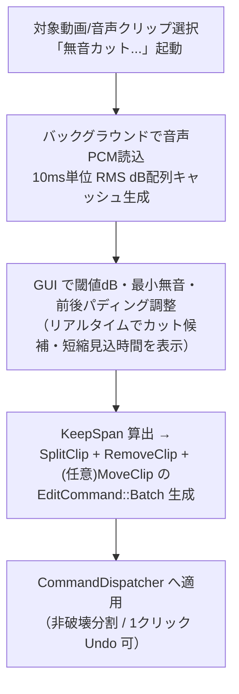

# [007] Phase P3 設計書：無音カットプラグイン（録画下準備用・完全ローカル音量判定）

- **ステータス**: Draft
- **作成日**: 2026-11-18
- **更新日**: 2026-11-18
- **関連ドキュメント**:
  - プラグイン開発ロードマップ: [`loadmap/Plugin Loadmap.md`](loadmap/Plugin%20Loadmap.md)
  - 市場調査・開発戦略レポート: [`loadmap/Market Research.md`](loadmap/Market%20Research.md)
  - 全体基本設計書（完了済み）: [`completed/draft.md`](completed/draft.md)

---

## 1. 概要・目的

- **解決したい課題・達成したいこと**:
  - 長時間（30 分〜数時間）のゲーム録画データには、ロード画面・無言の移動区間・マッチ待機時間などの不要パートが多く含まれ、手作業のカットだけで約 30 分〜1 時間かかっている。
  - 本プラグインは字幕入力（Phase P0〜P1）の前段階として、**外部 AI を一切使わず音声 PCM の音量レベル判定のみ** で無音・低音量区間を高速検出し、タイムライン上で非破壊カット＆区間詰めを実行することで、**API コストゼロで録画下準備時間を劇的に短縮する**。
- **対象ユーザー / 利用シーン**:
  - 録画したばかりの長いゲームプレイ動画（またはラジオ・雑談録音）から、見どころや音声のある区間だけを素早く残して編集を始めたいクリエイター。

---

## 2. スコープ

### 対象（In Scope）
- 対象クリップ（`ClipKind::Video { audio: Some(_), .. }` または `ClipKind::Audio`、および複数選択クリップ群）に対する高速 PCM 音量解析
- 無音区間・有効（残す）区間の抽出アルゴリズム（dB 閾値、最小無音継続時間、最小有効時間、前後パディング余白、結合距離）
- GUI パラメータ調整モーダル／ツールパネルと、**タイムライン上の削除予定区間プレビュー表示**（赤色／斜線オーバーレイ）
- 非破壊カット適用（`EditCommand::SplitClip` / `RemoveClip` / `MoveClip` の `EditCommand::Batch` による単一 Undo 編集）と、カット後の「間隔を詰める（リップル）」／「無音部削除のみ（隙間維持）」の切替

### 対象外（Out of Scope）
- 映像フレームのピクセル差分・シーンチェンジ解析によるカット（CPU/GPU 負荷・複雑性抑制のため P3 スコープ外）
- 音声内容の意味理解に基づく「えー」「あのー」等のフィラーワード除去（音声認識を伴うため必要時は Phase P4 以降の検討課題）

---

## 3. 要件・制約

- **機能要件**:
  1. **AI コストゼロ・高速解析**: 既存の音声デコーダ（[`open_audio_decoder`](../src/media/decoder.rs)）または [`WaveformPeaks`](../src/audio/waveform.rs) キャッシュを活用し、1 時間分の音声でも数秒程度で無音判定が完了すること。
  2. **誤カットを防ぐ柔軟なパラメータ**:
     - **無音判定閾値（dB）**: 例 `-45.0 dB` 〜 `-10.0 dB`（クリップ内相対ピーク／絶対 RMS 選択可）
     - **最小無音時間（ms）**: 例 `1000ms〜5000ms`（この時間より短い一瞬の無音・息継ぎは切らない）
     - **残す余白マージン（前パディング / 後パディング）**: 例 `前 150ms / 後 300ms`（アタック音・語尾が切れるのを防ぐ）
     - **隣接区間の結合閾値**: 残す区間同士がごく短い無音（例 `300ms` 未満）を挟む場合は分割せず 1 クリップに結合する
  3. **事前プレビューと非破壊復元性**: 適用前にタイムライン上で「どこが切られるか・総時間が何分短縮されるか」を確認でき、適用後は既存の `TrimLeft` / `TrimRight` で後から境界を伸ばして復元でき、かつ 1 クリック Undo で全体を取り消せること。
- **非機能要件・安全性**:
  - 解析中は UI スレッドをブロックせず、別スレッドで実行して進捗バー・キャンセルボタンを提供する。
  - ロックされたレイヤー（`layer.locked == true`）のクリップは変更対象から安全に除外し、他レイヤーへのリップル同期オプション（リンクされた別トラックの映像/音声を同時に切るか）を明示的に制御する。

---

## 4. アーキテクチャ / 設計詳細

### 4.1 モジュール構成・責務分担

- `src/audio/silence_detector.rs`（純粋ロジック・新規）:
  - `SilenceDetectionConfig`（閾値 dB、窓サイズ ms、最小無音長、前後パディング、最小維持長）
  - `analyze_silence_intervals(pcm: &DecodedAudioPcm, config: &SilenceDetectionConfig) -> Vec<KeepSpan>`
  - `Clip` の既存 `source_in` / `playback_rate` / `timeline_start` / `duration` を考慮し、クリップローカルのタイムラインフレーム区間列へマッピングする純粋関数
- `src/timeline/silence_cut_planner.rs`（コマンド生成・新規）:
  - 算出された残存区間列 `KeepSpan` とリップル設定から、`EditCommand::SplitClip` / `RemoveClip` / `MoveClip` 列を組み立てる（元クリップの `effect_offset_frames`・`source_in`・`VisualProperties`・`AudioProperties`・`midpoints` をそのまま維持した非破壊分割）。
- `src/ui/silence_cut_modal.rs`（GPUI ダイアログ & タイムラインプレビュー連携）:
  - スライダ変更時に既にメモリへキャッシュ済みの 10ms ビン RMS エンベロープから **リアルタイム（< 10ms）でカット候補区間を再計算** し、タイムライン描画へオーバーレイ表示する。

### 4.2 処理フロー（1 回デコード → インタラクティブ閾値調整 → 非破壊適用）



### 4.3 カット区間算出アルゴリズム（クリップ時間モデル整合）

1. クリップ `c` が参照しているソース区間 `[source_in, source_in + clip_duration_sec * playback_rate)` を 10ms 窓で走査し、各窓の RMS を算出：`db = 20.0 * rms.max(1e-9).log10()`。
2. `db >= threshold_db` の窓を「有音」、未満を「無音」とマークする。
3. 連続無音長が `min_silence_ms` 未満の短い無音ギャップは「有音」へマージする。
4. 各「有音」連続区間の開始を `-pad_before_ms`、終了を `+pad_after_ms` だけ拡張し、重複・隣接（`merge_gap_ms` 以内）した区間を結合する。
5. クリップのタイムライン整数フレーム境界 `[0, c.duration.get())` に丸め込み、0 フレーム区間や `c.duration` と同一の単一区間（カット箇所なし）を除外する。
6. **リップル有り時**：残されたクリップ群を順に詰め、もし同一時刻・他レイヤーに「リンク対象として選んだ別音声/字幕トラック」がある場合は連動カットまたは警告する（既定では選択クリップ同一レイヤー内の後続を詰める／または任意で全非ロックトラックを同一削除スパン分だけ同期カット）。

---

## 5. インターフェース / API 仕様

```rust
pub struct SilenceDetectionConfig {
    pub threshold_db: f32,         // 既定: -38.0 dB
    pub window_ms: u32,            // 既定: 10 ms
    pub min_silence_ms: u32,       // 既定: 1500 ms
    pub pad_before_ms: u32,        // 既定: 150 ms
    pub pad_after_ms: u32,         // 既定: 300 ms
    pub min_keep_ms: u32,          // 既定: 250 ms
}

pub struct SilenceCutOptions {
    pub ripple_close_gaps: bool,   // 既定: true（カット後の隙間を詰める）
    pub ripple_all_unlocked_layers: bool, // 既定: false（選択クリップと同一レイヤー基準）
}
```

- メニュー／右クリック導線：
  - タイムライン上の動画／音声クリップ右クリック → `無音カット...`
  - トップメニュー `タイムライン`（または `プラグイン`）→ `無音カット...`

---

## 6. エラーハンドリング・エッジケース

- **音声トラックを持たない動画・無音ファイル（全区間が無音判定）**:
  - 全区間がカット対象になった場合はエラーとして適用を拒否し、「閾値が高すぎるためクリップ全体が削除対象になっています（例：-45dB 付近へ下げてください）」と案内してデータ消失を防ぐ。
- **カット箇所が 0 件（削除対象なし）**:
  - 「現在の設定ではカット対象の無音区間は見つかりませんでした」と通知し、空の `EditCommand::Batch` を発行しない。
- **`playback_rate != 1/1` や既に `source_in > 0` のトリム済みクリップ**:
  - ソース秒数とタイムラインフレームの変換に `PlaybackRate` を必ず考慮し、倍速再生中クリップでも画面と音声の位置が 1 フレームもズレないようフレーム境界を計算する。
- **欠損メディア（`AssetStatus::Missing`）**:
  - ファイルが見つからないクリップには解析ボタンを無効化し、再リンクを案内する。

---

## 7. テスト計画・受け入れ基準

- **単体テスト（各 `.rs` 末尾）**:
  - 合成 PCM（有音 2 秒・無音 3 秒・一瞬の無音 0.3 秒・有音 2 秒のサイン波）に対し、`min_silence_ms = 1500` で 0.3 秒の息継ぎが残され、3 秒区間だけが正しくカット候補になること。
  - パディング拡張（`pad_before_ms`, `pad_after_ms`）による境界クランプ（`0` 未満・クリップ末尾超過しないこと）および重複マージの検証。
  - `source_in > 0` かつ `playback_rate = 2/1` のクリップに対するフレーム境界マッピング精度。
  - 全無音時の全削除ガードエラー検証。
- **結合テスト（`tests/phase_p3_silence_cut.rs` + `tests/phase_p3_silence_cut/mod.rs`）**:
  - テスト WAV アセットを配置した `ProjectDocument` で無音カットプランを実行 → `CommandDispatcher` 適用 → 残存クリップ数・総尺短縮・`source_in` 連続性・`TrimRight` による非破壊復元可能性・単一 `Undo` による元状態完全復帰を検証。
- **完了条件（Definition of Done）**:
  - `cargo fmt --check`、`cargo clippy --workspace --all-targets --all-features -- -D warnings`、`cargo build --workspace --all-targets`、`cargo test --workspace --all-targets --all-features` が警告・エラーゼロで通過すること。
  - 長尺 MP4 録画（例：10〜30 分）を使った実機 GUI 上でのプレビューハイライト・カット実行・再生同期を手動確認すること。

---

## 8. 未決事項・検討メモ（Open Questions）

- [ ] **複数トラック同期カットの UX**: ゲーム録画とマイク音声が別ファイル（別レイヤー）に分かれている場合に、「選択クリップの無音判定を基準にして、全非ロックレイヤーを同じ時間軸で一括スプリット＆リップルするモード」のデフォルト挙動・警告表示を詰める。
- [ ] **カット境界のクリック音対策（マイクロフェード）**: 連続したゲーム BGM 等を含む録画をブツ切りにした際のプチノイズを防ぐため、分割クリップ両端へ数ミリ秒の自動オーディオフェード（将来パラメータ）を併設するか検討する。
