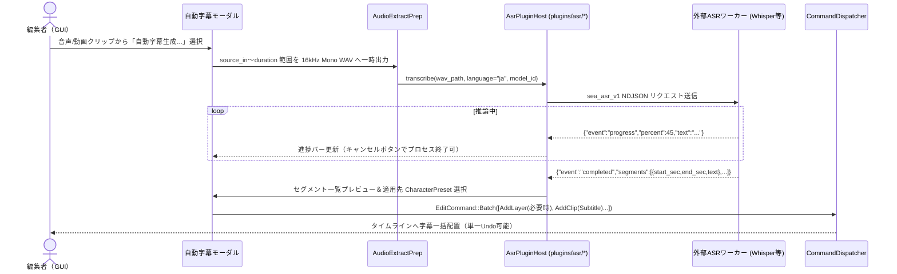

# [008] Phase P4 設計書：拡張入力（ローカル ASR プラグイン ／ 外部台本インポート機能モジュール）

- **ステータス**: Draft
- **作成日**: 2026-11-18
- **更新日**: 2026-11-18
- **関連ドキュメント**:
  - 機能モジュール・プラグイン開発ロードマップ: [`loadmap/Plugin Loadmap.md`](loadmap/Plugin%20Loadmap.md)
  - 市場調査・開発戦略レポート: [`loadmap/Market Research.md`](loadmap/Market%20Research.md)
  - 前提基盤機能モジュール（Phase P0）: [`004-phase-p0-core-prerequisites.md`](004-phase-p0-core-prerequisites.md)
  - 音声作成機能モジュール＆外部 TTS プラグイン（Phase P1）: [`005-phase-p1-tts-voice-plugin.md`](005-phase-p1-tts-voice-plugin.md)
  - 感情連動立ち絵・定番演出機能モジュール（Phase P2）: [`006-phase-p2-tachie-ai-effects-plugin.md`](006-phase-p2-tachie-ai-effects-plugin.md)

---

## 1. 概要・目的

- **解決したい課題・達成したいこと**:
  - Phase P0〜P3 によって「字幕をキーボード入力して音声・立ち絵・演出を作る」ゆっくり実況ワークフローが確立したあと、**タイムラインへ字幕を流し込む入口をさらに 2 方向へ拡張**する。
    1. **P4-A：肉声実況向け自動字幕プラグイン（ローカル ASR・別プロセス分離）**：配信者自身の声が入っている録画・録音から音声認識でタイムスタンプ付き字幕を自動生成する着脱可能な外部プラグイン（無くても本体起動可能）。生成した字幕を起点にそのまま Phase P2（立ち絵・定番演出自動配置）を実行でき、肉声動画へのテロップ入れ＋相槌キャラ解説も高速化できる。
    2. **P4-B：外部台本インポート機能モジュール（本体内蔵・GUI ドラッグ＆ドロップ）**：外部エディタやチャット AI 等で作成した台本ファイル（`.txt` / `.csv` / `.srt` 等）を GUI へドラッグ＆ドロップするだけで `CharacterPreset` 付きの字幕群へ展開し、そのまま Phase P1（音声一括作成）へ流せる。
- **対象ユーザー / 利用シーン**:
  - 肉声ゲーム実況のフルテロップ作業を自動化したい個人配信者。
  - メモ帳・スプレッドシート・別ツールで書き溜めたゆっくり解説台本を一括でタイムラインへ展開したい制作者。

---

## 2. スコープ

### 対象（In Scope）
- **P4-A：肉声自動字幕プラグイン（`plugins/asr/<id>/asr-plugin.json` + 別プロセス隔離ホスト）**
  - 別プロセス起動ワーカー（`sea_asr_v1` NDJSON stdio プロトコル）経由でのローカル音声認識（Whisper 系推論エンジン／ユーザー導入済みローカル ASR CLI）
  - 本体側ホストによる選択動画／音声クリップの音声範囲抽出（`source_in`, `playback_rate` 考慮）→ 16kHz モノラル WAV 一時書き出し → ASR ワーカー実行（進捗％通知・キャンセル対応）
  - 認識セグメント（`start_sec`, `end_sec`, `text`）を指定 `CharacterPreset` の `Subtitle` クリップ列（`EditCommand::Batch`）へ変換
- **P4-B：外部台本インポート機能モジュール（`src/yukkuri/script_import.rs` + GUI モーダル／D&D 対応）**
  - 対応形式：
    1. プレーンテキスト台本（`キャラ名: セリフ`、`キャラ名「セリフ」`、または単一キャラ連続行 `.txt`）
    2. CSV / TSV 台本（`character,text[,reading_override,emotion,gap_sec]`）
    3. SRT 字幕ファイル（`.srt` タイムコード＋テキストをそのまま時刻同期配置）
  - GUI ドラッグ＆ドロップ受付と、話者名 ⇔ `CharacterPreset` の対話的マッピング確認モーダル

### 対象外（Out of Scope）
- クラウド有料音声認識 API への長時間録画音声の強制送信（ローカル推論またはユーザー導入外部 CLI を標準とし、維持費ゼロを優先）
- 多人数話者分離（Diarization）の高度 AI モデル本体開発（単一話者認識＋手動トラック分割を基本とし、外部 ASR が話者タグを返す場合のみマッピングで受ける）

---

## 3. 要件・制約

- **機能要件**:
  1. **ASR 字幕のタイムライン自動同期**: 選択クリップの現在タイムライン位置（`timeline_start`）とトリム済み `source_in` / `playback_rate` を考慮し、認識された発話タイミングにズレなく `Subtitle` クリップを配置すること。
  2. **P2 / P1 とのシームレスな連鎖**:
     - P4-A（肉声字幕）で生成された `Subtitle` クリップは、選択 `CharacterPreset`（例：「配信者テロップ」や解説キャラ）のスタイルを継承し、即座に Phase P2（感情・定番演出自動配置）の対象にできること。
     - P4-B（外部台本）で生成された `Subtitle` クリップは、仮尺＋`reading_override`＋キャラ紐付けを保持し、即座に Phase P1（音声一括作成）へ渡せること。
  3. **GUI 完結の操作・モデル導入**: ターミナルコマンドを打たせず、モデル未導入時は GUI モーダル上からモデル配置フォルダ指定や公式オープンモデル取得導線・外部 CLI パス設定を完了できること。
- **非機能要件・安全性・ライセンス**:
  - 音声認識推論（Whisper 系 C/C++ バインディング等）は重いメモリ消費やネイティブクラッシュのリスクがあるため、本体（`unsafe_code = "deny"`）へ直接リンクせず **必ず別プロセスプラグイン（`plugins/asr/`）** に隔離する。
  - GPL ライセンス汚染を避け、本体リポジトリは MIT/Apache-2.0 互換プロトコルのみを保持する。
  - 台本インポート時の最大行数・ファイルサイズに上限チェック（例：最大 50MB・文字コード UTF-8 / Shift-JIS 自動判定または明示選択）を設ける。

---

## 4. アーキテクチャ / 設計詳細

### 4.1 P4-A：ローカル ASR 隔離プラグイン構成



### 4.2 P4-B：外部台本インポート構成

- **パーサモジュール（`src/yukkuri/script_import.rs`）**:
  - `ScriptFormat`: `Auto`, `DialogueTxt`, `Csv`, `Tsv`, `Srt`
  - `ParsedScriptLine`: `{ speaker_raw: Option<String>, text: String, reading_override: Option<String>, start_sec: Option<f64>, end_sec: Option<f64>, emotion_hint: Option<String> }`
- **文字コード＆改行吸収**:
  - 日本のフリー台本・ゆっくり系ツールでは Shift-JIS（CP932）の `.txt` / `.csv` が多いため、UTF-8 BOM 有無の判定に加え Shift-JIS デコードフォールバックを備える（GUI で文字化け時に手動切替可）。
- **ドラッグ＆ドロップ動線**:
  - 既存のタイムライン外部ファイル D&D ハンドラ（`window.rs` / `timeline/`）を拡張し、拡張子が `.txt` / `.csv` / `.tsv` / `.srt` のファイルがドロップされた場合はメディア素材追加ではなく **台本インポートモーダル** を開く。

---

## 5. インターフェース / API 仕様

### 5.1 ASR プラグインマニフェスト（`plugins/asr/<id>/asr-plugin.json`）

```json
{
  "schema_version": 1,
  "id": "sea.asr.whisper_local",
  "name": "ローカル音声認識 (Whisper 互換)",
  "version": "0.1.0",
  "entrypoint": "sea-asr-whisper",
  "protocol": "sea_asr_v1",
  "models": [
    { "id": "small", "label": "Small (高速・軽量)", "size_mb": 466 },
    { "id": "medium", "label": "Medium (日本語高精度)", "size_mb": 1460 }
  ]
}
```

- `sea_asr_v1` リクエスト：
  `{"protocol":"sea_asr_v1","method":"transcribe","params":{"wav_path":"...","language":"ja","model":"small"}}`
- `sea_asr_v1` ストリーム応答イベント：
  - `{"event":"progress","percent":0..100}`
  - `{"event":"completed","segments":[{"start_sec":1.20,"end_sec":3.45,"text":"こんにちは"}]}`
  - `{"event":"error","code":"missing_model","message":"..."}`

### 5.2 台本インポート話者マッピング仕様

- 台本内の `speaker_raw` ごとに、プロジェクト既存 `CharacterPreset` との一致（完全一致 → 部分一致・別名一致）を自動候補提示。
- 未一致話者はドロップダウンで「既存キャラへ割り当て」「既定スタイルで仮キャラ作成」「インポート対象から除外」を選択可能。

---

## 6. エラーハンドリング・エッジケース

- **ASR モデルファイル未配置・推論ワーカー異常終了**:
  - タイムラインを一切変更せず、モーダル内に不足モデル名と「モデル配置先を開く／パスを指定する」ボタンを表示する。
- **認識セグメントの重複・逆転・0 長**:
  - 外部 ASR が `end_sec <= start_sec` や隣接セグメントとの微小重なりを返した場合、パーサ側で `start_frame < end_frame`（`duration >= 1`）かつ同一レイヤー非重複となるよう自動正規化（クランプ／微小重なり切り詰め）し、`CommandDispatcher` の `OverlapError` を防ぐ。
- **台本インポート時の不正 CSV 列数・空行**:
  - コメント行（`#` 始まり等）や空行は安全にスキップし、パース不能行がある場合は行番号付きプレビューで警告表示する。

---

## 7. テスト計画・受け入れ基準

- **単体テスト（各 `.rs` 末尾）**:
  - ASR セグメント配列（重複・極短・逆転含む）→ `timeline_start`・`playback_rate` 考慮の整数フレーム非重複 `NewClipSpec` 変換テスト。
  - `.txt`（`霊夢: テスト` / `魔理沙「テスト」`）、`.csv`（引用符・カンマ内包）、`.srt`（`HH:MM:SS,mmm --> HH:MM:SS,mmm` 複数行字幕）パーサと不正入力異常系テスト。
  - Shift-JIS / UTF-8 判定・デコードテスト。
- **結合テスト（`tests/phase_p4_extended_inputs.rs` + `tests/phase_p4_extended_inputs/mod.rs`）**:
  - Mock ASR バイナリ（テスト用ダミープロトコル応答）を用いた認識 → 字幕一括配置 → 単一 Undo 検証。
  - 外部台本インポート → キャラマッピング → `EditCommand::Batch` 展開 → Phase P1 Mock `BatchTtsPlanner` への連続連携（台本読込から音声尺調整まで一連動作）検証。
- **完了条件（Definition of Done）**:
  - `cargo fmt --check`、`cargo clippy --workspace --all-targets --all-features -- -D warnings`、`cargo build --workspace --all-targets`、`cargo test --workspace --all-targets --all-features` が警告・エラーゼロで通過すること。
  - サンプル音声でのローカル ASR 実行および日本語台本 `.txt`/`.srt` の GUI D&D インポートを手動確認すること。

---

## 8. 未決事項・検討メモ（Open Questions）

- [ ] **採用 ASR エンジンの配布形態**: `whisper.cpp` 準拠の純粋オフライン実行ラッパを配布同梱（モデルのみ初回 GUI ダウンロード）とするか、汎用外部 CLI アダプタ＋オプション同梱にするかをライセンス・配布バイナリ容量の観点から確定する。
- [ ] **句読点・最大文字数による字幕折り返し**: ASR が出力する長い 1 文をテロップ用に指定文字数（例：22 文字）で自動改行／2 クリップ分割する整形オプションの要否を詰める。
