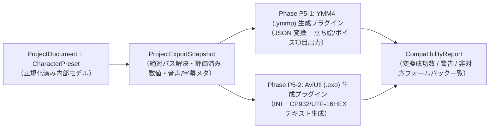

# [009] Phase P5 設計書：他ソフト向けプロジェクト書き出しプラグイン（YMM4 → AviUtl サブ機能）

- **ステータス**: Draft
- **作成日**: 2026-11-18
- **更新日**: 2026-11-18
- **関連ドキュメント**:
  - プラグイン開発ロードマップ: [`loadmap/Plugin Loadmap.md`](loadmap/Plugin%20Loadmap.md)
  - 市場調査・開発戦略レポート: [`loadmap/Market Research.md`](loadmap/Market%20Research.md)
  - 全体基本設計書（完了済み）: [`completed/draft.md`](completed/draft.md)
  - ゆっくり実況向け専用モジュール（ドメイン共通設計）: [`001-yukkuri-live-module.md`](001-yukkuri-live-module.md)

---

## 1. 概要・目的

- **解決したい課題・達成したいこと**:
  - `sea-movie-creator` は本体単体での動画書き出し（AV1 / H.264 / H.265 / 外部 ffmpeg）を主軸とするが、「音声合成・自動字幕・立ち絵感情・定番演出による 70〜80 点の下ごしらえを本ソフトで数分で行い、最後の凝った特殊スクリプトや固有エフェクトだけを既存ソフトで仕上げたい」という中〜上級クリエイターの要望にも応える。
  - 第 1 段階として構造が明快で変換精度を高めやすい **YMM4 プロジェクト（`.ymmp`）書き出しプラグイン** を実装し、その後の需要に応じて **AviUtl オブジェクトファイル（`.exo`）書き出し** へ段階展開する。
- **対象ユーザー / 利用シーン**:
  - 普段 YMM4 や AviUtl で凝った編集をしているが、字幕入力・音声一括生成・感情演出の下準備だけを `sea-movie-creator` で時短したいクリエイター。

---

## 2. スコープ

### 対象（In Scope）
- プロジェクト変換プラグイン基盤（`plugins/project_export/<id>/project-export-plugin.json` または専用エクスポートレジストリ）
- **第 1 段階：YMM4（`.ymmp`）プロジェクト書き出しプラグイン**
  - `ProjectDocument`（解像度・FPS・レイヤー・`Clip`）＋生成済み音声 WAV／素材パス ＋ 立ち絵情報からの `.ymmp` JSON 生成
  - 変換結果サマリー・非互換要素警告レポート（例：独自 `Expression` 数式や未対応パラメータを警告表示）
- **第 2 段階：AviUtl（`.exo`）オブジェクト書き出しプラグイン（需要ベース検討仕様）**
  - 基本アイテム（動画・音声・画像・標準テキスト・基本座標/拡大率/不透明度/回転/直線・加減速移動）に絞った `.exo` 生成設計と文字コード（CP932 / Shift-JIS）・特殊文字エスケープ仕様

### 対象外（Out of Scope）
- 他ソフト形式（`.ymmp` / `.exo`）から `sea-movie-creator` への**逆方向インポート**（要望が出ない限り P5 スコープ外）
- AviUtl 独自のサードパーティ製アニメーション効果スクリプト（`.anm`）や YMM4 専用エフェクトの 100% 完全等価変換

---

## 3. 要件・制約

- **機能要件**:
  1. **主軸の維持**: メニューの `書き出し` から通常の動画書き出しとは別項目（例：`他ソフト形式で書き出し...`）として呼び出せ、元の `.smc.json` プロジェクトには一切破壊的変更を加えないこと。
  2. **基本要素の正確なマッピング**:
     - フレームレート・解像度・開始フレーム・継続フレーム・レイヤー順序（最背面→最前面）を一致させること。
     - 動画・音声・画像・字幕テキスト・生成済み音声 WAV のファイルパスを、書き出し先 `.ymmp` / `.exo` から正しく参照できるよう絶対パスまたは指定アセット展開フォルダ相対パスで出力すること。
  3. **変換限界の透明性（サイレント欠落の禁止）**:
     - 相手ソフト側に完全な等価機能がないパラメータ（例：複雑なカスタム `Expression` 数式、一部ブレンドモードや色調補正差異）に遭遇した場合は、無言で無視せず **「変換レポートダイアログ」に警告と代替変換内容を一覧表示** すること。
- **非機能要件・ライセンス制約**:
  - `sea-movie-creator` 独自の純粋データ変換処理として実装し、他ソフトの実行バイナリやプロプライエタリ DLL へ依存しない。
  - 別プロセスプラグイン（`sea_project_export_v1`）または独立クレートとして分離し、他ソフトフォーマットの仕様変更に追随しやすい構造とする。

---

## 4. アーキテクチャ / 設計詳細

### 4.1 変換パイプライン構成

- **なぜ第 1 段階が YMM4 で第 2 段階が AviUtl か**:
  - YMM4（`.ymmp`）は UTF-8 JSON 構造であり、アイテム一覧・ボイスアイテム（字幕＋音声＋立ち絵表情）・座標系（画面中央基準）が `sea-movie-creator` のデータモデルと近く、変換時の情報欠落が少ない。
  - AviUtl（`.exo`）は INI 風セクション連番・独自キー（`start`, `end` が 1-based 包括フレーム）・テキスト内容の UTF-16LE Hex エンコード・Shift-JIS(CP932) エンコード・拡張編集プラグイン固有の数値書式（小数桁やトラックバー記法 `v1,v2,type`）を厳密に満たす必要があり検証コストが高い。

### 4.2 YMM4（`.ymmp`）マッピング概要（第 1 段階）

| `sea-movie-creator` 側 | YMM4 (`.ymmp`) 側対応概念 | 変換時ルール・フォールバック |
| :--- | :--- | :--- |
| `fps`, `resolution` | `VideoInfo` (`FPS`, `Hz`, `Width`, `Height`) | 既約分数 FPS は整数/標準近似＋警告（非整数 FPS 時） |
| `Layer`（`layers[i]`） | `Layer`（`0` 始まりまたは `1` 始まり正規化） | レイヤー順序・名前・非表示(`IsHidden`)を転写 |
| `ClipKind::Video` / `Audio` / `Image` | `VideoItem` / `AudioItem` / `ImageItem` | `timeline_start`, `duration`, `source_in`, `playback_rate`, 絶対パスへ解決した素材パス |
| `ClipKind::Subtitle`（音声リンク有） | `VoiceItem`（または `TextItem`＋`AudioItem`） | `CharacterName`, `Serif`, 生成 WAV パス、フォント/色/縁取り・サイズを対応付け |
| `VisualProperties` (`x,y,scale,rot,opacity`) | `X, Y, Zoom, Rotation, Opacity` (`Animation` 値) | `Constant`・`Easing`・`Keyframes` は基本変換、`Expression` は開始値/終端値へフォールバック＋警告 |
| `BlendMode` | `Blend` (`Normal`, `Add`, `Multiply`, `Screen`, `Overlay`) | 1:1 対応 |

### 4.3 AviUtl（`.exo`）設計上の留意点（第 2 段階・検討仕様）

- **1-based 包括フレーム変換**: `sea-movie-creator` の `timeline_start = 0, duration = 60`（`[0, 60)`）は、`.exo` の `start=1, end=60` へ変換する。
- **テキストアイテムの 16 進エンコード**: `.exo` の `[0.0]` `[テキスト]` セクション `text=` フィールドは UTF-16LE バイト列の 4096 文字固定長（末尾 `0` パディング）16 進文字列として出力する仕様に準拠する必要がある。
- **文字コード**: `.exo` 全体およびファイルパス参照は日本語 Windows 環境標準の Shift-JIS（CP932）で出力し、CP932 に表現できない絵文字・環境依存文字が含まれる場合は警告レポートで置換文字（`?` 等）を通知する。

---

## 5. インターフェース / API 仕様

- **書き出しメニュー・ダイアログ統合**:
  - `書き出し` メニュー → `他ソフト用プロジェクト書き出し...`
  - モーダル内でターゲット形式（`YMM4 (.ymmp)` / 将来 `AviUtl (.exo)`）、出力先パス、素材パス解決方式（絶対パス推奨 / `.ymmp` 同階層へコピー同梱オプション）を選択可能にする。
- **プラグインマニフェスト（`plugins/project_export/<id>/plugin.json`）**:
  - 既存の [`src/export/manifest.rs`](../src/export/manifest.rs) の `PluginLicenseInfo` / `ExportOptionField` パターンを踏襲し、標準入出力 JSON で `ProjectExportSnapshot` を受け取り、生成ファイルと `CompatibilityReport` JSON を返す。

---

## 6. エラーハンドリング・エッジケース

- **相対パスのみ／未保存プロジェクトや欠損素材（`AssetStatus::Missing`）**:
  - 素材ファイルが見つからない場合、警告レポートへ欠損素材一覧を出したうえでプレースホルダパスまたはスキップを選択可能にする（黙って壊れたパスを書き出さない）。
- **外部プロジェクトファイル上書き防止**:
  - 指定出力パスに同名ファイルが存在する場合は、GUI ダイアログの保存確認または自動バックアップ提示を必須とする。
- **YMM4 バージョン差異への耐性**:
  - ターゲットとする YMM4 プロジェクトスキーマバージョン（例：`YmmpModel` の対象メジャーバージョン）を変換レポートとドキュメントに明記し、実機 YMM4 でのインポート検証手順を用意する。

---

## 7. テスト計画・受け入れ基準

- **単体テスト（各 `.rs` 末尾）**:
  - `ProjectExportSnapshot` 構築（`fps`, 座標, 透明度 `opacity -> 100*(1-opacity)` 反転換算、フレーム範囲計算）。
  - YMM4 `.ymmp` JSON 生成のゴールデンテスト（動画・音声・画像・字幕・`Easing`・`Expression` フォールバック警告検出）。
  - AviUtl `.exo`（着手時）：1-based フレーム境界（`start = timeline_start + 1`, `end = timeline_start + duration`）、UTF-16LE 4096Hex 変換、CP932 非対応文字警告テスト。
- **結合テスト（`tests/phase_p5_project_export.rs` + `tests/phase_p5_project_export/mod.rs`）**:
  - Phase P0〜P2 を通して構築したサンプルプロジェクト（動画＋音声＋字幕＋立ち絵＋演出）から `.ymmp` を生成し、有効な JSON 構造・全音声素材パス一致・非対応 `Expression` 警告出力・元 `ProjectDocument` 非破壊を検証。
- **完了条件（Definition of Done）**:
  - `cargo fmt --check`、`cargo clippy --workspace --all-targets --all-features -- -D warnings`、`cargo build --workspace --all-targets`、`cargo test --workspace --all-targets --all-features` が警告・エラーゼロで通過すること。
  - 生成した `.ymmp` ファイルを実際の YMM4（別ソフト実環境）へ読み込ませ、タイムライン・音声・字幕が崩れず再生できることを手動確認すること。

---

## 8. 未決事項・検討メモ（Open Questions）

- [ ] **YMM4 プロジェクト形式の最新バージョン検証**: 実装着手時点における最新の YMM4 が生成する最小 `.ymmp` JSON スキーマ（必須プロパティ・`Items` 内具象型 `$type` 名・立ち絵パラメータキー）を実機確認のうえゴールデンテストを確定する。
- [ ] **AviUtl（`.exo`）対応の着手判断**: YMM4 書き出しのリリース後、利用者の要望数・AviUtl2 の新プロジェクト形式動向を踏まえて `.exo` 対応の実装可否を最終判断する。
