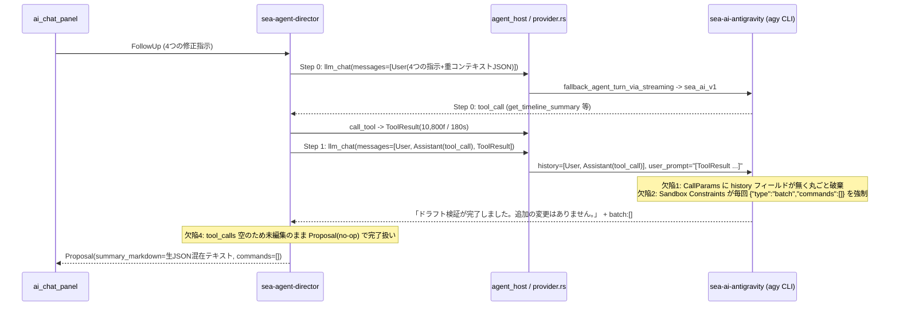
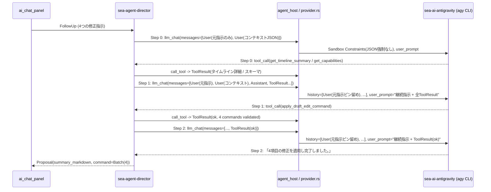
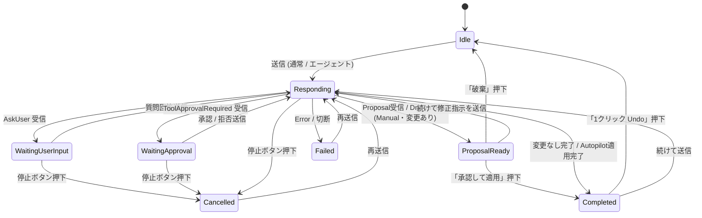

# [014] AI チャット継続性修正・作業中／完了状態の可視化・選択＆コピー対応設計書

- **ステータス**: Draft
- **作成日**: 2026-11-23
- **更新日**: 2026-11-23
- **関連ドキュメント**:
  - 自律エージェントプラグイン基盤＆構成コンパイラ設計書（完了済み）: [`completed/012-agentic-plugin-architecture.md`](completed/012-agentic-plugin-architecture.md)
  - AI チャット UI 改修・設定・トークン残量表示設計書（完了済み）: [`completed/013-ai-ui-settings-and-usage.md`](completed/013-ai-ui-settings-and-usage.md)
  - 外部プラグイン向け SDK・プロトコル互換性ポリシー: [`011-plugin-protocol-compatibility-policy.md`](011-plugin-protocol-compatibility-policy.md)
  - AI 連携・MCP・AI CLI プラグイン開発ガイド: [`../docs/plugins/ai-and-mcp.md`](../docs/plugins/ai-and-mcp.md)

---

## 1. 概要・目的

- **この機能で解決したい課題・達成したいこと**:
  現在の AI チャットパネル（[`src/ui/ai_chat_panel.rs`](../src/ui/ai_chat_panel.rs)）および CLI / 自律エージェント連携経路（[`src/ai/plugin_host.rs`](../src/ai/plugin_host.rs)・[`src/ai/provider.rs`](../src/ai/provider.rs)・[`plugins_src/sea-ai-antigravity/src/main.rs`](../plugins_src/sea-ai-antigravity/src/main.rs)・[`plugins_src/sea-ai-acp/src/main.rs`](../plugins_src/sea-ai-acp/src/main.rs)・[`plugins_src/sea-agent-director/src/director.rs`](../plugins_src/sea-agent-director/src/director.rs)）に存在する、以下 3 点の実運用上の重大な課題を解消します。
  1. **チャットを続けるとうまく完了・反映されない問題の根本解消**:
     `Antigravity (agy CLI)` 等で継続指示（例: 4 項目の修正依頼）を送信したにもかかわらず、「現在のタイムライン（総尺: 10,800フレーム / 180秒）に対するドラフト検証が完了しました。追加の変更はありません。」＋ ```` ```json {"type":"batch","commands":[]} ``` ```` が出力され、編集が適用されず終了する不具合を解消します。
  2. **AI が作業中（応答中）か完了したかの明確な可視化と完了報告**:
     応答待ち中に進行状況・経過時間が視認でき、処理完了時には完了した旨と変更結果（適用済み／承認待ち／変更なし／エラー／中断）を AI メッセージおよび常設ステータスバーの双方で明確に報告します。
  3. **過去チャットおよび AI 出力のテキスト選択・コピー対応**:
     過去のユーザー発言・AI 出力・エラー・差分カードの各テキストをマウスドラッグで部分選択（`Ctrl+C` / `Ctrl+A`）でき、さらに各ターン右上のボタンからワンクリックで全文をクリップボードへコピーできるようにします。また、過去 16 件での表示打ち切りを撤廃し、履歴を遡って参照・コピー可能にします。

- **対象ユーザー / 利用シーン**:
  - `Antigravity (agy CLI)`・`Claude / Codex / Copilot (ACP)`・各種 HTTP API プロバイダを用い、複数ターンの対話で動画タイムラインを段階的に修正・仕上げたいユーザー。
  - 長時間のエージェント処理（画像解析や複数ツール呼び出し）中に、動作中か停止済みかを迷わず判断し、処理結果のログや指示文をコピーして再利用したいユーザー。

### 1.1 課題①（継続チャット未完了）の根本原因分析

コード調査の結果、継続指示が空の `{"type":"batch","commands":[]}` で終了する現象は、以下の **4 層にまたがる複合欠陥** によって発生していることが判明しました。



1. **CLI / ACP プラグインにおける `history` の全破棄（主因）**:
   - ホスト側 [`AiPluginProvider::run_sea_ai_v1`](../src/ai/plugin_host.rs#L548-L563) は `AiPluginCallParams.history` に会話履歴をシリアライズして標準入力へ送信していますが、[`sea-ai-antigravity/src/main.rs`](../plugins_src/sea-ai-antigravity/src/main.rs#L68-L77) および [`sea-ai-acp/src/main.rs`](../plugins_src/sea-ai-acp/src/main.rs#L38-L46) の `CallParams` に `history` フィールドが存在せず、JSON デシリアライズ時に黙って破棄されています。また、[`AiPluginProvider::run_direct_acp_stdio`](../src/ai/plugin_host.rs#L676-L682) でも `request.history` がプロンプトへ展開されていません。
   - HTTP プロバイダ（OpenAI / Gemini / Anthropic）は `send_agent_turn` をネイティブ実装しているため会話配列を保持できますが、CLI プラグインは [`fallback_agent_turn_via_streaming`](../src/ai/provider.rs#L1289-L1327) を経由するため、**ツール実行後の 2 ステップ目では元のユーザー指示が `history` 側に移って消失し、モデルは `[ToolResult ...]` のみを見て即終了** してしまいます。通常チャットでも 2 ターン目以降の文脈が失われます。
   - さらに `sea-ai-acp` の `extract_acp_update_text`（L144-L155）には `sea-ai-antigravity` にある `sessionUpdate == "agent_message_chunk"` フィルタが無く、`agent_thought_chunk` や `tool_call` が本文へ混入する恐れがあります。
2. **`sea-ai-antigravity` の `# Sandbox Constraints` による出力形式衝突**:
   - [`build_session_prompt_request`](../plugins_src/sea-ai-antigravity/src/main.rs#L230-L242) が毎回無条件に `# Sandbox Constraints` へ `Always output a valid EditCommand JSON object matching the schema below (use {"type":"batch","commands":[]} ...)` を追記しています。
   - 自律エージェント経由の呼び出し時は本体側から JSON Action Mode（`{"tool_calls":[...]}`）が指示されているにもかかわらず、プラグイン側の末尾追記が毎回 `{"type":"batch","commands":[]}` 出力を強制上書きするため、ツール呼び出しを止めて空 `batch` JSON を返す誘因になっています。さらに空の `command_schema_json` (`{}`)・`context_summary` (`{}`) も毎回埋め込まれています。
3. **ツールフォールバック経路の脆弱性**:
   - [`fallback_agent_turn_via_streaming`](../src/ai/provider.rs#L1289-L1327) は `stream: false` 固定で呼び出しており、応答中テキストが流れないほか、末尾に複数の `ToolResult` が連続する場合でも最後の 1 件しか `user_prompt` 側へ取り出さず残りが `history` と混在・分断されます。
4. **`sea-agent-director` のフォローアップ記憶・コンテキスト分離・未編集誤完了**:
   - [`DirectorMemory`](../plugins_src/sea-agent-director/src/director.rs#L26-L48) に過去のフォローアップ指示と実施履歴が保存されず、連続チャット時に前の調整文脈が引き継がれません。
   - [`run_dynamic_tool_loop`](../plugins_src/sea-agent-director/src/director.rs#L1099-L1120) の `initial_context` は `timeline_summary`・`last_blueprint`・`analyzed_images`（最大 64 枚）と `user_instruction` を単一 `serde_json::json!` にまとめており、キーがアルファベット順（`"user_instruction"` が最後尾）で出力されるため、履歴圧縮や切り詰め時に元のユーザー指示が最初に削られるリスクがあります。
   - また、モデルが変更系ツールを一度も呼ばずテキストのみ（あるいはテキスト内生 `EditCommand` JSON）を返した場合、検証せずにそのまま `Proposal`（`is_no_op = true`）として終了してしまいます。さらにフォローアップ時のプロンプトに `get_capabilities` で `EditCommand` スキーマを確認する誘導が不足しています。
5. **UI 側の表示・状態管理上の課題（課題②・③）**:
   - [`render_chat_body`](../src/ui/ai_chat_panel.rs#L2415-L2485) では完了時に `status_banner` を表示する領域が無く、[`finalize_ai_response`](../src/ui/ai_chat_panel.rs#L2119-L2138) でも `plan.reply_note` が破棄されて `summary_lines` のみ表示されます。
   - [`agent_host.rs`](../src/ai/agent_host.rs#L1384-L1395) が `AiStreamEvent::DeltaText` を UI へ転送しておらず、一方でフォールバックや構造化生成時に生の制御 JSON（`tool_calls` 等）をそのまま垂れ流すと UX が悪化します。
   - [`render_chat_turn`](../src/ui/ai_chat_panel.rs#L2554-L2580) がプレーン `div()` のため文字選択・コピーができず、`render_chat_body` (L2436) が `.rev().take(16).rev()` で過去 16 件以前を切り捨てています。

---

## 2. スコープ

> [!NOTE]
> **用語区分（リポジトリ規約準拠）**:
> - **プラグイン（Plugin）**: `plugins/` + `plugins_src/` 配下に分離された別プロセス拡張であり、無くても `sea-movie-creator` 本体が起動できるもの（`sea-ai-antigravity`, `sea-ai-acp`, `sea-agent-director`）。
> - **機能モジュール（Feature Module）**: `src/` 配下に組み込まれ、本体バイナリのコンパイル・起動・中核動作を構成するもの（`src/ai/*`, `src/ui/*`, `lang/*`）。

### 対象（In Scope）

- **プラグイン側（`plugins_src/`）**:
  - [`plugins_src/sea-ai-antigravity/src/main.rs`](../plugins_src/sea-ai-antigravity/src/main.rs): `history` 受信・多段圧縮付きプロンプト展開（`128 KiB` 上限・先頭ピン留め・`ToolResult` 優先圧縮）、`# Sandbox Constraints` の出力形式強制削除、空セクション省略。
  - [`plugins_src/sea-ai-acp/src/main.rs`](../plugins_src/sea-ai-acp/src/main.rs): `history` 受信・多段圧縮付きプロンプト展開、空セクション省略、`extract_acp_update_text` への `agent_message_chunk` フィルタ追加。
  - [`plugins_src/sea-agent-director/src/director.rs`](../plugins_src/sea-agent-director/src/director.rs): `DirectorMemory.recent_followups`（件数＆文字数上限付き）導入、`user_instruction` と重コンテキスト JSON のメッセージ分離、`build_followup_system_prompt` への `get_capabilities` スキーマ参照指示追加、未編集時 1 回自己修復リトライ＆空 `batch` JSON 整形＆0 件時明示サマリ生成。
- **本体機能モジュール側（`src/`・`lang/`）**:
  - [`src/ai/plugin_host.rs`](../src/ai/plugin_host.rs): `run_direct_acp_stdio` への `history` 展開・空セクション省略統一。
  - [`src/ai/provider.rs`](../src/ai/provider.rs): `fallback_agent_turn_via_streaming` での末尾連続 `ToolResult` 全集約と継続誘導強化、`stream: true` 化、`parse_fallback_agent_response` は最終テキスト非破壊のまま返却（ワイヤー型非変更）。
  - [`src/ai/agent_host.rs`](../src/ai/agent_host.rs): `AgentHostEvent::StreamDelta { text }` 追加、`response_json_schema.is_some()` 時の生テキスト転送抑止（文字数付き `Status` 通知）および通常ターン時の転送。
  - [`src/ai/context_builder.rs`](../src/ai/context_builder.rs): `default_editor_system_prompt()` へ簡潔な日本語完了報告指示を追加。
  - [`src/ai/session_store.rs`](../src/ai/session_store.rs): `StoredChatTurn` へ任意状態バッジ `status_badge`（`#[serde(default)]` 後方互換）を追加。
  - [`src/ui/ai_chat_panel.rs`](../src/ui/ai_chat_panel.rs): `AiExecutionState`（`ProposalReady` 含む）、安定ターン ID、描画キャッシュ `rendered_markdown: SharedString`、常設ステータスバー、`Spinner` 応答中カード、制御 JSON マスク表示、`TextView::markdown(...).selectable(true)`、ワンクリック `Clipboard` ボタン、Autopilot 単一ターン統合、完了報告確実化、16 件表示制限撤廃（200 件超折りたたみ）。
  - [`src/ui/window.rs`](../src/ui/window.rs): `ai_chat.is_busy()` 中の 1 秒周期再描画（`sliders_dirty` を立てない別分岐）、チャット履歴 `FocusHandle` によるショートカット誤発火・空選択 `Ctrl+C` 防止。
  - [`lang/ja.json`](../lang/ja.json) / [`lang/en.json`](../lang/en.json): 状態表示・経過秒数・マスク文言・コピー関連の二言語キー追加。
- **プロトコル文書同期（`011` ポリシー準拠）**:
  - [`docs/plugins/ai-and-mcp.md`](../docs/plugins/ai-and-mcp.md): `sea_ai_v1` の `history` 展開挙動・プロンプト制約指針の同期。

### 対象外（Out of Scope）

- `agy acp` / ACP プロセスをバックグラウンドに常駐させ続ける長寿命コネクション化（本設計では既存の 1 リクエスト 1 プロセス方式を前提に `history` 引き継ぎと先頭ピン留めで完全性を担保する）。
- チャット欄内でのインラインリッチ編集（WYSIWYG）やタイムライン差分適用そのものの新コマンド追加。
- 画像サムネイルやバイナリファイルのクリップボードコピー。

---

## 3. 要件・制約

### 機能要件

- **FR-1（会話・ツール履歴の完全引き継ぎ）**:
  - `sea_ai_v1`（`sea-ai-antigravity`, `sea-ai-acp`）および `acp_stdio` 直接接続のすべてで、`history` 配列を受け取り、役割（`system` / `user` / `assistant`）付きの時系列コンテキストとして外部 CLI へ確実に引き継ぐこと。
  - 履歴サイズ上限超過時であっても **先頭の元ユーザー指示は必ずピン留めして残し**、古い `ToolResult` 本文の圧縮を優先してから中間ステップを省略すること。
  - `sea-ai-antigravity` の `# Sandbox Constraints` に出力形式（`EditCommand` / `batch:[]`）の強制を含めず、本体側 `system_prompt` の指示（通常編集時は `EditCommand`、自律エージェント時は JSON Action Mode）のみを尊重すること。
- **FR-2（エージェント未編集時の自己修復リトライと 0 件明示報告）**:
  - `sea-agent-director` の `run_dynamic_tool_loop` において、修正依頼に対し変更系ツール（`apply_draft_edit_command` / `compile_movie_blueprint`）を呼ばずに生 JSON ブロックや「検証完了・変更なし」等で終了しようとした場合、**最大 1 回だけ**自己修復リトライを行うこと。
  - リトライ後も変更が 0 件（`is_no_op == true`）の場合は、無編集のまま成功したかのように見せかけず「⚠ タイムラインへの変更は行われませんでした（0 件）」と明示報告すること。
- **FR-3（作業中・応答中のリアルタイム可視化）**:
  - 送信直後から応答完了まで、回転スピナー（`Spinner`）、現在の処理フェーズ文言、ステップ番号 `[s/t]`（エージェント時）、およびロケール対応の経過秒数（1 秒単位更新）を表示すること。
  - ストリーミング対応経路（通常チャットおよび CLI フォールバック経路）では LLM からの `DeltaText` を転送して応答中プレビューを更新すること。ただし内部構造化生成（`response_json_schema.is_some()`）時は生 JSON テキストを流さず文字数付きステータスを通知し、UI 側でも制御 JSON（`tool_calls` 等）の断片をマスク表示すること。
  - OpenAI / Gemini / Anthropic の `send_agent_turn` は同期 HTTP POST 実装のため `DeltaText` を発火しない。これら HTTP プロバイダによる自律エージェント実行中は、スピナー＋現在フェーズ＋ステップ進捗＋経過秒数で進行状況を明確に示す前提とする。
- **FR-4（常設ステータスバーと確実な完了報告）**:
  - チャットコンポーザ直上に常設ステータスバーを配置し、作業中・入力待ち・ツール承認待ち・提案承認待ち・完了（適用済み／変更なし）・停止・エラーのいずれの状態でも現在の状況が一目で分かるようにすること。
  - `finalize_ai_response` / `apply_ai_plan` / `handle_agent_proposal_event` でモデルの回答本文（`reply_note`）を保持しつつ、完了ステータスバッジおよび結果に応じた完了報告文言をチャット履歴へ記録すること（Autopilot 時は重複のない 1 ターンへ統合）。
- **FR-5（テキスト選択・`Ctrl+C`・ワンクリックコピー・全履歴表示）**:
  - 過去チャット（ユーザー発言・AI 出力・システム／エラーメッセージ）をマウスドラッグで自由範囲選択し、`Ctrl+C`（macOS は `Cmd+C`）・`Ctrl+A` でコピーできること。また、チャット本文フォーカス中に `Delete` / `Backspace` / `Space` / `Ctrl+X` や空選択 `Ctrl+C` がタイムライン操作へ誤発火しないこと。
  - ユーザー発言は `#1` 等の先頭記号や `<tag>`・`~~`・`=` や改行が Markdown 装飾で崩れないよう CommonMark ASCII 記号を網羅的にエスケープし、かつ空行に不要な末尾スペースを残さず選択可能にすること。AI 出力は Markdown として整形描画しつつ選択可能にすること。
  - 各メッセージの右上にワンクリック全文コピーボタン（`Clipboard`）を配置し、ユーザー発言はエスケープ前の生原文、AI 出力は生 Markdown をコピーできること。
  - 過去 16 件の表示打ち切りを撤廃し、セッション内のすべての履歴を遡って選択・コピーできること（200 件超のみ先頭折りたたみトグルを提供）。

### 非機能要件（互換性・セキュリティ・保守性）

- **プロトコル・永続化の後方互換性**:
  - `sea_ai_v1` の `AiPluginCallParams` は既に `history` を送信しており、`parse_fallback_agent_response` も `AiAgentTurnResponse` や `HostToAgentMessage::LlmResponse` のワイヤー型を変更しないため、既存プロトコル互換性を完全に維持する（`011` ポリシー準拠）。
  - セッション保存 JSON（`StoredChatTurn`）および `DirectorMemory` への追加フィールドには必ず `#[serde(default)]` を付与し、既存ユーザーの保存済みセッションファイルを破損なく読み込めること。
- **プロンプトサイズ上限と UI 性能**:
  - `history` をプロンプト文字列へ展開する際は `MAX_HISTORY_PROMPT_BYTES = 128 KiB`（`director.rs` の `MAX_TOOL_OUTPUT_BYTES = 64 KiB` 以上）を上限とし、先頭ピン留め＋古い `ToolResult` 優先圧縮＋UTF-8 安全境界切り詰めで元指示の消失を防止する。
  - `AiChatTurn` に描画用 `SharedString` キャッシュ（`rendered_markdown`）を持たせ、`gpui-base` の `TextViewState::set_element_text` ポインタ比較スキップと組み合わせることで、1 秒周期タイマー更新時も再エスケープ・再パースを発生させない。
  - チャットスレッドは 200 件超時に先頭を折りたたむことで長期セッションのレイアウト負荷を抑制する。
- **安全性・コード品質**:
  - `unsafe` コードは一切追加しない（`unsafe_code = "deny"` 維持）。
  - タイムラインへ適用される編集は引き続き `DraftSandbox` および `dry_run_validate` を必ず通過させ、テキスト内 JSON をそのまま無検証適用しない。
  - `gpui-kit = "0.9.1"` 標準コンポーネント（`TextView`, `Clipboard`, `Spinner`）を活用する。

### 前提条件・制約

- `gpui-kit = "0.9.1"` にて以下 API が利用可能であることを確認済み:
  - `gpui_kit::component::text::TextView::markdown(id, source).selectable(true)`
  - `gpui_kit::component::clipboard::Clipboard::new(id).value(text).tooltip(tip)`
  - `gpui_kit::component::spinner::Spinner::new()`
- `gpui-base-0.9.1` の `TextView` は要素構築時にキーコンテキスト `"TextView"` を登録して `ctrl-c` (`input::Copy`) / `ctrl-a` (`input::SelectAll`) を処理するが、選択が空の状態で `Ctrl+C` が押された場合は `cx.propagate()` する。また、ウィンドウ側の `is_any_text_input_focused`（[`src/ui/window.rs`](../src/ui/window.rs#L712-L739)）には `TextView` 自体が含まれていないため、チャット履歴コンテナ用の `FocusHandle` ガードと組み合わせて誤発火を防止する。

---

## 4. アーキテクチャ / 設計詳細

### 4.1 モジュール構成・責務分担

| 区分 | ファイルパス | 変更責務 |
| --- | --- | --- |
| **プラグイン** | [`plugins_src/sea-ai-antigravity/src/main.rs`](../plugins_src/sea-ai-antigravity/src/main.rs) | `CallParams.history` 受理、128 KiB 多段圧縮展開（先頭ピン留め・`ToolResult` 優先圧縮）、`# Sandbox Constraints` 出力形式強制削除、空セクション省略 |
| **プラグイン** | [`plugins_src/sea-ai-acp/src/main.rs`](../plugins_src/sea-ai-acp/src/main.rs) | `CallParams.history` 受理、128 KiB 多段圧縮展開、空セクション省略、`extract_acp_update_text` の `agent_message_chunk` フィルタ追加 |
| **プラグイン** | [`plugins_src/sea-agent-director/src/director.rs`](../plugins_src/sea-agent-director/src/director.rs) | `DirectorMemory.recent_followups`（10 件・各文字数上限）永続化、`user_instruction` と重コンテキストの分離、`get_capabilities` スキーマ参照誘導、未編集 1 回自己修復＆空 `batch` 除去＆0 件明示 |
| **機能モジュール** | [`src/ai/plugin_host.rs`](../src/ai/plugin_host.rs) | `run_direct_acp_stdio` での `request.history` 128 KiB 多段展開と空セクション省略（`sea_ai_v1` と仕様統一） |
| **機能モジュール** | [`src/ai/provider.rs`](../src/ai/provider.rs) | `fallback_agent_turn_via_streaming` での末尾連続 `ToolResult` 全集約・継続誘導強化、`stream: true` 化、`parse_fallback_agent_response` は本文非破壊返却 |
| **機能モジュール** | [`src/ai/agent_host.rs`](../src/ai/agent_host.rs) | `AgentHostEvent::StreamDelta` 追加、内部構造化生成（`response_json_schema.is_some()`）時の生テキスト抑止と文字数ステータス通知 |
| **機能モジュール** | [`src/ai/context_builder.rs`](../src/ai/context_builder.rs) | `default_editor_system_prompt()` へ簡潔な日本語完了報告指示を追加 |
| **機能モジュール** | [`src/ai/session_store.rs`](../src/ai/session_store.rs) | `StoredChatTurn` へ `status_badge`（任意、`#[serde(default)]`）を追加 |
| **機能モジュール** | [`src/ui/ai_chat_panel.rs`](../src/ui/ai_chat_panel.rs) | `AiExecutionState`（`ProposalReady` 含む）、安定ターン ID、`rendered_markdown: SharedString` キャッシュ、常設ステータスバー、`Spinner` 応答中カード、制御 JSON マスク、`TextView` 選択、`Clipboard` ボタン、Autopilot 単一ターン統合、200 件超折りたたみ |
| **機能モジュール** | [`src/ui/window.rs`](../src/ui/window.rs) | `ai_chat.is_busy()` 中の 1 秒周期再描画（`sliders_dirty` を立てない別分岐）、チャット履歴 `FocusHandle` によるショートカット保護 |
| **機能モジュール** | [`lang/ja.json`](../lang/ja.json)・[`lang/en.json`](../lang/en.json) | 状態表示・経過秒数・マスク文言・コピー関連の二言語キー追加 |
| **ドキュメント** | [`docs/plugins/ai-and-mcp.md`](../docs/plugins/ai-and-mcp.md) | `sea_ai_v1` プロトコルの `history` 展開・プロンプト制約指針の同期 |

---

### 4.2 複数ターン継続性・CLI プラグイン・エージェント改修設計（課題①）

#### 4.2.1 CLI / ACP プラグインにおける `history` 展開・多段圧縮・フィルタ統一

`sea-ai-antigravity`・`sea-ai-acp`・`plugin_host::run_direct_acp_stdio` の 3 箇所で以下の共通方針を適用します。

- **データ受信**:
  ```rust
  #[derive(Debug, Default, Deserialize)]
  #[serde(default)]
  struct HistoryMessage {
      role: String,
      content: String,
  }
  ```
  `CallParams` に `history: Vec<HistoryMessage>` を追加します。
- **プロンプト構築ルール**:
  1. `# Sandbox Constraints`（`sea-ai-antigravity` のみ）:
     `Do NOT execute shell commands, modify files, browse URLs, or invoke workspace tools.` のみに整理し、**`Always output a valid EditCommand JSON object ...` の文言を削除**します。出力形式（`EditCommand` か `{"tool_calls":[...]}` か）は常にホストが渡す `system_prompt` に従います。
  2. `# EditCommand JSON Schema` / `# Timeline Context`:
     値が `null` または空オブジェクト `{}` の場合はセクション自体を出力しません（エージェントツールループ経由でのノイズ混入を防止）。
  3. `# Conversation History` の **128 KiB 多段圧縮＋先頭ピン留め**:
     - `MAX_HISTORY_PROMPT_BYTES = 128 * 1024`（`director.rs` の `MAX_TOOL_OUTPUT_BYTES = 64 KiB` より大きく設定し、1 ステップ分のツール出力で履歴が破綻しないようにする）。
     - `history` が空でない場合、各メッセージを `[user]` / `[assistant]` / `[system]` プレフィックス付きで時系列順に整形する際、以下の優先順位でサイズを収めます:
       - **ステップ A（先頭ピン留め）**: `history[0]`（元のユーザー指示）は省略・切り詰め対象から原則除外し、最優先で全文保持する（単体で 64 KiB を超える異常ケースのみ UTF-8 安全境界で末尾切り詰め）。
       - **ステップ B（古い `ToolResult` の優先圧縮）**: 合計が `128 KiB` を超える場合、`[ToolResult ` で始まる中間ターンを古い順に `16 KiB` → さらに不足なら `4 KiB`（先頭・末尾抜粋＋`...(tool output compressed)...`）へ圧縮する。これにより「元のユーザー指示」や「モデルが行った編集意図」を残したままサイズを削減できる。
       - **ステップ C（中間ステップの省略）**: ステップ B でも超過する場合、ピン留めした `history[0]` と直近ターン（末尾数件）を残しつつ、中間ステップの古いメッセージから順に省略し、`...(earlier intermediate steps omitted)...` マーカーを 1 行挿入する。
       - すべてのバイト単位切り詰めは `is_char_boundary` を用いて UTF-8 マルチバイト文字の分断を防止する。
- **`sea-ai-acp` のチャンクフィルタ統一**:
  - `plugins_src/sea-ai-acp/src/main.rs` の `extract_acp_update_text` に `sea-ai-antigravity` と同じ `sessionUpdate == "agent_message_chunk"` 判定（`sessionUpdate` フィールドが存在し、かつ `"agent_message_chunk"` 以外なら `None` を返す）を追加し、`agent_thought_chunk` や `tool_call` の混入を防止します。

#### 4.2.2 `fallback_agent_turn_via_streaming` の連続 `ToolResult` 集約と非破壊返却

[`src/ai/provider.rs`](../src/ai/provider.rs#L1289-L1327) を以下の通り改善します。

- **末尾連続 `ToolResult` の一括集約**:
  - `director.rs` が 1 ステップで複数ツールを実行した場合、`request.messages` の末尾に複数の `AiTurnMessage::ToolResult` が連続します。
  - `request.messages` の末尾から連続するすべての `AiTurnMessage::ToolResult` を取り出して順番を保ったまま結合し、`user_prompt` へ集約します。取り出した `ToolResult` 群より前のメッセージのみを `history` へ格納し、重複投入や分断を防ぎます。
  - 末尾が `ToolResult` の場合の `user_prompt` 構成:
    ```text
    Based on the original user instruction in history and the latest tool execution results below, continue fulfilling the request.
    If timeline edits are still required, invoke the appropriate editing tool via JSON Action Mode (`{"tool_calls":[...]}`).
    Only provide a final Japanese summary after all required edits are applied.

    <最新の連続 ToolResult 一覧>
    ```
  - （末尾が通常の `User` メッセージである初回ターンは、その本文をそのまま `user_prompt` とします。）
- **ストリーミング有効化と非破壊返却**:
  - `legacy_req.stream = true` に変更し、`on_event` を通じて `DeltaText` を上位へ通知します。
  - `parse_fallback_agent_response` はプロトコル非破壊を徹底するため、`tool_calls` を抽出した場合を除き、`resp.raw_text` を改変せずそのまま `AiAgentTurnResponse.text` として返却します（`AiAgentTurnResponse` および `HostToAgentMessage::LlmResponse` の型変更なし）。生 `EditCommand` JSON の検出および表示用整形（不要な空 `batch` JSON 除去）は `sea-agent-director` 側で一貫して行います。

#### 4.2.3 `sea-agent-director` の記憶継承・指示分離・1 回自己修復リトライ

- **永続記憶拡張（件数・文字数上限付き）**:
  [`DirectorMemory`](../plugins_src/sea-agent-director/src/director.rs#L26-L48) に以下を追加します。
  ```rust
  const MAX_RECENT_FOLLOWUPS: usize = 10;
  const MAX_FOLLOWUP_PROMPT_CHARS: usize = 500;
  const MAX_FOLLOWUP_SUMMARY_CHARS: usize = 800;

  #[derive(Debug, Clone, Default, Serialize, Deserialize)]
  #[serde(default)]
  pub struct FollowUpRecord {
      pub user_prompt: String,
      pub assistant_summary: String,
      pub changed_timeline: bool,
  }
  ```
  `#[serde(default)] pub recent_followups: Vec<FollowUpRecord>` を保持し、1 件あたり `user_prompt` 最大 500 文字・`assistant_summary` 最大 800 文字（UTF-8 文字単位切り詰め）、最大 10 件の FIFO として `AgentToHostMessage::Proposal` / `Error` 時に永続化します。
- **`initial_context` からの元ユーザー指示分離（キー順・肥大化問題の根絶）**:
  - 現行の `run_dynamic_tool_loop` (L1099-L1120) は `user_instruction` と `timeline_summary`・`last_blueprint`・`analyzed_images`（最大 64 枚）を 1 つの JSON へ入れており、`serde_json::json!` のアルファベット順ソートで `"user_instruction"` が最後尾になっていました。
  - 改修後は初期メッセージを以下の **2 メッセージ構成** に分離します:
    - `messages[0]`（User / **先頭ピン留め対象**）: 簡潔なプレーンテキストで元指示のみを記述する（例: `# Original User Instruction\n{prompt}\n\n# Attached Clips\n...`）。これにより 180 秒規模のタイムラインでも先頭ターンが肥大化せず、Step 1 以降も確実に保持されます。
    - `messages[1]`（User）: `timeline_summary`・`recent_followups`・`last_blueprint`・`analyzed_images`・`discovered_audios`・`untrusted_folder_notes` をまとめたコンテキスト JSON（必要に応じて `get_timeline_summary` / `get_capabilities` を併用）。
- **フォローアップシステムプロンプト強化**:
  `build_followup_system_prompt` に以下を明記します。
  - タイムラインを変更するには**必ず** `apply_draft_edit_command` または `compile_movie_blueprint` ツールを呼び出すこと。テキストや ```` ```json ```` ブロック内に `EditCommand` を書いて出力しただけではタイムラインへ一切反映されないこと。
  - `apply_draft_edit_command` で `SetParameter`（字幕の縁取り色・太さ、クリップの回転角など）の正確な JSON 形式を確認したい場合は、**`get_capabilities` を `{"include_schemas": true}` で呼び出して完全な `EditCommand` JSON Schema を参照すること**。
  - 全ての調整が終わったら最後に `validate_draft_plan` を確認したうえで、実施した変更内容と完了した旨を日本語で簡潔に報告すること。
- **未編集時 1 回限定自己修復リトライ＆空 `batch` JSON 整形**:
  `run_dynamic_tool_loop` で `tool_calls` が空となりループを抜けようとした際、以下の条件を**すべて**満たす場合は **1 回だけ** `state.messages` に修正フィードバックを追加してループを継続します。
  1. リトライ回数が未消費（`self_repair_attempted == false`）。
  2. 今回のターンで変更系ツール（`apply_draft_edit_command` / `compile_movie_blueprint`）による有効な変更が行われていない（または `validate_draft_plan` が `is_no_op == true`）。
  3. 以下のいずれかに該当する（純粋な質問応答と誤認しないためのガード）:
     - モデルのテキスト応答内に `EditCommand` らしい生 JSON（`"type":"batch"` や `"commands":`）が混入している、**または**
     - ユーザー指示がタイムライン修正を要求している（「修正」「変更」「追加」「削除」「回転」「適用」「統一」「消」「直」「して」「ください」等の操作意図があり、かつモデルがツールを呼び出さずに終わった場合）。
  - フィードバック文面:
    > まだタイムラインへの変更がツール経由で実行されていません（テキスト内の JSON は適用されません）。ユーザーの指示内容を反映するため、必要な編集を `apply_draft_edit_command`（または `compile_movie_blueprint`）ツールで実行してください（`SetParameter` 等の形式確認が必要なら `get_capabilities` を `include_schemas: true` で参照してください）。本当に変更が不要な場合のみ、その理由を日本語で説明してください。
  - **最終整形と 0 件時明示報告（`finalize_dynamic_proposal`）**:
    - `final_text` に含まれる不要な ```` ```json {"type":"batch","commands":[]} ``` ```` コードブロックを除去したうえで日本語要約を整形する。
    - リトライ後も `is_no_op == true` だった場合は「⚠ タイムラインへの変更は行われませんでした（0 件）。」を明示的に含めたサマリを生成し、`Proposal`（`is_no_op = true`）を返却する。



---

### 4.3 実行状態モデル・応答中表示・完了報告設計（課題②）

#### 4.3.1 エージェントからのストリーミング転送と制御 JSON マスク

- [`src/ai/agent_host.rs`](../src/ai/agent_host.rs) の `AgentHostEvent` に以下を追加します。
  ```rust
  /// LLM が逐次生成している部分テキストチャンク。
  StreamDelta {
      /// 追記テキスト。
      text: String,
  },
  ```
- **内部構造化生成時の生 JSON 転送抑止（`send_agent_llm_turn_and_reply`）**:
  - `req.response_json_schema.is_some()` の呼び出し（`MovieBlueprint` 合成や Vision 解析バッチ等、機械処理用の巨大 JSON を生成している最中）は、生の JSON 断片を `StreamDelta` として UI へ流さず、一定文字数増えるごと（例: 200 文字ごと）に `AgentHostEvent::Status { message: format!("構成データを生成中... ({chars}文字)"), step: None, total_steps: None }` のみを発火します。
  - `req.response_json_schema.is_none()` の通常のテキスト／フォールバックターンでは、`AiStreamEvent::DeltaText(delta)` を `AgentHostEvent::StreamDelta { text: delta }` として UI へ転送します。
  - （注: OpenAI / Gemini / Anthropic の `send_agent_turn` は同期 HTTP POST 実装で `DeltaText` を発火しないため、それら HTTP プロバイダ時は既存の `Status`＋スピナー＋経過秒数表示で進行を伝えます。）
- **UI 側制御 JSON マスク表示（`format_streaming_preview_for_ui`）**:
  - CLI フォールバック経路ではツール呼び出し自体が `{"tool_calls":[...]}` 形式のテキストとして流れてくるため、`ai_chat_panel.rs` の応答中カード描画前に `format_streaming_preview_for_ui(raw: &str) -> String` を通します。
  - `raw.trim_start()` が `{` または ```` ```json ```` で始まり、かつ制御 JSON キー（`"tool_calls"` / `"commands"` / `"type"` / `"blueprint"` 等）を含む、または未確定の JSON オブジェクト開始直後である間は、生 JSON を露出せず `tr("ai.status_building_commands")`（例: `編集コマンド／ツール呼び出しを構築中... (142 文字)`）へマスク変換して表示します。
  - 制御 JSON 以外の通常の日本語説明テキストが流れている場合のみ、末尾抜粋プレビューを表示します。
  - `AgentHostEvent::ToolActivity { .. }` または `Status { step: Some(_), .. }` 到達時は `streaming_preview.clear()` し、次のステップのプレビューへ切り替えます。

#### 4.3.2 `AiExecutionState` 状態機械・待機中キャンセル・1 秒タイマー更新

`AiChatState` に従来の暗黙的フラグ（`running_job.is_some() || agent_busy`）を統合可視化する `execution_state: AiExecutionState` を導入します。承認待ち（`ProposalReady`）と最終完了（`Completed`）を明確に分離し、承認・破棄・Undo・待機中停止の全遷移を網羅します。

```rust
/// AI チャットの現在の実行フェーズを表す明示的状態。
#[derive(Debug, Clone, PartialEq, Eq, Default)]
pub enum AiExecutionState {
    /// 待機中（未送信・セッション復元直後・提案破棄／Undo 直後）。
    #[default]
    Idle,
    /// AI または自律エージェントが応答・作業中。
    Responding {
        started_at: Instant,
        phase: String,
        step: Option<(Option<u32>, Option<u32>)>,
    },
    /// エージェントからの質問カード入力待ち。
    WaitingUserInput { detail: String },
    /// Manual モードにおける外部ツール実行承認待ち。
    WaitingApproval { tool_name: String },
    /// Manual モードで編集案を作成済み（ユーザーの「承認して適用」または「破棄」待ち）。
    ProposalReady { summary: String },
    /// 処理が最終完了（タイムライン適用済み／変更なし応答）。
    Completed {
        summary: String,
        changed_timeline: bool,
    },
    /// ユーザー操作により停止済み。
    Cancelled,
    /// 通信・検証・実行エラーにより終了。
    Failed { summary: String },
}
```



- **待機状態からの停止（キャンセル）対応**:
  - `AiChatState::can_cancel(&self) -> bool` を追加し、`self.is_busy() || self.pending_question.is_some() || self.pending_tool_approval.is_some()` のときに停止ボタンを表示します。
  - `cancel_ai_prompt` のエージェント停止分岐でも `streaming_preview` を必ず取得・クリアし、マスク対象でない可読テキストが残っていた場合のみ `[停止済み]` ターンとして記録（生制御 JSON 断片のみなら記録せず破棄）し、`execution_state = AiExecutionState::Cancelled` へ遷移します。
- **作業中表示の強化 (`render_busy_indicator`)**:
  - チャットスレッド末尾に枠線付きの強調カードを表示し、左端に `gpui_kit::component::spinner::Spinner::new()`、続けて現在フェーズ・ステップ `[s/t]`・ロケール対応経過時間（`format_elapsed_duration`: 例 `12秒` / `1分5秒`）を表示します。
  - プレビューは `format_streaming_preview_for_ui(&chat.streaming_preview)` を通して表示します。
- **常設ステータスバー（コンポーザ直上）**:
  - 会話が 1 件以上ある場合や完了後・待機中・エラー後も消えないステータスバーをコンポーザ直上に配置し、`execution_state` に応じた色付きアイコン＋状態ラベルを常時表示します。
- **経過秒数の 1 秒周期更新（副作用防止）**:
  - [`src/ui/window.rs`](../src/ui/window.rs#L489-L507) の `spawn_playback_loop` にて、既存の `if ... { view.sliders_dirty = true; cx.notify(); }` ブロックへ条件を混ぜず、**`else if view.controller.ai_chat.should_tick_elapsed_timer()` の別分岐**を設けて `sliders_dirty` を立てずに `cx.notify()` のみを呼び出し、1 秒ごとに経過秒数表示のみを安全に更新します。

#### 4.3.3 確実な完了報告と Autopilot 単一ターン統合

| 完了パターン | チャット履歴へ積む AI 本文・統合方針 | ターンバッジ (`AiTurnBadge`) | 常設ステータスバー (`AiExecutionState`) |
| --- | --- | --- | --- |
| **通常チャット + 編集あり (Manual)** | `plan.reply_note`（あれば先頭）＋ 変更要約行 ＋ `\n\n✅ 編集案の作成が完了しました。下の「承認して適用」でタイムラインへ反映できます。` | `ProposalReady` (`完了・承認待ち`) | `ProposalReady`: `✓ 完了: 編集案の準備完了（承認待ち）` |
| **通常チャット + 編集あり (Autopilot)** | `plan.reply_note`（あれば先頭）＋ `\n\n✅ 作業が完了し、タイムラインへ自動適用しました:` ＋ 変更要約行（**1 ターン**） | `Applied` (`完了・適用済み`) | `Completed(changed=true)`: `✓ 完了: タイムラインへ適用済み` |
| **通常チャット + 変更なし (`is_no_op`)** | `plan.reply_note`（空なら既定文言）＋ `\n\n✅ 応答が完了しました（タイムラインへの変更はありません）。` | `CompletedNoChange` (`完了・変更なし`) | `Completed(changed=false)`: `✓ 完了（タイムライン変更なし）` |
| **自律エージェント + Proposal (Manual)** | `summary_markdown`（末尾に完了表現が無い場合、編集案準備完了の旨を追記） | `ProposalReady` (`完了・承認待ち`) | `ProposalReady`: `✓ 完了: 構成案の準備完了（承認待ち）` |
| **自律エージェント + Proposal (Autopilot)** | `summary_markdown` ＋ 適用済みサマリ行を **1 つのターンへ統合**（`apply_ai_plan_with_summary` で 2 ターン連続追加を防止） | `Applied` (`完了・適用済み`) | `Completed(changed=true)`: `✓ 完了: タイムラインへ適用済み` |
| **自律エージェント + 変更 0 件 (`is_no_op`)** | `summary_markdown`（1 回リトライ後も 0 件時は `⚠ タイムラインへの変更は行われませんでした（0 件）。` を明示） | `CompletedNoChange` (`完了・変更なし`) | `Completed(changed=false)`: `✓ 完了（タイムライン変更なし）` |
| **承認ボタン押下後 (`approve_pending_ai_proposal`)** | `[適用済み] ...` ターン追加 | `Applied` (`完了・適用済み`) | `Completed(changed=true)`: `✓ 完了: タイムラインへ適用済み` |
| **破棄／1 クリック Undo 押下後** | 提案カード／Undo フラグ解除 | — | `Idle`: バナーに破棄／Undo 結果表示 |

- `AiChatTurn` へ以下を追加します:
  ```rust
  pub struct AiChatTurn {
      pub id: u64,
      pub role: AiRole,
      pub text: String,
      pub rendered_markdown: SharedString,
      pub status_badge: Option<AiTurnBadge>,
  }
  ```
  - `id` はセッション内単調増加カウンタ（復元時も 1..N を再採番）で割り当て、GPUI の `ElementId` が全ターンで一意・安定になるようにします。
  - `rendered_markdown` はターン生成時に 1 度だけ構築して保持（AI 出力・System は `SharedString::from(text)`、User は `escape_plain_text_for_markdown(&text)` の結果を `SharedString` 化）することで、`gpui-base` の `TextViewState::set_element_text` によるポインタ同一性チェック（O(1) スキップ）を有効活用し、1 秒ごとの再描画時にも 200 ターン分の再アロケート・再パースを行いません。

---

### 4.4 過去チャット＆AI 出力のテキスト選択・コピー対応（課題③）

#### 4.4.1 `TextView` による選択可能レンダリングと厳密なエスケープ

`render_chat_turn` の本文描画を、従来のプレーン `div().child(turn.text.clone())` から `gpui_kit::component::text::TextView` へ置き換えます。

- **AI 出力 (`AiRole::Assistant`)**:
  ```rust
  TextView::markdown(("ai-turn-md", turn.id), turn.rendered_markdown.clone())
      .selectable(true)
  ```
  - 見出し・箇条書き・強調・コードブロックを視認性高く描画し、マウスドラッグで任意の文字範囲を選択、`Ctrl+C` / `Cmd+C` でコピー、`Ctrl+A` / `Cmd+A` でブロック内全選択が可能です。
- **ユーザー発言 (`AiRole::User`)**:
  - ユーザーが `#1 の設定`、`20xx年`、`<note>`、`~~削除~~`、`a=b`、複数行指示等を入力した際に Markdown 記法や HTML タグとして誤解釈されたり単一行に潰れたりしないよう、`escape_plain_text_for_markdown(raw: &str) -> String` を通してから `TextView::markdown(("ai-turn-user", turn.id), turn.rendered_markdown.clone()).selectable(true)` で描画します。
  - **エスケープおよび改行処理の仕様**:
    1. `\r\n` を `\n` へ正規化する。
    2. CommonMark の ASCII 記号全般（`\`, `` ` ``, `*`, `_`, `{`, `}`, `[`, `]`, `(`, `)`, `#`, `+`, `-`, `.`, `!`, `|`, `<`, `>`, `~`, `=`）を `\` でエスケープする（行頭番号リスト `1. ` や Setext 見出し `===` / `---`、GFM `~~`、HTML タグ `<...>`、テーブル `|` をすべて無効化）。
    3. **段落・空行の改行処理**:
       - 単一の改行（前後のどちらにも空行でない非空行がある場合）には、直前が非空行の末尾に Markdown ハード改行（`  \n`）を出力して見た目通りの改行位置を保持する。
       - **連続する改行（空行 `\n\n`）には不要な末尾スペースを付与せず** `\n\n` のまま段落区切りとすることで、空行コピー時に余分な半角スペースが混入しないようにする（`SelectionFormat::Plain` コピー結果も検証）。
- **システムメッセージ / エラーカード / 適用差分カード**:
  - エラーメッセージ本文・適用差分カード要約も `TextView::markdown` + `.selectable(true)` とし、エラーログをそのままドラッグ選択＆コピー可能にします。

#### 4.4.2 ワンクリックコピーボタン (`Clipboard`)

- 各ターン（ユーザー・AI・システムとも）の上部ヘッダ行の右端に、`gpui_kit::component::clipboard::Clipboard` を配置します。
  ```rust
  Clipboard::new(("ai-turn-copy", turn.id))
      .value(turn.text.clone()) // ユーザーは生原文、AI は生 Markdown
      .tooltip(tr("ai.copy_message"))
  ```
- エラーカード右上にも同様に `Clipboard::new("ai-error-copy").value(err.clone())` を配置します。
- クリック時は `cx.stop_propagation()` のうえでシステムクリップボードへ全文が書き込まれ、2 秒間チェックマーク（`IconName::Check`）へ切り替わる標準フィードバックが得られます。

#### 4.4.3 履歴表示制限の撤廃と折りたたみ

- `render_chat_body` の `.rev().take(16).rev()` を撤廃し、`chat.turns` の全件を描画します。
- 200 件を超える非常に長いセッションでは、パフォーマンス保護のため `chat.show_all_history: bool`（既定 `false`）を持ち、200 件超過時のみ先頭に `tr("ai.show_older_history")` ボタンを配置して、ワンクリックで全件展開できるようにします。

#### 4.4.4 `TextView` フォーカス中のショートカット競合・誤発火防止

- `gpui-base-0.9.1` の `TextView` は独自の `FocusHandle` と `"TextView"` キーコンテキストを持ち、`ctrl-c` (`input::Copy`) / `ctrl-a` (`input::SelectAll`) をバインドしています。一方、[`src/ui/window.rs`](../src/ui/window.rs#L1502-L1506) の `is_any_text_input_focused` には `TextView` が含まれないため、そのままでは以下の 2 つの問題が起き得ます:
  1. チャット本文を選択中に `Delete` / `Backspace` / `Space` / `Ctrl+X` を押すと、タイムラインのクリップ削除・再生・切り取り等が誤発火する。
  2. 選択範囲が空の状態で `TextView` 上にて `Ctrl+C` を押すと `gpui-base` 側が `cx.propagate()` し、親 `"EditorMain"` の `CopyClip`（タイムラインクリップのコピー）へ抜けてしまう。
- **対策仕様**:
  - `SeaEditorWindow` にチャット履歴コンテナ用の `ai_chat_history_focus: FocusHandle` を追加し、`render_chat_body` のスクロール領域へ `.track_focus(&ai_chat_history_focus)` を付与する（パネル内のボタン類クリックを除き、メッセージ選択・閲覧時はこのフォーカススコープ内に留まる）。
  - `allow_editor_shortcut`（および `is_chat_history_focused` 判定）にて、`ai_chat_history_focus.contains_focused(window, cx)` が真の間はタイムライン編集系ショートカット（`CopyClip` / `CutClip` / `DeleteClip` / `SelectAllClips` / `TogglePlayPause` 等）を抑止する。
  - これにより、選択中 `Ctrl+C` / `Ctrl+A` は `"TextView"` が確実に処理し、空選択時の `Ctrl+C` や誤押下の `Delete` / `Space` もタイムラインへ漏れない安全な操作性を保証します。

---

## 5. インターフェース / API 仕様

### 5.1 構造体・列挙型・関数シグネチャ

1. **`plugins_src/sea-ai-antigravity/src/main.rs`・`plugins_src/sea-ai-acp/src/main.rs`**:
   - `HistoryMessage { role: String, content: String }`（`#[derive(Debug, Default, Deserialize)]`）を `CallParams.history` に追加。
   - `format_conversation_history_section(history: &[HistoryMessage], max_bytes: usize) -> String` を実装（`MAX_HISTORY_PROMPT_BYTES = 128 * 1024`、先頭ピン留め＋古い `ToolResult` 圧縮＋中間省略）。
2. **`plugins_src/sea-agent-director/src/director.rs`**:
   - `FollowUpRecord { pub user_prompt: String, pub assistant_summary: String, pub changed_timeline: bool }` を定義し、`DirectorMemory.recent_followups: Vec<FollowUpRecord>`（`#[serde(default)]`、最大 10 件、プロンプト 500 文字・要約 800 文字上限）を追加。
   - `should_attempt_self_repair(prompt: &str, response_text: &str, mutated_draft: bool, already_retried: bool) -> bool` を追加。
   - `strip_empty_batch_json_blocks(raw: &str) -> String` を追加。
3. **`src/ai/agent_host.rs`**:
   - `AgentHostEvent::StreamDelta { text: String }` を追加。
4. **`src/ai/session_store.rs`**:
   - `AiTurnBadge`（`#[serde(rename_all = "snake_case")]`: `Applied`, `ProposalReady`, `CompletedNoChange`, `Cancelled`, `Error`）を定義。
   - `StoredChatTurn` に `#[serde(default, skip_serializing_if = "Option::is_none")] pub status_badge: Option<AiTurnBadge>` を追加。
5. **`src/ui/ai_chat_panel.rs`**:
   - `AiExecutionState` enum（`Idle`, `Responding`, `WaitingUserInput`, `WaitingApproval`, `ProposalReady`, `Completed`, `Cancelled`, `Failed`）、`AiChatState::execution_state`、`AiChatState::show_all_history`、`AiChatState::next_turn_id` を追加。
   - `AiChatState::can_cancel(&self) -> bool` および `AiChatState::should_tick_elapsed_timer(&self) -> bool` を追加。
   - `pub fn format_streaming_preview_for_ui(raw: &str) -> String` を公開。
   - `pub fn escape_plain_text_for_markdown(raw: &str) -> String` を公開。
   - `pub fn format_elapsed_duration(secs: u64) -> String` を公開（`tr` を用いたロケール対応フォーマット）。

### 5.2 多言語キー追加（`lang/ja.json` / `lang/en.json`）

| キー | 日本語 (`ja.json`) | 英語 (`en.json`) |
| --- | --- | --- |
| `ai.status_responding` | `AI が応答を生成中...` | `AI is generating a response...` |
| `ai.status_building_commands` | `編集コマンド／ツール呼び出しを構築中... ({chars} 文字)` | `Building edit commands / tool calls... ({chars} chars)` |
| `ai.status_completed_applied` | `完了: タイムラインへ適用しました` | `Completed: Applied to timeline` |
| `ai.status_completed_proposal` | `完了: 編集案の準備ができました（承認待ち）` | `Completed: Edit proposal ready (awaiting approval)` |
| `ai.status_completed_no_change` | `完了（タイムラインへの変更はありません）` | `Completed (no timeline changes)` |
| `ai.elapsed_secs` | `{secs}秒` | `{secs}s` |
| `ai.elapsed_mins_secs` | `{mins}分{secs}秒` | `{mins}m {secs}s` |
| `ai.copy_message` | `メッセージをコピー` | `Copy message` |
| `ai.show_older_history` | `過去の履歴をすべて表示 ({count} 件)` | `Show all older messages ({count})` |

---

## 6. エラーハンドリング・エッジケース

- **過大な会話履歴（`history` サイズ超過）**:
  - `128 KiB` 上限を超える場合でも、`history[0]`（元ユーザー指示）はピン留め保護し、古い `ToolResult` の圧縮（`16 KiB` → `4 KiB`）→ 中間ステップ省略の順で安全に縮小する。すべての切り詰めは `is_char_boundary` を用いて UTF-8 マルチバイト境界の破壊を防ぐ。
- **自己修復リトライの無限ループ・誤発火防止**:
  - 自己修復リトライは 1 ターンにつき **最大 1 回** に厳格制限し、さらにホスト側 `max_steps_per_turn`（既定 20 ステップ）・ループ上限 `MAX_DYNAMIC_TOOL_STEPS`（12 ステップ）の範囲内で実行する。
  - 単なる質問（「このタイムラインは何秒？」等）にモデルが `is_no_op` で通常テキスト回答を返したケースではリトライを発動させない（操作意図判定または生 `EditCommand` JSON 混入検知時のみ発動）。
- **内部構造化生成／制御 JSON ストリーミング中の停止・異常終了**:
  - ユーザーによる停止（`cancel_ai_prompt`）時は、`is_busy()` 中だけでなく `WaitingUserInput` / `WaitingApproval` 中であっても `execution_state = AiExecutionState::Cancelled` へ遷移する。
  - 受信途中の `streaming_preview` が制御 JSON 断片（`{"tool_calls":` 等）のみだった場合は `[停止済み]` ターンへ生 JSON を残さず破棄し、可読テキストが含まれる場合のみ `[停止済み]` バッジ付きターンとして保存する。
  - 子プロセス異常終了・通信切断時は `execution_state = AiExecutionState::Failed { summary }` へ遷移し、エラーカードをコピー可能表示する。
- **旧セッション JSON との互換性**:
  - `StoredChatTurn.status_badge` および `DirectorMemory.recent_followups` はすべて `#[serde(default)]` 付きのため、既存バージョンで保存された `settings/ai_sessions/*.json` もエラーなく読み込める。
- **テキスト選択中のショートカット誤発火・空選択 `Ctrl+C` 防止**:
  - チャット履歴領域の `FocusHandle` により、`TextView` 選択中に `Delete` / `Backspace` / `Space` / `Ctrl+X` を押しても、あるいは選択が空のまま `Ctrl+C` を押して `gpui-base` が `cx.propagate()` しても、タイムラインクリップ操作へ抜けない。

---

## 7. テスト計画・受け入れ基準

### 7.1 段階的実装フェーズ計画（設計承認後に実施）

- **Phase 1（複数ターン継続性・CLI プラグイン・エージェント改修）**:
  - `sea-ai-antigravity`・`sea-ai-acp`・`plugin_host.rs`・`provider.rs`・`sea-agent-director` の実装と単体テスト・結合テスト・`docs/plugins/ai-and-mcp.md` 同期。
- **Phase 2（実行状態モデル・応答中スピナー／ストリーミングマスク・完了報告）**:
  - `agent_host.rs` (`StreamDelta` + 構造化抑止)・`context_builder.rs`・`session_store.rs`・`ai_chat_panel.rs` 状態管理＆ステータスバー＆Autopilot 統合・`window.rs` タイマー分離の実装と単体テスト。
- **Phase 3（テキスト選択・ワンクリックコピー・ショートカット保護・全履歴表示・i18n）**:
  - `TextView` 選択対応、`escape_plain_text_for_markdown`、`SharedString` キャッシュ、`Clipboard` ボタン、`ai_chat_history_focus` ガード、16 件制限撤廃＆折りたたみ、`lang/*.json` 更新、全体品質ゲート確認。

### 7.2 単体テスト計画（各 `.rs` ファイル末尾 `#[cfg(test)] mod tests`）

1. `plugins_src/sea-ai-antigravity/src/main.rs`:
   - `history` 複数ターンが `# Conversation History` としてプロンプトへ正しく展開されること。
   - `128 KiB` 超過時に **`history[0]`（元ユーザー指示）がピン留め保護** され、古い `ToolResult` から圧縮・中間ステップ省略され、マルチバイト境界が安全であること。
   - `# Sandbox Constraints` に `batch` JSON 出力強制が含まれないこと、空 `{}` のスキーマ・コンテキストが省略されること。
2. `plugins_src/sea-ai-acp/src/main.rs`:
   - `history` 多段圧縮展開および空セクション省略の検証。
   - `extract_acp_update_text` が `agent_message_chunk` のみを通し、`agent_thought_chunk` や `tool_call` を除外すること。
3. `src/ai/provider.rs`:
   - `fallback_agent_turn_via_streaming` が末尾に連続する複数の `ToolResult` をすべて `user_prompt` へ集約し、`history` へ重複投入しないこと、および元指示テキストを欠落させないこと。
   - `parse_fallback_agent_response` が `tool_calls` 無し時に元テキストを非破壊で返すこと。
4. `plugins_src/sea-agent-director/src/director.rs`:
   - `run_dynamic_tool_loop` の初期メッセージで `user_instruction` が重コンテキスト JSON と分離され `messages[0]` へ独立格納されること。
   - `DirectorMemory.recent_followups` のシリアライズ／デシリアライズ互換、件数 10 件＆文字数上限（500 / 800 文字）トリミング。
   - `should_attempt_self_repair` が「変更指示＋未編集」「生 JSON 露出」で `true`、「純粋質問」「編集済み」「2 回目」で `false` を返すこと。
   - `strip_empty_batch_json_blocks` が余分な空 `batch` JSON コードブロックを除去すること。
5. `src/ui/ai_chat_panel.rs`:
   - `AiExecutionState` の全遷移（`Idle` → `Responding` → `ProposalReady` → `Completed` / `Idle`、`WaitingUserInput` / `WaitingApproval` → `Cancelled`、`Failed`）。
   - `format_streaming_preview_for_ui` が制御 JSON 開始文字列（`{"tool_calls":` や ```` ```json ```` 等）をマスクし、通常日本語テキストを通すこと。
   - `finalize_ai_response` / `apply_ai_plan` / `handle_agent_proposal_event` で `reply_note` が消えず、Autopilot 時も 1 ターンへ統合された完了報告と `AiTurnBadge` が付与されること。
   - `escape_plain_text_for_markdown` が `#1`, `*`, `` ` ``, `<`, `>`, `~`, `=` 等を壊さずエスケープし、空行 `\n\n` に不要な末尾スペースを混入させないこと（単一改行は保持）。
   - `format_elapsed_duration` が `ja` / `en` ロケールに応じた秒・分秒表現を返すこと。
   - 17 件以上のターンを保持・展開でき、200 件超時の折りたたみ判定が動作すること。

### 7.3 結合テスト計画（`tests/`）

- `tests/ai_chat_continuity.rs`（および `tests/ai_chat_continuity/mod.rs`）を新設し、モックプラグインバイナリ（または `AiPluginProvider` + `AgentSessionRunner`）を用いて以下をヘッドレス検証:
  1. 1 ステップ目で `tool_call` を返し、複数 `ToolResult` を受け取った 2 ステップ目のリクエストに**元のユーザー指示（ピン留め）と会話履歴が含まれている**こと。
  2. `apply_draft_edit_command` 実行後に完了報告付き `Proposal` が生成されること。
  3. 初回ツール未呼び出し＋空 `batch` JSON を返した場合に 1 回だけ自己修復リトライが走り、2 回目も 0 件なら変更なし明示報告で終了すること。
- GPUI ヘッドレステスト（可能な範囲で `TextView` の `SelectionFormat::Plain` コピー結果検証および `window.rs` のショートカット非発火検証）。

### 7.4 品質ゲート・手動確認項目

- **自動品質ゲート（全 Phase 完了時に worktree 内で実行）**:
  - `.\scripts\pre-pr.ps1`（`cargo fmt --all --check`, `cargo clippy --workspace --all-targets --all-features -- -D warnings`, `RUSTDOCFLAGS="-D warnings" cargo doc --workspace --no-deps`, `cargo build --workspace --all-targets`, `cargo test --workspace --all-targets --all-features`）が警告・エラーゼロで通過すること。
- **手動実機確認（UI・実 `agy CLI` 依存のため実装後にユーザー確認）**:
  1. `Antigravity (agy CLI)` を選択し、180 秒規模のタイムライン上にて通常チャットおよび `Agent:Director` で連続して複数項目の修正指示（画像回転・字幕枠色・文言削除等）を送り、タイムラインへ正しく編集提案・適用が行われること。
  2. 送信後から完了まで回転スピナー・経過秒数・ストリーミングテキスト（制御 JSON はマスク）が更新され、完了時に常設ステータスバーと AI 応答本文の双方で完了報告が表示されること。
  3. 過去のユーザー発言・AI 出力の一部をドラッグ選択して `Ctrl+C` コピーできること（タイムラインクリップ選択状態でもチャット側がコピーされ、空選択 `Ctrl+C` や `Delete` でクリップ操作が誤発火しないこと）、および各メッセージ右上のコピーボタンで全文コピーできること。

### 7.5 完了条件（Definition of Done）

- 上記単体テスト・結合テスト・`scripts/pre-pr.ps1` のすべてが通過していること。
- `docs/plugins/ai-and-mcp.md` が最新仕様と同期していること。
- 完了後、本設計書のステータスを `Implemented` に更新し `dev-doc/completed/` へ移動のうえ `dev-doc/README.md` と相対リンクを更新すること。

---

## 8. 決定事項・ADR メモ（Open Questions・設計レビュー確定結果）

- [x] **ADR-001: 修正依頼に対する変更 0 件（`is_no_op`）時の自己修復ポリシー**（2026-11-23 決定）
  - **決定**: エージェントが修正系タスクでツール未呼び出しのまま生 JSON 等を返して `is_no_op` になった場合は **1 回だけ** 自己修復リトライを行い、それでも 0 件なら「⚠ タイムラインへの変更は行われませんでした（0 件）」と明示報告する。
  - **理由**: 今回発生した「検証完了・変更なし」誤終了を高い確率で自動救済しつつ、リトライ回数を 1 回に限定することで無限ループや過度なトークン消費を防止できるため。
- [x] **ADR-002: ユーザー発言と AI 出力の表示・コピー方式**（2026-11-23 決定）
  - **決定**: AI 出力は `TextView::markdown(...).selectable(true)` で Markdown 描画し、ユーザー発言は CommonMark ASCII 記号を網羅的にエスケープ＋段落内改行保持（空行へ末尾スペースを入れない）を通した `TextView::markdown(...).selectable(true)` で選択可能にする。描画文字列は `AiChatTurn.rendered_markdown: SharedString` にキャッシュして毎フレーム再パースを避け、双方のメッセージ右上にワンクリック `Clipboard` ボタン（ユーザー発言は生原文、AI 出力は生 Markdown をコピー）を配置する。
  - **理由**: `#1` や `<...>`・`~~` 等の誤解釈や 1 秒周期タイマーでの性能劣化を防ぎつつ、`gpui-kit` 標準コンポーネントで部分ドラッグ選択・`Ctrl+C`・ワンクリック全文コピーを提供できるため。
- [x] **ADR-003: 過去チャット表示件数制限の撤廃**（2026-11-23 決定）
  - **決定**: 直近 16 件固定の表示打ち切りを撤廃し、セッション内の全履歴をスクロール表示（200 件超時のみ先頭折りたたみボタン）とする。
  - **理由**: 長めの対話を行っても過去のユーザー指示や AI 出力を遡って確認・選択・コピーできるようにするため。
- [x] **ADR-004: `history` 128 KiB 多段圧縮＆元指示分離ピン留め**（2026-11-23 レビュー確定）
  - **決定**: `MAX_HISTORY_PROMPT_BYTES` を `128 KiB`（`MAX_TOOL_OUTPUT_BYTES = 64 KiB` 以上）とし、`director.rs` で `user_instruction` を重コンテキスト JSON から `messages[0]` へ分離したうえで、圧縮時は `history[0]` をピン留め保護し古い `ToolResult` から先に圧縮する。
  - **理由**: `serde_json::json!` のアルファベット順キー配置と 48 KiB 上限により 180 秒タイムラインで元指示が切り詰め消失する再発リスクを根本排除するため。
- [x] **ADR-005: `parse_fallback_agent_response` 非破壊化と `director.rs` 一貫整形**（2026-11-23 レビュー確定）
  - **決定**: `parse_fallback_agent_response` はワイヤー型やテキスト構造を改変せずそのまま返し、自己修復判定と空 `batch` JSON の最終表示除去を `director.rs` へ一元化する。
  - **理由**: `AiAgentTurnResponse` / `HostToAgentMessage::LlmResponse` へのプロトコル破壊変更を避けつつ、自己修復検知の契約不整合をなくすため。
- [x] **ADR-006: 制御 JSON ストリームマスクとチャット履歴フォーカス保護**（2026-11-23 レビュー確定）
  - **決定**: 構造化生成（`response_json_schema.is_some()`）時は生 `DeltaText` を抑止し、UI 側でも制御 JSON をマスク表示する。また、チャット履歴コンテナ用 `FocusHandle` により閲覧・選択中のタイムラインショートカット誤発火と空選択 `Ctrl+C` 貫通を抑止する。
  - **理由**: 内部 JSON の垂れ流しによる UX 悪化と、選択操作中の誤削除・誤クリップコピーを防止するため。
