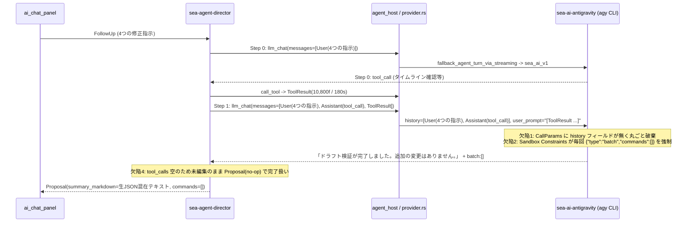
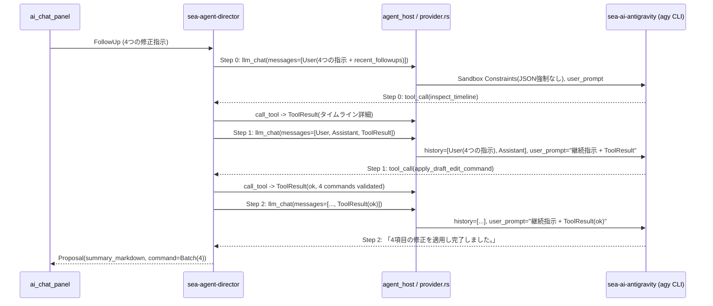
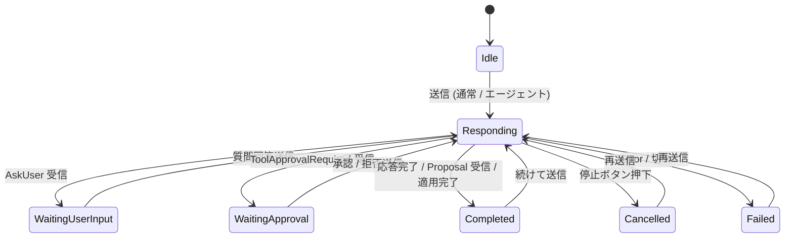

# [014] AI チャット継続性修正・作業中／完了状態の可視化・選択＆コピー対応設計書

- **ステータス**: Draft
- **作成日**: 2026-11-23
- **更新日**: 2026-11-23
- **関連ドキュメント**:
  - 自律エージェントプラグイン基盤＆構成コンパイラ設計書（完了済み）: [`completed/012-agentic-plugin-architecture.md`](completed/012-agentic-plugin-architecture.md)
  - AI チャット UI 改修・設定・トークン残量表示設計書（完了済み）: [`completed/013-ai-ui-settings-and-usage.md`](completed/013-ai-ui-settings-and-usage.md)
  - 外部プラグイン向け SDK・プロトコル互換性ポリシー: [`011-plugin-protocol-compatibility-policy.md`](011-plugin-protocol-compatibility-policy.md)
  - AI 連携・MCP・AI CLI プラグイン開発ガイド: [`../docs/plugins/ai-and-mcp.md`](../docs/plugins/ai-and-mcp.md)

---

## 1. 概要・目的

- **この機能で解決したい課題・達成したいこと**:
  現在の AI チャットパネル（[`src/ui/ai_chat_panel.rs`](../src/ui/ai_chat_panel.rs)）および CLI / 自律エージェント連携経路（[`src/ai/plugin_host.rs`](../src/ai/plugin_host.rs)・[`src/ai/provider.rs`](../src/ai/provider.rs)・[`plugins_src/sea-ai-antigravity/src/main.rs`](../plugins_src/sea-ai-antigravity/src/main.rs)・[`plugins_src/sea-ai-acp/src/main.rs`](../plugins_src/sea-ai-acp/src/main.rs)・[`plugins_src/sea-agent-director/src/director.rs`](../plugins_src/sea-agent-director/src/director.rs)）に存在する、以下 3 点の実運用上の重大な課題を解消します。
  1. **チャットを続けるとうまく完了・反映されない問題の根本解消**:
     `Antigravity (agy CLI)` 等で継続指示（例: 4 項目の修正依頼）を送信したにもかかわらず、「現在のタイムライン（総尺: 10,800フレーム / 180秒）に対するドラフト検証が完了しました。追加の変更はありません。」＋ ```` ```json {"type":"batch","commands":[]} ``` ```` が出力され、編集が適用されず終了する不具合を解消します。
  2. **AI が作業中（応答中）か完了したかの明確な可視化と完了報告**:
     応答待ち中に進行状況・経過時間が視認でき、処理完了時には完了した旨と変更結果（適用済み／承認待ち／変更なし／エラー／中断）を AI メッセージおよび常設ステータスバーの双方で明確に報告します。
  3. **過去チャットおよび AI 出力のテキスト選択・コピー対応**:
     過去のユーザー発言・AI 出力・エラー・差分カードの各テキストをマウスドラッグで部分選択（`Ctrl+C` / `Ctrl+A`）でき、さらに各ターン右上のボタンからワンクリックで全文をクリップボードへコピーできるようにします。また、過去 16 件での表示打ち切りを撤廃し、履歴を遡って参照・コピー可能にします。

- **対象ユーザー / 利用シーン**:
  - `Antigravity (agy CLI)`・`Claude / Codex / Copilot (ACP)`・各種 HTTP API プロバイダを用い、複数ターンの対話で動画タイムラインを段階的に修正・仕上げたいユーザー。
  - 長時間のエージェント処理（画像解析や複数ツール呼び出し）中に、動作中か停止済みかを迷わず判断し、処理結果のログや指示文をコピーして再利用したいユーザー。

### 1.1 課題①（継続チャット未完了）の根本原因分析

コード調査の結果、継続指示が空の `{"type":"batch","commands":[]}` で終了する現象は、以下の **4 層にまたがる複合欠陥** によって発生していることが判明しました。



1. **CLI / ACP プラグインにおける `history` の全破棄（主因）**:
   - ホスト側 [`AiPluginProvider::run_sea_ai_v1`](../src/ai/plugin_host.rs#L548-L563) は `AiPluginCallParams.history` に会話履歴をシリアライズして標準入力へ送信していますが、[`sea-ai-antigravity/src/main.rs`](../plugins_src/sea-ai-antigravity/src/main.rs#L68-L77) および [`sea-ai-acp/src/main.rs`](../plugins_src/sea-ai-acp/src/main.rs#L38-L46) の `CallParams` に `history` フィールドが存在せず、JSON デシリアライズ時に黙って破棄されています。また、[`AiPluginProvider::run_direct_acp_stdio`](../src/ai/plugin_host.rs#L676-L682) でも `request.history` がプロンプトへ展開されていません。
   - HTTP プロバイダ（OpenAI / Gemini / Anthropic）は `send_agent_turn` をネイティブ実装しているため会話配列を保持できますが、CLI プラグインは [`fallback_agent_turn_via_streaming`](../src/ai/provider.rs#L1289-L1327) を経由するため、**ツール実行後の 2 ステップ目では元のユーザー指示が `history` 側に移って消失し、モデルは `[ToolResult ...]` のみを見て即終了** してしまいます。通常チャットでも 2 ターン目以降の文脈が失われます。
2. **`sea-ai-antigravity` の `# Sandbox Constraints` による出力形式衝突**:
   - [`build_session_prompt_request`](../plugins_src/sea-ai-antigravity/src/main.rs#L230-L242) が毎回無条件に `# Sandbox Constraints` へ `Always output a valid EditCommand JSON object matching the schema below (use {"type":"batch","commands":[]} ...)` を追記しています。
   - 自律エージェント経由の呼び出し時は本体側から JSON Action Mode（`{"tool_calls":[...]}`）が指示されているにもかかわらず、プラグイン側の末尾追記が毎回 `{"type":"batch","commands":[]}` 出力を強制上書きするため、ツール呼び出しを止めて空 `batch` JSON を返す誘因になっています。さらに空の `command_schema_json` (`{}`)・`context_summary` (`{}`) も毎回埋め込まれています。
3. **ツールフォールバック経路の脆弱性**:
   - [`fallback_agent_turn_via_streaming`](../src/ai/provider.rs#L1289-L1327) は `stream: false` 固定で呼び出しており、応答中テキストが流れないほか、末尾メッセージが `ToolResult` の場合に「直前のツール結果を踏まえて元のユーザー依頼の作業を継続する」誘導が弱く、空 `batch` JSON がテキストとして返却されるとそのまま最終応答扱いになります。
4. **`sea-agent-director` のフォローアップ記憶不足と未編集誤完了**:
   - [`DirectorMemory`](../plugins_src/sea-agent-director/src/director.rs#L26-L48) に過去のフォローアップ指示と実施履歴が保存されず、セッションを跨いだり連続チャットしたりする際に前の調整文脈が引き継がれません。
   - [`run_dynamic_tool_loop`](../plugins_src/sea-agent-director/src/director.rs#L1089-L1171) でモデルが変更系ツールを一度も呼ばずテキストのみ（あるいはテキスト内生 `EditCommand` JSON）を返した場合、検証せずにそのまま `Proposal`（`is_no_op = true`）として終了してしまいます。
5. **UI 側の表示・状態管理上の課題（課題②・③）**:
   - [`render_chat_body`](../src/ui/ai_chat_panel.rs#L2415-L2485) では完了時に `status_banner` を表示する領域が無く、[`finalize_ai_response`](../src/ui/ai_chat_panel.rs#L2119-L2138) でも `plan.reply_note` が破棄されて `summary_lines` のみ表示されます。
   - [`agent_host.rs`](../src/ai/agent_host.rs#L1384-L1395) が `AiStreamEvent::DeltaText` を UI へ転送していません。
   - [`render_chat_turn`](../src/ui/ai_chat_panel.rs#L2554-L2580) がプレーン `div()` のため文字選択・コピーができず、`render_chat_body` (L2436) が `.rev().take(16).rev()` で過去 16 件以前を切り捨てています。

---

## 2. スコープ

> [!NOTE]
> **用語区分（リポジトリ規約準拠）**:
> - **プラグイン（Plugin）**: `plugins/` + `plugins_src/` 配下に分離された別プロセス拡張であり、無くても `sea-movie-creator` 本体が起動できるもの（`sea-ai-antigravity`, `sea-ai-acp`, `sea-agent-director`）。
> - **機能モジュール（Feature Module）**: `src/` 配下に組み込まれ、本体バイナリのコンパイル・起動・中核動作を構成するもの（`src/ai/*`, `src/ui/*`, `lang/*`）。

### 対象（In Scope）

- **プラグイン側（`plugins_src/`）**:
  - [`plugins_src/sea-ai-antigravity/src/main.rs`](../plugins_src/sea-ai-antigravity/src/main.rs): `history` 受信・プロンプト展開、`# Sandbox Constraints` の出力形式強制削除、空セクション省略。
  - [`plugins_src/sea-ai-acp/src/main.rs`](../plugins_src/sea-ai-acp/src/main.rs): `history` 受信・プロンプト展開、空セクション省略。
  - [`plugins_src/sea-agent-director/src/director.rs`](../plugins_src/sea-agent-director/src/director.rs): `DirectorMemory.recent_followups` 導入、プロンプト改善、未編集時 1 回自己修復リトライ＆0 件時明示サマリ生成。
- **本体機能モジュール側（`src/`・`lang/`）**:
  - [`src/ai/plugin_host.rs`](../src/ai/plugin_host.rs): `run_direct_acp_stdio` への `history` 展開・空セクション省略統一。
  - [`src/ai/provider.rs`](../src/ai/provider.rs): `fallback_agent_turn_via_streaming` の `ToolResult` 継続指示強化、`stream: true` 化、`parse_fallback_agent_response` 整理。
  - [`src/ai/agent_host.rs`](../src/ai/agent_host.rs): `AgentHostEvent::StreamDelta { text }` 追加と `send_agent_llm_turn_and_reply` での転送。
  - [`src/ai/context_builder.rs`](../src/ai/context_builder.rs): `default_editor_system_prompt()` への完了報告文言追記。
  - [`src/ai/session_store.rs`](../src/ai/session_store.rs): `StoredChatTurn` への任意状態バッジ保存（`#[serde(default)]` 後方互換）。
  - [`src/ui/ai_chat_panel.rs`](../src/ui/ai_chat_panel.rs): `AiExecutionState` 導入、スピナー＋経過秒数＋ストリーミングプレビュー、`TextView::markdown(...).selectable(true)`、ワンクリック `Clipboard` ボタン、常設ステータスバー、完了報告確実化、16 件表示制限撤廃（200 件超折りたたみ）。
  - [`src/ui/window.rs`](../src/ui/window.rs): `is_busy()` 中の 1 秒周期再描画、`TextView` と `EditorMain` のショートカット整合確認。
  - [`lang/ja.json`](../lang/ja.json) / [`lang/en.json`](../lang/en.json): 新規 UI テキスト・ツールチップキー追加。
- **プロトコル文書同期（`011` ポリシー準拠）**:
  - [`docs/plugins/ai-and-mcp.md`](../docs/plugins/ai-and-mcp.md): `sea_ai_v1` の `history` 展開挙動補足。

### 対象外（Out of Scope）

- `agy acp` / ACP プロセスをバックグラウンドに常駐させ続ける長寿命コネクション化（将来拡張。本設計では既存の 1 リクエスト 1 プロセス方式を前提に `history` 引き継ぎで完全性を担保する）。
- チャット欄内でのインラインリッチ編集（WYSIWYG）やタイムライン差分適用そのものの新コマンド追加。
- 画像サムネイルやバイナリファイルのクリップボードコピー。

---

## 3. 要件・制約

### 機能要件

- **FR-1（会話・ツール履歴の完全引き継ぎ）**:
  - `sea_ai_v1`（`sea-ai-antigravity`, `sea-ai-acp`）および `acp_stdio` 直接接続のすべてで、`history` 配列を受け取り、役割（`system` / `user` / `assistant`）付きの時系列コンテキストとして外部 CLI へ確実に引き継ぐこと。
  - `sea-ai-antigravity` の `# Sandbox Constraints` に出力形式（`EditCommand` / `batch:[]`）の強制を含めず、本体側 `system_prompt` の指示（通常編集時は `EditCommand`、自律エージェント時は JSON Action Mode）のみを尊重すること。
- **FR-2（エージェント未編集時の自己修復リトライと 0 件明示報告）**:
  - `sea-agent-director` の `run_dynamic_tool_loop` において、修正依頼に対し変更系ツール（`apply_draft_edit_command` / `compile_movie_blueprint`）を呼ばずに生 JSON ブロックや「検証完了・変更なし」等で終了しようとした場合、**最大 1 回だけ**自己修復リトライを行うこと。
  - リトライ後も変更が 0 件（`is_no_op == true`）の場合は、無編集のまま成功したかのように見せかけず「タイムラインへの変更は行われませんでした（0 件）」と明示報告すること。
- **FR-3（作業中・応答中のリアルタイム可視化）**:
  - 送信直後から応答完了まで、回転スピナー（`Spinner`）、現在の処理フェーズ文言、ステップ番号 `[s/t]`（エージェント時）、経過秒数（1 秒単位更新）、およびストリーミング受信中の部分テキストをリアルタイム表示すること。
  - エージェント実行中も LLM からの `DeltaText` を UI へ転送して応答中プレビューを更新すること。
- **FR-4（常設ステータスバーと確実な完了報告）**:
  - チャットコンポーザ直上に常設ステータスバーを配置し、作業中・入力待ち・承認待ち・完了（適用済み／承認待ち／変更なし）・停止・エラーのいずれの状態でも現在の状況が一目で分かるようにすること。
  - `finalize_ai_response` / `apply_ai_plan` / `handle_agent_proposal_event` でモデルの回答本文（`reply_note`）を保持しつつ、完了ステータスバッジおよび結果に応じた完了報告文言をチャット履歴へ記録すること。
- **FR-5（テキスト選択・`Ctrl+C`・ワンクリックコピー・全履歴表示）**:
  - 過去チャット（ユーザー発言・AI 出力・システム／エラーメッセージ）をマウスドラッグで自由範囲選択し、`Ctrl+C`（macOS は `Cmd+C`）・`Ctrl+A` でコピーできること。
  - ユーザー発言は `#1` 等の先頭記号や改行が Markdown 見出し等へ誤変換されないようエスケープ＋改行保持で描画しつつ選択可能にし、AI 出力は Markdown として整形描画しつつ選択可能にすること。
  - 各メッセージの右上にワンクリック全文コピーボタン（`Clipboard`）を配置し、ユーザー発言はエスケープ前の生原文、AI 出力は生 Markdown をコピーできること。
  - 過去 16 件の表示打ち切りを撤廃し、セッション内のすべての履歴を遡って選択・コピーできること（200 件超のみ先頭折りたたみトグルを提供）。

### 非機能要件（互換性・セキュリティ・保守性）

- **プロトコル・永続化の後方互換性**:
  - `sea_ai_v1` の `AiPluginCallParams` は既に `history` を送信しているため、プラグイン側の `#[serde(default)] history` 追加は後方・前方互換を壊さない（`011` ポリシー準拠）。
  - セッション保存 JSON（`StoredChatTurn`）および `DirectorMemory` への追加フィールドには必ず `#[serde(default)]` を付与し、既存ユーザーの保存済みセッションファイルを破損なく読み込めること。
- **プロンプトサイズ上限と性能**:
  - `history` をプロンプト文字列へ展開する際は UTF-8 文字境界を壊さないバイト上限（`48 KiB`）を設け、上限超過時は古いターンを先頭から省略して最新コンテキストを優先保持する。
  - チャットスレッドは 200 件超時に先頭を折りたたむことで、長期セッションでの GPUI レイアウト負荷増大を抑制する。
- **安全性・コード品質**:
  - `unsafe` コードは一切追加しない（`unsafe_code = "deny"` 維持）。
  - タイムラインへ適用される編集は引き続き `DraftSandbox` および `dry_run_validate` を必ず通過させ、テキスト内 JSON をそのまま無検証適用しない。
  - 既存の `gpui-kit = "0.9.1"`（`gpui-component-0.9.1` / `gpui-base-0.9.1`）標準コンポーネント（`TextView`, `Clipboard`, `Spinner`）を活用し、独自再実装による重複を避ける。

### 前提条件・制約

- `gpui-kit = "0.9.1"` にて以下 API が利用可能であることを確認済み:
  - `gpui_kit::component::text::TextView::markdown(id, source).selectable(true)`
  - `gpui_kit::component::clipboard::Clipboard::new(id).value(text).tooltip(tip)`
  - `gpui_kit::component::spinner::Spinner::new()`
- `gpui-base-0.9.1` の `TextView` は独自のキーコンテキスト `"TextView"` に `ctrl-c` (`input::Copy`) / `ctrl-a` (`input::SelectAll`) をバインドし、`FocusHandle` を内部保持しているため、チャット本文クリック・ドラッグ時にフォーカスが移り、ウィンドウ側の `"EditorMain"` (`CopyClip`) より内側のバブリングで優先処理される必要がある（[`src/ui/window.rs`](../src/ui/window.rs) にて競合有無を検証する）。

---

## 4. アーキテクチャ / 設計詳細

### 4.1 モジュール構成・責務分担

| 区分 | ファイルパス | 変更責務 |
| --- | --- | --- |
| **プラグイン** | [`plugins_src/sea-ai-antigravity/src/main.rs`](../plugins_src/sea-ai-antigravity/src/main.rs) | `CallParams.history` 受理、会話履歴整形（48KiB 上限）、`# Sandbox Constraints` 出力形式強制削除、空セクション省略 |
| **プラグイン** | [`plugins_src/sea-ai-acp/src/main.rs`](../plugins_src/sea-ai-acp/src/main.rs) | `CallParams.history` 受理、会話履歴整形（48KiB 上限）、空セクション省略 |
| **プラグイン** | [`plugins_src/sea-agent-director/src/director.rs`](../plugins_src/sea-agent-director/src/director.rs) | `DirectorMemory.recent_followups` 永続化・参照、フォローアップ指示プロンプト改善、未編集時 1 回自己修復リトライ、0 件時明示サマリ |
| **機能モジュール** | [`src/ai/plugin_host.rs`](../src/ai/plugin_host.rs) | `run_direct_acp_stdio` での `request.history` 展開と空セクション省略（`sea_ai_v1` と仕様統一） |
| **機能モジュール** | [`src/ai/provider.rs`](../src/ai/provider.rs) | `fallback_agent_turn_via_streaming` の `ToolResult` 継続誘導強化、`stream: true` 化、空 `batch` JSON フィルタリング整理 |
| **機能モジュール** | [`src/ai/agent_host.rs`](../src/ai/agent_host.rs) | `AgentHostEvent::StreamDelta` 追加と `send_agent_llm_turn_and_reply` での転送 |
| **機能モジュール** | [`src/ai/context_builder.rs`](../src/ai/context_builder.rs) | `default_editor_system_prompt()` へ簡潔な日本語完了報告指示を追加 |
| **機能モジュール** | [`src/ai/session_store.rs`](../src/ai/session_store.rs) | `StoredChatTurn` へ `status_badge`（任意、`#[serde(default)]`）を追加 |
| **機能モジュール** | [`src/ui/ai_chat_panel.rs`](../src/ui/ai_chat_panel.rs) | `AiExecutionState`、安定ターン ID、常設ステータスバー、`Spinner` 応答中カード、`TextView` 選択描画、`Clipboard` ボタン、全履歴表示＆折りたたみ |
| **機能モジュール** | [`src/ui/window.rs`](../src/ui/window.rs) | `ai_chat.is_busy()` 中の 1 秒間隔再描画、テキスト選択中 `Ctrl+C` 競合ガード |
| **機能モジュール** | [`lang/ja.json`](../lang/ja.json)・[`lang/en.json`](../lang/en.json) | 状態表示・完了報告・コピー関連の多言語キー追加 |
| **ドキュメント** | [`docs/plugins/ai-and-mcp.md`](../docs/plugins/ai-and-mcp.md) | `sea_ai_v1` プロトコルの `history` 展開・プロンプト制約指針の同期 |

---

### 4.2 複数ターン継続性・CLI プラグイン・エージェント改修設計（課題①）

#### 4.2.1 CLI / ACP プラグインにおける `history` 展開とプロンプト整形

`sea-ai-antigravity`・`sea-ai-acp`・`plugin_host::run_direct_acp_stdio` の 3 箇所で共通ロジック（各クレート境界に応じたヘルパ）を適用します。

- **データ受信**:
  ```rust
  #[derive(Debug, Default, Deserialize)]
  #[serde(default)]
  struct HistoryMessage {
      role: String,
      content: String,
  }
  ```
  `CallParams` に `history: Vec<HistoryMessage>` を追加します。
- **プロンプト構築ルール**:
  1. `# Sandbox Constraints`（`sea-ai-antigravity` のみ）:
     `Do NOT execute shell commands, modify files, browse URLs, or invoke workspace tools.` のみに整理し、**`Always output a valid EditCommand JSON object ...` の文言を削除**します。出力形式（`EditCommand` か `{"tool_calls":[...]}` か）は常にホストが渡す `system_prompt` に従います。
  2. `# EditCommand JSON Schema` / `# Timeline Context`:
     値が `null` または空オブジェクト `{}` の場合はセクション自体を出力しません（エージェントツールループ経由でのノイズ混入を防止）。
  3. `# Conversation History`:
     `history` が空でない場合、各メッセージを `[user]` / `[assistant]` / `[system]` プレフィックス付きで時系列順に整形します。合計バイト数が `MAX_HISTORY_PROMPT_BYTES = 48 * 1024` を超える場合は古いメッセージから順に省略し、先頭に `...(earlier messages omitted)...` を挿入します。単一メッセージが極端に大きい場合は UTF-8 文字境界で安全に切り詰めます。

#### 4.2.2 `fallback_agent_turn_via_streaming` の継続性・ストリーミング強化

[`src/ai/provider.rs`](../src/ai/provider.rs#L1289-L1327) を以下の通り改善します。

- `request.messages` の末尾が `AiTurnMessage::ToolResult` の場合、`user_prompt` に単なる `"Continue based on the tool results above."` ではなく、以下の明確な継続指示を組み立てます。
  ```text
  Based on the conversation history and the latest tool execution results below, continue fulfilling the original user request.
  If timeline edits are still required, invoke the appropriate editing tool via JSON Action Mode (`{"tool_calls":[...]}`).
  Only provide a final Japanese summary after all required edits are applied.

  <最新の ToolResult 一覧>
  ```
- `legacy_req.stream = true` に変更し、`on_event` を通じて `DeltaText` を逐次上位へ返却します。
- `parse_fallback_agent_response` では、`tool_calls` が無く、かつ応答本文が `{"type":"batch","commands":[]}` 等の純粋な空コマンド JSON のみ、または生 JSON コードブロックと説明文が混在している場合に、`reply_note` 相当のテキストのみを抽出しつつメタデータとして「生 JSON が直接返された」ことを識別できるようにします（次項の自己修復判定で活用）。

#### 4.2.3 `sea-agent-director` の記憶継承と 1 回自己修復リトライ

- **永続記憶拡張**:
  [`DirectorMemory`](../plugins_src/sea-agent-director/src/director.rs#L26-L48) に以下を追加します。
  ```rust
  #[derive(Debug, Clone, Default, Serialize, Deserialize)]
  pub struct FollowUpRecord {
      pub user_prompt: String,
      pub assistant_summary: String,
      pub changed_timeline: bool,
  }
  ```
  `pub recent_followups: Vec<FollowUpRecord>`（上限 10 件の FIFO）を保持し、`run_dynamic_tool_loop` の `initial_context` へ `recent_followups` として渡すことで、セッションを跨いだ連続チャットや「さっきの字幕をもう少し小さくして」のような指示でも前後の文脈を保持します。
- **フォローアップシステムプロンプト強化**:
  `build_followup_system_prompt` に以下を明記します。
  - タイムラインを変更するには**必ず** `apply_draft_edit_command` または `compile_movie_blueprint` ツールを呼び出すこと。
  - テキストや ```` ```json ```` ブロック内に `EditCommand` を書いて出力しただけではタイムラインへ一切反映されないこと。
  - 全ての調整が終わったら最後に `validate_draft_plan` を確認したうえで、実施した変更内容と完了した旨を日本語で簡潔に報告すること。
- **未編集時 1 回限定自己修復リトライ**:
  `run_dynamic_tool_loop` で `tool_calls` が空となりループを抜けようとした際、以下の条件を**すべて**満たす場合は **1 回だけ** `state.messages` に修正フィードバックを追加してループを継続します。
  1. リトライ回数が未消費（`self_repair_attempted == false`）。
  2. 今回のターンで変更系ツール（`apply_draft_edit_command` / `compile_movie_blueprint`）が一度も呼ばれていない、または `validate_draft_plan` の結果が `is_no_op == true`。
  3. 以下のいずれかに該当する（意図的な質問・確認回答と誤認しないためのガード）:
     - モデルのテキスト応答内に `EditCommand` らしい生 JSON（`"type":"batch"` や `"commands":`）が混入している、**または**
     - ユーザー指示がタイムライン修正を要求している（「修正」「変更」「追加」「削除」「回転」「適用」「統一」「して」「ください」等の操作意図があり、かつモデルがツールを呼び出さずに終わった場合）。
  - フィードバック文面:
    > まだタイムラインへの変更がツール経由で実行されていません（テキスト内の JSON は適用されません）。ユーザーの指示内容を反映するため、必要な編集を `apply_draft_edit_command`（または `compile_movie_blueprint`）ツールで実行してください。本当に変更が不要な場合のみ、その理由を日本語で説明してください。
  - **2 回目（リトライ後）も `is_no_op == true` で終わった場合**:
    これ以上の再試行は行わず、`finalize_dynamic_proposal` にて「⚠ タイムラインへの変更は行われませんでした（0 件）」の明示付きサマリを生成し、`Proposal`（`is_no_op = true`）を返却します。



---

### 4.3 実行状態モデル・応答中表示・完了報告設計（課題②）

#### 4.3.1 エージェントからのストリーミング転送

- [`src/ai/agent_host.rs`](../src/ai/agent_host.rs) の `AgentHostEvent` に以下を追加します。
  ```rust
  /// LLM が逐次生成している部分テキストチャンク。
  StreamDelta {
      /// 追記テキスト。
      text: String,
  },
  ```
- `send_agent_llm_turn_and_reply` の `on_stream_event` クロージャで `AiStreamEvent::DeltaText(delta)` を受け取り、`AgentHostEvent::StreamDelta { text: delta }` を `event_tx` へ送信します。
- `ai_chat_panel.rs` の `handle_agent_host_event` にて：
  - `AgentHostEvent::StreamDelta { text }` 受信時、`self.ai_chat.streaming_preview.push_str(&text)` を実行。
  - `AgentHostEvent::ToolActivity { .. }` または `Status { step: Some(_), .. }` で新しいツール／ステップへ移行した際は、古い思考途中テキストと混ざらないよう `streaming_preview` をクリアします。

#### 4.3.2 `AiExecutionState` 状態機械と常設ステータスバー

`AiChatState` に従来の暗黙的フラグ（`running_job.is_some() || agent_busy`）を統合可視化する `execution_state: AiExecutionState` を導入します。

```rust
/// AI チャットの現在の実行フェーズを表す明示的状態。
#[derive(Debug, Clone, PartialEq, Eq, Default)]
pub enum AiExecutionState {
    /// 待機中（未送信またはセッション復元直後）。
    #[default]
    Idle,
    /// AI または自律エージェントが応答・作業中。
    Responding {
        started_at: Instant,
        phase: String,
        step: Option<(Option<u32>, Option<u32>)>,
    },
    /// エージェントからの質問カード入力待ち。
    WaitingUserInput { detail: String },
    /// Manual モードにおける外部ツール実行承認待ち。
    WaitingApproval { tool_name: String },
    /// 処理が完了（タイムライン適用済み／提案承認待ち／変更なし）。
    Completed {
        summary: String,
        changed_timeline: bool,
    },
    /// ユーザー操作により停止済み。
    Cancelled,
    /// 通信・検証・実行エラーにより終了。
    Failed { summary: String },
}
```



- **作業中表示の強化 (`render_busy_indicator`)**:
  - チャットスレッド末尾に枠線付きの強調カードを表示し、左端に `gpui_kit::component::spinner::Spinner::new()`、続けて現在フェーズ・ステップ `[s/t]`・経過時間（`format_elapsed_seconds`: 例 `12秒` / `1分5秒`）を表示します。
  - `streaming_preview` が空でない場合は、同カード下部にリアルタイム受信テキストの末尾抜粋を表示します。
- **常設ステータスバー（コンポーザ直上）**:
  - 会話が 1 件以上ある場合や完了後・エラー後も消えないステータスバーをコンポーザ直上に配置し、`execution_state` に応じた色付きアイコン＋状態ラベル（例: 回転スピナー＋`AI が作業中... (8秒)`、`✓ 完了: タイムラインへ適用済み`、`✓ 完了: 承認待ちの編集案を作成`、`✓ 完了（タイムライン変更なし）`、`⚠ エラー: ...`、`■ 停止しました`）を常時表示します。
- **経過秒数の 1 秒周期更新**:
  - [`src/ui/window.rs`](../src/ui/window.rs#L489-L507) の `spawn_playback_loop` にて、`view.controller.ai_chat.is_busy()` かつ最後に秒数描画を更新した時刻から 1 秒以上経過した場合に `cx.notify()` を発火させ、応答待機中も経過タイマーとスピナーが止まらず動作することを保証します。

#### 4.3.3 確実な完了報告の生成ルール

| 完了パターン | チャット履歴へ積む AI 本文 | ターンバッジ (`AiTurnBadge`) | 常設ステータスバー |
| --- | --- | --- | --- |
| **通常チャット + 編集あり (Manual)** | `plan.reply_note`（あれば先頭）＋ 変更要約行 ＋ `\n\n✅ 編集案の作成が完了しました。下の「承認して適用」でタイムラインへ反映できます。` | `ProposalReady` (`完了・承認待ち`) | `✓ 完了: 承認待ちの編集案を作成` |
| **通常チャット + 編集あり (Autopilot)** | `plan.reply_note`（あれば先頭）＋ `\n\n✅ 作業が完了し、タイムラインへ自動適用しました:` ＋ 変更要約行 | `Applied` (`完了・適用済み`) | `✓ 完了: タイムラインへ自動適用済み` |
| **通常チャット + 変更なし (`is_no_op`)** | `plan.reply_note`（空なら既定文言）＋ `\n\n✅ 応答が完了しました（タイムラインへの変更はありません）。` | `CompletedNoChange` (`完了・変更なし`) | `✓ 完了（タイムライン変更なし）` |
| **自律エージェント + Proposal (Manual)** | `summary_markdown`（末尾に完了表現が無い場合、編集案サイズに応じた完了追記） | `ProposalReady` (`完了・承認待ち`) | `✓ 完了: 構成案の準備完了` |
| **自律エージェント + Proposal (Autopilot)** | `summary_markdown` ＋ `apply_ai_plan` の適用完了ターン（`✅ 作業が完了し、タイムラインへ自動適用しました`） | `Applied` (`完了・適用済み`) | `✓ 完了: タイムラインへ自動適用済み` |
| **自律エージェント + 変更 0 件 (`is_no_op`)** | `summary_markdown`（1 回リトライ後も 0 件時は `⚠ タイムラインへの変更は行われませんでした（0 件）。` を明示） | `CompletedNoChange` (`完了・変更なし`) | `✓ 完了（タイムライン変更なし）` |

- `AiChatTurn` へ以下を追加します:
  ```rust
  pub struct AiChatTurn {
      pub id: u64,
      pub role: AiRole,
      pub text: String,
      pub status_badge: Option<AiTurnBadge>,
  }
  ```
  `id` はセッション内単調増加カウンタ（復元時も 1..N を再採番）で割り当て、GPUI の `ElementId` が全ターンで一意・安定になるようにします。

---

### 4.4 過去チャット＆AI 出力のテキスト選択・コピー対応（課題③）

#### 4.4.1 `TextView` による選択可能レンダリング

`render_chat_turn` の本文描画を、従来のプレーン `div().child(turn.text.clone())` から `gpui_kit::component::text::TextView` へ置き換えます。

- **AI 出力 (`AiRole::Assistant`)**:
  ```rust
  TextView::markdown(("ai-turn-md", turn.id), turn.text.clone())
      .selectable(true)
  ```
  - 見出し・箇条書き・強調・コードブロックを視認性高く描画し、マウスドラッグで任意の文字範囲を選択、`Ctrl+C` / `Cmd+C` でコピー、`Ctrl+A` / `Cmd+A` でブロック内全選択が可能です。
- **ユーザー発言 (`AiRole::User`)**:
  - ユーザーが `#1 の設定` や `*補足*`、複数行の箇条書き等を入力した際に Markdown 記法として見出し化・太字化されたり単一行に潰れたりしないよう、`escape_plain_text_for_markdown(raw: &str) -> String` を通してから `TextView::markdown(("ai-turn-user", turn.id), escaped).selectable(true)` で描画します。
  - エスケープ仕様:
    - バックスラッシュ `\` および Markdown 制御文字（`#`, `*`, `_`, `` ` ``, `[`, `]`, `(`, `)`, `>`, `+`, `-`, `!`, `|` 等）と番号付きリストの `1. ` 相当をエスケープ。
    - 改行 `\r\n` / `\n` を Markdown ハード改行（`  \n`）へ変換し、入力通りの改行位置を維持。
- **システムメッセージ / エラーカード / 適用差分カード**:
  - エラーメッセージ本文・適用差分カード要約も `TextView::markdown` + `.selectable(true)` とし、エラーログをそのままドラッグ選択＆コピー可能にします。

#### 4.4.2 ワンクリックコピーボタン (`Clipboard`)

- 各ターン（ユーザー・AI・システムとも）の上部ヘッダ行の右端に、`gpui_kit::component::clipboard::Clipboard` を配置します。
  ```rust
  Clipboard::new(("ai-turn-copy", turn.id))
      .value(turn.text.clone()) // ユーザーは生原文、AI は生 Markdown
      .tooltip(tr("ai.copy_message"))
  ```
- エラーカード右上にも同様に `Clipboard::new("ai-error-copy").value(err.clone())` を配置します。
- クリック時は `cx.stop_propagation()` のうえでシステムクリップボードへ全文が書き込まれ、2 秒間チェックマーク（`IconName::Check`）へ切り替わる標準フィードバックが得られます。

#### 4.4.3 履歴表示制限の撤廃と折りたたみ

- `render_chat_body` の `.rev().take(16).rev()` を撤廃し、`chat.turns` の全件を描画します。
- 200 件を超える非常に長いセッションでは、パフォーマンス保護のため `chat.show_all_history: bool`（既定 `false`）を持ち、200 件超過時のみ先頭に「過去の履歴をすべて表示（残り N 件）」ボタンを配置して、ワンクリックで全件展開できるようにします。

#### 4.4.4 `Ctrl+C` ショートカット競合の防止

- `gpui-base-0.9.1` の `TextView` は要素構築時にキーコンテキスト `"TextView"` を登録し、`ctrl-c` / `cmd-c` を `input::Copy` アクションへバインドしています。
- タイムライン上でクリップを選択したままチャット欄のテキストをドラッグ選択して `Ctrl+C` を押した場合でも、`"TextView"` 側のバインディングが内側のフォーカス要素上で先に捕捉するため `CopyClip`（タイムラインクリップのコピー）に奪われない設計となります。
- 念のため [`src/ui/window.rs`](../src/ui/window.rs) の `CopyClip` / `SelectAllClips` ハンドラ側でも、`TextView` を含む入力・選択コンテキストからの誤発火が無いか統合確認・テスト（またはフォーカス／アクション伝播ガード）を行います。

---

## 5. インターフェース / API 仕様

### 5.1 構造体・列挙型・関数シグネチャ

1. **`plugins_src/sea-ai-antigravity/src/main.rs`・`plugins_src/sea-ai-acp/src/main.rs`**:
   - `HistoryMessage { role: String, content: String }`（`#[derive(Debug, Default, Deserialize)]`）を `CallParams.history` に追加。
   - `format_conversation_history_section(history: &[HistoryMessage], max_bytes: usize) -> String` を実装。
2. **`plugins_src/sea-agent-director/src/director.rs`**:
   - `FollowUpRecord { pub user_prompt: String, pub assistant_summary: String, pub changed_timeline: bool }` を定義し、`DirectorMemory.recent_followups: Vec<FollowUpRecord>`（`#[serde(default)]`）を追加。
   - `should_attempt_self_repair(prompt: &str, response_text: &str, mutated_draft: bool, already_retried: bool) -> bool` を追加。
3. **`src/ai/agent_host.rs`**:
   - `AgentHostEvent::StreamDelta { text: String }` を追加。
4. **`src/ai/session_store.rs`**:
   - `AiTurnBadge`（`#[serde(rename_all = "snake_case")]`: `Applied`, `ProposalReady`, `CompletedNoChange`, `Cancelled`, `Error`）を定義。
   - `StoredChatTurn` に `#[serde(default, skip_serializing_if = "Option::is_none")] pub status_badge: Option<AiTurnBadge>` を追加。
5. **`src/ui/ai_chat_panel.rs`**:
   - `AiExecutionState` enum、および `AiChatState::execution_state` / `AiChatState::show_all_history` / `AiChatState::next_turn_id` を追加。
   - `pub fn escape_plain_text_for_markdown(raw: &str) -> String` を公開（単体テスト可能）。
   - `pub fn format_elapsed_duration_ja(secs: u64) -> String` を公開（例: `0秒`, `45秒`, `1分12秒`）。

### 5.2 多言語キー追加（`lang/ja.json` / `lang/en.json`）

| キー | 日本語 (`ja.json`) | 英語 (`en.json`) |
| --- | --- | --- |
| `ai.status_responding` | `AI が応答を生成中...` | `AI is generating a response...` |
| `ai.status_completed_applied` | `完了: タイムラインへ適用しました` | `Completed: Applied to timeline` |
| `ai.status_completed_proposal` | `完了: 編集案の準備ができました（承認待ち）` | `Completed: Edit proposal ready (awaiting approval)` |
| `ai.status_completed_no_change` | `完了（タイムラインへの変更はありません）` | `Completed (no timeline changes)` |
| `ai.copy_message` | `メッセージをコピー` | `Copy message` |
| `ai.show_older_history` | `過去の履歴をすべて表示 ({count} 件)` | `Show all older messages ({count})` |

---

## 6. エラーハンドリング・エッジケース

- **過大な会話履歴（`history` サイズ超過）**:
  - 48 KiB 上限を超える場合は古いターンから切り詰め、直近のユーザー指示と最新のツール実行結果を必ず残す。UTF-8 マルチバイト文字の途中でスライスしてパニックしないよう `char_indices` / `is_char_boundary` を使用する。
- **自己修復リトライの無限ループ・誤発火防止**:
  - 自己修復リトライは 1 ターンにつき **最大 1 回** に厳格制限し、さらにホスト側 `max_steps_per_turn`（既定 20 ステップ）・ループ上限 `MAX_DYNAMIC_TOOL_STEPS`（12 ステップ）の範囲内で実行する。
  - 単なる質問（「このタイムラインは何秒？」等）にモデルが `is_no_op` で通常テキスト回答を返したケースではリトライを発動させない（操作意図判定または生 `EditCommand` JSON 混入検知時のみ発動）。
- **ストリーミング中の停止・異常終了**:
  - ユーザーによる停止（`cancel_ai_prompt`）時は `execution_state = AiExecutionState::Cancelled` へ遷移し、受信途中の `streaming_preview` があれば `[停止済み]` バッジ付きターンとして保存してコピー可能にする。
  - 子プロセス異常終了・通信切断時は `execution_state = AiExecutionState::Failed { summary }` へ遷移し、エラーカードをコピー可能表示する。
- **旧セッション JSON との互換性**:
  - `StoredChatTurn.status_badge` および `DirectorMemory.recent_followups` はすべて `#[serde(default)]` 付きのため、既存バージョンで保存された `settings/ai_sessions/*.json` もエラーなく読み込める。
- **クリップボード・テキスト選択時のショートカット競合**:
  - タイムライン上でクリップが選択されている状態でチャット内テキストをコピーする際、ウィンドウ全体の `CopyClip` アクションが発火しないようフォーカス・コンテキスト境界を検証する。

---

## 7. テスト計画・受け入れ基準

### 7.1 段階的実装フェーズ計画（設計承認後に実施）

- **Phase 1（複数ターン継続性・CLI プラグイン・エージェント改修）**:
  - `sea-ai-antigravity`・`sea-ai-acp`・`plugin_host.rs`・`provider.rs`・`sea-agent-director` の実装と単体テスト・結合テスト・`docs/plugins/ai-and-mcp.md` 同期。
- **Phase 2（実行状態モデル・応答中スピナー／ストリーミング・完了報告）**:
  - `agent_host.rs` (`StreamDelta`)・`context_builder.rs`・`session_store.rs`・`ai_chat_panel.rs` 状態管理＆ステータスバー・`window.rs` タイマー更新の実装と単体テスト。
- **Phase 3（テキスト選択・ワンクリックコピー・全履歴表示・i18n）**:
  - `TextView` 選択対応、`escape_plain_text_for_markdown`、`Clipboard` ボタン、16 件制限撤廃＆折りたたみ、`lang/*.json` 更新、全体品質ゲート確認。

### 7.2 単体テスト計画（各 `.rs` ファイル末尾 `#[cfg(test)] mod tests`）

1. `plugins_src/sea-ai-antigravity/src/main.rs`:
   - `history` 複数ターンが `# Conversation History` としてプロンプトへ正しく展開されること、48 KiB 超過時にマルチバイト安全に切り詰められること。
   - `# Sandbox Constraints` に `batch` JSON 出力強制が含まれないこと、空 `{}` のスキーマ・コンテキストが省略されること。
2. `plugins_src/sea-ai-acp/src/main.rs`:
   - `history` 展開および空セクション省略の検証。
3. `src/ai/provider.rs`:
   - `fallback_agent_turn_via_streaming` が `ToolResult` 末尾のメッセージ列でも元指示とツール結果を正しく組み立てること。
4. `plugins_src/sea-agent-director/src/director.rs`:
   - `DirectorMemory.recent_followups` のシリアライズ／デシリアライズ互換、上限 10 件トリミング。
   - `should_attempt_self_repair` が「変更指示＋未編集」「生 JSON 露出」で `true`、「純粋質問」「編集済み」「2 回目」で `false` を返すこと。
5. `src/ui/ai_chat_panel.rs`:
   - `AiExecutionState` の遷移（`Idle` → `Responding` → `Completed` / `Failed` / `Cancelled`）。
   - `finalize_ai_response` / `apply_ai_plan` / `handle_agent_proposal_event` で `reply_note` が消えず、完了報告と `AiTurnBadge` が確実に付与されること。
   - `escape_plain_text_for_markdown` が `#1`, `*`, `` ` ``, `\n` を壊さずエスケープすること。
   - 17 件以上のターンを保持・展開できること。

### 7.3 結合テスト計画（`tests/`）

- `tests/ai_chat_continuity.rs`（および `tests/ai_chat_continuity/mod.rs`）を新設し、モックプラグインバイナリ（または `AiPluginProvider` + `AgentSessionRunner`）を用いて以下をヘッドレス検証:
  1. 1 ステップ目で `tool_call` を返し、`ToolResult` を受け取った 2 ステップ目のリクエストに**元のユーザー指示と会話履歴が含まれている**こと。
  2. `apply_draft_edit_command` 実行後に完了報告付き `Proposal` が生成されること。
  3. 初回ツール未呼び出し＋空 `batch` JSON を返した場合に 1 回だけ自己修復リトライが走り、2 回目も 0 件なら変更なし明示報告で終了すること。

### 7.4 品質ゲート・手動確認項目

- **自動品質ゲート（全 Phase 完了時に worktree 内で実行）**:
  - `.\scripts\pre-pr.ps1`（`cargo fmt --all --check`, `cargo clippy --workspace --all-targets --all-features -- -D warnings`, `RUSTDOCFLAGS="-D warnings" cargo doc --workspace --no-deps`, `cargo build --workspace --all-targets`, `cargo test --workspace --all-targets --all-features`）が警告・エラーゼロで通過すること。
- **手動実機確認（UI・実 `agy CLI` 依存のため実装後にユーザー確認）**:
  1. `Antigravity (agy CLI)` を選択し、通常チャットおよび `Agent:Director` で連続して複数項目の修正指示（画像回転・字幕枠色・文言削除等）を送り、タイムラインへ正しく編集提案・適用が行われること。
  2. 送信後から完了まで回転スピナー・経過秒数・ストリーミングテキストが更新され、完了時に常設ステータスバーと AI 応答本文の双方で完了報告が表示されること。
  3. 過去のユーザー発言・AI 出力の一部をドラッグ選択して `Ctrl+C` コピーできること（タイムラインクリップ選択状態でもチャット側がコピーされること）、および各メッセージ右上のコピーボタンで全文コピーできること。

### 7.5 完了条件（Definition of Done）

- 上記単体テスト・結合テスト・`scripts/pre-pr.ps1` のすべてが通過していること。
- `docs/plugins/ai-and-mcp.md` が最新仕様と同期していること。
- 完了後、本設計書のステータスを `Implemented` に更新し `dev-doc/completed/` へ移動のうえ `dev-doc/README.md` と相対リンクを更新すること。

---

## 8. 決定事項・ADR メモ（Open Questions の確定結果）

- [x] **ADR-001: 修正依頼に対する変更 0 件（`is_no_op`）時の自己修復ポリシー**（2026-11-23 決定）
  - **決定**: エージェントが修正系タスクでツール未呼び出しのまま生 JSON 等を返して `is_no_op` になった場合は **1 回だけ** 自己修復リトライを行い、それでも 0 件なら「タイムラインへの変更は行われませんでした（0 件）」と明示報告する。
  - **理由**: 今回発生した「検証完了・変更なし」誤終了を高い確率で自動救済しつつ、リトライ回数を 1 回に限定することで無限ループや過度なトークン消費を防止できるため。
- [x] **ADR-002: ユーザー発言と AI 出力の表示・コピー方式**（2026-11-23 決定）
  - **決定**: AI 出力は `TextView::markdown(...).selectable(true)` で Markdown 描画し、ユーザー発言は Markdown エスケープ＋ハード改行変換を通した `TextView::markdown(...).selectable(true)` で入力通りの見た目を保ったまま選択可能にする。さらに双方のメッセージ右上にワンクリック `Clipboard` ボタン（ユーザー発言は生原文、AI 出力は生 Markdown をコピー）を配置する。
  - **理由**: `#1` や箇条書きを含むユーザー指示の見た目崩れを防ぎつつ、`gpui-kit` 標準コンポーネントで部分ドラッグ選択・`Ctrl+C`・ワンクリック全文コピーのすべてを統一的に提供できるため。
- [x] **ADR-003: 過去チャット表示件数制限の撤廃**（2026-11-23 決定）
  - **決定**: 直近 16 件固定の表示打ち切りを撤廃し、セッション内の全履歴をスクロール表示（200 件超時のみ先頭折りたたみボタン）とする。
  - **理由**: 長めの対話を行っても過去のユーザー指示や AI 出力を遡って確認・選択・コピーできるようにするため。
