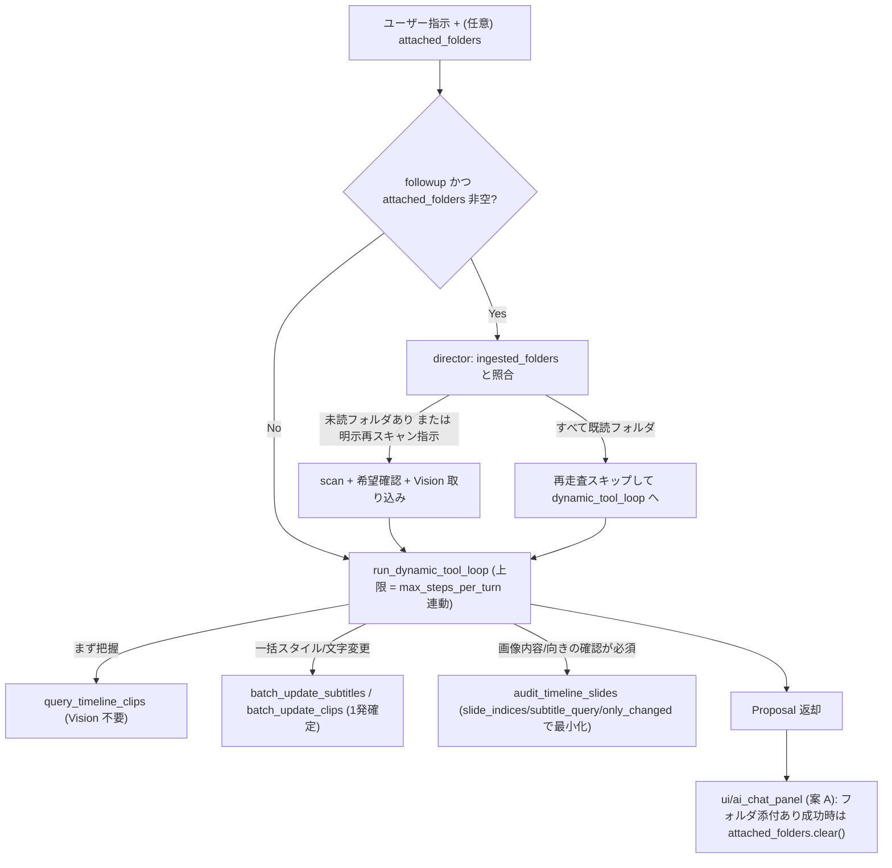

# [018] エージェントハーネス高度化設計書（決定論バルク編集・軽量クエリ・選別＆キャッシュ監査・既読フォルダ保護）

- **ステータス**: Draft
- **作成日**: 2026-11-25
- **更新日**: 2026-11-28
- **関連ドキュメント**:
  - 自律エージェントプラグイン基盤＆構成コンパイラ設計書（完了済み）: [`completed/012-agentic-plugin-architecture.md`](completed/012-agentic-plugin-architecture.md)
  - 外部プラグイン向け SDK・プロトコル互換性ポリシー: [`011-plugin-protocol-compatibility-policy.md`](011-plugin-protocol-compatibility-policy.md)
  - AI プラグイン・MCP 利用ガイド: [`../docs/plugins/ai-and-mcp.md`](../docs/plugins/ai-and-mcp.md)
  - 関連先行設計（`main` へ統合済み）: [`completed/015-ai-activity-ui-and-early-ask.md`](completed/015-ai-activity-ui-and-early-ask.md)・[`completed/016-ai-vision-audit-exif-and-token-compression.md`](completed/016-ai-vision-audit-exif-and-token-compression.md)・[`completed/017-editor-ux-timeline-follow-preview-backdrop-json-hl.md`](completed/017-editor-ux-timeline-follow-preview-backdrop-json-hl.md)

---

## 1. 概要・目的

- **この機能で解決したい課題・達成したいこと**:
  現在の自律編集エージェント（`sea-agent-director` ＋ 本体側 `HostToolRegistry`）は、大量クリップへの一括ルール適用や後続ターンでの局所確認において、以下のハーネス上のボトルネックを抱えています。
  1. **大量クリップの一括編集で変更 0 件・取りこぼし・ステップ上限到達が起きる**:
     「すべての字幕に青縁 4px・文字サイズ 54px 以上・先頭の `20xx年、` 削除」のようなルールベース一括変更を頼んだ際、現状は LLM が `apply_draft_edit_command` 向けに 36〜100 個以上の `EditCommand::SetParameter` JSON を手書き展開する必要があり、途中でツール反復上限（`MAX_DYNAMIC_TOOL_STEPS = 12`）や出力崩れにより **変更 0 件** になる事例が発生しています。
  2. **字幕スタイル修正だけの指示でも初回フォルダ取り込み（102 枚走査・確認カード・Vision）が再発火する**:
     初回制作後もチャット入力欄に `attached_folders` が残ったまま毎ターン送信され、`director.rs` が `!attached_folders.is_empty()` で無条件に `ingest_folders_and_vision` を呼ぶため、後続指示のたびに不要な走査・質問・約 10 分の待ち時間が発生します。
  3. **Vision 不要な確認と局所監査の効率が悪い**:
     字幕の文字サイズ・縁取り・特定語句を調べるだけでもテキスト特化の軽量クエリツールがなく、また `audit_timeline_slides` に柔軟な絞り込みフィルタやセッション内監査キャッシュが無いため、毎回のフォローアップで全スライドを再監査しがちです。
  4. **設定画面の `max_steps_per_turn`（無制限 / 20 / 50）とプラグイン側ステップ上限が連動していない**:
     ホスト側設定で「無制限」等を選んでも `director.rs` 側が固定値 `12` で打ち切るため、設定と実挙動が乖離しています。

- **本設計で達成するゴール**:
  LLM に「150 個の生 JSON を手書きさせる／毎回全画像を送り直す」設計から、**「LLM は意図・フィルタ条件・対象選別だけを決め、大量更新・集計・検証・キャッシュは Rust ホストが決定論的に 1 発で実行する」** 理想的なハーネスへ引き上げます。

### 1.1 実コード確認結果（現状箇所）

- [`src/ui/ai_chat_panel.rs`](../src/ui/ai_chat_panel.rs): 初回構成適用後も `AiChatState::attached_folders` が自動クリアされず、フォローアップのたびに `send_follow_up` へ同フォルダが再送される。
- [`plugins_src/sea-agent-director/src/director.rs`](../plugins_src/sea-agent-director/src/director.rs):
  - `DirectorSession::handle_follow_up` が `!attached_folders.is_empty()` だけで即 `ingest_folders_and_vision` を呼び出す。
  - `run_dynamic_tool_loop` の上限が定数 `MAX_DYNAMIC_TOOL_STEPS = 12` に固定されており、ホスト設定 `runtime_settings.max_steps_per_turn` が渡っていない。
- [`src/ai/toolbox.rs`](../src/ai/toolbox.rs): タイムライン変更ツールが個別コマンド手書き型の `compile_movie_blueprint` と `apply_draft_edit_command` のみで、フィルタ条件付きの一括更新ツール・軽量クリップクエリツールが存在しない。
- [`src/ai/vision_audit.rs`](../src/ai/vision_audit.rs): `execute_audit_timeline_slides` は `slide_indices` による絞り込みはあるものの、`clip_ids`・`time_range_frames`・`subtitle_query`・差分/キャッシュ機構を持たない。
- [`src/timeline/command.rs`](../src/timeline/command.rs)・[`src/media/visual_properties.rs`](../src/media/visual_properties.rs):
  - `ParameterPath` には `SubtitleText`, `SubtitleFontFamily`, `SubtitleFontSize`, `SubtitleTextColor`, `SubtitleOutlineColor`, `SubtitleOutlineWidth`, `SubtitleAlignment`, `X`, `Y`, `ScaleX`, `ScaleY`, `RotationDeg`, `Opacity` 等が定義済みで、`EditCommand::Batch` による単一 Undo 適用が可能。

---

## 2. スコープ

> [!NOTE]
> **用語区分（リポジトリ規約準拠）**:
> - **機能モジュール（Feature Module）**: `sea-movie-creator` 本体に組み込まれる [`src/ai/bulk_edit.rs`](../src/ai/bulk_edit.rs)（新設）、[`src/ai/timeline_query.rs`](../src/ai/timeline_query.rs)（新設）、[`src/ai/vision_audit.rs`](../src/ai/vision_audit.rs)、[`src/ai/toolbox.rs`](../src/ai/toolbox.rs)、[`src/ai/agent_host.rs`](../src/ai/agent_host.rs)、[`src/ai/mod.rs`](../src/ai/mod.rs)、[`src/ui/ai_chat_panel.rs`](../src/ui/ai_chat_panel.rs)、[`Cargo.toml`](../Cargo.toml)。
> - **プロトコル / プラグイン（Plugin）**: 着脱可能な外部エージェントプロトコルと基準プラグインである [`plugins_src/sea-agent-protocol/src/lib.rs`](../plugins_src/sea-agent-protocol/src/lib.rs) および [`plugins_src/sea-agent-director/src/director.rs`](../plugins_src/sea-agent-director/src/director.rs)。

### 対象（In Scope）

1. **決定論バルク編集ツール（`batch_update_subtitles` / `batch_update_clips`）** の新設（[`src/ai/bulk_edit.rs`](../src/ai/bulk_edit.rs)・[`src/ai/toolbox.rs`](../src/ai/toolbox.rs)）。
2. **軽量テキストクエリ＆集計ツール（`query_timeline_clips`）** の新設（[`src/ai/timeline_query.rs`](../src/ai/timeline_query.rs)・[`src/ai/toolbox.rs`](../src/ai/toolbox.rs)）。
3. **`audit_timeline_slides` の選別フィルタ拡張＋セッション内 Vision 監査キャッシュ**（[`src/ai/vision_audit.rs`](../src/ai/vision_audit.rs)・[`src/ai/agent_host.rs`](../src/ai/agent_host.rs)）。
4. **案 A（初回取り込み完了後のフォルダ添付自動解除）＋既読フォルダ再走査ガード＋ステップ上限連動＋連続エラーガード＋3 段階ルーティングプロンプト**（[`src/ui/ai_chat_panel.rs`](../src/ui/ai_chat_panel.rs)・[`plugins_src/sea-agent-protocol/src/lib.rs`](../plugins_src/sea-agent-protocol/src/lib.rs)・[`plugins_src/sea-agent-director/src/director.rs`](../plugins_src/sea-agent-director/src/director.rs)）。

### 対象外（Out of Scope）

- `EditCommand` / `ProjectDocument` プロジェクト保存フォーマット（`.seaproj` v1）自体のスキーマ変更。
- `sea_agent_v1` 以外の外部プラグイン（`sea-export-*` / `sea-ai-*` / `sea-audio-host`）の改造。
- Vision LLM のプロンプト設計そのものの再編（既存のコンタクトシート方式・2 段階確認を維持）。

---

## 3. 要件・制約

### 機能要件

- **FR-1（決定論バルク編集＆事後定量検証）**:
  - 複数の字幕クリップに対するスタイル統一（最小／最大／固定フォントサイズ、フォント名、文字色、縁取り色、縁取り幅、揃え、位置、不透明度）とテキスト一括置換（正規表現・部分一致・空白トリム）を、LLM の 1 回のツール呼び出しで `EditCommand::Batch`（単一 Undo 単位）へ展開して `DraftSandbox` に適用できること。
  - 画像・動画・音声・字幕の共通プロパティ（座標・スケール・回転・不透明度・色調・音量・ミュート等）も同様に `batch_update_clips` で一括・条件付き更新できること。
  - 適用直後に **定量検証サマリ**（一致件数・変更件数・未変更件数・変更後最小フォントサイズ／最小縁取り幅・条件未達残件数）をツール戻り値として返し、LLM が更新漏れ・ルール違反を即座に検知できること。
- **FR-2（Vision 非依存の軽量クエリ・集計）**:
  - `query_timeline_clips` により、Vision API を一切呼ばずに全クリップ／字幕のスタイル統計（例：`font_size < 54` の件数、`outline_width == 0` の件数）、文字一致・正規表現一致、非直交回転や縦横比情報、時間範囲検索を数ミリ秒で取得できること。
- **FR-3（`audit_timeline_slides` の選別監査＋キャッシュ）**:
  - `clip_ids`・`time_range_frames`・`subtitle_query` により、ユーザー指示や `query_timeline_clips` の結果に基づく **必要スライドのみ** を選別して Vision 監査できること。
  - セッション内の `VisionAuditCache` により、画像ファイル（パス・サイズ・更新日時）・回転角・重複字幕テキスト・監査観点が変わっていないスライドは Vision API を再呼び出しせず即座に再利用でき、`only_changed: true` で未監査／変更スライドだけを抽出し、`force_refresh: true` で強制再監査できること。
- **FR-4（案 A フォルダ添付解除・既読フォルダ保護・ステップ上限連動）**:
  - **案 A**: フォルダ添付を伴う初回／追加取り込みターンで `Proposal` が正常返却された時点で入力欄の `attached_folders` を自動解除すること（エラー・キャンセル・質問待機中は再試行できるよう保持）。
  - すでに走査済みのフォルダが再送されたフォローアップでも、明示的な再スキャン指示が無い限り `ingest_folders_and_vision` を再起動しないこと。
  - `runtime.max_steps_per_turn` を `sea-agent-director` の `run_dynamic_tool_loop` 上限へ連動させ、同一ツールの連続同種エラーを検知したら無限リトライせず別手段またはユーザー確認へ切り替えること。

### 非機能要件（パフォーマンス・互換性・セキュリティ）

- **ReDoS 防御**: 正規表現には `regex::RegexBuilder` でコンパイルサイズ上限・DFA サイズ上限を設定し、バックトラッキング爆発を構造的に防止する（Rust `regex` クレートは有限オートマトン採用で指数時間バックトラッキングなし。導入時は `cargo deny check` にてライセンス・依存整合性を確認）。
- **後方互換性（011 ポリシー準拠）**: `sea_agent_v1` の `HostToAgentMessage::{StartTask, ResumeSession, FollowUp}` へ追加する `max_steps_per_turn` は `#[serde(default, skip_serializing_if = "Option::is_none")]` とし、旧バイナリ間通信を破壊しない。
- **安全性**: 新設・変更コードはすべて `unsafe` 不使用（`unsafe_code = "deny"` 維持）、パニック系マクロ禁止。

---

## 4. アーキテクチャ / 設計詳細

### 4.1 柱 1: 決定論バルク編集モジュール（`src/ai/bulk_edit.rs`）

#### 提供ツール 1: `batch_update_subtitles`（`ToolSafetyClass::DraftMutation`）
1. **入力スキーマ構造**:
   - `filter`（`SubtitleBatchFilter`・すべて任意、未指定時は全字幕クリップ対象）:
     - `layer_ids: Option<Vec<String>>` / `layer_names: Option<Vec<String>>`
     - `clip_ids: Option<Vec<String>>`
     - `include_name_prefixes: Option<Vec<String>>` / `exclude_name_prefixes: Option<Vec<String>>`（例：`["Year "]` を除外して年号表示を守る）
     - `text_contains: Option<String>` / `text_regex: Option<String>`
     - `time_range_frames: Option<{ start: u64, end: u64 }>`（区間重なり判定）
   - `style`（`SubtitleStylePatch`・指定されたフィールドのみ更新）:
     - `font_size: Option<f64>`（絶対値に統一、`AnimatedParameter::Constant` 設定）
     - `min_font_size: Option<f64>` / `max_font_size: Option<f64>`（クランプ更新）
     - `font_family: Option<String>`
     - `text_color: Option<FlexibleColor>` / `outline_color: Option<FlexibleColor>`
     - `outline_width: Option<f64>`（`0.0..=32.0` 等へ検証クランプ）
     - `alignment: Option<TextAlignment>`（`"left"` / `"center"` / `"right"`）
     - `x: Option<f64>` / `y: Option<f64>` / `opacity: Option<f64>`
   - `text_transforms`（`Vec<SubtitleTextTransform>`・記載順に適用）:
     - `LiteralReplace { find: String, replace: String }`
     - `RegexReplace { pattern: String, replace: String }`
     - `Trim`
   - `allow_empty_text: bool`（既定 `false` — 置換後に空文字または空白のみになる場合はそのクリップの文字置換を拒否／エラー計上して字幕消失を防ぐ）
   - `dry_run: bool`（既定 `false` — `true` の場合は `DraftSandbox` を変更せず影響件数とプレビュー差分のみ返す）
   - **ロック保護・事前バリデーション（Sandbox 変更前に検証）**:
     - `layer.locked == true` 上のクリップは変更せず、`skipped` へ `{ clip_id, reason: "locked_layer" }` として記録する。
     - `font_size` と `min_font_size`/`max_font_size` の併用、`min_font_size > max_font_size`、非有限浮動小数点（`NaN` / `inf`）、`font_size <= 0.0`、`outline_width < 0.0`、`opacity` の `0.0..=1.0` 範囲外、`LiteralReplace { find: "" }`、`text_transforms.len() > 16` はいずれも `Err(...)` を即時返却し、`DraftSandbox` を一切変更しない。

2. **`AnimatedParameter` への `min_font_size` / `max_font_size` 適用ルール**:
   - `Constant { value }` → `value.clamp(min, max)`
   - `Easing { start_value, end_value, .. }` → 始点・終点をともにクランプ
   - `Keyframes { keyframes, .. }` → 各キーフレーム `kf.value` をクランプ
   - `Expression { .. }` → 数式を破壊しないようスキップし、戻り値の `skipped` リストへ `{ clip_id, reason: "animated_expression_preserved" }` を記録。

3. **柔軟カラーパーサ（LLM の表記揺れ耐性）**:
   - LLM が指定しがちな 4 形式をすべて受け入れ `RgbaColor`（`0.0..=1.0`）へ正規化：
     1. 配列 `[r, g, b]` / `[r, g, b, a]`（各値がすべて `<= 1.0` なら `0.0..=1.0`、それ以外の整数表記 `> 1.0 && <= 255.0` を含む場合は `/ 255.0` 自動正規化）
     2. CSS Hex 文字列 `"#RRGGBB"` / `"#RRGGBBAA"`
     3. オブジェクト `{"r": ..., "g": ..., "b": ..., "a": ...}`
     4. 代表色名エイリアス（`"white"`, `"black"`, `"blue"`, `"red"`, `"yellow"`, `"green"`, `"transparent"`）

4. **定量検証サマリ付き返却 JSON**:
   ```json
   {
     "dry_run": false,
     "matched_count": 38,
     "updated_count": 38,
     "unchanged_count": 0,
     "command_count": 114,
     "skipped": [],
     "sample_changes": [
       { "clip_id": "c_sub_1", "name": "Sub #1", "before_text": "2005年、桜", "after_text": "桜", "font_size": 54.0, "outline_width": 4.0 }
     ],
     "post_check": {
       "total_matched_subtitles": 38,
       "min_font_size_after": 54.0,
       "max_font_size_after": 60.0,
       "below_requested_min_font_size_count": 0,
       "min_outline_width_after": 4.0,
       "zero_outline_width_count": 0
     }
   }
   ```
   - 実際に値が変化したプロパティだけ `EditCommand::SetParameter` を生成し、変更ゼロ時は `DraftSandbox::apply_command` への無駄な空バッチ投入を行わない。
   - **`post_check` における `AnimatedParameter` の評価基準**（`query_timeline_clips` と共通）:
     - `Constant { value }` → `min = max = value`
     - `Easing { start_value, end_value, .. }` → `min = start_value.min(end_value)`、`max = start_value.max(end_value)`
     - `Keyframes { keyframes, .. }` → 全キーフレーム値の最小・最大（空配列は評価対象外）
     - `Expression { .. }` → 静的数値集計から除外して別途 `expression_font_size_count`（クエリ詳細行では `font_size: null`, `font_size_is_expression: true`）として計上し、`below_requested_min_font_size_count` や `font_size_lt` 判定は全非数式字幕の `min < threshold`（区間のどこかで基準未満になるか）で厳密判定する。

#### 提供ツール 2: `batch_update_clips`（`ToolSafetyClass::DraftMutation`）
- 字幕以外のクリップ（画像・動画・音声・字幕の共通パラメータ）を一括変更したい場合用。
  - フィルタ: `kind`（`"all" | "image" | "video" | "audio" | "subtitle"`）、`clip_ids`, `layer_ids`, `name_contains`, `include_name_prefixes`, `exclude_name_prefixes`, `time_range_frames`
  - パッチ: `x`, `y`, `scale_x`, `scale_y`, `rotation_deg`, `rotation_delta_deg`, `opacity`, `brightness`, `contrast`, `saturation`, `hue_deg`, `gamma`, `gain_db`, `pan`, `audio_muted`
  - 規則:
    - `rotation_deg` と `rotation_delta_deg` の同時指定は不可（`Err(...)`）。
    - `rotation_delta_deg` は `Constant` / `Easing` / `Keyframes` の各値へ加算後に `normalize_signed_deg` で `(-180.0, 180.0]` へ正規化し、`Expression` は `"animated_expression_preserved"` として `skipped` に記録する。
    - `layer.locked == true` 上のクリップは `"locked_layer"` として `skipped` に記録し変更しない。
    - **異種クリップ混在時の非対応パラメータ処理**: `kind: "all"` 等で異なる種別のクリップが混在し、対象外パラメータ（例：`Image` / `Subtitle` に対する音声用 `gain_db` / `pan` / `audio_muted`、`Audio` に対する映像用 `x` / `y` / `scale_*` / `rotation_*` / `opacity` / 色調）が含まれる場合、全体エラーにはせず非対応クリップ（または非対応フィールド適用不可クリップ）を `skipped` へ `{ clip_id, reason: "unsupported_parameter_for_clip_kind" }` として隔離し、対応クリップのみ安全に適用する（適用可能クリップが 0 件の場合は `updated_count: 0` と `skipped` 内訳を返却）。
  - 全対象を 1 つの `EditCommand::Batch` として `DraftSandbox::apply_command` へ適用し、変更件数・スキップ詳細を返却する。

---

### 4.2 柱 2: 軽量テキストクエリ＆集計ツール（`src/ai/timeline_query.rs`）

#### 提供ツール: `query_timeline_clips`（`ToolSafetyClass::ReadOnly`、Vision API コスト 0）
- 現在の `DraftSandbox::draft_document()` を走査し、以下を実行する：
  - **フィルタ条件**:
    - `kind`: `"all" | "subtitle" | "image" | "video" | "audio"`（既定 `"all"`）
    - `layer_ids`, `layer_names`, `clip_ids`
    - `name_contains`, `text_contains`, `text_regex`
    - `font_size_lt: Option<f64>` / `outline_width_lt: Option<f64>`（規定未達クリップの即時特定用）
    - `time_range_frames: Option<{ start: u64, end: u64 }>`（`start < end` を検証し半開区間 `[start, end)` の重なりで判定）
    - `limit: usize`（既定 `50`, 上限 `200`）
    - ※ `text_regex` には `bulk_edit.rs` と共通の `RegexBuilder` サイズ／DFA 上限を適用し、不正・上限超過パターンは `Err(...)` を返す。
  - **集計サマリ (`summary`)**:
    - `total_clips_in_timeline`, `matched_count`, `returned_count`
    - 字幕統計（該当字幕が 1 件以上ある場合）: `min_font_size`, `max_font_size`, `outline_widths_distinct`（代表値一覧）, `outline_zero_count`, `expression_font_size_count`（静的集計には上記 `AnimatedParameter` 最小/最大評価ルールを適用）
    - スライド統計: `total_image_slides`
  - **詳細行 (`clips`)**:
    - 共通: `clip_id`, `name`, `kind`, `layer_id`, `layer_name`, `start_frame`, `end_frame`, `slide_index`（画像スライド番号 `1..N`、該当しない場合は `null`）
    - 字幕時: `text`, `font_family`, `font_size`（`Expression` 時は `null`＋`font_size_is_expression: true`、動的イージング／キーフレーム時は最小・最大または評価代表値）, `outline_width`, `outline_color_hex`, `text_color_hex`, `y`
    - 画像・動画時: `asset_name`, `asset_width`, `asset_height`, `rotation_deg`, `scale_x`, `scale_y`

---

### 4.3 柱 3: `audit_timeline_slides` の選別拡張＋セッション内監査キャッシュ

#### 選別引数の拡張（[`src/ai/toolbox.rs`](../src/ai/toolbox.rs)・[`src/ai/vision_audit.rs`](../src/ai/vision_audit.rs)）
既存の `slide_indices`, `check_subtitle_mismatch`, `check_orientation`, `focus_hint` を維持したまま、以下の任意引数を追加する（複数フィルタ指定時は **AND 結合** とし、応答内の `total_slides` は常にタイムライン全体の実スライド数を維持する）：
- `clip_ids: Option<Vec<String>>` — 指定画像クリップ ID に対応するスライドのみ監査
- `time_range_frames: Option<{ start: u64, end: u64 }>` — `start < end` を検証し半開区間 `[start, end)` と重なるスライドのみ監査
- `subtitle_query: Option<String>` — 重なっている字幕テキストに部分一致するスライドのみ監査（例：`"りんご飴"` が付いているスライドだけ見たいとき 102 枚中 1 枚だけを監査可能）
- `use_cache: bool`（既定 `true`）— セッション内キャッシュを利用
- `only_changed: bool`（既定 `false`）— キャッシュに一致エントリがあるスライドを監査リストから除外し、未監査または変化したスライドだけを実行・返却する
- `force_refresh: bool`（既定 `false`）— キャッシュを無視して Vision 再実行しキャッシュを上書き更新
- **フラグ優先順位**: `force_refresh: true` は `use_cache` および `only_changed` より優先され常に全対象を再監査する。また `use_cache: false` 指定時はキャッシュ参照（および `only_changed` によるスキップ）を無効化する。

#### `VisionAuditCache` 設計（[`src/ai/vision_audit.rs`](../src/ai/vision_audit.rs)・[`src/ai/agent_host.rs`](../src/ai/agent_host.rs)・[`src/ai/toolbox.rs`](../src/ai/toolbox.rs)）
- **保持場所と受け渡し経路**:
  - `CoordinatorState::vision_audit_cache: VisionAuditCache`（常駐セッション単位で保持・最大 256 エントリ FIFO/LRU 上限）として保持する。
  - `AiProvider` トレイト自体は現在アクティブなモデル名を保持しないため、`ToolExecutionContext` に `pub llm_model_name: Option<&'a str>` および `pub vision_audit_cache: Option<&'a mut VisionAuditCache>` を追加し、`CoordinatorState::execute_registered_tool` から `llm_model_name: Some(self.model_name.as_str())` を明示的に引き渡す。
  - `CoordinatorMsg::UpdateRuntime` でプロバイダ／モデルが変更された場合は、キャッシュキーの `provider_id + model_name` が変わることで自動的にミスする設計とし（既存エントリは 256 件上限で順次 eviction され、旧モデルへ戻した際の再キャッシュヒットも維持）、明示的な `clear()` 併用も許容する。
- **キャッシュ対象（生 LLM 判定のみ保持）**: 最終出力 JSON ではなく生 LLM 判定である `ParsedAuditItem` のみをキャッシュする。出力構築時の `recommended_rotation_deg`・`recommended_scale_x_param` / `recommended_scale_y_param`・`companion_backdrop_updates` は毎回最新の `DraftSandbox::draft_document()` から決定論的に再計算するため、他クリップ変更後の出力値陳腐化が起きない。
- **キャッシュキー（決定論スナップショット）**:
  - `provider_id: String` + `model_name: String`（`ctx.llm_model_name.unwrap_or(provider.id())` を用いてセッション途中のモデル切替による誤再利用を防止）
  - `canonical_asset_path: String`
  - `file_len_bytes: u64` + `file_modified_epoch_nanos: Option<u128>`
  - `pre_rotation_deg: Option<i32>`（現在タイムライン上の回転角）
  - `overlapping_subtitles_digest: String`（重複字幕の `clip_id + text` 列を結んだ決定論文字列／ハッシュ）
  - `check_subtitles: bool` + `check_orientation: bool` + `focus_hint: String`
- **返却形式の拡充**:
  - キャッシュから取得したアイテムには `"cached": true` を付与（新規 Vision 実行分は `"cached": false`）。
  - 戻り値トップレベルに `"cache_hit_count"`, `"vision_api_called_count"` を追加し、LLM・ログ双方でトークン節約効果を可視化する。

---

### 4.4 柱 4: 案 A（フォルダ添付自動解除）・既読フォルダ保護・ステップ上限＆ルーティング改善



1. **案 A（UI 側フォルダ添付チップ自動解除: [`src/ui/ai_chat_panel.rs`](../src/ui/ai_chat_panel.rs)）**:
   - エージェント送信開始時（`start_agent_prompt_with_provider`）に「このターンで `attached_folders` を送信したか（送信時フォルダ一覧スナップショット等）」を `AiChatState` に記録する。
   - `handle_agent_proposal_event` で `Proposal` が届いた際、そのターンがフォルダ取り込みを完了していた場合（かつ現在の `attached_folders` が送信時と一致している場合）は `self.ai_chat.attached_folders.clear()` を実行し、ステータス／システム注記で「取り込み済みフォルダの添付を解除しました（編集・監査はプロジェクト内素材から継続可能）」と案内する。
   - **安全ガード**: 送信後にユーザーが手動で別フォルダへ変更していた場合や、`AgentError` / `Cancel` で中断した場合は `attached_folders` を消さず、そのままワンクリックで再試行できるようにする。

2. **多層防御（プラグイン側既読フォルダ保護: [`plugins_src/sea-agent-director/src/director.rs`](../plugins_src/sea-agent-director/src/director.rs)）**:
   - `DirectorMemory` に `#[serde(default)] pub ingested_folders: Vec<String>` を追加。
   - `scan_attached_folders` 完了時にフォルダパスを正規化（`canonicalize` 可能なら正規パス、失敗時は `trim` パス。Windows 環境では大文字・小文字を区別せず同一判定）したうえで `ingested_folders` へ重複なく記録する。
   - `DirectorSession::handle_follow_up` では、渡された `attached_folders` のうち同正規化基準で **未取り込み（`!ingested_folders.contains(...)`）のものだけ** を抽出し、すべて既読かつプロンプトに明示的な再スキャン語（「再スキャン」「フォルダ再読込」「新しい写真を追加」等）が無ければ `ingest_folders_and_vision` をスキップする。

3. **ステップ上限連動（[`plugins_src/sea-agent-protocol/src/lib.rs`](../plugins_src/sea-agent-protocol/src/lib.rs)・[`src/ai/agent_host.rs`](../src/ai/agent_host.rs)・[`plugins_src/sea-agent-director/src/director.rs`](../plugins_src/sea-agent-director/src/director.rs)）**:
   - `HostToAgentMessage::{StartTask, ResumeSession, FollowUp}` へ以下を追加（後方互換）：
     ```rust
     /// 1 ターンあたりのツール対話ステップ上限（`0` はホスト設定上の無制限扱い）。
     #[serde(default, skip_serializing_if = "Option::is_none")]
     pub max_steps_per_turn: Option<u32>,
     ```
   - `CoordinatorState` は `StartTask` / `ResumeSession` に加えて毎回の `FollowUp` でも最新の `runtime_settings.max_steps_per_turn` を送出し、セッション途中の `UpdateRuntime` 設定変更が次ターンから即時反映されるようにする。
   - **ホスト側・プラグイン側のステップ定義整合（案 1 採用）**:
     - `CoordinatorState::check_step_budget()`（[`src/ai/agent_host.rs`](../src/ai/agent_host.rs)）の `turn_step_count` は **LLM 呼び出し（`handle_llm_chat`）単位のみ** をカウントする定義へ見直し、`director.rs` 側の `run_dynamic_tool_loop` 反復上限と 1:1 で一致させる。
     - これにより、1 反復内で `handle_llm_chat` と複数回の `handle_call_tool` を実行してもホスト側が先に `max_steps_exceeded` で強制終了せず、プラグイン側の最終ステップ（`step + 1 == max_steps` で `ask_user` 除外）による安全収束へ確実に到達できる。
     - `handle_call_tool` の暴走防止用には別カウンタ `turn_tool_call_count`（上限 `max(effective_steps * 4, 160)` 程度）を設けて安全側の上限も維持する。
   - `director.rs` の `effective_dynamic_tool_steps(configured: Option<u32>) -> u32`:
     - `Some(0)`（「無制限」選択時）→ 安全側サーキットブレーカ付き上限 `40`
     - `Some(n)` → `n.clamp(4, 100)`
     - `None` → `20`（従来の 12 から引き上げ、バルク編集の余地を確保）
   - 算出された `max_steps` はツールループ反復回数だけでなく、最終ステップでの `ask_user` 除外条件（`step + 1 < max_steps`）および実行時 `ask_user` スキップガード（`step + 1 >= max_steps`）の双方へ一貫して適用する。
   - **連続同一エラーガード**: `(tool_name, normalized_error)` を追跡し、同じ失敗が 3 回連続したら即座にツールループの無意味なリトライを止め、LLM へ「別ツールを使うか `ask_user` で確認せよ」と注記する（バルク編集系でスキーマミスを繰り返す暴走を防止）。

4. **システムプロンプト（`build_followup_system_prompt`）の 3 段階ルーティング指針**:
   - ルール 1: 「まず編集対象や現状値を正確に把握したいときは `query_timeline_clips` を呼ぶこと（高速・Vision 不要）」。
   - ルール 2: 「複数またはすべての字幕のスタイル統一（文字サイズ・縁取り色/太さ・フォント・色・位置）やテキスト一括置換には、個別に `apply_draft_edit_command` を連打せず **必ず `batch_update_subtitles`**（または `batch_update_clips`）を使うこと。年号等の独立ラベルを残したい場合は `exclude_name_prefixes` や `layer_names` を適切に使うこと」。
   - ルール 3: 「`audit_timeline_slides` は画像内容や向きの確認が必要な場合のみ呼び出し、番号・時間帯・キーワードが特定できる場合は `slide_indices` / `clip_ids` / `subtitle_query` / `only_changed: true` で必要最小限に絞り込むこと」。

---

## 5. インターフェース / API 仕様

- `src/ai/bulk_edit.rs`:
  - `pub fn execute_batch_update_subtitles(args: &Value, ctx: &mut ToolExecutionContext<'_>) -> Result<Value, String>`
  - `pub fn execute_batch_update_clips(args: &Value, ctx: &mut ToolExecutionContext<'_>) -> Result<Value, String>`
- `src/ai/timeline_query.rs`:
  - `pub fn execute_query_timeline_clips(args: &Value, ctx: &ToolExecutionContext<'_>) -> Result<Value, String>`
- `src/ai/vision_audit.rs`:
  - `pub struct VisionAuditCache`（`new`, `len`, `clear`, `invalidate_all`）
  - `execute_audit_timeline_slides` は `clip_ids`, `time_range_frames`, `subtitle_query`, `use_cache`, `only_changed`, `force_refresh` を追加受理。
- `plugins_src/sea-agent-protocol/src/lib.rs`:
  - `HostToAgentMessage::{StartTask, ResumeSession, FollowUp}` に任意フィールド `max_steps_per_turn: Option<u32>` を追加。
- `src/ai/toolbox.rs`:
  - `ToolExecutionContext<'a>` に `pub llm_model_name: Option<&'a str>` および `pub vision_audit_cache: Option<&'a mut VisionAuditCache>` を追加（`CoordinatorState::execute_registered_tool` から渡す）。
  - 登録ツール名：
    - `query_timeline_clips`（`ReadOnly`）
    - `batch_update_subtitles`（`DraftMutation`）
    - `batch_update_clips`（`DraftMutation`）

---

## 6. エラーハンドリング・エッジケース

- **空文字列への字幕置換防止**: `regex_replace` / `literal_replace` / `trim` の結果テキストが空文字になるクリップが存在し、かつ `allow_empty_text == false` の場合、そのクリップのテキスト変更のみを拒否して `skipped`（`"empty_subtitle_text_blocked"`）へ計上し、字幕データ消滅を防ぐ（スタイル変更は独立して適用可）。
- **不正な正規表現 / ReDoS**: `RegexBuilder::new(pattern).size_limit(1 << 20).dfa_size_limit(1 << 20).build()` で失敗時は `Err("invalid regex pattern ...")` を即返却し、Sandbox を一切変更しない。
- **`AnimatedParameter::Expression` を持つサイズ・座標**: 数値範囲クランプ（`min_font_size` 等）やデルタ加算時に数式表現が壊れないよう上書きせず、`skipped` として明示報告する（`font_size` 明示指定時は意図的上書きとして許可または設定方針に従う）。
- **不正な色表現・範囲外値**: パース不能な色文字列／配列は `Err(...)` を返却し部分適用を残さない。`outline_width < 0.0` や `font_size <= 0.0` はバリデーションエラーにする。
- **フィルタ一致 0 件**: エラーにせず `matched_count: 0, updated_count: 0` を正常返却し、LLM が「フィルタ条件（例：`text_contains` や `exclude_name_prefixes`）が厳しすぎた」と判断して即座に条件を見直せるようにする。
- **キャッシュの陳腐化**: `audit_timeline_slides` 呼び出し前段で既に `DraftSandbox` に積み上がった回転変更や字幕変更がある場合でも、`build_timeline_slide_pairs(&doc)` が **Sandbox の最新 `draft_document()`** から回転角・重複字幕テキストを読むため、前の変更とずれた古いキャッシュを返すことはない。
- **案 A のキャンセル／エラー時挙動**: 初回取り込み中にレート制限・認証エラー・手動キャンセルで `Proposal` に到達しなかった場合、`attached_folders` はクリアされず再試行可能。またユーザーが「あとから別フォルダの写真を追加したい」場合は通常通り「フォルダ」ボタンから再添付できる。
- **日本語・多バイト文字の正規表現置換**: Rust `regex` クレートにより UTF-8 安全（例：`^\d{4}年[、,\s]*` や `^20\d{2}年[、,\s]*` で確実に先頭年号を除去可能）。`Cargo.toml` へ `regex` を追加するため、`cargo deny check`（ライセンス MIT/Apache-2.0 確認）を必ず実施する。

---

## 7. テスト計画・受け入れ基準

### 段階的実装プラン（Phase 分割）
- **Phase 1（ホスト軽量クエリ＆決定論バルク編集）**:
  - `Cargo.toml` に `regex` 追加、`src/ai/timeline_query.rs`・`src/ai/bulk_edit.rs`・`src/ai/toolbox.rs` 実装。
- **Phase 2（`audit_timeline_slides` 選別フィルタ＆セッションキャッシュ）**:
  - `src/ai/vision_audit.rs` 拡張、`src/ai/agent_host.rs` の `CoordinatorState` に `VisionAuditCache` 保持・引き渡し。
- **Phase 3（案 A フォルダ解除・プロトコル／ディレクタ連動・プロンプト強化）**:
  - `plugins_src/sea-agent-protocol/src/lib.rs`、`plugins_src/sea-agent-director/src/director.rs`、`src/ai/agent_host.rs`、`src/ui/ai_chat_panel.rs` の更新。
- **Phase 4（結合テスト・設計書完了整理・ドキュメント更新）**:
  - `tests/phase_agent_director/` 結合テスト追加、`docs/plugins/ai-and-mcp.md` 更新、`dev-doc/completed/` 移動＆`pre-pr` ゲート全通過。

### 単体テスト・結合テスト（画面を出さない軽量テスト）
- **`src/ai/bulk_edit.rs` 単体テスト**:
  - 字幕 40 件に対し `exclude_name_prefixes: ["Year "]` + `min_font_size: 54.0` + `outline_width: 4.0` + `outline_color` + `regex_replace("^20\\d{2}年[、,\\s]*", "")` を適用し、Year 以外の 38 件のみ 1 バッチで変更され `post_check.below_requested_min_font_size_count == 0` となること、さらに Undo 1 回で全 38 件が元に戻ることを検証。
  - `dry_run: true` で Sandbox が汚れないこと、`allow_empty_text: false` で空文字化が阻止されること、`FlexibleColor` の 4 形式が正しく変換されることを検証。
- **`src/ai/timeline_query.rs` 単体テスト**:
  - `font_size_lt`, `outline_width_lt`, `text_regex`, `kind` フィルタが正確な `summary` と `slide_index` を返すことを検証。
- **`src/ai/vision_audit.rs` 単体テスト**:
  - `subtitle_query` / `clip_ids` / `time_range_frames` による選別監査が対象スライドのみ Vision API を呼ぶこと。
  - 同一状態での 2 回目呼び出しがキャッシュヒット（`vision_api_called_count == 0`, `cached: true`）になり、字幕修正後または `only_changed: true` / `force_refresh: true` で期待通り再監査・スキップされることを検証。
- **`director.rs` / `agent_host.rs` / `ai_chat_panel.rs` テスト**:
  - 案 A：`Proposal` 確定で送信時 `attached_folders` がクリアされ、エラー時は残ることを検証。
  - 既読フォルダ保護：同フォルダ付き FollowUp で `ingest_folders_and_vision` がスキップされること、明示的再スキャン指示時は再走査することを検証。
  - `HostToAgentMessage` の `max_steps_per_turn` 後方互換シリアライズ、`CoordinatorState::check_step_budget()` の LLM 呼出単位カウント＋ツール別枠上限、および連続同一エラー 3 回打ち切りを検証。

### 完了条件（Definition of Done）
- `scripts/pre-pr.ps1`（`fmt` / `clippy -D warnings` / `doc -D warnings` / `build` / `test`）および `cargo deny check`（`regex` 追加分含む）がすべて警告・エラーゼロで通過すること。

---

## 8. 未決事項・検討メモ（Open Questions）

- [x] **決定済み（案 A 採用）**: 初回／追加フォルダ取り込みが `Proposal` 到達まで正常完了したら入力欄のフォルダ添付チップ（`attached_folders`）を自動解除する。加えて多層防御として `DirectorMemory::ingested_folders` による既読フォルダ再走査スキップも併用する。
- [x] **決定済み（バルク編集ツール導入）**: 大量クリップのスタイル・文字修正を LLM の個別 JSON 手書きに頼らず、`batch_update_subtitles` / `batch_update_clips` + `post_check` 定量検証サマリで決定論処理する。
- [x] **実装時確認済み (`Cargo.lock`)**: `regex = "1.13.1"`（MIT/Apache-2.0）がすでに推移依存として `Cargo.lock` に存在するため、`Cargo.toml` へ同系バージョンを直接依存として追加する際は既存ロック整合・`cargo deny check` を最終確認する。
