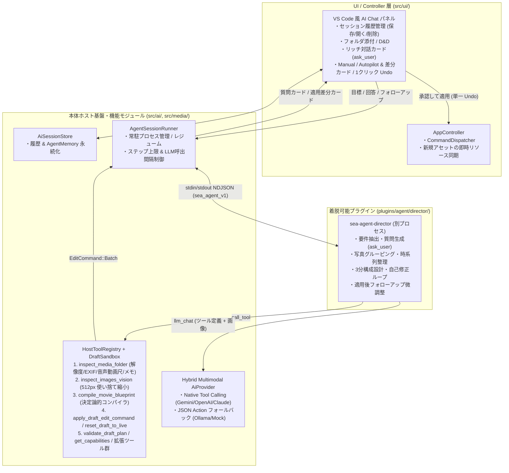
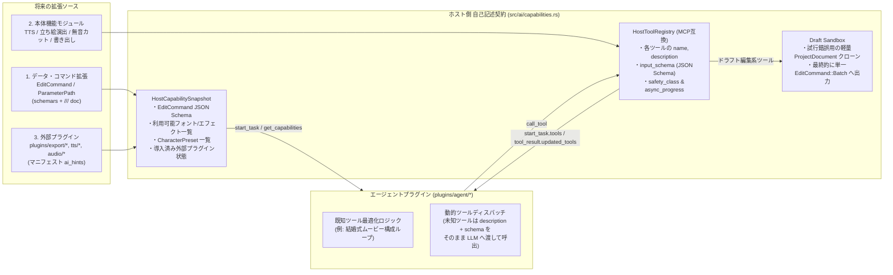
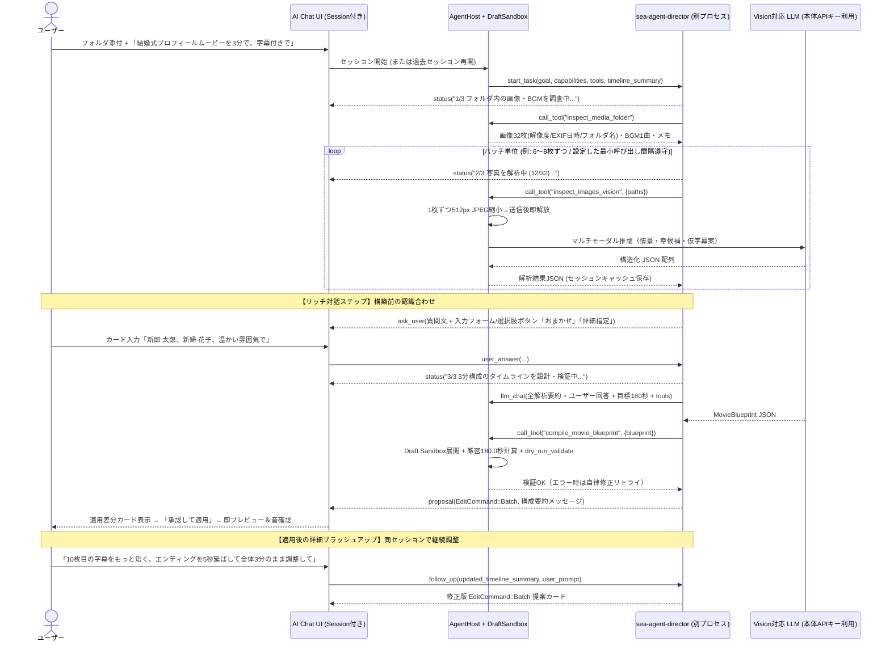

# [012] 自律エージェントプラグイン基盤＆構成コンパイラ設計書（Agentic Movie Creator Plugin）

- **ステータス**: Implemented
- **作成日**: 2026-11-18
- **更新日**: 2026-11-19
- **関連ドキュメント**:
  - 全体基本設計書（完了済み）: [`draft.md`](draft.md)
  - 初期実装設計書 Phase C（完了済み）: [`initial-implementation/PhaseC.md`](initial-implementation/PhaseC.md)
  - 機能モジュール・プラグイン開発ロードマップ: [`../loadmap/Plugin Loadmap.md`](../loadmap/Plugin%20Loadmap.md)
  - 将来拡張メモ（本機能群の次期候補）: [`../loadmap/Agent-Future-Features.md`](../loadmap/Agent-Future-Features.md)
  - AI 連携・MCP・音声プラグインガイド: [`../../docs/ai-and-plugins.md`](../../docs/ai-and-plugins.md)
  - エージェントプラグイン開発ガイド（第三者向け）: [`../../docs/plugins/agent-plugins.md`](../../docs/plugins/agent-plugins.md)

---

## 1. 概要・目的

- **解決したい課題・達成したいこと**:
  - 従来の `AI Chat` 機能（[`src/ui/ai_chat_panel.rs`](../../src/ui/ai_chat_panel.rs) / [`src/ai/plugin_host.rs`](../../src/ai/plugin_host.rs)）は、1 回の指示に対して単一の `EditCommand`（または `EditCommand::Batch`）JSON を 1 往復で返す「単発編集モデル」であった。
  - 本設計では、**「このフォルダにある画像を使って結婚式プロフィールムービーを 3 分で、適切な字幕付きで作って」** のような高レベル・複数工程の指示に対し、**VS Code 風のリッチな対話・セッション管理を備え、別プロセス型プラグインとして自律的にタイムラインを構築・詳細調整できるエージェント基盤**を実現する。
  - あわせて、今後本体機能モジュール（Phase P0〜P5 等）やサードパーティ製プラグインが増えた際にも、エージェントプラグイン側の再実装なしで AI が新機能を認識・利用できる **「4 層の自己記述・拡張契約」** を策定・実装する。
- **対象ユーザー / 利用シーン**:
  - フォルダ内の写真・BGM から指定時間（例：3 分）のプロフィールムービー／スライドショーを対話的に素早く組み立て、後から差分適用や会話で細部を仕上げたいクリエイター。
  - `sea-movie-creator` 向けに独自の自律エージェントプラグインや拡張機能を追加したいサードパーティ開発者。

---

## 2. スコープ

### 対象（In Scope）

- **本体側機能モジュール（`src/` 内・全エージェント共通基盤）**:
  - マルチモーダル LLM（テキスト＋画像パーツ）＆ハイブリッドツール呼び出し抽象化（Gemini / OpenAI / Anthropic は Native Tool Calling、Ollama / Mock 等は構造化 JSON アクションフォールバック）
  - 安全なローカルフォルダ走査・長辺 512px 使い捨てサムネイル生成・最小純粋 Rust EXIF 撮影日時読取・メディア尺取得（`src/ai/media_inspector.rs`）
  - 将来拡張を自動認識させる **4 層自己記述契約**（`HostCapabilitySnapshot`、`HostToolRegistry` / MCP 互換 `AgentTool` トレイト、`DraftSandbox`、`ToolSafetyClass`）
  - 意味的構成計画（`MovieBlueprint`）から正確なフレーム配分・A/B 2 レイヤー交互クロスフェード・縦長背景暗転額縁・Ken Burns キーフレーム・字幕・BGM フェードアウトを一貫展開する決定論的コンパイラ（`src/ai/blueprint.rs`）
  - 双方向 NDJSON ホスト（`AgentSessionRunner`）、VS Code 風セッション永続化＆再開（`AiSessionStore`）、`AppController` の AI 経由アセット即時キャッシュ／音声ミキサー同期修正
  - VS Code 風リッチ対話 UI（`ask_user` カード、セッション履歴管理、フォルダ添付 / D&D、`Manual` / `Autopilot` 統合、呼び出しステップ上限＆頻度制御設定）
- **軽量プロトコルクレート & 別プロセスプラグイン（`plugins/` + `plugins_src/`）**:
  - `plugins_src/sea-agent-protocol/`（`serde` + `serde_json` のみの軽量プロトコルクレート）
  - `plugins/agent/director/agent-plugin.json` + `plugins_src/sea-agent-director/`（無くても本体が起動できる標準同梱エージェントプラグイン）
- **開発者・利用者向けドキュメント**:
  - `docs/plugins/agent-plugins.md`（第三者向け開発・自己記述契約・プロトコル仕様書）
  - `docs/ai-and-plugins.md`（利用者ガイド更新）
  - `dev-doc/loadmap/Agent-Future-Features.md`（MVP 外の将来機能メモ）

### 対象外（Out of Scope / MVP 後に分離）

- 専用の GPU ガウスぼかし背景シェーダ、装飾フレーム／フィルムグレイン等の特殊映像シェーダ（[`../loadmap/Agent-Future-Features.md`](../loadmap/Agent-Future-Features.md) へ記録）
- BGM 波形ビート／サビ自動検出によるトランジション同期（同上）
- Phase P1（TTS 音声合成）や Phase P2（立ち絵）の本体機能実装そのもの（本設計の `HostToolRegistry` 契約により、実装後に自動接続可能）

---

## 3. 要件・制約

- **機能要件**:
  1. **用語と分離原則の遵守**: 本体側基盤は機能モジュール（`src/ai/`, `src/ui/`）、自律ループとワークフロー本体は無くても本体起動可能な **別プロセスプラグイン（`plugins/agent/*` + `plugins_src/*`）** として分離する。
  2. **対話的構築＋ブラッシュアップ**: 写真解析後に VS Code 風リッチ対話カード（`ask_user`）でタイトル・トーン等を確認し、適用差分カードで承認・反映後も、同セッション上で「10 枚目の字幕を変えて」等の継続調整を行えること。
  3. **セッション永続化**: チャット履歴・解析済み画像メモ・`MovieBlueprint` をセッション単位で保存・一覧表示・再開・削除できること。
  4. **3 分厳密尺＆安全適用**: 指定時間（例：180 秒）に対し FPS 基準で誤差 0 フレームのタイムラインを構築し、試行錯誤は軽量な `DraftSandbox`（`ProjectDocument` クローン）で行い、最後に単一 `EditCommand::Batch` として 1 クリック Undo 可能に適用すること。
  5. **動的拡張認識**: 新しい `EditCommand`・`ParameterPath`・ホストツール・外部プラグイン（`ai_hints`）が追加された際、エージェントプラグインを再コンパイルせず動的に発見・利用できること。
- **非機能要件・セキュリティ・軽量性**:
  - **Tokio 不使用による軽量性維持**: `sea-movie-creator` 本体は `Cargo.toml` 既定の同期＋スレッド構成を維持し、`rmcp` / `tokio` 等の重いランタイム依存を持ち込まない。プロトコル層も `serde` / `serde_json` のみに限定する。
  - **メモリ管理**: 解析用 512px JPEG サムネイルはバッチ単位で使い捨て解放し、大量画像フォルダでもメモリ肥大化を防ぐ。
  - **外部アクセスとアカウント保護**:
    - フォルダ走査はユーザーが明示添付・指定したパス配下に厳格制限（パストラバーサル拒否）。
    - `agy acp` 等の外部 CLI における連続送信制限リスクを避けるため、外部 LLM 呼び出し間隔（`min_llm_interval_ms`）および最大ステップ数（`max_steps_per_turn`：既定無制限、設定変更可）の制御を備える。
  - **リポジトリ品質ルール**:
    - 全新規クレートに `[lints] workspace = true`、`unsafe_code = "deny"`、`missing_docs = "deny"`、ライセンス `MIT OR Apache-2.0` 準拠（`deny.toml`）、Windows 子プロセス起動時の `CREATE_NO_WINDOW` 付与を徹底する。

---

## 4. アーキテクチャ / 設計詳細

### 4.1 全体モジュール構成と双方向 IPC



### 4.2 将来の機能拡張を AI が動的に認識・利用できる「4 層契約」



1. **能力スナップショット契約 (`HostCapabilitySnapshot`)**:
   - `edit_command_schema`（`schemars` による `///` 説明付きスキーマ）・`blueprint_schema`、利用可能フォント一覧、`BlendMode` / `ParameterPath` 一覧、導入済みプラグイン（有効・未設定・欠損状態と任意 `ai_hints`）を構造化 JSON で供給（`start_task` / `resume_session` 時の初期同梱および `get_capabilities` ツールで取得）。
2. **動的自己記述ツール契約 (`HostToolRegistry` / `AgentTool`)**:
   - 各ツールが `name`, `category`, `description`, `input_schema`, `safety_class`, `supports_progress` を自己申告し、`start_task.tools` / `tool_result.updated_tools` で公開。エージェントは既知ツールの高速パスに加え、未知ツールを LLM ツール呼び出しへそのまま橋渡しできる。[`mcp_server.rs`](../../src/ai/mcp_server.rs) とも基盤を共有。
3. **プラグインマニフェスト `ai_hints` 後方互換規約**:
   - `plugin.json` / `ai-plugin.json` / `agent-plugin.json` に `#[serde(default)]` の任意 `ai_hints`（`purpose`, `capabilities`, `recommended_scenarios`）を許容。
4. **`DraftSandbox` ＋ `ToolSafetyClass` ＋ `Manual` / `Autopilot` 統合**:
   - `ReadOnly`（調査系）、`DraftMutation`（`ProjectDocument` クローン上で試行錯誤し最終的に単一 `EditCommand::Batch` を出力）、`ExternalSideEffect`（外部書出・削除等）の 3 段階とし、既存の `AiApprovalMode`（`Manual` / `Autopilot`）と連動させる。

### 4.3 処理フロー（3 分結婚式プロフィールムービーの例）



---

## 5. インターフェース / API 仕様

### 5.1 マニフェスト（`plugins/agent/<id>/agent-plugin.json`）

```json
{
  "schema_version": 1,
  "id": "sea.agent.director",
  "name": "ムービー構成エージェント (Director)",
  "version": "0.1.0",
  "entrypoint": "sea-agent-director",
  "args": [],
  "protocol": "sea_agent_v1",
  "ai_hints": {
    "purpose": "複数画像・動画・BGMフォルダから構成案と字幕を対話的に設計しタイムラインを構築する",
    "capabilities": ["vision_batch", "interactive_planning", "movie_blueprint"],
    "recommended_scenarios": ["結婚式プロフィールムービー", "旅行Vlog", "スライドショー作成"]
  }
}
```

### 5.2 双方向 NDJSON プロトコル（`sea_agent_v1` / `plugins_src/sea-agent-protocol`）

- **ホスト → プラグイン（`stdin` 1 行 JSON）**:
  - `start_task`: `session_id`, `goal`, `attached_folders`, `attached_clips`, `capabilities`, `tools`, `timeline_summary`, `agent_memory`
  - `resume_session`: 永続化済み `agent_memory` と `timeline_summary` を渡して常駐セッション復元
  - `follow_up`: 適用後タイムライン要約とユーザー追加指示
  - `user_answer`: リッチ対話質問 (`ask_user`) に対するユーザー回答（選択ボタン ID＋入力フォーム値＋自由文）
  - `tool_result`: `call_tool` の実行結果または拒否通知
  - `llm_response`: `llm_chat` の応答（テキストまたはツール呼出リスト）
  - `cancel`: セッション中断要求
- **プラグイン → ホスト（`stdout` 1 行 JSON、`stderr` は診断ログ専用）**:
  - `status`: 進捗メッセージ・ステップ番号・現在/総数
  - `call_tool`: `request_id`, `tool_name`, `arguments`
  - `llm_chat`: `request_id`, `messages`（テキスト＋任意画像参照）, `tools`, `response_json_schema`
  - `ask_user`: `request_id`, `title`, `message`, `fields`（入力欄定義）, `choices`（選択肢ボタン）, `allow_skip`
  - `proposal`: `summary_markdown`, `command` (`EditCommand::Batch`), `agent_memory_patch`
  - `error`: `code`, `message`, `recoverable`, `agent_memory_patch`（任意）

### 5.3 決定論的構成コンパイラ (`MovieBlueprint`)

- **入力主要フィールド**: `target_duration_seconds`, `transition_overlap_seconds`, `title_card`, `ending_card`, `slides`（画像パス、字幕テキスト、モーションプリセット `ZoomIn` / `ZoomOut` / `PanLeft` / `PanRight` / `Static`、重み）、`bgm`（音声パス、音量 dB、フェード時間）。
- **計算不変条件**:
  - `target_total_frames = round(target_duration_seconds * fps).max(1)` とし、端数フレームは最終スライドまたはエンディングへ厳密配分する。
  - A/B 2 つの写真レイヤーを交互使用し、前クリップ終端と次クリップ先端の重複区間にのみ `opacity` クロスフェードを設定することで `OverlappingClips` を構造的に防止する。
  - 縦長画像（`img_w / img_h < canvas_w / canvas_h`）では、背景専用レイヤーに暗転拡大版（例: `brightness: -0.45`, `opacity: 0.35`, カバー倍率）を自動配置し、前景へフィット表示するオプションを備える。

---

## 6. エラーハンドリング・エッジケース

- **画像 0 枚・非対応拡張子・巨大フォルダ**: 走査時に画像 0 件なら即座に理由を返答。極端に枚数が多い場合（例：100 枚超）はメタ情報のみ先に提示し `ask_user` で選定方針（代表抽出など）を相談する。
- **未登録・外部フォルダの不正アクセス**: パス正規化と許可ルート検証を行い、ユーザー指定フォルダ外の読み取りや `..` トラバーサルを拒否する。
- **LLM 応答不正 / `dry_run_validate` 失敗**: `MovieBlueprint` や `EditCommand` 検証に失敗した場合はエラー文脈をプラグインへ返し自律修正（最大 3 回）、それでも不整合なら生の安全エラーを UI に表示する。
- **API 制限 / 中断 / プロセスクラッシュ**:
  - `min_llm_interval_ms` により最小呼び出し間隔を強制し、429/403 エラー時は解析済みキャッシュを失わず安全停止して再試行・プロバイダ切替を案内。
  - UI の停止ボタン押下時やパネル破棄時は `cancel` 送出後に子プロセスを確実に終了させる。
- **プロバイダ間のマルチモーダル非対応**: 選択中モデルが Vision 非対応（またはテキスト専用モック）と判明・エラーになった場合は、ファイル名・EXIF 日時・フォルダ構造・テキストメモのみで仮字幕を組むフォールバックパスを提供する。

---

## 7. テスト計画・受け入れ基準

- **単体テスト（各 `.rs` 末尾）**:
  - `media_inspector`: フォルダ走査、パストラバーサル拒否、JPEG APP1 EXIF 撮影日時抽出、512px リサイズ、メモ読込。
  - `blueprint`: 3 分（30fps=5,400f / 60fps=10,800f / 29.97fps）誤差 0 フレーム配分、縦長・横長スケール計算、A/B クロスフェード非重複保証、BGM トリム＆フェード、`dry_run_validate()` 通過。
  - `capabilities` / `toolbox`: `HostCapabilitySnapshot` と `HostToolRegistry` への新規コマンド／ツール／プラグイン `ai_hints` 自動反映、`DraftSandbox` の本番非汚染と単一 `EditCommand::Batch` 生成。
  - `session_store` / `plugin_host` / `sea-agent-protocol`: セッション永続化・一覧・再開・削除、`sea_agent_v1` 双方向 NDJSON ラウンドトリップ、レート制御・キャンセル動作。
- **結合テスト（`tests/phase_agent_director.rs` + `tests/phase_agent_director/mod.rs`）**:
  - `MockAiProvider`（マルチターン＋ツール呼出の決定論応答）＋実ビルド `sea-agent-director` バイナリを用い、フォルダ調査 → Vision 解析 → `ask_user` リッチ対話 → 3 分タイムライン生成 → セッション保存/再読込 → フォローアップ修正 → `AppController` 適用＆キャッシュ/ミキサー同期 → 1 クリック Undo を通し検証。
- **品質ゲート・ドキュメント整合**:
  - `scripts/pre-pr.ps1`（`cargo fmt --all --check`、`cargo clippy --workspace --all-targets --all-features -- -D warnings`、`RUSTDOCFLAGS="-D warnings" cargo doc --workspace --no-deps`、`cargo build --workspace --all-targets`、`cargo test --workspace --all-targets --all-features`、`cargo deny check`）および `tests/quality_gates.rs`（`plugins/agent/*/agent-plugin.json` 検証含む）全通過。
  - `docs/plugins/agent-plugins.md` 内のプロトコル JSON 例がユニットテストでパース整合することを確認。

---

## 8. 設計決定ログ（ADR メモ）

- [x] **プラグイン境界**: `plugins/agent/*` + `plugins_src/sea-agent-protocol`（Tokio 不使用・`serde` のみ）による別プロセス隔離（`tokio` 依存の外部ハーネスクレートは本体軽量性維持のため非採用、ACP/Codex の設計規約のみ互換参考）。
- [x] **対話＆ブラッシュアップ**: `ask_user` リッチ UI カード＋`AiSessionStore` セッション管理＋常駐プロセスによる適用後微調整。
- [x] **安全＆レート制御**: `Manual` / `Autopilot` 統合、`DraftSandbox` 上の試行錯誤＋単一 `EditCommand::Batch` 適用、設定可能なステップ上限＆最小 LLM 呼び出し間隔。
- [x] **将来拡張契約**: 4 層契約（`HostCapabilitySnapshot`、`HostToolRegistry`、`ai_hints`、`DraftSandbox`）により新規機能・新規プラグインをエージェントコード無改修で動的利用可能にする。
