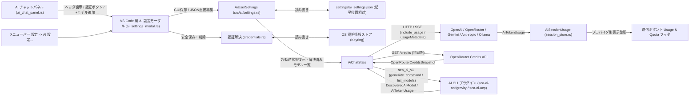
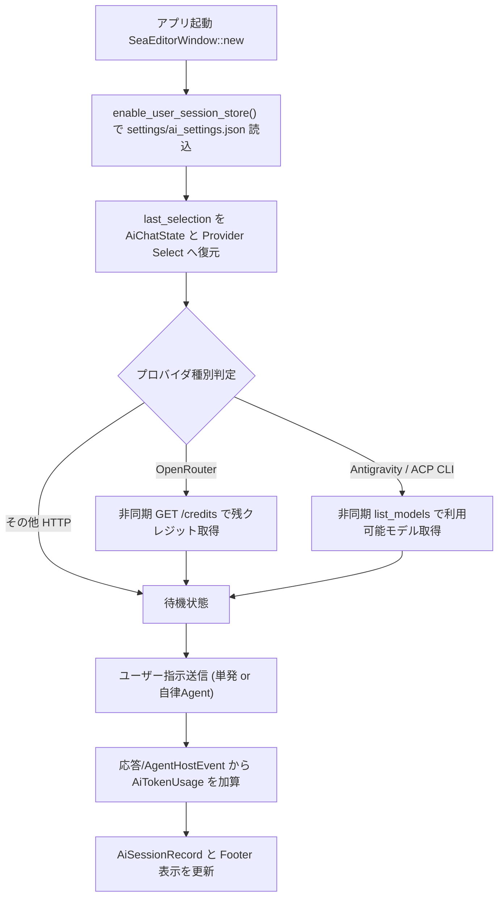

# [013] AI チャット UI 改修・VS Code 風設定画面・起動時状態復元・モデル管理・トークン残量表示設計書

- **ステータス**: Implemented
- **作成日**: 2026-11-21
- **更新日**: 2026-11-21
- **関連ドキュメント**:
  - 全体基本設計書（完了済み）: [`draft.md`](draft.md)
  - 初期実装設計書 Phase C（完了済み）: [`initial-implementation/PhaseC.md`](initial-implementation/PhaseC.md)
  - 自律エージェントプラグイン基盤設計書（完了済み）: [`012-agentic-plugin-architecture.md`](012-agentic-plugin-architecture.md)
  - Phase P0 設計書（API キーガイド関連）: [`../004-phase-p0-core-prerequisites.md`](../004-phase-p0-core-prerequisites.md)
  - プラグインプロトコル互換性ポリシー: [`../011-plugin-protocol-compatibility-policy.md`](../011-plugin-protocol-compatibility-policy.md)
  - 導入・ビルド・起動方法: [`../docs/getting-started.md`](../../docs/getting-started.md)
  - AI 連携・MCP・AI CLI プラグイン開発ガイド: [`../docs/plugins/ai-and-mcp.md`](../../docs/plugins/ai-and-mcp.md)

---

## 1. 概要・目的

- **この機能で解決したい課題・達成したいこと**:
  現在の AI チャット機能（[`src/ui/ai_chat_panel.rs`](../../src/ui/ai_chat_panel.rs)）および認証・設定基盤には以下の 5 つの実用上の課題が存在します。本設計では、**VS Code の Settings / Copilot Chat UI に準拠した操作体験** と **ポータブルな起動位置相対 `settings/` フォルダ管理** を原則としてこれらを一括解消します。
  1. **ヘッダ右端の設定アイコン (`⚙`) の見切れ解消**: ヘッダ上の長大な文言（`"未設定: OPENROUTER_API_KEY"` 等）が右パネル幅を圧迫して `⚙` ボタンが半分隠れる不具合を解消し、最小パネル幅（`240px`）でもすべての操作アイコンが完全に表示されるようにします。
  2. **API キー設定および設定 JSON の分かりやすい提供（VS Code 風 UI）**: [`src/ai/providers/credentials.rs`](../../src/ai/providers/credentials.rs) に実装済みの OS 資格情報ストア（Keyring）連携に加え、GUI から直感的に操作できる **VS Code 風 AI 設定モーダル** と、起動位置の `settings/ai_settings.json` を直接編集（またはモーダル内 `{ } JSON` タブで編集）できる仕組みを提供します。
  3. **起動時の前回選択状態（接続 AI・モデル等）の自動復元**: [`SeaEditorWindow::new`](../../src/ui/window.rs) 起動時に、前回使用していた AI プロバイダ、モデル ID、思考レベル（Thinking Level）、承認モード（`Manual` / `Autopilot`）、自律エージェント選択状態、カスタムベース URL を自動復元します。
  4. **ユーザー自由追加モデルと固定モデル CLI の利用可能モデル動的表示**: OpenRouter や OpenAI / Gemini / Anthropic / Local (Ollama 等) では設定画面または `settings/ai_settings.json` からユーザーが自由にモデル選択肢を増減できるようにします。一方、Antigravity (`agy CLI`) や ACP CLI (`Claude / Codex / Copilot`) のように接続先側でモデルが決まっている場合は、自由追加ではなく **現在実際に利用可能なモデル・CLI 一覧を動的取得して表示** します。
  5. **チャット下部（送信ボタン下）のトークン・価格・残量表示**: 送信ボタンの下側に、**現在残っているトークン数 / 価格 / パーセント** と **このセッションで利用したトークン数 / 価格 / パーセント** を、接続プロバイダの特性に合わせた形式で常時表示します。

- **対象ユーザー / 利用シーン**:
  - OpenRouter 経由で最新の任意モデルを追加して動画編集アシスタントを活用したいユーザー。
  - API キーの環境変数設定なしで、GUI または `settings/ai_settings.json` から安全・手軽にプロバイダ接続を行いたいユーザー。
  - Antigravity / Claude Code / Codex CLI 等を切り替えて利用し、現在使えるモデルやセッション内のトークン消費量・コンテキスト残量・クレジット残高を一目で把握したいユーザー。

---

## 2. スコープ

> [!NOTE]
> **用語区分（リポジトリ規約準拠）**:
> - **機能モジュール（Feature Module）**: `src/` 配下に組み込まれ、本体バイナリのコンパイル・起動・中核動作を構成するもの（設定ストア、認証解決、HTTP プロバイダ、UI パネル・モーダル、プラグイン呼び出しホスト側）。
> - **プラグイン（Plugin）**: `plugins/` + `plugins_src/` 配下に分離された別プロセス拡張であり、無くても `sea-movie-creator` 本体が起動できるもの（`sea-ai-antigravity`, `sea-ai-acp` 等）。

### 対象（In Scope）

- **本体機能モジュール側（`src/`）**:
  - 実行ファイル配置フォルダ基準のポータブル設定ディレクトリ（`<起動位置>/settings/`）解決基盤（[`src/core/mod.rs`](../../src/core/mod.rs) `user_config_file_path` / `user_config_read_path` / `legacy_user_config_file_path`）、既存単一ファイル設定の初回フォールバック読込対応（[`src/ui/key_config.rs`](../../src/ui/key_config.rs), [`src/export/external_tools.rs`](../../src/export/external_tools.rs), [`src/ui/i18n.rs`](../../src/ui/i18n.rs)）、およびドキュメント反映（[`docs/getting-started.md`](../../docs/getting-started.md), [`.gitignore`](../../.gitignore)）。
  - ユーザー AI 設定永続化（新規機能モジュール `src/ai/settings.rs` -> `settings/ai_settings.json`）：前回選択状態、カスタムモデル定義、任意 API キー（JSON 直接設定用）、予算上限、表示形式、エージェント実行設定。
  - 認証解決の拡張（[`src/ai/providers/credentials.rs`](../../src/ai/providers/credentials.rs)）：`settings/ai_settings.json` 参照対応、解決元診断 (`CredentialSource`)、Keyring 削除 (`delete_secret_from_keyring`)。
  - トークン使用量・コストメタデータ (`AiTokenUsage`) の抽出（OpenAI / OpenRouter / Gemini / Anthropic の HTTP/SSE 応答、エージェントターン [`src/ai/agent_host.rs`](../../src/ai/agent_host.rs) 経由の逐次通知）、および OpenRouter クレジット残高照会（`GET /credits`）。
  - セッション単位の利用量累積および永続化（[`src/ai/session_store.rs`](../../src/ai/session_store.rs)）。
  - AI プラグインからの利用可能モデル動的取得ホスト呼び出し（[`src/ai/plugin_host.rs`](../../src/ai/plugin_host.rs) `probe_available_models`）。
  - AI チャットパネル改修（[`src/ui/ai_chat_panel.rs`](../../src/ui/ai_chat_panel.rs)）：ヘッダ見切れ修正、モデル選択メニュー拡張、プロバイダ別残量・セッション利用量フッタ。
  - VS Code 風 AI 設定モーダル（新規機能モジュール `src/ui/ai_settings_modal.rs`）：旧 [`render_agent_settings_drawer`](../../src/ui/ai_agent_widgets.rs) の統合、カテゴリ別 GUI 設定と `{ } JSON` 直接編集の切替。
  - メニューバー項目追加・ウィンドウ統合・多言語キー追加（[`src/ui/menu_bar.rs`](../../src/ui/menu_bar.rs), [`src/ui/window.rs`](../../src/ui/window.rs), [`lang/ja.json`](../../lang/ja.json), [`lang/en.json`](../../lang/en.json)）。
- **別プロセス AI CLI プラグイン・プロトコル文書側（`plugins_src/`・`docs/plugins/`）**:
  - [`plugins_src/sea-ai-antigravity/src/main.rs`](../../plugins_src/sea-ai-antigravity/src/main.rs) および [`plugins_src/sea-ai-acp/src/main.rs`](../../plugins_src/sea-ai-acp/src/main.rs) における `sea_ai_v1` の `"method": "list_models"` 対応、および応答内 `usage` メタデータの転記。
  - [`../011-plugin-protocol-compatibility-policy.md`](../011-plugin-protocol-compatibility-policy.md) のドキュメント同期義務に基づき、[`docs/plugins/ai-and-mcp.md`](../../docs/plugins/ai-and-mcp.md) へ `sea_ai_v1` の `"method": "list_models"`・`models` イベント・`completed.usage` 仕様を同時更新する。

### 対象外（Out of Scope）

- OpenRouter 以外の外部 SaaS ダッシュボード向け非公式スクレイピングや課金管理画面への OAuth 連携。
- ブラウザ経由で API キー取得手順を示す画像付きオンボーディングガイド（[`../004-phase-p0-core-prerequisites.md`](../004-phase-p0-core-prerequisites.md) の P0-2 スコープ。ただし本モーダルの接続画面は P0-2 実装時に導線共有できるよう疎結合に設計します）。
- キャラクタープリセット・連続字幕入力 UI（P0-1）・音声作成（P1）・立ち絵（P2）・無音カット（P3）等の他機能モジュール。

---

## 3. 要件・制約

### 機能要件

1. **ポータブル `settings/` フォルダ管理**:
   - プラグイン（`plugins/`）や言語パック（`lang/`）と同じく、実行ファイルと同じ階層に `settings/` フォルダを作成し、設定ファイル群（`ai_settings.json`, `ai_sessions/`, `key_config.json`, `external_tools.json`, `language.json` 等）を一元配置すること。
   - [`docs/getting-started.md`](../../docs/getting-started.md) に `settings/` フォルダの構成と役割、環境変数 `SEA_SETTINGS_DIR` による上書き、および API キー記載時の共有禁止注意を明記すること。
2. **ヘッダアイコンの見切れ防止**:
   - 右パネル最小幅（`MIN_RIGHT_PANEL_WIDTH = 240.0` px）および初期幅（ウィンドウ幅 1280px 時の約 307px）において、プロバイダ切替・認証状態ボタン・`履歴`・`⚙`・`+` ボタンのいずれも右端から溢れたり半分隠れたりしないこと。
3. **VS Code 風 AI 設定画面 ＆ JSON 設定**:
   - `⚙` ボタン、ヘッダ認証ボタン、メニューバー（`設定 -> AI 設定...`）、モデル選択メニュー末尾（`+ モデルを追加 / 設定...`）から **VS Code 風 AI 設定モーダル** を開けること。
   - モーダル内で GUI 設定（`API キー・接続` / `モデル管理` / `エージェント・予算`）と生 JSON 編集（`{ } JSON` トグル、フォーマット、検証付き保存、設定フォルダを開く）を切り替えられること。
   - 旧インラインドロワー `AiChatDrawer::AgentSettings` は本モーダルの `エージェント・予算` タブへ統合し、UI の二重化を無くすこと。
4. **起動時の前回選択状態復元**:
   - アプリ再起動時、最後に開いていたプロバイダ（`selected_provider`）、モデル（`model_name`）、思考レベル（`thinking_level`）、承認モード（`approval_mode`）、エージェント種別（`selected_agent_id`）、プロバイダ別カスタムベース URL を自動復元すること。
5. **モデルの自由追加と固定モデル CLI の利用可能モデル表示**:
   - カスタマイズ可能プロバイダ（OpenRouter / OpenAI / Google Gemini / Anthropic Claude / Ollama 等）は、設定画面または `settings/ai_settings.json` から任意モデル ID・表示名・Thinking 対応・コンテキスト長・単価を追加・編集・削除できること。
   - 固定モデル CLI プラグイン（`sea.ai.antigravity`, `sea.ai.acp`）は、自由追加 UI を出さず、外部 CLI プローブにより現在アカウント・環境で利用可能なモデル（または検出された CLI プロファイル）を表示し、未取得・未導入時は既定カタログへ安全フォールバックしつつ状態注記を出すこと。
6. **送信ボタン下のプロバイダ別トークン・価格・残量表示**:
   - チャットコンポーザ内の送信ボタンの下に、接続プロバイダ別の形式で **「残量（残トークン / 残クレジット価格 / 残%）」** と **「今回セッション利用量（トークン数 / 価格 / 予算%）」** を表示すること。
   - 単発チャットおよび自律エージェント（[`src/ai/agent_host.rs`](../../src/ai/agent_host.rs)）の複数ターン実行の両方でセッション利用量が累積され、セッション保存・再開（[`src/ai/session_store.rs`](../../src/ai/session_store.rs)）でも維持されること。

### 非機能要件（互換性・セキュリティ・保守性）

- **プロジェクトファイルの機密分離**: API キーはいかなる場合もプロジェクトファイル（`.smc.json`）へ保存しない（[`src/ai/providers/credentials.rs`](../../src/ai/providers/credentials.rs) の不変条件を維持）。
- **シークレットマスクと漏洩防止**: `AiUserSettings` の `Debug` 実装では `api_keys` の値を `***REDACTED***` でマスクし、ログやエラー文言へ生キーを出力しない。また、リポジトリに `settings/` が混入しないよう `.gitignore` に `/settings/` を追加し、テストコード内のダミー値も [`tests/quality_gates/repository_rules.rs`](../../tests/quality_gates/repository_rules.rs) のスキャン規則に抵触しない表記を用いる。
- **既存データとの後方互換性**:
  - 既存の `ai_sessions/*.json` には `session_usage` フィールドが存在しないため、`#[serde(default)]` を付与して既存セッション読込を破壊しないこと。
  - 旧 `%APPDATA%\sea-movie-creator\` からの設定移行方針（4.3 節詳細）：単一 JSON 設定ファイル（`agent_settings.json` → `ai_settings.json` の `runtime` 引き継ぎ、および `key_config.json` / `external_tools.json` / `language.json`）は、新 `settings/` に未作成かつ `SEA_SETTINGS_DIR` 未設定の初回読込時のみ旧パスへフォールバックし、次回保存時に新 `settings/` へ移行する。一方、ディレクトリ系（`ai_sessions/`, 追加 `lang/`, `fonts/`）は Alpha 開発版として新 `settings/` 配下で新規運用する。
- **品質ゲート準拠**: ルート [`Cargo.toml`](../../Cargo.toml) の `[workspace.lints]`（`unsafe_code = "deny"`, `unwrap_used = "deny"`, `expect_used = "deny"`, `panic = "deny"`, `missing_docs = "deny"`, `dead_code = "deny"`）を遵守する。
- **ショートカット競合防止**: 設定モーダル表示中およびモーダル内テキスト入力欄フォーカス時は、[`SeaEditorWindow::allow_editor_shortcut`](../../src/ui/window.rs) / `is_any_text_input_focused` により単キーショートカット（`Space`, `S`, `T`, `Delete` 等）が誤発火しないこと。
- **i18n 整合性**: [`lang/ja.json`](../../lang/ja.json) と [`lang/en.json`](../../lang/en.json) のキー集合および `{placeholder}` を完全に一致させること。

---

## 4. アーキテクチャ / 設計詳細

### 4.1 全体構成図



### 4.2 モジュール構成・責務分担

| 区分 | ファイル | 責務 |
| :--- | :--- | :--- |
| 機能モジュール (Core) | [`src/core/mod.rs`](../../src/core/mod.rs) | 起動位置相対 `<起動位置>/settings/` パス解決 (`app_settings_dir`, `user_config_file_path`)、旧パス解決 (`legacy_user_config_file_path`)、単一設定向け初回読込フォールバック (`user_config_read_path`) |
| 機能モジュール (UI/Export 読込側) | [`src/ui/key_config.rs`](../../src/ui/key_config.rs), [`src/export/external_tools.rs`](../../src/export/external_tools.rs), [`src/ui/i18n.rs`](../../src/ui/i18n.rs) | 単一設定 JSON の読込パスを `user_config_read_path` へ切替（保存先は新 `user_config_file_path` を使用） |
| 機能モジュール (AI) | `src/ai/settings.rs` [NEW] | `AiUserSettings` の JSON 永続化・検証・カスタムモデル管理・モデル一覧解決・`Debug` マスク |
| 機能モジュール (AI) | [`src/ai/providers/credentials.rs`](../../src/ai/providers/credentials.rs) | `CredentialSource` 判定付きキー解決 (`resolve_api_key_with_source`)、Keyring 削除 (`delete_secret_from_keyring`) |
| 機能モジュール (AI) | [`src/ai/provider.rs`](../../src/ai/provider.rs) | `AiTokenUsage`、プリセットモデルのコンテキスト長・単価情報、`settings_key` / `supports_custom_models` |
| 機能モジュール (AI) | [`src/ai/providers/sse.rs`](../../src/ai/providers/sse.rs), [`openai_compat.rs`](../../src/ai/providers/openai_compat.rs), [`gemini.rs`](../../src/ai/providers/gemini.rs), [`anthropic.rs`](../../src/ai/providers/anthropic.rs) | SSE/Sync からの `AiTokenUsage` 抽出、`GET` JSON ヘルパ (`get_json_sync`)、OpenRouter クレジット取得 (`fetch_openrouter_credits`) |
| 機能モジュール (AI) | [`src/ai/plugin_host.rs`](../../src/ai/plugin_host.rs) | `DiscoveredAiModel` 型、`sea_ai_v1` の `models` イベント解析、`probe_available_models()` |
| 機能モジュール (AI) | [`src/ai/agent_host.rs`](../../src/ai/agent_host.rs) | 自律エージェントの LLM 応答ごとの `AgentHostEvent::UsageReported(AiTokenUsage)` 送出 |
| 機能モジュール (AI) | [`src/ai/session_store.rs`](../../src/ai/session_store.rs) | `AiSessionUsage` 累積型、[`AiSessionRecord`](../../src/ai/session_store.rs) への後方互換フィールド追加 |
| 機能モジュール (UI) | [`src/ui/ai_chat_panel.rs`](../../src/ui/ai_chat_panel.rs) | ヘッダ見切れ修正、起動時復元・自動保存、モデルメニュー拡張、送信ボタン下プロバイダ別残量・利用量バー |
| 機能モジュール (UI) | `src/ui/ai_settings_modal.rs` [NEW] | VS Code 風 AI 設定モーダル（カテゴリナビ、APIキー・接続 / モデル管理 / エージェント・予算 / `{ } JSON` 切替） |
| 機能モジュール (UI) | [`src/ui/ai_agent_widgets.rs`](../../src/ui/ai_agent_widgets.rs), [`src/ui/menu_bar.rs`](../../src/ui/menu_bar.rs), [`src/ui/window.rs`](../../src/ui/window.rs) | 旧 `render_agent_settings_drawer` 削除、`OpenAiSettingsAction` 追加、モーダル表示・フォーカス監視・`Esc` 処理統合 |
| プラグイン | [`plugins_src/sea-ai-antigravity/src/main.rs`](../../plugins_src/sea-ai-antigravity/src/main.rs), [`plugins_src/sea-ai-acp/src/main.rs`](../../plugins_src/sea-ai-acp/src/main.rs) | `"method": "list_models"` による利用可能モデル/CLI 動的列挙、ACP `usage` 抽出 |
| ドキュメント・設定 | [`docs/getting-started.md`](../../docs/getting-started.md), [`docs/plugins/ai-and-mcp.md`](../../docs/plugins/ai-and-mcp.md), [`.gitignore`](../../.gitignore), [`lang/ja.json`](../../lang/ja.json), [`lang/en.json`](../../lang/en.json) | `settings/` フォルダ説明追記、`sea_ai_v1` プロトコル仕様同期（`011` 規約準拠）、`/settings/` Git 除外、日英 UI 文言追加 |

### 4.3 ポータブル `settings/` ディレクトリ設計

現在の [`user_config_file_path`](../../src/core/mod.rs) は `%APPDATA%\sea-movie-creator\` 等を参照していますが、本設計では配布パッケージの `plugins/` や `lang/` と統一するため、実行ファイル位置基準の `settings/` フォルダへ統一します。

- **ディレクトリ解決優先順位（純粋関数 `resolve_settings_dir_from`）**:
  1. 環境変数 `SEA_SETTINGS_DIR` が設定されており空白以外であればそのパス。
  2. `std::env::current_exe()` の親ディレクトリが取得できれば `<exe_dir>/settings`。
  3. 取得できない環境（特殊テストランナー等）では `std::env::current_dir()/settings`。
- **実行環境（配布パッケージ vs `cargo run`）と `.gitignore` の意図**:
  - **配布パッケージ実行時**（`<配布フォルダ>/sea-movie-creator.exe`）: `std::env::current_exe()` の親フォルダが配布フォルダとなるため、`<配布フォルダ>/settings/` が参照されます（`plugins/`・`lang/` と同階層）。
  - **開発時（`cargo run`）実行時**: `std::env::current_exe()` は `target/debug/sea-movie-creator.exe`（または `target/release/sea-movie-creator.exe`）となるため、既定では `target/debug/settings/` が参照されます。開発ビルドと配布フォルダ・リポジトリ直下を分離する目的でそのまま `target/` 配下を既定とします（リポジトリ直下の永続フォルダを使いたい場合は `SEA_SETTINGS_DIR=./settings` を指定して上書き可能）。
  - **`.gitignore` への `/settings/` 追加意図**: 開発者が `SEA_SETTINGS_DIR=./settings` で起動した際や、リリース配置確認でリポジトリ直下に `settings/` を作成した場合に、API キーを含む設定ファイルが誤って Git コミットされるのを防ぐためです。この挙動差（配布時 `<配布フォルダ>/settings/` と `cargo run` 時 `target/debug/settings/`）も [`docs/getting-started.md`](../../docs/getting-started.md) に明記します。
- **既存環境からの移行方針（全 `user_config_file_path` 呼び出し箇所の扱い）**:
  - [`src/core/mod.rs`](../../src/core/mod.rs) に読込専用ヘルパ `user_config_read_path(file_name)` を新設します。新パス（`user_config_file_path(file_name)`）が存在すればそれを返し、存在しないかつ環境変数 **`SEA_SETTINGS_DIR` が未設定の場合のみ** 旧パス `legacy_user_config_file_path(file_name)`（`%APPDATA%\sea-movie-creator\<file_name>` 等）に存在すればフォールバックとして返します（テストやポータブル分離環境で `SEA_SETTINGS_DIR` を指定した場合にホスト側の旧設定を誤読しないための安全策）。書き込み時は常に新パス `user_config_file_path` へ保存します。
  - 各呼び出し箇所ごとの移行ポリシーは以下の通り割り切り・明文化します：

| 対象ファイル / フォルダ | 呼び出し元 | 移行方針（旧 `%APPDATA%\sea-movie-creator\` からの扱い） |
| :--- | :--- | :--- |
| `settings/ai_settings.json` | `src/ai/settings.rs` [NEW] | 新ファイル未作成かつ `SEA_SETTINGS_DIR` 未設定時、`settings/agent_settings.json` → 旧 `legacy_user_config_file_path("agent_settings.json")` の順で `AgentRuntimeSettings` を自動引き継ぎ。 |
| `settings/key_config.json` | [`src/ui/key_config.rs`](../../src/ui/key_config.rs) | 単一設定 JSON のため `load_or_default()` で `user_config_read_path("key_config.json")` を使用し初回のみ旧パスへフォールバック読込（次回保存時に新 `settings/` へ移行）。 |
| `settings/external_tools.json` | [`src/export/external_tools.rs`](../../src/export/external_tools.rs) | 単一設定 JSON のため `load_or_default()` で `user_config_read_path("external_tools.json")` を使用し初回のみ旧パスへフォールバック読込（次回保存時に新 `settings/` へ移行）。 |
| `settings/language.json` | [`src/ui/i18n.rs`](../../src/ui/i18n.rs) | 単一設定 JSON のため `load_saved_language_preference()` で `user_config_read_path("language.json")` を使用し初回のみ旧パスへフォールバック読込（保存時に新 `settings/` へ移行）。 |
| `settings/ai_sessions/` | [`src/ai/session_store.rs`](../../src/ai/session_store.rs) | Alpha 開発版のためディレクトリ自動移行は対象外とし、`<起動位置>/settings/ai_sessions/` で新規作成（過去履歴を引き継ぎたい場合はユーザーが旧フォルダから手動コピー）。 |
| `settings/lang/` | [`src/ui/i18n.rs`](../../src/ui/i18n.rs) | 同上（Alpha 開発版のため追加言語ディレクトリは自動移行対象外。なお実行ファイル同階層の `<exe_dir>/lang/` は従来通り最優先で読込）。 |
| `settings/fonts/` | [`src/media/google_fonts.rs`](../../src/media/google_fonts.rs) | キャッシュ／ダウンロード済みフォント領域のため自動移行対象外（必要時に再取得または手動コピー）。 |

### 4.4 データ構造と JSON スキーマ

#### プロバイダ識別キー（`AiProviderKind::settings_key`）の統一仕様

`last_selection.provider`（[`AiProviderKind`](../../src/ai/provider.rs) の `#[serde(rename_all = "snake_case")]`）と `api_keys` / `custom_models` / `custom_base_urls` のマップキーの揺れを防ぎ、ユーザーの手編集ミスを無くすため、正規キーを以下のように統一します。

| `AiProviderKind` バリアント | 正規 `settings_key()` | 読込時の許容エイリアス（正規化対象） | `supports_custom_models()` |
| :--- | :--- | :--- | :--- |
| `OpenAi` | `"open_ai"` | `"openai"` → `"open_ai"` | `true` |
| `OpenRouter` | `"open_router"` | `"openrouter"` → `"open_router"` | `true` |
| `OllamaCompat` | `"ollama_compat"` | `"ollama"` → `"ollama_compat"` | `true` |
| `Gemini` | `"gemini"` | `"google_gemini"` → `"gemini"` | `true` |
| `Anthropic` | `"anthropic"` | `"claude"` → `"anthropic"` | `true` |
| `Plugin { plugin_id }` | `"plugin:<plugin_id>"`（例: `"plugin:sea.ai.antigravity"`, `"plugin:sea.ai.acp"`） | — | `false`（CLI 動的列挙） |
| `Mock` | `"mock"` | — | `false` |

- シリアライズ時は常に正規 `settings_key()`（`"open_router"` 等、`snake_case` と一致）を出力し、手書き JSON の読込時・参照時はトリム＋小文字化＋上記エイリアス正規化を適用して寛容に受け付けます。

#### 主要 Rust 型定義（最小手書き JSON 対応の `#[serde(default)]`）

ユーザーが `{ } JSON` タブや外部エディタで `api_keys` や `custom_models` だけを手書きした最小 JSON（例: `{"api_keys": {"open_router": "..."}}`）でもそのまま読み込めるよう、`AiUserSettings`・`AiLastSelection`・`AiCustomModelConfig` の各省略可能フィールドには `#[serde(default)]` を明示的に付与します。

```rust
// src/ai/settings.rs [NEW]
#[derive(Debug, Clone, Copy, PartialEq, Eq, Default, Serialize, Deserialize)]
#[serde(rename_all = "snake_case")]
pub enum UsageDisplayPreference {
    #[default]
    Auto,
    Tokens,
    Cost,
    Percent,
}

#[derive(Debug, Clone, PartialEq, Eq, Serialize, Deserialize)]
#[serde(default)]
pub struct AiLastSelection {
    pub provider: AiProviderKind,          // Default: AiProviderKind::OpenAi
    pub model_name: String,                // Default: "gpt-4.1-mini"
    pub thinking_level: AiThinkingLevel,   // Default: Auto
    pub approval_mode: AiApprovalMode,     // Default: Manual
    #[serde(default, skip_serializing_if = "Option::is_none")]
    pub selected_agent_id: Option<String>, // Default: None
    #[serde(default, skip_serializing_if = "BTreeMap::is_empty")]
    pub custom_base_urls: BTreeMap<String, String>,
}

#[derive(Debug, Clone, PartialEq, Serialize, Deserialize)]
pub struct AiCustomModelConfig {
    pub id: String,                        // モデル追加時の必須識別子
    #[serde(default, skip_serializing_if = "Option::is_none")]
    pub display_name: Option<String>,
    #[serde(default, skip_serializing_if = "Vec::is_empty")]
    pub thinking_levels: Vec<AiThinkingLevel>,
    #[serde(default, skip_serializing_if = "Option::is_none")]
    pub default_thinking: Option<AiThinkingLevel>,
    #[serde(default, skip_serializing_if = "Option::is_none")]
    pub context_window_tokens: Option<u64>,
    #[serde(default, skip_serializing_if = "Option::is_none")]
    pub input_price_per_1m_usd: Option<f64>,
    #[serde(default, skip_serializing_if = "Option::is_none")]
    pub output_price_per_1m_usd: Option<f64>,
}

#[derive(Clone, PartialEq, Serialize, Deserialize)]
#[serde(default)]
pub struct AiUserSettings {
    pub schema_version: u32,               // Default: 1
    pub last_selection: AiLastSelection,
    #[serde(default, skip_serializing_if = "BTreeMap::is_empty")]
    pub api_keys: BTreeMap<String, String>,
    #[serde(default, skip_serializing_if = "BTreeMap::is_empty")]
    pub custom_models: BTreeMap<String, Vec<AiCustomModelConfig>>,
    #[serde(default, skip_serializing_if = "Option::is_none")]
    pub budget_usd: Option<f64>,
    pub usage_display_mode: UsageDisplayPreference,
    pub runtime: AgentRuntimeSettings,
}
```

```rust
// src/ai/provider.rs 拡張
#[derive(Debug, Clone, Default, PartialEq, Serialize, Deserialize)]
#[serde(default)]
pub struct AiTokenUsage {
    pub input_tokens: u64,
    pub output_tokens: u64,
    pub total_tokens: u64,
    pub cost_usd: Option<f64>,
    pub is_estimated: bool,
}

// src/ai/session_store.rs 拡張
#[derive(Debug, Clone, Default, PartialEq, Serialize, Deserialize)]
#[serde(default)]
pub struct AiSessionUsage {
    pub input_tokens: u64,
    pub output_tokens: u64,
    pub total_tokens: u64,
    pub last_context_tokens: u64,
    pub cost_usd: f64,
    pub has_known_cost: bool,
    pub has_estimated_tokens: bool,
}
```

#### `settings/ai_settings.json` フォーマット例

```json
{
  "schema_version": 1,
  "last_selection": {
    "provider": "open_router",
    "model_name": "deepseek/deepseek-r1",
    "thinking_level": "high",
    "approval_mode": "manual",
    "selected_agent_id": "sea.agent.director",
    "custom_base_urls": {
      "ollama_compat": "http://127.0.0.1:11434/v1"
    }
  },
  "api_keys": {
    "open_router": "your-openrouter-api-key-if-stored-in-json"
  },
  "custom_models": {
    "open_router": [
      {
        "id": "deepseek/deepseek-r1",
        "display_name": "DeepSeek R1",
        "thinking_levels": ["auto", "low", "medium", "high"],
        "default_thinking": "medium",
        "context_window_tokens": 64000,
        "input_price_per_1m_usd": 0.55,
        "output_price_per_1m_usd": 2.19
      }
    ]
  },
  "budget_usd": 10.0,
  "usage_display_mode": "auto",
  "runtime": {
    "max_steps_per_turn": 20,
    "min_llm_interval_ms": 1500,
    "vision_batch_size": 6,
    "vision_max_edge_px": 512
  }
}
```

### 4.5 UI 設計詳細

#### (1) ヘッダの見切れ解消（`render_compact_header`）

現在、`"未設定: OPENROUTER_API_KEY"`（約 170px〜190px）がプロバイダ `Select`（`min_w(80px)`）と `履歴`・`⚙`・`+` を押し出して `⚙` が右端で切れています。

- **改善レイアウト**:
  - 左側: プロバイダ `Select` を `div().flex_1().min_w(px(64.)).overflow_hidden()` とする。
  - 右側（`flex_shrink_0()`, `gap_0p5()`）:
    1. コンパクト認証ボタン（例: `"🔑 未設定"`（赤色）/ `"🔑 OK"`（グレー）/ `"CLI"` / `"Local"`、幅約 48〜60px）。クリックすると即座に AI 設定モーダルの `API キー・接続` タブを開く。
    2. `履歴` ボタン（幅約 36px）
    3. `⚙` ボタン（幅約 26px、クリックで AI 設定モーダルを開く）
    4. `+` ボタン（会話あり時のみ表示、幅約 24px）
  - 合計の右側幅は約 110〜135px となり、最小パネル幅 `240px` でも左右の余白を含めて全アイコンが 100% 収まります。

#### (2) VS Code 風 AI 設定モーダル（`src/ui/ai_settings_modal.rs`）

[`src/ui/external_tools_modal.rs`](../../src/ui/external_tools_modal.rs) と同じモーダルオーバーレイ方式（半透明バックドロップ＋中央カード `w(px(760.))`、`max_h(px(620.))`）で描画します。

```text
+------------------------------------------------------------------------+
| AI 設定   settings/ai_settings.json     [{ } JSON] [📁 フォルダ] [×]    |
+------------------+-----------------------------------------------------+
| [API キー・接続] |  OpenRouter API    [現在有効: 環境変数 OPENROUTER...] |
|  モデル管理      |  ⚠ 環境変数が設定されているため Keyring/JSON より優先 |
|  エージェント・  |  API Key: [••••••••••••••••••••••• 👁] [Keyring保存] |
|  予算            |  [JSON保存] [クリア]                                |
|                  |  Base URL: [https://openrouter.ai/api/v1         ]  |
|                  |-----------------------------------------------------|
|                  |  OpenAI API / Google Gemini / Anthropic / Local ... |
+------------------+-----------------------------------------------------+
```

- **`API キー・接続` タブの解決元表示と環境変数優先時の注記**:
  - 各プロバイダカードの右上に現在の `CredentialSource` バッジ（`環境変数 (OPENROUTER_API_KEY)` / `settings/ai_settings.json` / `OS Keyring` / `一時上書き` / `未設定`）を明示表示します。
  - `CredentialSource::EnvVar(env_name)` が有効な場合、ユーザーが GUI から `[Keyring保存]` または `[JSON保存]` で別キーを保存しても環境変数が最優先され続けるため、カード内に **「環境変数 `{env_name}` が設定されているため、Keyring / JSON へ保存したキーより環境変数が優先されます」** という警告・案内バナーを表示して混乱を防ぎます。
- **右上 `{ } JSON` トグルボタン**:
  - VS Code の「Open Settings (JSON)」と同様に、ワンクリックでモーダル内をマルチライン JSON エディタ（`TextareaState`）へ切り替えられます。
  - JSON モードでは `整形 (Format)`・`ファイルから再読込`・`検証して保存` ボタンを提供し、構文不正時は赤バナーで具体的なパースエラー箇所を通知します。
- **`モデル管理` タブ**:
  - プロバイダ切替ボタン（`OpenRouter` を始め各プロバイダを選択）。
  - カスタマイズ可能プロバイダ時: 組み込み＋カスタムモデルの一覧（カスタムモデルは `[削除]` ボタン付き）と、下部に `Model ID` / `表示名` / `Ctx上限` / `入力$/1M` / `出力$/1M` / `Thinking対応` の追加フォームを表示。
  - `Antigravity` / `ACP CLI` 選択時: 自由追加フォームを出さず、「接続先 CLI から自動検出された利用可能モデル一覧」と `[再スキャン]` ボタンのみを表示。

#### (3) モデル選択ドロップダウン拡張（`render_model_menu_button`）

- 解決済みモデル一覧（`AiChatState::resolved_models_for_current_provider()`）を表示。
- カスタマイズ可能プロバイダではメニュー末尾に区切り線と `"+ モデルを追加 / 管理..."` を配置し、クリックで設定モーダルの `モデル管理` タブを直接開きます。
- `Antigravity` / `ACP CLI` では各モデルの `[利用可能]` / `[未導入]` ステータスを添えて表示し、末尾に `"↻ 利用可能モデルを再取得"` を配置します。

#### (4) 送信ボタン下のプロバイダ別残量・セッション利用量フッタ

`render_prompt_composer` 内の `送信` / `停止` ボタン行の直下に、1 行（極狭幅時は自動折返し）のステータスストリップを配置します。

| プロバイダ種別 | 左側（残っているトークン数 / 価格 / %） | 右側（このセッションの利用量） | 補足動作 |
| :--- | :--- | :--- | :--- |
| **OpenRouter** | 残クレジット取得時: `残 $4.82 (96%)` / 未取得時: `残Ctx 184k (92%)` | `今回: 12.4k tok ($0.0182)` | 送信完了時・起動時に `/credits` を非同期更新、`↻` 再取得可 |
| **OpenAI / Gemini / Anthropic** | `残Ctx 192k (96%)`（`budget_usd` 設定時は `残予算 $9.85 (98%)` 併用） | `今回: 12.4k tok (約$0.014)`（単価未定義時はトークン数のみ） | プリセットまたはカスタム単価からセッション価格を算出 |
| **Local (Ollama 等)** | `残Ctx 28k (88%) · Local` | `今回: 4.2k tok` | 無料ローカル実行のため課金表示なし |
| **Antigravity (`agy CLI`) / ACP CLI** | `残量: 接続先プラン管理`（Ctx 上限既知時は `Ctx残 ~94%` 併記可） | CLI 返却時 `今回: 8.1k tok` / 非返却時 `今回: ~8.1k tok (推定)` | 誤った残クォータ数値を表示せず実測／推定を明示 |
| **Mock** | `Mock (Offline)` | `今回: 0.3k tok` | オフラインテスト用 |

- `usage_display_mode`（`Auto` / `Tokens` / `Cost` / `Percent`）設定により、スペースが限られる場合の優先表示要素を切り替えられます。

### 4.6 処理フロー



---

## 5. インターフェース / API 仕様

### 5.1 `sea_ai_v1` プラグインプロトコル拡張（後方互換）

既存の `"method": "generate_command"` に加え、以下の任意メソッドを追加します。また、[`../011-plugin-protocol-compatibility-policy.md`](../011-plugin-protocol-compatibility-policy.md) で定められたドキュメント同期義務に従い、[`src/ai/plugin_host.rs`](../../src/ai/plugin_host.rs) の変更と同時に [`docs/plugins/ai-and-mcp.md`](../../docs/plugins/ai-and-mcp.md) へ下記メソッドおよび `models` / `completed.usage` 仕様を反映します。

1. **リクエスト（ホスト -> プラグイン `stdin` 1行 JSON）**:
   ```json
   {
     "protocol": "sea_ai_v1",
     "method": "list_models",
     "params": {
       "external_cli": null,
       "external_args": []
     }
   }
   ```
   - `CallParams` の既存フィールド（`system_prompt`, `command_schema_json`, `context_summary`, `user_prompt`, `history`, `stream`）は `#[serde(default)]` とし、`list_models` 時には省略可能とします。
2. **レスポンス（プラグイン -> ホスト `stdout` NDJSON）**:
   ```json
   {"event":"models","models":[{"id":"gemini-4-argon","display_name":"Gemini 4 Argon","badge":null,"thinking_levels":["low","medium","high"],"default_thinking":"medium","available":true,"note":"ACP利用可能"}]}
   ```
   - `completed` イベントには任意フィールド `"usage": { "input_tokens": 120, "output_tokens": 45, "total_tokens": 165, "cost_usd": null, "is_estimated": false }` を付与可能とします。

### 5.2 HTTP プロバイダ別トークン・残高取得仕様

- **OpenAI / OpenRouter (`OpenAiCompatProvider`)**:
  - ストリーミングリクエストボディへ `"stream_options": { "include_usage": true }` を付与（`OpenAi | OpenRouter` 時のみ）。
  - 応答 JSON の `usage.prompt_tokens`, `usage.completion_tokens`, `usage.total_tokens`, `usage.cost`（OpenRouter 拡張フィールド）を抽出。
  - クレジット照会: `GET {base_url}/credits`（`Authorization: Bearer <key>` 付与）で `data.total_credits` と `data.total_usage` を取得し、`remaining = (total_credits - total_usage).max(0.0)` と残率を計算。
- **Google Gemini (`GeminiProvider`)**:
  - `usageMetadata.promptTokenCount`, `candidatesTokenCount`, `thoughtsTokenCount`, `totalTokenCount` を抽出し、`output_tokens = candidates + thoughts` として集計。
- **Anthropic Claude (`AnthropicProvider`)**:
  - SSE 時は `message_start` の `message.usage.input_tokens` と `message_delta` の `usage.output_tokens` を合算、非 SSE 時は `usage.input_tokens` / `usage.output_tokens` を抽出。

### 5.3 認証解決優先順位

1. `runtime_api_key`（メモリ上のセッション一時上書き）
2. OS 環境変数（`OPENAI_API_KEY`, `OPENROUTER_API_KEY`, `GEMINI_API_KEY`, `ANTHROPIC_API_KEY`）
3. `<起動位置>/settings/ai_settings.json` 内の `api_keys.<settings_key>`
4. OS 資格情報ストア（`keyring` サービス名 `sea-movie-creator`）

- 解決結果と併せて `CredentialSource`（`RuntimeOverride` / `EnvVar(&'static str)` / `SettingsJson` / `Keyring` / `Missing`）を返却し、GUI 上（4.5 節 (2)）では現在の有効取得元を表示します。環境変数がすでに設定されている状態でユーザーが GUI から Keyring または `settings/ai_settings.json` に別キーを保存した場合は、環境変数が優先中であることを明示案内して設定が反映されないと誤解されるのを防ぎます。

### 5.4 メニュー・多言語キー

- [`src/ui/menu_bar.rs`](../../src/ui/menu_bar.rs): `OpenAiSettingsAction` を新設し、`設定` メニューへ配置。
- [`lang/ja.json`](../../lang/ja.json) / [`lang/en.json`](../../lang/en.json): `menu.settings.ai_settings`, `ai.settings_modal_title`, `ai.cred_ok`, `ai.cred_missing`, `ai.usage_session`, `ai.usage_remaining` 等を同一キーセットで追加。

---

## 6. エラーハンドリング・エッジケース

- **OS 資格情報ストアが利用不能／ロックされている環境（Linux ヘッドレス CI 等）**:
  - `save_secret_to_keyring` / `delete_secret_from_keyring` 失敗時もパニックさせず、モーダル内にエラー理由を表示したうえで「`settings/ai_settings.json` へ保存」または「このセッションのみ有効化（メモリ保持）」を選択できるよう案内します。
- **破損した `settings/ai_settings.json` の起動時読込**:
  - パースに失敗しても起動を妨げず既定値で安全に立ち上げ、AI 設定モーダルまたはステータスバナーに警告を表示します（既存の手編集ファイルが上書き消失しないよう、パース失敗時は自動保存を抑止する配慮も検討）。
- **OpenRouter クレジット API の一時失敗・権限制限キー**:
  - 一部制限付き OpenRouter キーやオフライン環境で `/credits` が 4xx/タイムアウトになった場合、エラーでチャット全体を止めず、コンテキスト残トークン表示へ自動フォールバックします。
- **外部 CLI (`agy` / `claude` / `codex` / `copilot`) 未導入・未ログイン時**:
  - `list_models` プローブがタイムアウトまたは失敗した場合は、組み込みカタログ表示を維持したまま `"CLI未検出/未ログインのため標準一覧を表示"` の注記を添えます。
- **自動テストによる実ファイル汚染の防止**:
  - [`AppController::new()`](../../src/ui/app_controller.rs) 直後のテスト環境では `settings_path` が `None` であるため、`AiChatState::sync_selection_and_persist()` は `settings_path.is_some()` かつ `settings_load_warning.is_none()` の場合のみディスクへ書き出すようガードします。

---

## 7. テスト計画・受け入れ基準

### 段階的実装フェーズ

- **Phase 1**: ポータブル `settings/` 基盤 (`src/core/mod.rs` の `user_config_read_path` 等)、単一設定ファイル群（[`src/ui/key_config.rs`](../../src/ui/key_config.rs), [`src/export/external_tools.rs`](../../src/export/external_tools.rs), [`src/ui/i18n.rs`](../../src/ui/i18n.rs)）のフォールバック読込対応、`.gitignore`、[`docs/getting-started.md`](../../docs/getting-started.md)（配布時・`cargo run` 時の配置説明含む）、`src/ai/settings.rs`、`credentials.rs` 拡張＋単体テスト
- **Phase 2**: `AiTokenUsage`、HTTP/SSE（OpenAI / OpenRouter / Gemini / Anthropic）使用量抽出、OpenRouter `/credits`、`AgentHostEvent::UsageReported`、`AiSessionUsage` 永続化＋単体テスト
- **Phase 3**: `sea-ai-antigravity` / `sea-ai-acp` の `list_models` 実装、ホスト側プローブ、[`docs/plugins/ai-and-mcp.md`](../../docs/plugins/ai-and-mcp.md) 同期更新（`011` 規約準拠）＋単体テスト
- **Phase 4**: AI チャットヘッダ見切れ修正、モデルメニュー拡張、送信ボタン下プロバイダ別残量バー、VS Code 風 AI 設定モーダル（`CredentialSource`・環境変数優先注記含む）、`lang/*.json`、結合テスト (`tests/phase_ai_settings_ui.rs` + `tests/phase_ai_settings_ui/mod.rs`)

### テスト項目

- **単体テスト（各 `.rs` 末尾）**:
  - `resolve_settings_dir_from` の環境変数 / 実行ファイル親ディレクトリ / CWD フォールバック検証、および `user_config_read_path` の初回旧パスフォールバックと `SEA_SETTINGS_DIR` 設定時のフォールバック抑止検証。
  - `AiUserSettings` の JSON 往復・最小手書き JSON（`#[serde(default)]`）読込・`settings_key` 正規化およびエイリアス（`"openrouter"` / `"open_router"` 等）解決・不正 JSON エラー・`Debug` シークレットマスク・カスタムモデル追加/削除・固定モデルプロバイダ拒否検証。
  - `resolve_api_key_with_source` の優先順位および `CredentialSource::EnvVar` 判定検証（実 Keyring 書込テストは `#[ignore]` 分離）。
  - モック HTTP サーバを用いた OpenAI / OpenRouter / Gemini / Anthropic の SSE・Sync `usage` 抽出および OpenRouter クレジット計算テスト。
  - `sea-ai-antigravity` / `sea-ai-acp` の ACP `session/new` `configOptions` パース・`list_models` 単体テスト。
  - `format_usage_footer_parts` のプロバイダ別フォーマット出力テスト。
- **結合テスト（`tests/phase_ai_settings_ui.rs` + `tests/phase_ai_settings_ui/mod.rs`）**:
  - `SEA_SETTINGS_DIR`（または一時ディレクトリ）を用いた起動時前回プロバイダ/モデル/Thinking/Approval 復元検証。
  - カスタムモデル追加後の選択・JSON 再読込整合性検証。
  - プロジェクト保存（`.smc.json`）に API キーが一切混入しないことの検証。
  - セッション利用量の累積・保存・再読込復元検証。
- **品質ゲート（完了条件 / Definition of Done）**:
  - `scripts/pre-pr.ps1` / `scripts/pre-pr.sh` 相当の全チェック（`cargo fmt --all --check`、`cargo clippy --workspace --all-targets --all-features -- -D warnings`、`RUSTDOCFLAGS="-D warnings" cargo doc --workspace --no-deps`、`cargo build --workspace --all-targets`、`cargo test --workspace --all-targets --all-features`）がエラー・警告ゼロで通過すること。
  - GUI ウィンドウでの手動確認（最小幅での `⚙` 表示、設定モーダル GUI/JSON 切替、再起動後復元、プロバイダ別残量・利用量表示）が完了していること。

---

## 8. 未決事項・決定記録（Open Questions / ADR）

- [x] **決定 1: 設定ファイルの保存場所を起動位置相対 `<起動位置>/settings/` に統一**
  - **理由**: すでに `plugins/` と `lang/` が配布フォルダ（起動位置）基準のポータブル構成をとっているため、設定ファイル群も同じフォルダ構造へ揃えることでバックアップ・環境移行・複数バージョン共存が容易になる。[`docs/getting-started.md`](../../docs/getting-started.md) にも構造と注意点を明記する。
- [x] **決定 2: 旧 `AgentSettings` ドロワーを VS Code 風 AI 設定モーダルへ統合**
  - **理由**: `⚙` ボタン押下時の設定導線を 1 本化し、API キー・カスタムモデル・ステップ上限/レート制御・予算・JSON 直接編集を 1 つの見通しの良い VS Code 風設定画面へ集約するため。
- [x] **決定 3: チャット下部フッタをプロバイダ別最適フォーマットで表示**
  - **理由**: OpenRouter（クレジット残高あり）、API 従量課金プロバイダ（コンテキスト残＋単価概算）、ローカル LLM（無料・コンテキスト残のみ）、外部 CLI プラン（サブスクリプション/プラン管理）でユーザーにとって意味のある「残量」が異なるため。
- [ ] **検討事項: OpenRouter モデルの API からのオンライン検索・一括取得ボタン**
  - 初版は手入力＋JSON 編集（モデル ID / 表示名 / コンテキスト長 / 単価）で確実に動作させ、必要に応じて `GET https://openrouter.ai/api/v1/models` からの候補サジェスト機能を後続拡張として追加検討する。
