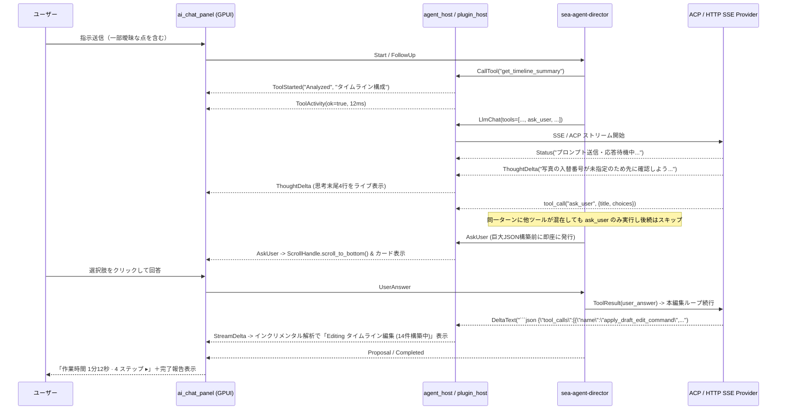

# [015] AI 実行中アクティビティ・思考ストリーム可視化＆質問早期表示設計書

- **ステータス**: Implemented
- **作成日**: 2026-11-24
- **更新日**: 2026-11-24
- **関連ドキュメント**:
  - 自律エージェントプラグイン基盤＆構成コンパイラ設計書（完了済み）: [`012-agentic-plugin-architecture.md`](012-agentic-plugin-architecture.md)
  - AI チャット UI 改修・設定・トークン残量表示設計書（完了済み）: [`013-ai-ui-settings-and-usage.md`](013-ai-ui-settings-and-usage.md)
  - AI チャット継続性修正・作業中／完了状態の可視化・選択＆コピー対応設計書（完了済み）: [`014-ai-chat-reliability-status-and-copy.md`](014-ai-chat-reliability-status-and-copy.md)
  - 外部プラグイン向け SDK・プロトコル互換性ポリシー: [`../011-plugin-protocol-compatibility-policy.md`](../011-plugin-protocol-compatibility-policy.md)
  - 追加編集時の写真・字幕クロス監査、EXIF 向き自動補正、CLI Vision 対応＆画像トークン圧縮設計書: `016-ai-vision-audit-exif-and-token-compression.md`

---

## 1. 概要・目的

- **この機能で解決したい課題・達成したいこと**:
  1. **AI 実行中の「上部断片固定＋文字数増加でハングに見える」表示の解消**:
     従前のチャット UI では、`Antigravity (agy CLI)` 等で長い編集指示を実行している最中に、ヘッダ行が `...に接続中...` のまま固まり、その下に直前本文の末尾断片と `編集コマンド／ツール呼び出しを構築中... (30157 文字)` だけが増え続けるため、利用者に「出力が壊れている」「ハングしている」と誤認されていました。
     また、HTTP API プロバイダ（Anthropic / Gemini / OpenAI 互換）の自律エージェントターン（`send_agent_turn`）も同期 POST 実装のため、実行中の思考・生成テキストがリアルタイム表示されていませんでした。
     本設計では、CLI/ACP プラグインと HTTP プロバイダ双方のストリーミング＆思考（Thinking/Reasoning）出力を統合し、**VS Code / Antigravity 風のアクティビティ可視化 UI**（`Analyzed ...` / `Editing ...` / `Checked ...` といったステップ行＋思考／最新出力の末尾ライブプレビュー＋完了後の `作業時間 X分Y秒 · N ステップ ▸` 折りたたみログ）へ刷新します。
  2. **質問（確認・選択）の早期表示と即時選択**:
     確認が必要な項目（例: どの写真を入れ替えるか・どの写真を回転するか）がある場合、AI が同一ターン内に質問文と巨大な編集 JSON を混在出力すると、すべての出力・ツールループが終わるまでユーザーへ質問カードが表示されませんでした。また、初回フォルダ制作フローでも重い Vision 解析の全完了後にしか希望確認カードが出ませんでした。
     本設計では、自律ツールループへ `ask_user` ツールを公開して確認事項がある場合は巨大な編集コマンド構築より先に最優先で質問カードを表示し、さらに初回フォルダ制作フローでも希望確認カードをフォルダ走査直後（Vision 解析前）へ前倒しします。
- **対象ユーザー / 利用シーン**:
  - `Antigravity (agy CLI)`、`Claude / Codex / Copilot (ACP)`、および各種 HTTP API プロバイダ（Anthropic / Gemini / OpenAI / OpenRouter / カスタム互換）を使って複数ステップの編集指示や初回ムービー作成を行うすべてのユーザー。
  - 長時間の AI 作業中に「正常に進行中か」「いま何を思考・編集構築しているか」「確認待ちに入っていないか」を迷わず判断・応答したいユーザー。

### 1.1 実装前の根本原因（調査記録）

1. **CLI プラグイン側のステータス停滞**:
   - [`plugins_src/sea-ai-antigravity/src/main.rs`](../../plugins_src/sea-ai-antigravity/src/main.rs) および [`plugins_src/sea-ai-acp/src/main.rs`](../../plugins_src/sea-ai-acp/src/main.rs) は、プロセス起動直後に `{"event": "status", "message": "... に接続中..."}` を 1 回だけ送出したあと、完了まで `status` を更新していませんでした。
2. **ACP `agent_thought_chunk` / `tool_call` の破棄と HTTP `send_agent_turn` の同期 POST 固定**:
   - [`plugins_src/sea-ai-protocol/src/lib.rs`](../../plugins_src/sea-ai-protocol/src/lib.rs) の `extract_acp_update_message_delta` は `agent_message_chunk` 以外の `sessionUpdate` をすべて破棄していました。
   - HTTP プロバイダ（[`anthropic.rs`](../../src/ai/providers/anthropic.rs)・[`gemini.rs`](../../src/ai/providers/gemini.rs)・[`openai_compat.rs`](../../src/ai/providers/openai_compat.rs)）の `send_agent_turn` は同期 `post_json_sync` であり、さらに `anthropic.rs` は署名付き `thinking` ブロック未保持のため `tools` 併用時に `thinking` を抑止していました。
3. **UI ストリーミングプレビューの断片固定と単調マスク**:
   - [`src/ui/ai_chat_panel.rs`](../../src/ui/ai_chat_panel.rs) は、制御 JSON 検知時に前置き断片＋文字数カウントのみを表示していました。
4. **ツール実行履歴の未保持と開始時通知欠如**:
   - `AgentHostEvent::ToolActivity` 受信時に `streaming_preview` 消去と 1 行バナー上書きのみで、開始通知・ステップリスト・折りたたみログがありませんでした。
5. **自律ツールループにおける `ask_user` 未公開＆初回質問の後回し**:
   - [`plugins_src/sea-agent-director/src/director.rs`](../../plugins_src/sea-agent-director/src/director.rs) の `run_dynamic_tool_loop` に `ask_user` ツールがなく、初回フォルダ制作フローでも `ask_movie_preferences_card` が Vision 解析の後に実行されていました。

---

## 2. スコープ

> [!NOTE]
> **用語区分（リポジトリ規約準拠）**:
> - **プラグイン（Plugin）**: `plugins_src/` 配下の別プロセス拡張であり、無くても本体が起動できるもの（`sea-ai-protocol`, `sea-ai-antigravity`, `sea-ai-acp`, `sea-agent-director`）。
> - **機能モジュール（Feature Module）**: `src/`・`lang/` 配下に組み込まれ、本体バイナリの起動・中核動作を構成するもの（`src/ai/*`, `src/ui/*`, `lang/*`）。

### 対象（In Scope）

- **プラグイン側（`plugins_src/`）**:
  - [`plugins_src/sea-ai-protocol/src/lib.rs`](../../plugins_src/sea-ai-protocol/src/lib.rs): `AcpSessionUpdateEvent` と `extract_acp_update_event` の追加（既存 `extract_acp_update_message_delta` は後方互換維持）。
  - [`plugins_src/sea-ai-antigravity/src/main.rs`](../../plugins_src/sea-ai-antigravity/src/main.rs) / [`plugins_src/sea-ai-acp/src/main.rs`](../../plugins_src/sea-ai-acp/src/main.rs): フェーズ遷移ごとの `status` 更新、`thought`（思考チャンク）および `activity`（ツール活動）NDJSON イベント送出。
  - [`plugins_src/sea-agent-director/src/director.rs`](../../plugins_src/sea-agent-director/src/director.rs) / [`protocol_io.rs`](../../plugins_src/sea-agent-director/src/protocol_io.rs):
    - `run_dynamic_tool_loop` への仮想内蔵ツール `ask_user` 追加、混在 `tool_calls` ガード、キャンセル／見送り時自己修復抑止、および「質問最優先（Early Ask）」プロンプト規約導入。
    - `HostToAgentMessage::LlmResponse` から受け取った `thinking_blocks` / `thought_signature` をそのまま次ターンの `AgentLlmMessage` へ引き回してマルチターン思考維持に対応。
    - `scan_attached_folders` と `run_vision_analysis_batches` の分離により `run_folder_story_workflow` における `ask_movie_preferences_card` を走査直後へ前倒し（希望を反映した `theme_hint` 生成と `user_preferences` 既存時スキップ付き）。
  - [`plugins_src/sea-agent-protocol/src/lib.rs`](../../plugins_src/sea-agent-protocol/src/lib.rs): `AgentThinkingBlock { thinking, signature }` を追加し、`HostToAgentMessage::LlmResponse`・`AgentLlmMessage` に任意 `thinking_blocks`、`AgentLlmToolCall` に任意 `thought_signature` を後方互換追加（`#[serde(default, skip_serializing_if = ...)]`）。
- **ドキュメント同期（`011` ポリシー準拠）**:
  - [`docs/plugins/ai-and-mcp.md`](../../docs/plugins/ai-and-mcp.md): `sea_ai_v1` の `thought` / `activity` イベント・2 段階パース、および `sea_agent_v1` の任意 `thinking_blocks` / `thought_signature` フィールド仕様を同期更新。
- **本体機能モジュール側（`src/`・`lang/`）**:
  - [`src/ai/provider.rs`](../../src/ai/provider.rs): `AiStreamEvent::ThoughtDelta(String)`・`AiStreamEvent::ActivityHint(String)` 追加、およびマルチターン Anthropic Tool Use 向け `AiThinkingBlock`（`thinking` + `signature`）を保持できる `AiTurnMessage::Assistant` 拡張。
  - [`src/ai/plugin_host.rs`](../../src/ai/plugin_host.rs): `serde_json::Value` 経由の 2 段階 NDJSON パースによる未知イベント安全スキップ、`AiPluginHostEvent::Thought` / `Activity` 受信、`run_direct_acp_stdio` での思考・ツール活動中継。
  - [`src/ai/providers/sse.rs`](../../src/ai/providers/sse.rs), [`anthropic.rs`](../../src/ai/providers/anthropic.rs), [`gemini.rs`](../../src/ai/providers/gemini.rs), [`openai_compat.rs`](../../src/ai/providers/openai_compat.rs):
    - 通常チャット (`send_streaming`) と**エージェントターン (`send_agent_turn`) の双方**を汎用 `post_json_sse_or_sync` で SSE ストリーミング対応化し、思考チャンク・通常テキスト差分・ストリーミング `tool_calls` をリアルタイム中継。
    - `anthropic.rs` では `thinking_delta` + `signature_delta` を蓄積して `AiTurnMessage::Assistant` へ保持・再送可能にし、全過去 `tool_use` 履歴が署名を保持している場合は `tools` 併用時の `thinking` を有効化。
  - [`src/ai/agent_host.rs`](../../src/ai/agent_host.rs): `AgentHostEvent::ThoughtDelta`・`AgentHostEvent::ToolStarted` 追加、`ToolActivity` への `call_id` / `verb` / `target` / `duration_ms` 付与（`Manual` 承認待ち時間は `duration_ms` から除外）。
  - [`src/ai/session_store.rs`](../../src/ai/session_store.rs): `AiActivityStepStatus`・`AiActivityStep`・`AiTurnActivitySummary` 追加および `StoredChatTurn.activity_log` 追加（`#[serde(default)]`）。
  - [`src/ui/ai_activity_view.rs`](../../src/ui/ai_activity_view.rs)・[`src/ui/ai_chat_panel.rs`](../../src/ui/ai_chat_panel.rs)・[`src/ui/right_panel.rs`](../../src/ui/right_panel.rs)・[`src/ui/window.rs`](../../src/ui/window.rs):
    - `AiLiveActivityState`・`inspect_streaming_json_progress`・`extract_tail_lines`・`render_live_activity_card`・`render_turn_activity_summary`。
    - `SeaEditorWindow` への `ai_chat_scroll_handle: ScrollHandle` 保持（`.overflow_y_scroll().track_scroll(&handle)` + `.vertical_scrollbar(&handle)`）による `AskUser` 到着時・ターン追加時のスレッド最下部自動スクロール。
  - [`lang/ja.json`](../../lang/ja.json) / [`lang/en.json`](../../lang/en.json): VS Code 風作業時間・ステップ・思考・構築進捗の多言語キー追加。

### 対象外（Out of Scope）

- 画像の視覚認識精度・EXIF 回転補正・コンタクトシート圧縮（`016-ai-vision-audit-exif-and-token-compression.md` で扱う）。
- タイムライン再生位置追随・プレビュー画面外グレー・JSON 設定ハイライト（`017-editor-ux-timeline-follow-preview-backdrop-json-hl.md` で扱う）。
- エージェントによる編集適用前のドライラン検証（`DraftSandbox`）の省略。

---

## 3. 要件・制約

### 機能要件

- **FR-1（接続中表示の即時解消と CLI / HTTP 双方でのフェーズ・思考ストリーミング）**:
  - CLI プラグインおよび直接 ACP 接続では、接続・セッション開始・プロンプト送信・思考中・応答生成中の各フェーズで `status` を更新し、応答が始まった後に「接続中...」が残らないこと。
  - HTTP プロバイダ（Anthropic / Gemini / OpenAI 互換）の `send_agent_turn` も SSE ストリーミング受信を行い、ツール呼び出し中・応答構築中のテキストや思考チャンク（`ThoughtDelta`）をリアルタイムに UI へ転送すること。
- **FR-2（VS Code / Antigravity 風のステップ一覧表示）**:
  - エージェント実行中は `agent_host.rs` がホスト内部のツール実行（`CallTool`）や対話カード要求（`AskUser`）の開始時に `AgentHostEvent::ToolStarted` を発火してスピナー付き行を追加し、完了時に `AgentHostEvent::ToolActivity` で `✓` / `✕` / `■` と実処理所要時間・結果要約へインプレース更新すること。
  - `Manual` 承認モードで外部ツール承認待ちに入った場合、ユーザー操作を待っている時間は `duration_ms` に含めず、承認後の実ツール実行時間のみを計測すること。
  - 実行中カード内では視認性維持のため最新 6 行を既定表示し、それ以上ある場合は展開ボタンで全ステップを確認できること。
- **FR-3（思考／最新テキストの末尾プレビューと生成中 JSON の構造化進捗）**:
  - 思考ストリーム（`ThoughtDelta`）または通常テキスト（`StreamDelta`）の**最新の末尾数行**を自動追従で表示し（上部の途切れ断片で固定しない）、クリックで全文展開できること。
  - 制御 JSON（`{"tool_calls":...}` や ```` ```json ````）の生成中は、どのツール／どの `EditCommand` を何件構築中か・直近のクリップや字幕断片をインクリメンタル抽出してライブ行へ表示すること。
- **FR-4（完了後の折りたたみアクティビティログ）**:
  - ターン完了時、アシスタント返答の直上に **`作業時間 {duration} · {count} ステップ ▸`**（英語：`Worked for {duration} · {count} steps ▸`）を表示し、クリックでステップ一覧を展開・再折りたたみできること。
- **FR-5（質問の早期表示と即時選択）**:
  - `run_dynamic_tool_loop` に `ask_user` ツールを提供し、確認や選択が必要な依頼では巨大な編集 JSON を作る前の最初のステップで質問カードを表示してユーザーの即座の選択を受け付けること。
  - 同一ターンで `ask_user` と他の変更／参照ツールが同時に返された場合は、`ask_user` のみを実行して同一ターンの後続ツールをスキップし、ユーザー回答を得てから LLM へ再判断させること。
  - `ask_user` の回答でユーザーが「変更不要」「見送り」「中止」を選択した場合、元の指示文に編集キーワードが含まれていても `try_queue_self_repair` や `expect_timeline_edit` の 0 件警告を発動させないこと。
  - 初回フォルダ制作フローでは、フォルダ走査（および 100 枚超時の枚数確認）直後・Vision 解析前に `ask_movie_preferences_card` を提示し、得られた希望を Vision 解析の `theme_hint` へ渡すこと（リトライ／セッション再開時に `user_preferences` が取得済みなら再質問しない）。
  - `AskUser` イベント到着時、チャットスレッドが自動的に最下部へスクロールし、質問カードが即座に視認・クリック可能になること。

### 非機能要件（互換性・性能・保守性）

- **プロトコル後方互換性（`011` ポリシー準拠）**:
  - `sea_ai_v1` の NDJSON イベント追加（`thought`, `activity`）は既存イベントを変更せず追加のみとし、`plugin_host.rs` の 2 段階パースで未知イベントを安全スキップする。
  - `sea_agent_v1` では `HostToAgentMessage::LlmResponse`・`AgentLlmMessage`・`AgentLlmToolCall` へ `thinking_blocks` / `thought_signature` のみを `#[serde(default, skip_serializing_if = ...)]` で後方互換追加し、`ToolStarted` / `ToolActivity` はホスト側 [`src/ai/agent_host.rs`](../../src/ai/agent_host.rs) で生成する。
- **永続化互換性**:
  - `StoredChatTurn.activity_log` には `#[serde(default, skip_serializing_if = "Option::is_none")]` を付与し、既存の保存済みセッション JSON を問題なく読み込めること。
- **UI パフォーマンス**:
  - ステップ数は 1 ターン最大 64 件（`MAX_ACTIVITY_STEPS`）、思考バッファは 16,000 文字（`MAX_THOUGHT_BUFFER_CHARS`）を上限とし、プレビュー抜粋文字列はデルタ受信時にキャッシュ更新して毎フレーム再走査を回避する。
- **コード品質**:
  - `unsafe` 不使用（`unsafe_code = "deny"`）。

---

## 4. アーキテクチャ / 設計詳細

### 4.1 処理フロー（イベントおよび質問早期表示シーケンス）



### 4.2 モジュール構成・責務分担

| 区分 | ファイル | 責務 |
| :--- | :--- | :--- |
| **プラグイン** | [`plugins_src/sea-ai-protocol/src/lib.rs`](../../plugins_src/sea-ai-protocol/src/lib.rs) | `AcpSessionUpdateEvent` 定義と `extract_acp_update_event` |
| **プラグイン** | [`plugins_src/sea-ai-antigravity/src/main.rs`](../../plugins_src/sea-ai-antigravity/src/main.rs) | フェーズ毎 `status` 更新、`thought` / `activity` イベント発火 |
| **プラグイン** | [`plugins_src/sea-ai-acp/src/main.rs`](../../plugins_src/sea-ai-acp/src/main.rs) | 同上（汎用 ACP プラグイン側） |
| **プラグイン** | [`plugins_src/sea-agent-protocol/src/lib.rs`](../../plugins_src/sea-agent-protocol/src/lib.rs) | `AgentThinkingBlock` 定義、`LlmResponse` / `AgentLlmMessage` / `AgentLlmToolCall` 後方互換拡張 |
| **プラグイン** | [`plugins_src/sea-agent-director/src/director.rs`](../../plugins_src/sea-agent-director/src/director.rs)・[`protocol_io.rs`](../../plugins_src/sea-agent-director/src/protocol_io.rs) | `ask_user` 仮想ツール公開・混在スキップ・中止時自己修復抑止・`thinking_blocks` 引き回し・走査直後の希望質問前倒し |
| **機能モジュール** | [`src/ai/provider.rs`](../../src/ai/provider.rs) | `AiStreamEvent::ThoughtDelta` / `ActivityHint`、`AiThinkingBlock` 保持対応 |
| **機能モジュール** | [`src/ai/plugin_host.rs`](../../src/ai/plugin_host.rs) | 2 段階 NDJSON パースによる未知イベント安全スキップ、`Thought` / `Activity` 受信、ACP 直接接続中継 |
| **機能モジュール** | [`src/ai/providers/sse.rs`](../../src/ai/providers/sse.rs)・[`anthropic.rs`](../../src/ai/providers/anthropic.rs)・[`gemini.rs`](../../src/ai/providers/gemini.rs)・[`openai_compat.rs`](../../src/ai/providers/openai_compat.rs) | `post_json_sse_or_sync` による `send_agent_turn` / `send_streaming` SSE ストリーミング実装・署名保持 |
| **機能モジュール** | [`src/ai/agent_host.rs`](../../src/ai/agent_host.rs) | `AgentHostEvent::ThoughtDelta` / `ToolStarted` 生成、`describe_tool_activity`、承認待ち時間除外計測 |
| **機能モジュール** | [`src/ai/session_store.rs`](../../src/ai/session_store.rs) | `AiActivityStep` / `AiActivityStepStatus` / `AiTurnActivitySummary` / `StoredChatTurn.activity_log` |
| **機能モジュール** | [`src/ui/ai_activity_view.rs`](../../src/ui/ai_activity_view.rs)・[`ai_chat_panel.rs`](../../src/ui/ai_chat_panel.rs)・[`right_panel.rs`](../../src/ui/right_panel.rs)・[`window.rs`](../../src/ui/window.rs) | `AiLiveActivityState`、`inspect_streaming_json_progress`、実行中カード、完了後折りたたみ表示、`ScrollHandle` 保持と自動最下部スクロール |
| **機能モジュール** | [`lang/ja.json`](../../lang/ja.json)・[`lang/en.json`](../../lang/en.json) | 作業時間・ステップ・思考・進捗ラベルの二言語定義 |

---

## 5. 実装済みテスト・検証サマリ

- `sea-ai-protocol`, `sea-agent-protocol`, `sea-ai-antigravity`, `sea-ai-acp`, `sea-agent-director` 各プラグイン単体テスト全通過。
- 本体単体テスト（`ai::plugin_host`, `ai::providers::*`, `ai::agent_host`, `ai::session_store`, `ui::ai_activity_view`, `ui::ai_chat_panel`, `ui::i18n`）全通過。
- 結合テスト（`tests/phase_agent_director.rs`, `tests/ai_chat_continuity.rs`, `tests/quality_gates.rs`）および `scripts/pre-pr.ps1` 全品質ゲート通過。
