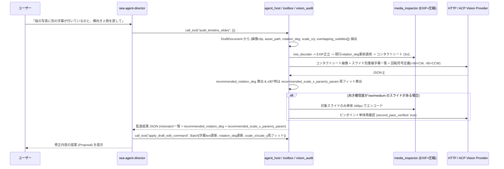

# [016] 追加編集時の写真・字幕クロス監査、EXIF 向き自動補正、CLI Vision 対応＆画像トークン圧縮設計書

- **ステータス**: Implemented
- **作成日**: 2026-11-24
- **更新日**: 2026-11-24
- **関連ドキュメント**:
  - 自律エージェントプラグイン基盤＆構成コンパイラ設計書（完了済み）: [`012-agentic-plugin-architecture.md`](012-agentic-plugin-architecture.md)
  - AI チャット継続性修正・作業中／完了状態の可視化・選択＆コピー対応設計書（完了済み）: [`014-ai-chat-reliability-status-and-copy.md`](014-ai-chat-reliability-status-and-copy.md)
  - 外部プラグイン向け SDK・プロトコル互換性ポリシー: [`011-plugin-protocol-compatibility-policy.md`](../011-plugin-protocol-compatibility-policy.md)
  - AI 実行中アクティビティ・思考ストリーム可視化＆質問早期表示設計書: [`015-ai-activity-ui-and-early-ask.md`](015-ai-activity-ui-and-early-ask.md)

---

## 1. 概要・目的

- **この機能で解決したい課題・達成したいこと**:
  実運用において、すでに作成したタイムラインに対して「写真の内容と字幕の内容が合っていない（例：桜の写真に別の食べ物等の字幕が付いている）ので修正して」「人が横を向いて立っている写真があるので回転して修正して」と追加編集（フォローアップ）を依頼しても、AI が写真の中身を正しく見られず適切に直せない問題が発生しています。
  本設計では、この問題の根本原因である **5 層の欠陥** を一括解消し（±90° 回転時のスケール再フィット含む）、さらに **AI が認識できる画質を保ったまま画像トークン消費量を大幅圧縮する仕組み（コンタクトシート合成＋品質最適化）** を導入します。
- **対象ユーザー / 利用シーン**:
  - 初期生成されたフォトムービーや既存タイムラインを、対話による追加編集でブラッシュアップしたいユーザー。
  - `Antigravity (agy CLI)` や HTTP API プロバイダを利用して、できるだけ少ないトークン消費で高精度な写真確認・字幕修正・回転＆スケール補正を行いたいユーザー。

### 1.1 現状の根本原因分析（なぜ写真と字幕の不一致・横向き人物が直らないのか）

コード調査により、現状では以下の **5 つの複合要因** によって AI が写真内容・向きを正しく認識できていないことが判明しています。

1. **CLI / ACP プラグインが Vision（画像送信）未対応**:
   - [`src/ai/plugin_host.rs`](../../src/ai/plugin_host.rs) の `AiPluginProvider` は [`AiProvider::supports_vision`](../../src/ai/provider.rs) を実装しておらず（常に `false`）、さらに `send_agent_turn` もオーバーライドしていないため既定の `fallback_agent_turn_via_streaming`（内部の `render_turn_message_as_text` が `AiContentPart::ImageData` を破棄してプレースホルダ文字列へ変換する）を通っています。
   - また [`AiPluginCallParams`](../../src/ai/plugin_host.rs) に画像配列フィールドが無く、[`classify_vision_api_error`](../../src/ai/toolbox.rs) も `AiError::PluginError` に対する `vision_unsupported` 判定を持っていません。
   - そのため `Antigravity (agy CLI)` 等を選択している場合、[`inspect_images_vision`](../../src/ai/toolbox.rs) は**写真を 1 枚も見ずにファイル名ベースの仮テキストを生成するフォールバック**に落ちています。これが「桜の写真に無関係な字幕が付く」最大の原因です。
2. **追加編集時に既存タイムラインの画像ファイルを視覚参照する経路がない**:
   - [`src/ai/context_builder.rs`](../../src/ai/context_builder.rs) の `AssetSummary` には画像ファイルのパス情報が含まれておらず、さらにフォルダ未添付の追加編集時は [`AllowedFolderScope`](../../src/ai/agent_host.rs) が空になります。
   - 結果として、タイムラインに配置済みの既存画像アセットを AI が `inspect_images_vision` 等で後から読み直すこと自体がブロックされます。また「どの写真クリップとどの字幕クリップが時間的に重なっているか」のペア情報も要約にありません。
3. **本体の画像デコーダと Vision 縮小が EXIF Orientation を無視している**:
   - [`src/media/decoder.rs`](../../src/media/decoder.rs)（`decode_image_file`, `decode_image_bytes`）、[`src/media/image_loader.rs`](../../src/media/image_loader.rs)（`inspect_image_file`）、および [`src/ai/media_inspector.rs`](../../src/ai/media_inspector.rs)（`encode_thumbnail_jpeg_base64`）はすべて `image::ImageReader::decode()` / `into_dimensions()` を呼ぶだけで EXIF Orientation タグを適用していません。
   - スマートフォン等で撮影された縦写真（生ピクセルは横向き＋EXIF Orientation 6/8）が、読み込み時点で横倒しのまま表示・解析されてしまいます。
4. **Vision プロンプトに「向き判定」と「現行字幕との整合監査」がない**:
   - [`src/ai/toolbox.rs`](../../src/ai/toolbox.rs) のプロンプトは `scene_description` と新規 `suggested_subtitle` を生成するだけで、「人物・建物・地面の向きが横／逆さまになっていないか（何度の回転補正が必要か）」および「現在タイムライン上に付いている字幕と写真が一致しているか」を判定するフィールドを持っていません。
5. **1 枚ずつの個別画像送信による高トークン消費**:
   - 現状は 1 枚あたり長辺 `512px`・JPEG 品質 `78` で 1 枚ずつ `ImageData` パートを送っており、36 枚〜100 枚のフォトムービーでは入力画像トークンが肥大化します。

---

## 2. スコープ

### 対象（In Scope）

- **機能モジュール側（`src/media/`・`src/ai/`・`src/ui/`）**:
  - [`src/media/decoder.rs`](../../src/media/decoder.rs)・[`src/media/image_loader.rs`](../../src/media/image_loader.rs): `into_decoder()` → `decoder.orientation()` → `apply_orientation()` による EXIF Orientation の自動検出・適用（デコード画素および `inspect_image_file` の実表示寸法スワップ）。
  - [`src/ai/media_inspector.rs`](../../src/ai/media_inspector.rs):
    - `AllowedFolderScope` へのプロジェクト登録済みアセットファイル単位の読み取り専用許可 (`allowed_files`) 追加。
    - `inspect_media_folder` / `encode_thumbnail_jpeg_base64` への EXIF Orientation 適用（デコード爆弾対策 `Limits` 維持）。
    - JPEG 品質設定対応（既定 `68`）と **番号バッジ付きコンタクトシート合成機能**（複数枚を 1 枚へパックし画像トークン削減）。
  - [`src/ai/context_builder.rs`](../../src/ai/context_builder.rs): `TimelineSlidePairSummary`（画像クリップ＋全重複字幕 `overlapping_subtitles`＋現在 `rotation_deg` / `scale_x` / `scale_y` / アニメーション有無）の要約構築。
  - [`src/ai/toolbox.rs`](../../src/ai/toolbox.rs)・[`src/ai/vision_audit.rs`](../../src/ai/vision_audit.rs):
    - `inspect_images_vision` の出力拡張と `classify_vision_api_error` への `AiError::PluginError` 判定追加（初回制作時のみフォールバック継続＋明示警告）。
    - 新規専用ツール `audit_timeline_slides`（現在の Draft タイムラインから画像＋全重複字幕ペアを自動抽出し、現行プレビュー適用済み向きでコンタクトシート Vision 一括監査＋低信頼時の単体 448px 再確認＋相対/絶対回転量計算＋±90° 回転時 `scale_x`/`scale_y` 再フィット値を返却）。
  - [`src/ai/provider.rs`](../../src/ai/provider.rs)・[`src/ai/session_store.rs`](../../src/ai/session_store.rs): `AgentRuntimeSettings` に画像圧縮・コンタクトシート設定（`vision_jpeg_quality`, `vision_packing_mode`, `vision_contact_sheet_cols`, `vision_contact_sheet_rows`, `vision_contact_sheet_tile_px`）を追加（`#[serde(default)]` 後方互換）。
  - [`src/ai/agent_host.rs`](../../src/ai/agent_host.rs): `AgentSessionRunner::start` および **`handle_follow_up_msg`（毎回 `base_document` 更新時）** で `base_document.assets` と `attached_folders_raw` から `AllowedFolderScope::from_folders_and_files(...)` を再構築。
  - [`src/ai/plugin_host.rs`](../../src/ai/plugin_host.rs): `AiPluginCallParams.images` 追加、`AiPluginProvider::send_agent_turn` 独自実装（`ImageData` 抽出・送信）、二層判定に基づく `supports_vision()` 実装、ACP 直接接続への画像ブロック組込。
  - [`src/ui/ai_settings_modal/agent_budget_tab.rs`](../../src/ui/ai_settings_modal/agent_budget_tab.rs): トークン節約設定（コンタクトシートモード・グリッド分割・タイル解像度・JPEG 品質）の UI 設定欄追加。
- **プラグイン側（`plugins_src/`・`plugins/`）**:
  - [`plugins_src/sea-ai-protocol/src/lib.rs`](../../plugins_src/sea-ai-protocol/src/lib.rs): 共有画像入力型 `AcpImageInput`・サイズ上限検証・`acp_supports_image_prompt`・コンテンツブロック生成ヘルパー。
  - [`plugins_src/sea-ai-antigravity/src/main.rs`](../../plugins_src/sea-ai-antigravity/src/main.rs)・[`plugins_src/sea-ai-acp/src/main.rs`](../../plugins_src/sea-ai-acp/src/main.rs): `images` 受理、`initialize` の `promptCapabilities.image` 確認、ACP `session/prompt` への `{"type": "image", "mimeType": ..., "data": ...}` ブロック送信、`false` 時 `"vision_unsupported"` エラー返却。
  - [`plugins_src/sea-agent-director/src/director.rs`](../../plugins_src/sea-agent-director/src/director.rs): `run_vision_analysis_batches` のハードコード `chunk_size = 6` をホスト側設定連動（100 枚上限単位委譲）へ統合、フォローアップ時の `audit_timeline_slides` 必須化と `ParameterPath::RotationDeg` ＋ `ScaleX` / `ScaleY` 再フィット適用プロンプト強化。
  - [`plugins/ai/`](../../plugins/ai): 該当プラグインマニフェスト（`ai-plugin.json`）への `capabilities.vision: true` 同期。
- **ドキュメント同期（`011` ポリシー準拠）**:
  - [`docs/plugins/ai-and-mcp.md`](../../docs/plugins/ai-and-mcp.md): `sea_ai_v1` の `images` フィールド、`vision_unsupported` エラーコード、および `ai-plugin.json` の `capabilities.vision` 仕様を同期更新。

### 対象外（Out of Scope）

- 音声ファイル（BGM・セリフ）の音声波形内容そのものを解析する ASR（別設計書 `008` スコープ）。
- 動画クリップ（`.mp4` 等）の全フレーム連続抽出・動画内容監査。
- ローカル専用顔認識モデルや外部画像解析専用バイナリの同梱（LLM Vision と EXIF 解析のみで完結させる）。

---

## 3. 要件・制約

### 機能要件

- **FR-1（EXIF Orientation の自動正立）**:
  - JPEG / WebP / TIFF 等に EXIF Orientation（1〜8、特に 90°/180°/270° 回転・反転）が記録されている場合、プレビュー表示・書き出し・サムネイル生成・Vision 解析のいずれの経路でも自動的に正しい向きへ変換して扱うこと（PNG は `image 0.25.9` で未対応のため `NoTransforms` 扱い）。
  - `inspect_image_file` が返す `width` / `height` および `inspect_media_folder` が返す `ImageOrientation`（`Portrait` / `Landscape` / `Square`）も、回転適用後の実表示寸法と一致すること。
- **FR-2（追加編集時のタイムライン写真×字幕実視覚監査＋回転＆スケール再フィット）**:
  - フォルダを添付し直さない追加編集（フォローアップ）であっても、現在開いているプロジェクトの `ProjectDocument.assets` に登録された画像ファイルについては、セッション開始時だけでなく毎回の `handle_follow_up_msg` 更新時にも `AllowedFolderScope` へ組み込み、AI ツールから読み取り専用で視覚参照できること。
  - 回転仕様は [`src/media/visual_properties.rs`](../../src/media/visual_properties.rs) および [`ParameterPath::RotationDeg`](../../src/timeline/command.rs) に厳密準拠し、**`+90` = 時計回り（CW）、`-90` = 反時計回り（CCW）** とすること。
  - 監査時は「いまプレビューで見えている向き（現行 `current_rotation_deg` をサムネイルへ事前適用）」を Vision へ渡し、Vision には現行表示に対する追加の相対回転量 `needs_rotation_deg`（`0 | 90 | -90 | 180`）のみを判定させ、ホスト側で絶対目標角 `recommended_rotation_deg = normalize_signed_deg(current_rotation_deg + needs_rotation_deg)` を計算して LLM の加算ミス・二重回転を防ぐこと。
  - **±90° 回転補正時の `scale_x` / `scale_y` 再フィット（Ken Burns アニメーション対応）**: `needs_rotation_deg.abs() == 90` により画像の縦横比が入れ替わる場合は、ホスト側で回転前フィット倍率 `old_fit_scale` と回転後フィット倍率 `new_fit_scale` から比例係数 `scale_ratio = new_fit_scale / old_fit_scale` を算出し、既存の `scale_x` / `scale_y`（`Constant` のみならず Ken Burns `ZoomIn` / `ZoomOut` 等の `Keyframes` / `Easing` / `Expression` も含む）へ一律 `scale_ratio` を乗じた `recommended_scale_x_param` / `recommended_scale_y_param`（`AnimatedParameter` JSON）を返却すること。
  - `rotation_deg` がアニメーション付きである場合はフラグ（`rotation_is_animated`）を返却する。
  - 1 枚の画像に複数字幕（タイトル＋本文等）が重なっている場合は全重複字幕配列 `overlapping_subtitles` を返し、誤った字幕クリップを書き換える事故を防ぐこと。
- **FR-3（CLI / ACP プラグインの Vision 対応と初回 vs 追加編集のフォールバック区別）**:
  - `AiPluginProvider` で `send_agent_turn` を実装して画像を直接プラグイン／ACP へ引き渡し、`initialize` 応答の `promptCapabilities.image` が非 `false` の場合は実画像ブロックを送信すること。
  - **`vision_unsupported` 時の明確な区別**:
    - **追加編集の視覚監査（`audit_timeline_slides`）**: 推測誤編集を防ぐため、明確に `vision_unsupported` エラーで停止・通知すること。
    - **初回フォルダ制作（`inspect_images_vision`）**: 従来どおりファイル名／EXIF フォールバックを継続し、`warning: "⚠ Vision 非対応のためファイル名・EXIF 情報のみで字幕を生成しました"` を付与すること。
- **FR-4（トークン消費削減のためのコンタクトシート合成＆圧縮）**:
  - 複数枚（既定 `3x2 = 6 枚`）の画像を、左上に高コントラストの識別番号ラベル（`#1`, `#2`, ...）を焼き込んだ 1 枚のコンタクトシート JPEG（タイル長辺 `320px`、JPEG Q68）に結合して送信できること。
  - コンタクトシート上で `rotation_confidence` が低い（`medium` / `low`）場合のみ対象画像を単体（`448px`）で 2 段階再確認できること。

### 非機能要件（セキュリティ・互換性・性能）

- **セキュリティ（パストラバーサル防御）**:
  - `AllowedFolderScope` の `allowed_files` は `canonicalize()` 済みのプロジェクト登録済みアセット実ファイルのみを許可し、未許可パスは `MediaInspectorError::AccessDenied` で拒否すること。
  - 1 回の `AiPluginCallParams.images` 送信あたり上限（最大 12 枚・合計 Base64 8 MiB 以下）を設けること。
- **プロトコル後方互換性（`011` ポリシー準拠）**:
  - `AiPluginCallParams.images` は `#[serde(default, skip_serializing_if = "Vec::is_empty")]`、`AgentRuntimeSettings` 追加項目はすべて `#[serde(default = ...)]` で後方互換を保つこと。

---

## 4. アーキテクチャ / 設計詳細

### 4.1 処理フロー（追加編集時の写真×字幕クロス監査＆回転スケール再フィット）

### 4.2 モジュール構成・責務分担

| 区分 | ファイル | 責務 |
| :--- | :--- | :--- |
| **機能モジュール** | [`src/media/decoder.rs`](../../src/media/decoder.rs) | `decode_oriented_dynamic_image_file` / `_bytes`（`Limits` 付き `into_decoder()` → `orientation()` → `apply_orientation()`） |
| **機能モジュール** | [`src/media/image_loader.rs`](../../src/media/image_loader.rs) | `inspect_image_file` で `into_decoder()` から `dimensions()` ＋ `orientation()` を取得し、90°/270° 回転時の `width`/`height` スワップ反映 |
| **機能モジュール** | [`src/timeline/serialization.rs`](../../src/timeline/serialization.rs) | `resolve_document_assets` にて既存 `.seaproj` 読込時に `AssetKind::Image` の寸法を正立寸法へ自動同期 |
| **機能モジュール** | [`src/ai/media_inspector.rs`](../../src/ai/media_inspector.rs) | `AllowedFolderScope::from_folders_and_files`、EXIF 適用＋任意事前回転＋JPEG 品質指定サムネイル、`build_contact_sheet_jpeg_base64` |
| **機能モジュール** | [`src/ai/context_builder.rs`](../../src/ai/context_builder.rs) | `TimelineSlidePairSummary` / `OverlappingSubtitleSummary`（全重複字幕配列＋回転・スケール・アニメーション有無）の要約構築 |
| **機能モジュール** | [`src/ai/toolbox.rs`](../../src/ai/toolbox.rs)・[`src/ai/vision_audit.rs`](../../src/ai/vision_audit.rs) | `audit_timeline_slides` 実装、`classify_vision_api_error` へ `AiError::PluginError` 対応追加、`inspect_images_vision` コンタクトシート＆警告対応 |
| **機能モジュール** | [`src/ai/agent_host.rs`](../../src/ai/agent_host.rs) | `start` と `handle_follow_up_msg` の双方で `base_document.assets` 含め `AllowedFolderScope` 再構築 |
| **機能モジュール** | [`src/ai/provider.rs`](../../src/ai/provider.rs) | `VisionPackingMode`、`vision_jpeg_quality` 等の設定構造体拡張、`build_fallback_legacy_request` |
| **機能モジュール** | [`src/ai/plugin_host.rs`](../../src/ai/plugin_host.rs) | `AiPluginProvider::send_agent_turn` 独自実装（画像抽出・送信）、`AiPluginCallParams.images`、二層 `supports_vision()` 判定 |
| **機能モジュール** | [`src/ui/ai_settings_modal/agent_budget_tab.rs`](../../src/ui/ai_settings_modal/agent_budget_tab.rs) | パッキング方式・シート分割・タイル長辺・JPEG 品質 UI |
| **プラグイン** | [`plugins_src/sea-ai-protocol/src/lib.rs`](../../plugins_src/sea-ai-protocol/src/lib.rs) | `AcpImageInput` 検証・ACP `promptCapabilities.image` 解析・画像ブロック生成共有ヘルパー |
| **プラグイン** | [`plugins_src/sea-ai-antigravity/src/main.rs`](../../plugins_src/sea-ai-antigravity/src/main.rs)・[`sea-ai-acp/src/main.rs`](../../plugins_src/sea-ai-acp/src/main.rs) | `images` 受信、`initialize` の `promptCapabilities.image` 確認、`session/prompt` 画像ブロック送信、`false` 時 `"vision_unsupported"` 返却 |
| **プラグイン** | [`plugins_src/sea-agent-director/src/director.rs`](../../plugins_src/sea-agent-director/src/director.rs) | Vision バッチ上限 (`100` 枚単位) 委譲、フォローアップ時の `audit_timeline_slides` 必須化と `rotation_deg` ＋ `scale_x`/`scale_y` 再フィット更新誘導 |

---

## 5. エッジケース・テスト計画・受け入れ基準

- **旧バージョン `.seaproj` の `AssetKind::Image { width, height }` 寸法ズレ**: `resolve_document_assets` 読込時に自動同期。
- **意図的な斜め演出・アニメーション付きスケール**: `±1.0°` 超の斜め角度は `orientation_audit_skipped: "non_orthogonal_rotation"` で回転監査をスキップし、`scale_is_animated == true`（Ken Burns 演出）は全キーフレーム・始終点へ `scale_ratio` を乗じた `AnimatedParameter` を生成。
- **オフライン・権限外パス**: `skipped_slides` へ記録し他スライドの監査を継続、未許可パスは `AccessDenied` で拒否。

---

## 6. 完了メモ

- [x] **実装・検証済み**: EXIF 自動正立・読込時寸法同期・ファイル単位 `AllowedFolderScope`・番号バッジ付きコンタクトシート合成・`audit_timeline_slides`（2 段階確認＆Ken Burns 比例スケール計算含む）・CLI/ACP プラグイン Vision 送信と `promptCapabilities.image` 検査（`result.agentCapabilities.promptCapabilities.image` および `result.capabilities.promptCapabilities.image` 互換対応済み）・UI 設定＆ドキュメント更新。
- [x] **品質ゲート**: `scripts/pre-pr.ps1` 全項目（`fmt` / `clippy` / `doc` / `build` / `test` / `quality_gates`）通過後に PR 提出。
