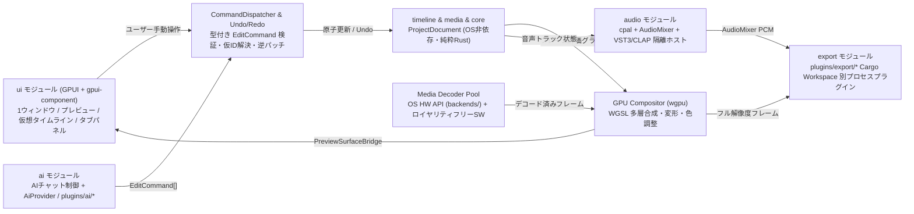

# `sea-movie-creator` 基本設計書（Architecture & AI-Native Design Draft）

- **ステータス**: Draft
- **作成日**: 2026-11-15
- **更新日**: 2026-11-16
- **関連ドキュメント**:
  - 要件メモ: [`completed/initial-implementation/draft.md`](completed/initial-implementation/draft.md)
  - 初期実装計画: [`completed/initial-implementation/PhaseA.md`](completed/initial-implementation/PhaseA.md), [`completed/initial-implementation/PhaseB.md`](completed/initial-implementation/PhaseB.md), [`completed/initial-implementation/PhaseC.md`](completed/initial-implementation/PhaseC.md)
  - UI 大幅修正詳細設計書（AviUtl 準拠タイムライン・設定ダイアログ・プレビュー操作）: [`002-aviutl-ui-redesign/README.md`](002-aviutl-ui-redesign/README.md)
  - 将来機能設計: [`001-yukkuri-live-module.md`](001-yukkuri-live-module.md)
  - 開発ルール: [`.github/copilot-instructions.md`](../.github/copilot-instructions.md)

---

## 1. 設計の最優先方針と前提

`sea-movie-creator` は、**「AI チャットから動画編集操作を行える軽量なデスクトップ動画編集ソフト」** である。設計全体を貫く最優先方針は以下の 5 点とする。

1. **AI-First（開発 AI とアプリ内 AI の双方にとっての扱いやすさ）**
   - プロジェクト状態を「ネストの深い可変 UI オブジェクト」ではなく、**一意な ID でフラットに参照可能な宣言的データモデル（JSON + `schemars` による JSON Schema 自動生成対応）** と **決定論的な編集コマンド（`EditCommand`）** に分離する。
   - 手動 UI 操作と AI チャット操作を**同一のコマンドパイプライン**に通すことで、AI 操作の Undo/Redo、バッチ仮 ID 参照、変更プレビュー、再現テストを完全に統一する。
2. **モジュールごとの高い独立性**
   - 機能単位（`core`, `timeline`, `media`, `audio`, `export`, `ui`, `ai`）にクレート内モジュールを分割し、データモデル（純粋 Rust）を UI（GPUI）や外部プロセスプラグイン（Cargo Workspace メンバー）から完全に切り離す。
3. **安全境界と `unsafe` の局所隔離**
   - ルート `Cargo.toml` の既定である `unsafe_code = "deny"` を維持する（Phase B-4 で Workspace 化する際は `[workspace.lints]` へ移行し、全メンバーで `[lints] workspace = true` により同一ルールを強制する）。
   - OS メディア API（Media Foundation / D3D11VA / VideoToolbox / VA-API）、`rav1d` 等の C ABI 呼び出し（`dav1d_*` 互換 API）、GPU サーフェス共有、共有メモリ IPC、VST3/CLAP FFI ホストなど `unsafe` が不可避な処理は **`backends/` 配下の専用モジュールまたは別クレート（`plugins_src/*`）へ厳格に隔離** し、最小境界に `#[allow(unsafe_code)]` を付与したうえで直前に **`// SAFETY:` コメントで不変条件を明記** する。
4. **マルチ OS 志向（Windows / macOS / Linux）**
   - 初期実装・検証の一次環境は Windows 10/11（64bit）とし、段階的に macOS / Linux 向けバックエンドを追加できるようコアロジックを OS 非依存の純粋 Rust に分離する。UI は GPUI、GPU 合成は `wgpu`、音声 I/O は `cpal`、プラグイン通信は標準入出力 JSON-RPC＋共有メモリを採用する。
5. **特許・ソフトウェアライセンスへの厳格な配慮**
   - GPL 汚染、特許対象コーデック（H.264 / H.265 / AAC 等）の再配布リスク、および VST2 ライセンス制約を設計段階から構造的に回避する（詳細は 4 章参照）。

---

## 2. システム全体構成と画面レイアウト

### 2.1 1 ウィンドウ画面構成（UI 方針・GPUI 現実解）

- **操作感**: AviUtl ライクな自由レイヤー配置・直感的なカット/ドラッグ操作とインスペクタ数値調整（詳細 UI/UX 仕様は [`002-aviutl-ui-redesign/README.md`](002-aviutl-ui-redesign/README.md) を正とする）。
- **ビジュアル・配色**: DaVinci Resolve / VS Code に近いダークテーマ基調・高コントラストかつ余白を抑えた情報密度。
- **チャット UI**: VS Code の Chat / Copilot パネルに準拠したメッセージスレッド・編集差分（適用コマンド一覧）プレビュー・承認/取り消し操作。
- **UI ウィジェット基盤とメニューバー方針**:
  - 採用クレートは **`gpui-kit = "0.9.1"`**（`gpui-pre 0.3.12` + `gpui-component 0.9.1` 統合ファサード）とする。標準的なボタン・入力欄（`Input`）・タブ（`TabBar`）・数値スライダー（`Slider`）・仮想リスト（`v_virtual_list`）・分割ペイン（`h_resizable`）・ウィンドウ内メニューバー（**`gpui_component::menu::AppMenuBar`**）は `gpui-component` を利用し、タイムラインやカーブ編集・プレビュー枠などの専用表現を GPUI プリミティブで実装する。
  - GPUI の OS ネイティブメニューバー機能は macOS 中心のため、Windows / Linux では **`gpui-component` の `AppMenuBar`（+ `TitleBar`）** によりウィンドウ上部カスタムメニューバーを描画する（将来 macOS 対応時にネイティブメニュー橋渡しを追加可能）。
  - PhaseA-0 スパイクでの実測により、`cosmic-text 0.19.0`（Rust 1.89）および Linux 向け `oo7 0.6.0`（Rust 1.92）の推移的依存に合わせ、`Cargo.toml` の **`rust-version` を `"1.92"`** へ確定・更新した（実機 `rustc 1.100.0` で検証済み）。

```text
+-----------------------------------------------------------------------+
| カスタムメニューバー（ファイル / 編集 / 表示 / プラグイン / 書き出し）   |
+---------------------------------------------------+-------------------+
|                                                   | [AIチャット] [設定] |
|                                                   |-------------------|
|            中央部：動画プレビュー再生画面           | 右側パネル        |
|    （wgpu 合成結果を PreviewSurfaceBridge 経由表示）| （初期幅: 画面 1/5）|
|        [再生/停止] [シーク] [時刻] [ズーム]         | タブ切り替え可能   |
+---------------------------------------------------+-------------------+
| 下部：タイムライン編集画面（仮想スクロール・無制限レイヤー）             |
|  Layer 1 | [動画クリップ]            [字幕クリップ]                     |
|  Layer 2 |       [画像クリップ]                                        |
|  Layer 3 | [BGM 音声クリップ                              ]            |
+-----------------------------------------------------------------------+
```

### 2.2 モジュール依存関係と全体アーキテクチャ



---

## 3. 「Rust + GPUI」で軽量な動画再生・編集を実現する仕組み

GPUI はテキストエディタ Zed 向けに最適化された高速 GPU UI フレームワークであり、HTML/DOM や重い仮想マシンを持たないため起動が速くメモリ消費が小さい。一方で、動画編集ソフトとして **60fps の滑らかな動画再生と多層エフェクト合成** を CPU 負荷を抑えて実現するには、GPUI のレイアウト描画と映像処理パイプラインを明確に分離し、かつ GPUI の現行プラットフォーム API 制約を踏まえた現実的な接続設計が必要である。

### 3.1 スレッド分離と A/V 同期パイプライン（代替時計を含む）

UI スレッド上で動画デコードやピクセル変換を行うと操作性が損なわれるため、以下の 4 系統に責務を分離する。

1. **UI スレッド（GPUI）**: 入力イベント処理、タイムライン描画、インスペクタ表示、プレビュー表面の表示更新のみを担当。
2. **デコードスレッドプール（先読みリングバッファ）**: 現在再生時刻の前後フレームを先読みデコードし、シーク時は古い先読みジョブをキャンセル世代番号（`generation: u64`）で即時破棄する。
3. **GPU 合成パイプライン（`wgpu`）**: 各レイヤーの動画フレーム・静止画・ラスタライズ済み字幕テクスチャを入力として受け取り、拡大縮小・回転・位置・透明度・色調整を **すべて WGSL シェーダ上で合成** する。
4. **音声再生スレッドと統合クロック（`PlaybackClock`）**:
   - 音声が有効に再生されている間は、オーディオコールバック（`cpal`）の出力サンプル数に基づく **`AudioMasterClock`** をマスタークロックとして A/V 同期を行う。
   - **代替時計（フォールバッククロック）**: プロジェクトに音声クリップが存在しない場合・全トラック無音時・一時停止中・シーク直後・あるいは音声出力デバイス未接続環境では、単調増加タイマー（`std::time::Instant`）に基づく **`SystemPlaybackClock`** へ自動切替し、動画単体でも正確な再生速度・A/V 状態遷移を維持する。

### 3.2 GPUI への映像表示方式（段階的・検証主導の `PreviewSurfaceBridge`）

GPUI の `gpui::surface()` は現状 macOS の `CVPixelBuffer` 連携を主眼としており、Windows の GPUI バックエンド上に外部 `wgpu` テクスチャを直接ゼロコピーで持ち込む公開安定 API は確立していない可能性が高い。そのため、**初期段階の確実な動作と理想的なゼロコピー最適化を両立する 2 段階戦略** を採用する。

- **検証結果（PhaseA-0 技術スパイクで確定）**:
  - `gpui-pre 0.3.12`（および `gpui 0.2.2`）の `gpui::surface` / `SurfaceSource` / `paint_surface` は `#[cfg(any(target_os = "macos", target_os = "ios"))]` 限定の `CVPixelBuffer` のみをサポートしており、Windows 版 GPUI に外部 GPU テクスチャをゼロコピー取り込みする公開 API が存在しないことを確認した。
- **正式主経路（全 OS 共通・確実動作パス）**:
  - `wgpu` 上でフル多層合成を完了させたのち、GPU 上で **プレビュー枠の論理/物理サイズへダウンスケール（例：1920x1080 → 960x540 相当）** したうえで、ダブルバッファの非同期ステージングバッファ経由で **BGRA 形式の `Arc<gpui::RenderImage>`** へ渡す。さらにフレーム差し替え時に旧フレームを **`window.drop_image(old)` で明示解放** して `sprite_atlas` 肥大化を防ぐ（実測：`960x540` BGRA 生成は約 2.1〜2.4ms/frame で 60fps 予算内に十分収まることを確認）。
- **ゼロコピー理想経路（macOS 等対応 OS 向け拡張余地）**:
  - `PreviewSurfaceBridge` トレイトの実装として、macOS の `IOSurface`/`CVPixelBuffer` や将来の GPUI 拡張対応 OS での共有 GPU テクスチャを差し込めるようにし、プレビュー画面の呼び出し側コード（UI）を変更せず差し替え可能に保つ。
- **プレビューと書き出しの画質一致保証**:
  - プレビューも動画書き出しも **同一の `wgpu` コンポジタグラフ（WGSL シェーダ）** を使用する。プレビュー時は表示領域サイズに応じた解像度で、書き出し時はプロジェクト出力解像度で実行する。

---

## 4. 特許・ライセンスに配慮したメディア・プラグイン設計

マルチプラットフォーム配布および商用・OSS 双方のクリーンな利用を妨げないよう、**著作権（GPL / MPL / LGPL / MIT / BSD）と動画・音声コーデック特許** の双方に配慮した境界設計を採用する。

### 4.1 動画・音声コーデックと採用クレート方針

オープンソースのライセンスは著作権を許諾するものであり、MPEG LA 等の特許プールが保有する H.264 / H.265 / AAC 等の特許ライセンスを付与するものではない。また、`x264` / `x265` 等は GPL ライセンスであるため本体へ静的リンクするとアプリ全体に GPL が波及する。さらに `symphonia` 0.5 は標準機能では Opus デコードを持たず、ライセンスは MPL-2.0 である。これらを踏まえ、以下の明確な 3 層構成とクレート選定とする。

| 層 | 採用技術・具体クレートとライセンス | 役割と選定理由 |
| --- | --- | --- |
| **第 1 層：本体内蔵（ロイヤリティフリー標準）** | ・コンテナ分離（読込）：`matroska-demuxer`（MIT / Apache-2.0 / Zlib、読込専用）<br>・コンテナ出力（書き出しプラグイン）：`oxideav-mkv`（MIT）または `webm-iterable`（MIT）<br>・AV1 デコード：`rav1d`（BSD-2-Clause：`dav1d` C ABI 経由のため呼び出し側は `backends/` に `unsafe` 隔離。PhaseA-0 実測により既定 `asm` は Windows x86_64 で `nasm` 未導入時にビルド失敗すること・非最適化 `dev` ビルドで Windows 既定 1MiB スタックを超過することを確認済みのため、**`default-features = false, features = ["bitdepth_8", "bitdepth_16"]`＋`[profile.dev.package.rav1d] opt-level = 2`＋ワーカー 8MiB スタック** を標準採用。※ AGPL の `rav1d-safe` は使用しない）<br>・AV1 エンコード（書き出しプラグイン）：`rav1e`（BSD-2-Clause・`default-features = false` で純粋 Rust、`opt-level = 2` 推奨）<br>・音声デコード：`symphonia`（MPL-2.0、Phase A は **`flac` / `vorbis` / `wav(pcm)` のみ有効化**）<br>・音声エンコード（書き出しプラグイン）：`flacenc`（Apache-2.0・純粋 Rust FLAC）<br>・音声リサンプル＆I/O：`rubato`（MIT）、`cpal`（Apache-2.0）<br>・画像：`image` クレート（MIT / Apache-2.0）<br>（※ Opus は将来必要に応じ `symphonia-adapter-libopus` + `libopus` ビルド手順を精査のうえ別機能追加） | C ライブラリ外部ビルド依存や特許リスクを極小化した構成。`rav1d` の C ABI 呼び出し境界と純粋 Rust デコード動作は `PhaseA-0` スパイクで検証済み（`64x64` フレームを 27.26ms でデコード、1MiB スタック超過も `[profile.dev.package.rav1d]` で解消）。`symphonia` の MPL-2.0 ファイル境界を維持しつつ、アプリ単体で必ず再生・編集・書き出しを行えるベースラインを保証する。 |
| **第 2 層：OS ネイティブメディア API（`backends/` に隔離）** | ・**Phase A（Windows 先行）**：`windows` クレート経由の **Media Foundation / D3D11VA**<br>・**Phase C-5（クロスプラットフォーム拡張）**：macOS **VideoToolbox / AVFoundation**、Linux **VA-API / Vulkan Video** | H.264 / H.265 / AAC 等のハードウェアデコード・エンコードを **ホスト OS が提供する正規メディア基盤** へ委譲し、アプリ配布物への特許対象ソフトウェアコーデック同梱を避ける。 |
| **第 3 層：外部プラグイン／ユーザー導入ツール分離** | ・`plugins/export/<name>/` 配下の **別プロセスプラグイン**（ユーザー自身の環境に導入済みの外部 `ffmpeg` 等を呼び出すアダプタを含む） | GPL 系エンコーダや任意コーデックを利用したい場合も、別プロセス境界によりアプリ本体のライセンス汚染および再配布責任を完全に分離する。 |

### 4.2 Cargo Workspace・リント継承・動画書き出しプラグインの仕組み

- **Cargo Workspace と `[workspace.lints]` の統一適用**:
  - Phase B-4 以降のプラグインバイナリ追加時に、ルート `Cargo.toml` を Cargo Workspace（`members = [".", "plugins_src/*"]`）へ移行し、既存の `[lints.rust]` / `[lints.clippy]` を **`[workspace.lints.rust]` / `[workspace.lints.clippy]`** へ移設する。
  - ルートおよびすべての `plugins_src/*` メンバー `Cargo.toml` に **`[lints] workspace = true`** を必須記述し、プラグインクレートでも `unsafe_code = "deny"`（必要時のみ最小モジュールで `#[allow]`）や Clippy 厳格設定が確実に効くようにする。
- **配置規則とテスト時バイナリ解決**:
  - 実行時はアプリ近傍の `plugins/export/<plugin-id>/` 配下にある **`plugin.json`（マニフェスト）と実行ファイル** を走査して自動認識する（1 形式 = 1 プラグイン）。
  - `CARGO_BIN_EXE_*` は同一パッケージ内のバイナリにしか使えないため、Workspace 化後の検証手順では **`cargo build --workspace --all-targets` を先に実行** したうえで `cargo test --workspace --all-targets --all-features` を実行する。テスト用プラグイン解決ヘルパーは `std::env::current_exe()` の親ディレクトリ（`target/debug/` 等）からビルド済みプラグインバイナリを探索し、見つからない場合はサイレントスキップせず明確なエラーメッセージでテストを失敗させる。
- **SW / GPU 両対応とクラッシュ隔離**:
  - `plugin.json` に `supports_software: bool` / `supports_hardware: bool`・対応 OS・設定スキーマを宣言する。
  - **別プロセス実行 + 標準入出力 JSON-RPC + クロスプラットフォーム共有メモリ** で接続し、エンコーダ異常終了時も編集中のプロジェクトデータを失わない。

### 4.3 外部音声プラグイン（VST3 + CLAP 採用、VST2 除外）

- **VST2 の除外**: Steinberg 社は 2018 年に VST2 SDK の新規配布・ライセンス提供を終了しており、VST2 ホストの配布には法的制約があるため **対象外** とする。
- **VST3 + CLAP の採用**:
  - **VST3**: Steinberg VST 3.8.0 以降の **MIT ライセンス化された SDK 仕様** に準拠したホストを実装し、Steinberg 社の VST 商標ガイドラインを遵守する。
  - **CLAP**: 完全オープン（MIT ライセンス）・スレッドセーフ設計のモダン規格（`clack-host` 系）としてサポートする。
- **クラッシュ隔離ホスト**: 外部プラグイン実行は分離ワーカープロセス（`plugins_src/sea-audio-host`）内で行い、共有メモリ経由で PCM バッファとパラメータ変更をやり取りする。ワーカークラッシュ時は自動的にバイパスへフォールバックする。

---

## 5. AI が操作しやすいデータ構造とスキーマ定義（Phase A 確定事項）

実装後の大規模な手戻りを防ぐため、Phase A 着手時点で JSON スキーマと不変条件を以下のとおり完全定義する。すべての公開スキーマ型には **`schemars::JsonSchema`**（`#[derive(Serialize, Deserialize, JsonSchema)]`）を実装し、コードから JSON Schema を自動生成する（`--print-command-schema` 等で出力可能）。

### 5.1 時間表現・フレーム境界・再生速度（丸め誤差と隙間の根絶）

30fps や 29.97fps（`30000/1001`）では 1 フレームの長さがマイクロ秒の整数で割り切れないため、**タイムライン上の配置・カット・移動は「フレーム番号」を唯一の正（Source of Truth）** として扱う。

- **プロジェクトフレームレートと変更ポリシー**:
  - `FrameRate { numerator: u32, denominator: u32 }`（例：`30/1`, `60/1`, `30000/1001`, `24000/1001`、`numerator > 0 && denominator > 0`）。
  - タイムライン配置とフレーム計算の不整合を防ぐため、**Phase A ではプロジェクト作成時に FPS を確定（作成後の直接変更は不可）** とする。将来 FPS 変更を許可する場合は、全クリップの `timeline_start_frame` / `duration_frames` / `effect_offset_frames` / `effect_duration_frames` / `Keyframe.time_frames` を新 FPS へ比例変換・フレーム境界再スナップして一括更新する専用コマンド `EditCommand::SetProjectFrameRate` として設計・追加する。
- **タイムライン配置座標と長さ**:
  - `timeline_start_frame: FrameIndex(u64)`（非負整数 `>= 0` のみ許可。負時刻はエラー）
  - `duration_frames: FrameCount(u64)`（`>= 1` のみ許可。0 フレームクリップ禁止）
  - **規則**: すべての配置・ドラッグ移動・トリム・カット分割は整数フレーム境界上で実行するため、隙間や重なりが一切生じない。時刻（秒）は表示や音声サンプル計算の都度 `frame * fps.denominator / fps.numerator` で算出する。
- **クリップ単位の再生速度（`PlaybackRate`）**:
  - `playback_rate: PlaybackRate { numerator: u32, denominator: u32 }`（`numerator > 0 && denominator > 0`、既定値 `1/1`）を Phase A の `Clip` に最初から持たせる。
  - `f64` ではなく既約有理数で表すことで、分割時の `source_offset` 進行計算で丸め誤差が発生しない。
- **元メディア再生開始オフセット（`source_offset`）**:
  - `source_offset: RationalDuration { numerator: u64, denominator: u64 }`（単位：秒の既約分数。操作ごとに GCD で約分）。
  - フレーム移動・分割量 `delta_frames` に対する元メディア進行量は、128bit 整数演算で厳密に `delta_frames * fps.denominator * rate.numerator / (fps.numerator * rate.denominator)` を加算する。
- **アニメーション基準オフセットと基準長**:
  - `effect_offset_frames: i64`（エフェクト時刻軸上の開始フレーム位置。既定 `0`）
  - `effect_duration_frames: FrameCount(u64)`（`>= 1` 必須。正規化進捗 `p` 計算時の分母となる元のアニメーション全長）

```rust
// Phase A-1 で src/timeline/document.rs に定義する中核モデル仕様
pub struct Clip {
    pub id: ClipId,
    pub kind: ClipKind,                      // Video | Image | Subtitle | Audio
    pub timeline_start_frame: FrameIndex,    // 非負整数フレーム位置
    pub duration_frames: FrameCount,         // >= 1
    pub playback_rate: PlaybackRate,         // 正の有理数 (既定 1/1)
    pub source_offset: RationalDuration,     // 元メディア内開始位置(秒・既約分数)
    pub effect_offset_frames: i64,           // 時間変化 f(t) 評価時の開始フレームオフセット
    pub effect_duration_frames: FrameCount,  // >= 1 (正規化進捗 p の基準全長)
    pub visual: Option<VisualProperties>,    // Video / Image / Subtitle 共通
    pub audio: Option<AudioProperties>,      // Video / Audio 共通
}
```

### 5.2 カット分割および左端・右端トリム時の厳密ルール

1. **カット分割（`SplitClip { clip_id, split_offset_frames }`）**:
   - 条件：`1 <= split_offset_frames < clip.duration_frames`（範囲外はエラー）。
   - **前半クリップ**: `timeline_start_frame`, `source_offset`, `effect_offset_frames`, `effect_duration_frames` を維持し、`duration_frames = split_offset_frames` に短縮する（変化の途中で終了）。
   - **後半クリップ**:
     - `timeline_start_frame += split_offset_frames`
     - `duration_frames -= split_offset_frames`
     - `source_offset += frames_to_source_seconds(split_offset_frames, project_fps, clip.playback_rate)`
     - `effect_offset_frames += split_offset_frames as i64`
     - `effect_duration_frames` は不変（元メディアも時間変化も途中から開始）。
2. **左端トリム（`TrimLeft { clip_id, delta_frames: i64 }`）**（正＝右へ縮める、負＝左へ伸ばす）：
   - `timeline_start_frame` に `delta_frames` を加算（結果 `< 0` ならエラー）。
   - `duration_frames` から `delta_frames` を減算（結果 `< 1` ならエラー）。
   - `source_offset` に `delta_frames` 相当のメディア時間を加算（結果 `< 0`、または有限アセットの末尾超過ならエラー）。
   - `effect_offset_frames += delta_frames`（左端を伸ばした場合もキーフレーム／`f(t)` のタイミングがタイムライン上でズレない）。
3. **右端トリム（`TrimRight { clip_id, new_duration_frames: FrameCount }`）**:
   - `timeline_start_frame`, `source_offset`, `effect_offset_frames`, `effect_duration_frames` はすべて不変。
   - `duration_frames = new_duration_frames`（`>= 1`、有限メディア末尾超過チェックあり）。

### 5.3 `AnimatedParameter`・`p` の範囲・`Keyframes` の基準時刻

```rust
pub enum ExtrapolationMode {
    Clamp,       // 既定: p を 0.0..=1.0 に収める（トリム延長時も終端値を安全維持）
    Extrapolate, // 0.0 未満や 1.0 超でもそのまま外挿する
    Loop,        // fract() で周期反復する
    PingPong,    // 往復反復する
}

pub struct Keyframe {
    /// クリップローカルではなく「エフェクト時刻 t（effect_offset 基準）」のフレーム位置。
    /// これによりカット分割時もキーフレーム位置が連続・保持される。
    pub time_frames: i64,
    pub value: f64,
    pub interpolation: EasingCurve,
}

pub enum AnimatedParameter {
    Constant { value: f64 },
    Easing {
        start: f64,
        end: f64,
        curve: EasingCurve,
        extrapolation: ExtrapolationMode,
    },
    Keyframes {
        points: Vec<Keyframe>,
        extrapolation: ExtrapolationMode,
    },
    Expression {
        formula: String,
        base_offset: f64,
        scale: f64,
        extrapolation: ExtrapolationMode,
    },
}
```

- **`effect_duration_frames == 0` の扱い**: スキーマ検証で `>= 1` を強制し 0 をエラー拒否する（評価器側の防御としても分母 0 時は `p = 0.0` を返す）。
- **`p` の範囲**:
  - `effective_frame = clip.effect_offset_frames + (local_frame as i64)`
  - `t = effective_frame_to_seconds`
  - `raw_p = (effective_frame as f64) / (clip.effect_duration_frames.get() as f64)`
  - `p` は `extrapolation` に従って変換する（既定 `Clamp` では `0.0..=1.0` に収まるため、右トリムでクリップを伸ばしても `Easing` や `p` ベース式が暴走しない）。`Expression` 内で生の経過時間を使いたい場合は変数 `t`（秒）を直接参照できる。
- **`Keyframes` の基準時刻**: `Keyframe.time_frames` は常に **エフェクト時刻（`effect_offset_frames + local_frame`）基準** とする。これによりカット分割しても後半クリップのキーフレーム補間が寸断なく続く。

### 5.4 座標系・単位・回転/拡大中心（`anchor`）

AI と人間の双方が画面配置を一意に指定できるよう、キャンバス座標系を以下のとおり確定する。

- **キャンバス原点と軸方向**: **プロジェクトキャンバス中央を `(0.0, 0.0)`**、右方向を `+X`、下方向を `+Y` とする（単位はプロジェクト基準解像度 `ProjectResolution { width, height }` における **論理ピクセル `px`**。例：1920x1080 で `(0.0, 0.0)` が中央、`(-960.0, -540.0)` が左上）。
- **回転・拡大の基準点（アンカー）**: `anchor_x: AnimatedParameter` / `anchor_y: AnimatedParameter`（要素自身のバウンディングボックス中心を `(0.0, 0.0)`、左上を `(-0.5, -0.5)`、右下を `(0.5, 0.5)` とする正規化ローカル座標。既定値 `(0.0, 0.0)`）。
- **描画サイズと適用順**:
  - 基本サイズ `width`, `height`（`px`、動画/画像は既定で元解像度、字幕はレイアウト結果矩形基準）に対し、`scale_x`, `scale_y`（拡大率、既定 `1.0`）を乗じ、**① アンカー補正 → ② 縦横拡大縮小 → ③ 時計回り回転（`rotation_deg`） → ④ 中央からの平行移動（`x, y`）** の順で行列合成する。

### 5.5 統一 `EditCommand`・仮 ID 解決・素材パス・検証ルール

- **コマンド構造の統一（型付き `ParameterValue` と `SetPlaybackRate`）**:
  - 要素参照は `ClipRef::Id(ClipId) | ClipRef::Temp(String)`（および `LayerRef::Id(LayerId) | LayerRef::Temp(String)`）とし、`EditCommand::AddClip` 等で指定した `temp_id`（例：`"$clip_1"`）を同一 `EditCommand::Batch` 内の後続コマンドから参照できるようにする。
  - パラメータ更新コマンドは **`EditCommand::SetParameter { target: ParameterTarget, path: ParameterPath, value: ParameterValue }`** に統一し、数値アニメーション以外の型（字幕本文、フォント名、色、`preserve_pitch`、`ExtrapolationMode`、各種列挙値等）も統一的に扱えるようにする。
    ```rust
    pub enum ParameterValue {
        Animated(AnimatedParameter), // 位置・大きさ・拡大率・回転・透明度・色調整・音量・パン・VST3/CLAP等
        Text(String),                // 字幕本文・フォントファミリー名等
        Bool(bool),                  // preserve_pitch・表示有効/無効・ミュート等
        Color(RgbaColor),            // 字幕文字色・縁取り色・背景色等
        Extrapolation(ExtrapolationMode),
        EnumVariant(String),         // 文字揃え・ブレンドモード等
    }
    ```
    （`CommandDispatcher` は `path` が期待する型と `value` のバリアントが一致しない場合 `TypeMismatchError` を返す。）
  - **再生速度変更の専用コマンド**: `playback_rate` は変更時に元素材長の範囲チェック（`source_offset + duration_sec * new_rate <= asset.duration`）を伴うため、**`EditCommand::SetPlaybackRate { clip: ClipRef, rate: PlaybackRate }`** として独立コマンド化し、境界違反時は安全に拒否する。
- **バリデーション不変条件（`CommandDispatcher` で全件チェック）**:
  - `timeline_start_frame >= 0`、`duration_frames >= 1`、`effect_duration_frames >= 1`、`playback_rate > 0`。
  - 有限メディア（動画・音声）については **`source_offset + duration_sec * playback_rate <= asset.duration`** を検証（超過コマンドは拒否エラー）。
  - 同一 `Layer` 内のクリップ時間区間 `[start, end)` の重複禁止（移動・トリム・追加時に重なりを検出したら `OverlapError`）。
- **素材パスと Missing Media（素材紛失時の挙動）**:
  - `Asset.source_path` は `AssetPath { relative_to_project: Option<PathBuf>, fallback_absolute: PathBuf }` とし、プロジェクト保存時に同一ルート配下なら相対パスを優先記録（他環境・他 OS への移動耐性）。
  - ロード時に素材ファイルが見つからない場合でもクラッシュさせず、`AssetStatus::Missing` としてタイムライン上に警告表示・プレビュー上に「Media Offline」プレースホルダを描画し、`EditCommand::RelinkAsset` で再紐付け可能とする。

---

## 6. AI チャット接続先・プラグイン・環境依存テスト方針

### 6.1 AI チャット接続先（コア HTTP ＋ プラグイン ＋ ローカル MCP）

1. **コア組み込み HTTP プロバイダ（`src/ai/providers/`）**
   - **OpenAI 互換 API**（OpenAI、**OpenRouter**、Ollama、LM Studio、vLLM 共通）
   - **Google Gemini API**
   - **Anthropic Messages API**
   - **Mock プロバイダ**（自動テスト用）
   - 構造化出力には `schemars` で生成した `EditCommand` JSON Schema を渡す。API キーはプロジェクト JSON へ保存せず、環境変数または OS 資格情報ストアからのみ取得する。
2. **AI エンドポイントプラグイン（`plugins/ai/<provider-id>/`）**
   - **Antigravity アダプタ（`plugins_src/sea-ai-antigravity`）**: 公式 `agy` CLI（`--print --input-format stream-json --output-format stream-json --json-schema`）を正規呼び出し。
   - **ACP 汎用アダプタ（`plugins_src/sea-ai-acp`）**: `stdio` JSON-RPC ベースの Agent Client Protocol 経由で **Claude Code**、**Codex CLI**、**GitHub Copilot（`copilot --acp --stdio`）** に接続。
3. **ローカル MCP サーバー（`sea-movie-creator mcp`）**
   - **通信方式**: 外部 CLI エージェント（Antigravity / Claude Code 等）との安全性・互換性を優先し、**`stdio` トランスポートを第 1 方式** とする。
   - もし起動中 GUI アプリへの接続用ローカルネットワーク待ち受けを使う場合も、**`127.0.0.1` ループバック限定バインド＋アプリ起動ごとに生成するランダム Bearer トークン認証（または同一ユーザー権限のローカル名前付きパイプ/UNIX ドメインソケット）** を必須とし、外部ネットワークへ露出させない。

### 6.2 環境依存テストの扱い（`cargo test --all-targets --all-features` 全通過保証）

必須チェックである `cargo test --all-targets --all-features` は **実 GPU・OS ハードウェアエンコーダ・外部 CLI（`agy`, `claude` 等）・実オーディオ出力デバイスが存在しない CI / ヘッドレス環境でも必ず警告・エラーゼロで通過する** 必要がある（`--all-features` 指定時は feature フラグで無効化できない点に注意）。

そのため以下のルールで統一する：
- ロジック・ソフトウェアバックエンド・Mock/ダミープロセスを用いる単体・結合テストはすべて通常テストとして常時実行する。
- 実 GPU アダプタ、実 OS HW エンコーダ、実外部 CLI、実音声ハードウェアを要求するテストは **`#[ignore = "requires hardware GPU / OS encoder / external CLI"]`** を付与し、実機検証時に `cargo test -- --ignored` で実行する。

---

## 7. AviUtl 拡張機能の評価結果と将来設計への移行

### 7.1 AviUtl 拡張機能取り込みの見送り判断

従来の AviUtl（v1.10 以前）プラグイン（`.auf` / `.aui` / `.auo` / `exedit.auf`）は 32bit x86 Windows DLL・Win32 GDI メッセージ・独自 CPU 表現 `PIXEL_YC` 依存であり、64bit マルチ OS・GPU（`wgpu` + GPUI）構成への直接読み込み・橋渡しは技術的・性能的に成立しないため **取り込みを見送り** とする。

### 7.2 代替計画：ゆっくり実況者向け専用モジュール（初期設計完了後・将来機能）

初期設計（Phase A〜C）完了後に追加する将来機能として、YukkuriMovieMaker 相当の機能（音声合成連携・キャラクタープリセット・パーツ分け立ち絵の口パク/まばたき/揺れ・自動字幕同期）を備えた専用モジュールを [`001-yukkuri-live-module.md`](001-yukkuri-live-module.md) に定義した。
