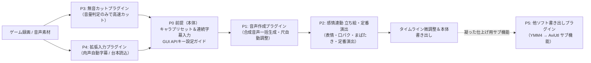

# プラグイン開発ロードマップ（Plugin Roadmap）

- **ステータス**: Draft
- **作成日**: 2026-11-18
- **更新日**: 2026-11-18
- **基準ドキュメント**: [`Market Research.md`](Market%20Research.md)

---

## 1. ロードマップの目的と基本方針

[`Market Research.md`](Market%20Research.md) の市場調査に基づき、`sea-movie-creator` が目指す製品価値は **「個人クリエイターが、録画済みゲーム映像（特に肉声なし映像）から、ゆっくり／ずんだもん実況動画の 70〜80 点の土台を数分・低コスト（数円以下）で自動作成し、タイムライン上で微調整して動画書き出しまで完結できること」** である。

個人開発で破綻せず、かつ一般クリエイターに定着するツールを実現するため、本体・プラグイン全体を貫く **要件上の基本原則** を以下のとおり定める。

1. **「本体＋役割別プラグイン」の疎結合構成**
   - 基礎的な編集機能を持つ本体と、役割ごとに切り分けられたプラグインへ責務を分離する。
2. **「字幕起点（Subtitle-First）」の合理的ワークフロー**
   - 長時間の映像を丸ごと AI に解析させず、**編集者が入力した字幕（＋キャラクタープリセット）をすべての自動化の出発点に統一**し、音声・立ち絵・演出を連鎖生成する。
3. **「70〜80 点主義」と後から直せる個別部品化**
   - AI に 100 点の特殊演出を求めず、音声・表情・定番演出を 70〜80 点の精度で素早く並べる。生成結果は 1 本の映像に焼き込まず、後から手動で動かせる個別のタイムライン部品として配置する。
4. **AI の失敗を恐れない安全設計**
   - 自動変更は適用前に差分を比較確認でき、意図と違う場合は 1 クリックで元に戻せること。
5. **導入・操作・権利・コストの障壁ゼロ化**
   - ターミナル操作をユーザーに強要せず GUI とダブルクリック起動の配布物で完結させる。
   - 外部 AI の API コストを最小化（BYOK・数円以下/本）し、権利上安全な音声ソフト連携（VOICEVOX 等最優先、AquesTalk は外部導入分離）を徹底する。

---

## 2. 全体制作フローとフェーズ一覧

| 優先順 | フェーズ | 作るプラグイン / 機能 | 達成したいユーザー価値（コア要件） | 詳細設計書 |
| :--- | :--- | :--- | :--- | :--- |
| **前提** | **Phase P0** | **本体前提基盤**（キャラプリセット・連続字幕入力・GUI API キーガイド・プラグイン導線） | 字幕起点ワークフローと、黒い画面不要の導入・AI 設定体験を整える | [`004-phase-p0-core-prerequisites.md`](../004-phase-p0-core-prerequisites.md) |
| **第1優先** | **Phase P1** | **音声作成プラグイン**（字幕 → 合成音声・尺自動調整） | 字幕から VOICEVOX 等の音声を一括生成し、尺伸縮・リップル・間・キャッシュを自動処理する | [`005-phase-p1-tts-voice-plugin.md`](../005-phase-p1-tts-voice-plugin.md) （基盤：[`001-yukkuri-live-module.md`](../001-yukkuri-live-module.md)） |
| **第2優先** | **Phase P2** | **感情連動の立ち絵・定番演出自動配置プラグイン**（字幕文脈 → 表情・効果） | 字幕文脈から立ち絵の表情・口パク・まばたき・非話者減光と厳選定番演出（5〜10 種）を 70〜80 点で自動配置する | [`006-phase-p2-tachie-ai-effects-plugin.md`](../006-phase-p2-tachie-ai-effects-plugin.md) （基盤：[`001-yukkuri-live-module.md`](../001-yukkuri-live-module.md)） |
| **第3優先** | **Phase P3** | **無音カットプラグイン**（録画下準備用） | 長時間録画の無言移動・ロード画面を AI コスト 0 の音量判定のみで高速カットする | [`007-phase-p3-silence-cut-plugin.md`](../007-phase-p3-silence-cut-plugin.md) |
| **第4優先** | **Phase P4** | **拡張入力プラグイン**（肉声実況向け自動字幕 ／ 外部台本インポート） | 肉声録画からの自動字幕化と、外部台本ファイルの GUI ドラッグ＆ドロップ展開を可能にする | [`008-phase-p4-extended-input-plugins.md`](../008-phase-p4-extended-input-plugins.md) |
| **第5優先** | **Phase P5** | **他ソフト向けプロジェクト書き出しプラグイン**（YMM4 → AviUtl） | 本ソフトで作った 70〜80 点の土台を既存ソフトへ引き渡して凝った仕上げを行えるようにする | [`009-phase-p5-external-project-export-plugins.md`](../009-phase-p5-external-project-export-plugins.md) |

---

## 3. 各フェーズで実現するプラグインと達成要件

### Phase P0（前提・本体側）：キャラクタープリセット・連続入力・GUI 導入支援

- **何を作るか**: 全プラグインの出発点となる本体側 UI とプラグイン呼び出し窓口。
- **達成したい機能・要件**:
  - **キャラクタープリセット**: キャラクターごとに「立ち絵」「使用音声」「字幕のフォントや色デザイン」を 1 セットとして登録し、ワン操作で切り替えられること。
  - **キーボード完結の連続字幕入力**: マウスへ持ち替えず、キーボード操作だけでキャラクター切替と次の字幕枠作成をテンポ良く連続入力できること。
  - **GUI 完結の API キー設定と取得ガイド**: ターミナル作業や手作業での環境変数設定を不要にし、月額チャットプランと API キー契約の違いを含めた画像付きガイドを見ながら、GUI ボタン操作のみで AI 接続を完了できること。
  - **プラグインの一元メニュー導線**: ユーザーが黒い画面を触らず GUI メニューから各プラグインを実行・管理できること。

### Phase P1（第1優先）：音声作成プラグイン（字幕 → 合成音声・尺自動調整）

- **何を作るか**: 入力された字幕とキャラクタープリセットをもとに、利用者の PC で稼働している外部音声合成エンジンと連携し、音声を一括生成・配置するプラグイン。
- **達成したい機能・要件**:
  - **無料収益化対応エンジンの最優先連携**: 商用無料（クレジット表記のみ）で新規利用者が最も多い **VOICEVOX / COEIROINK / AivisSpeech** を最優先でサポートし、概要欄向けクレジット表記も容易に確認・出力できること。
  - **ゆっくりボイス（AquesTalk）の権利分離**: ソフト本体には同梱せず、利用者が各自で導入した外部エンジンと連携する形式（YMM4 Lite と同様）をとり、収益化時のライセンス要件を明確に案内すること。
  - **字幕尺と後続部品の自動スライド調整**: 生成された実際の音声長に合わせて元の字幕表示時間を自動で伸縮させ、後ろに並んでいる字幕・音声と重ならないよう後続の部品を自動で後ろへずらすこと（BGM 等の背景素材を誤って巻き込まない配慮を含む）。
  - **自然な「間」と音声キャッシュ**: セリフ間に自然な無音時間を自動で確保でき、一部修正後の再実行時は未変更セリフの再生成時間を省くキャッシュ機能を持つこと。

### Phase P2（第2優先）：感情連動の立ち絵・定番演出自動配置プラグイン

- **何を作るか**: 入力された字幕テキストの文脈と感情を AI に読ませ、立ち絵の表情アニメーションと画面演出を 70〜80 点の精度で一括配置するプラグイン。
- **達成したい機能・要件**:
  - **文脈・感情に応じた表情＆自然モーション**: 字幕の感情（驚き・喜び・怒り・悲しみ等）を判定して立ち絵の表情パーツを自動切り替えし、口パク・約 3 秒に 1 回のまばたき・発話揺れ・**非話者を少し暗くする話者強調演出**を自動で施すこと。
  - **定番演出の厳選自動配置（5〜10 種）**: 開発破綻と AI 精度低下を防ぐため、演出は実況で頻出する **5〜10 種類（集中線・画面の揺れ・ズーム・暗転・フラッシュ・色調変化・テロップ強調・定番 SE 枠）** に絞り、後から手動で動かせる個別のタイムライン部品として配置すること。
  - **低コスト化と安全適用**: 動画映像ではなく字幕テキストの塊だけを AI へ渡して JSON 一括返答させることで 1 動画あたり数円以下の API コストを維持し、適用前の差分確認と 1 クリック Undo を必ず保証すること。

### Phase P3（第3優先）：無音カットプラグイン（録画下準備用）

- **何を作るか**: 字幕入力の前段階として、長時間のゲーム録画データから不要な移動時間やロード画面を切り落とすプラグイン。
- **達成したい機能・要件**:
  - **AI コスト完全ゼロの高速判定**: AI を使わずゲーム音や話し声の音量レベル判定のみで無音区間を高速に検出・カットできること。
  - **誤カット防止とやり直し容易性**: 音の頭やお尻が切れないよう前後余白や最小無音時間を GUI で調整でき、カット候補を事前確認したうえで後から手動で区間を伸ばして復元できる非破壊編集として適用されること。

### Phase P4（第4優先）：拡張入力プラグイン（肉声実況向け自動字幕 ／ 外部台本インポート）

- **何を作るか**: ゆっくり実況の基幹プラグイン完成後に、入力ソースを拡張する 2 種の入力プラグイン。
- **達成したい機能・要件**:
  - **肉声実況向けの自動字幕プラグイン**: 配信者自身の声が入った録画データからローカル音声認識で字幕を自動生成し、生成された字幕を起点にそのまま Phase P2（立ち絵・定番演出の自動配置）へ繋げられること。
  - **外部台本ファイルの GUI 読み込み**: 外部で作成したテキスト台本等をドラッグ＆ドロップで GUI から一括読み込みし、キャラクタープリセットと対応付けてタイムラインの字幕枠へ展開できること（チャット経由の補助読込も併用可）。

### Phase P5（第5優先）：他ソフト向けプロジェクト書き出しプラグイン（YMM4 → AviUtl）

- **何を作るか**: 本ソフト単体での動画書き出しを主軸としつつ、さらに凝った特殊演出を既存定番ソフトで仕上げたいクリエイター向けのプロジェクト引き渡しサブプラグイン。
- **達成したい機能・要件**:
  - **YMM4 形式の先行実装**: まず音声・字幕・立ち絵構造がシンプルで変換しやすい **YMM4 形式（`.ymmp`）** への書き出しを実装し、変換できなかった要素があれば分かる形で案内すること。
  - **AviUtl 形式の段階的検討**: 構造が複雑な **AviUtl 形式（`.exo`）** については、YMM4 対応後のユーザー要望を踏まえて対応範囲と実施可否を検討すること。

---

## 4. 横断的な普及・品質要件

1. **バイナリ配布とノーターミナル体験**: ダウンロードして解凍し、実行ファイルをダブルクリックするだけで全機能（同梱プラグイン含む）が使える状態で配布する。
2. **API コストと料金透明性**: ユーザー自身の API キー利用（BYOK）を前提に、映像データを送らない字幕起点バッチ処理で 1 動画あたり数円以下を維持する。
3. **スコープの規律**: 「100 点の映像加工を何でも自力実装する」のではなく、「70〜80 点の実況動画の土台を数分で作り上げる特化ツール」として範囲を堅持する。
