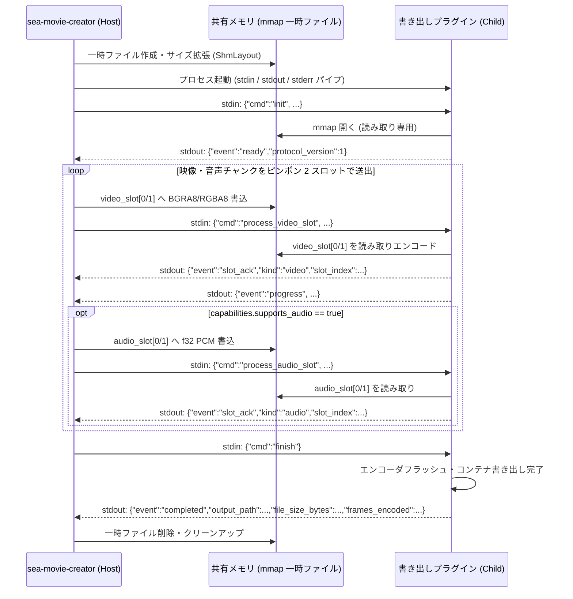

# 動画書き出しプラグイン開発ガイド（`Export Plugin SDK`）

このガイドでは、`sea-movie-creator` の動画書き出しプラグイン（`kind: "export"`）を新規開発するための**ディレクトリ構成**、**`plugin.json` マニフェスト仕様**、**標準入出力 NDJSON IPC**、および **共有メモリ（`mmap`）レイアウト仕様** を解説します。

本仕様は純粋な JSON Lines と標準ファイル `mmap` のみで構成されているため、**Rust 以外の言語（C / C++ / Go / Python 等）** でも実装できます。

---

## 1. アーキテクチャ概要

書き出し実行時、本体（[`src/export/runner.rs`](../../src/export/runner.rs)）は映像フレームの合成（GPU `wgpu` / CPU フォールバック）と音声ミキシング（`AudioMixer`）を担当し、プラグイン子プロセスへ**未圧縮映像フレーム＋PCM 音声**を共有メモリ経由で引き渡します。



---

## 2. クイックスタート（最小プラグインを作る）

リポジトリ内の最小テスト実装 [`plugins_src/sea-export-dummy/src/main.rs`](../../plugins_src/sea-export-dummy/src/main.rs) と実エンコーダ例 [`plugins_src/sea-export-av1/src/main.rs`](../../plugins_src/sea-export-av1/src/main.rs) が完全な動くリファレンスです。

### ステップ 1: フォルダと `plugin.json` を用意する

配布フォルダ（またはワークスペース）の `plugins/export/<your-plugin>/plugin.json` を作成します。

```json
{
  "schema_version": 1,
  "id": "com.example.export.raw_bmp",
  "name": "サンプル BMP 連番書き出し",
  "version": "0.1.0",
  "kind": "export",
  "entrypoint": "sea-export-sample",
  "args": [],
  "containers": ["dir"],
  "license": {
    "spdx": "MIT",
    "notice": "サンプル用サードパーティプラグインです。",
    "requires_external_binary": false
  },
  "capabilities": {
    "supports_alpha": true,
    "supports_audio": false,
    "pixel_format": "rgba8",
    "audio_sample_format": "f32_interleaved",
    "hw_accelerated": false
  },
  "presets": [
    {
      "id": "default",
      "label": "標準 (RGBA8)",
      "description": "確認用の最小プリセット",
      "video_codec": "Uncompressed",
      "audio_codec": "None",
      "container_ext": "json",
      "default_options": {
        "quality": 80
      }
    }
  ],
  "option_fields": [
    {
      "key": "quality",
      "label": "品質 (1〜100)",
      "description": "カスタム整数オプションの例",
      "kind": {
        "type": "integer",
        "min": 1,
        "max": 100
      },
      "default_value": 80
    }
  ]
}
```

### ステップ 2: バイナリを実装・配置する

- **リポジトリ外で Rust 実装する場合**: `plugins_src/sea-export-protocol` は現在 `publish = false`（crates.io 未公開）のため、外部リポジトリから作る場合は §4 の JSON Lines と §5 の `mmap` レイアウトを直接実装するか、プロトコル定義を自クレートへ取り込んでください。
- **本リポジトリ内のワークスペースで開発する場合**: `plugins_src/<crate-name>/` を作成し、`Cargo.toml` に `sea-export-protocol.workspace = true` を追加すると `HostToPluginMessage` / `PluginToHostMessage` / `ShmPluginRegion` をそのまま利用できます。
- ビルド済みバイナリ（例: `sea-export-sample.exe`）は `plugins/export/<your-plugin>/` 直下へ配置します（開発ワークスペース内では `target/debug/`・`target/release/` からも自動検出されます）。

---

## 3. `plugin.json` マニフェスト仕様リファレンス

スキーマ定義と検証ルールは [`src/export/manifest.rs`](../../src/export/manifest.rs) で実装されています。

### ルートオブジェクト（`ExportPluginManifest`）

| フィールド | 型 | 必須 | 説明・制約 |
| :--- | :--- | :---: | :--- |
| `schema_version` | `u32` | ○ | 現在は **`1` 固定**。これ以外の値は読み込みエラー |
| `id` | `string` | ○ | 一意な逆ドメイン形式 ID（例: `"sea.export.av1"`, `"com.example.vp9"`）。空文字不可 |
| `name` | `string` | ○ | 書き出しダイアログに表示される名称。空文字不可 |
| `version` | `string` | ○ | セマンティックバージョン文字列（例: `"0.1.0"`） |
| `kind` | `string` | ○ | **`"export"` 固定** |
| `entrypoint` | `string` | ○ | 実行ファイル名またはプラグインフォルダ内の相対パス。絶対パス・`..`・ルートプレフィックス不可。OS 拡張子（`.exe`）は自動補完 |
| `args` | `string[]` | - | プロセス起動時に常に先頭へ渡される追加 CLI 引数（省略時は `[]`） |
| `containers` | `string[]` | ○ | 対応コンテナ拡張子の配列（ドットなし小文字、例: `["mkv", "mp4"]`）。1 件以上必須 |
| `license` | `object` | ○ | ライセンスおよび外部依存の開示情報（下記参照） |
| `capabilities` | `object` | ○ | 入出力フォーマット・能力宣言（下記参照） |
| `presets` | `object[]` | ○ | 1 件以上のプリセット定義（`id` の重複不可） |
| `option_fields` | `object[]` | - | UI 上に動的生成する詳細オプション項目（省略時は `[]`） |

### `license`（`PluginLicenseInfo`）

| フィールド | 型 | 必須 | 説明 |
| :--- | :--- | :---: | :--- |
| `spdx` | `string` | ○ | SPDX ライセンス識別子（例: `"MIT OR Apache-2.0"`）。本リポジトリ同梱物は GPL 系・AGPL 不可 |
| `notice` | `string \| null` | - | 書き出しダイアログの注意欄に表示されるライセンス・特許・外部依存注記 |
| `requires_external_binary` | `bool` | - | 外部実行ファイルを必要とするかの宣言（既定 `false`） |

> [!WARNING]
> **現行 UI（Alpha v0.1.1）における `requires_external_binary` の挙動に関する注意**:
> [`src/ui/export_dialog.rs`](../../src/ui/export_dialog.rs#L121-L130) の `ExportDialogState::is_plugin_visible` は現在、外部 `ffmpeg` パスが未設定の状態で `license.requires_external_binary == true` のプラグインを**ダイアログ一覧から非表示**にする実装になっています。`ffmpeg` 以外の独自外部バイナリに依存するプラグインであっても、未設定時に一覧から消えてほしくない場合は `false` とし、実行時チェックや `notice` / `option_fields` で案内する設計を推奨します。

### `capabilities`（`PluginCapabilities`）

| フィールド | 型 | 既定値 | 説明 |
| :--- | :--- | :--- | :--- |
| `supports_alpha` | `bool` | `false` | 透過出力に対応するか（宣言用メタデータ） |
| `supports_audio` | `bool` | `true` | `false` にするとホストは音声 PCM スロットを送出しません |
| `pixel_format` | `string` | `"bgra8"` | `"bgra8"` または `"rgba8"`。`"rgba8"` 指定時はホスト側で BGRA→RGBA 変換して共有メモリへ書き込みます |
| `audio_sample_format` | `string` | `"f32_interleaved"` | 型定義上は `"f32_interleaved"` / `"i16_interleaved"` ですが、**現行ホスト（`runner.rs`）は常に `"f32_interleaved"` で送出します** |
| `hw_accelerated` | `bool` | `false` | OS HW エンコーダ等を利用するかどうか（表示・分類用） |

### `presets`（`PresetSchema`）

| フィールド | 型 | 必須 | 説明 |
| :--- | :--- | :---: | :--- |
| `id` | `string` | ○ | プラグイン内で一意のプリセット ID（空文字不可） |
| `label` | `string` | ○ | コンボボックス表示名 |
| `description` | `string` | - | 説明文（既定 `""`） |
| `video_codec` | `string` | ○ | UI 表示用の映像コーデック名 |
| `audio_codec` | `string` | ○ | UI 表示用の音声コーデック名 |
| `container_ext` | `string` | ○ | 選択時に出力ファイル名へ自動適用される拡張子（ドットなし、例: `"mp4"`） |
| `default_options` | `object` | - | このプリセット選択時に `Init.options` へマージされる初期 JSON オブジェクト |

### `option_fields`（`ExportOptionField`）と UI 描画仕様

各項目は `key`, `label`, `description`（任意）, `kind`, `default_value`（任意）を持ち、`kind.type` に応じて書き出しダイアログに UI コントロールが生成されます。

| `kind.type` | 追加フィールド | 現行ダイアログ（[`export_dialog.rs`](../../src/ui/export_dialog.rs#L1056-L1199)）での動作 |
| :--- | :--- | :--- |
| `"boolean"` | なし | `ON` / `OFF` トグルボタン |
| `"integer"` | `min`: `i64`, `max`: `i64` | `-` / `+` ボタンによる 1 刻み増減 |
| `"select"` | `choices`: `[{ "value": "...", "label": "..." }]` | ドロップダウンメニュー（注：`key == "backend_mode"` の `"external_ffmpeg"` 選択肢は `ffmpeg` 未設定時に非表示） |
| `"string"` | なし | **現行 UI では現在値の表示のみ**で汎用テキスト入力欄は未実装です（`key == "ffmpeg_path"` のみ外部ツール設定モーダルを開くボタンを表示）。ユーザーに選ばせたい値は `"select"` 等を推奨します |

---

## 4. IPC ワイヤプロトコル（NDJSON over `stdin` / `stdout`）

通信はすべて **UTF-8 の 1 行 1 JSON（末尾 `\n` 改行＋即時フラッシュ）** で行います。空行は無視されます。現在のプロトコルバージョンは `EXPORT_PROTOCOL_VERSION = 1` です（[`plugins_src/sea-export-protocol/src/lib.rs`](../../plugins_src/sea-export-protocol/src/lib.rs)）。

### ホスト → プラグイン（`stdin` 受信）

タグフィールド名は **`"cmd"`**（`snake_case`）です。

#### 1. `init`（起動直後に 1 回だけ受信）

```json
{
  "cmd": "init",
  "protocol_version": 1,
  "width": 1920,
  "height": 1080,
  "fps_num": 60,
  "fps_den": 1,
  "total_video_frames": 300,
  "sample_rate": 48000,
  "audio_channels": 2,
  "pixel_format": "bgra8",
  "audio_sample_format": "f32_interleaved",
  "shm_path": "C:\\Users\\...\\AppData\\Local\\Temp\\sea-export-1234-1.shm",
  "shm_layout": {
    "video_slot_stride_bytes": 8294400,
    "video_slot_count": 2,
    "audio_region_offset_bytes": 16588800,
    "audio_slot_stride_bytes": 32768,
    "audio_slot_count": 2,
    "total_bytes": 16654336
  },
  "output_path": "D:\\exports\\out.mkv",
  "preset_id": "av1_fast",
  "options": {
    "speed": 9,
    "quantizer": 110
  }
}
```

- **偶数解像度**: `ExportDialogState` / `runner.rs` の検証により `width`・`height` は 2 以上の偶数です。
- **フレームレート**: `fps_num / fps_den` の有理数（例: `30000 / 1001`, `60 / 1`）。

#### 2. `process_video_slot`

```json
{
  "cmd": "process_video_slot",
  "slot_index": 0,
  "frame_index": 42,
  "data_len_bytes": 8294400
}
```

- `frame_index` は書き出し対象範囲の先頭を `0` とする 0 始まりの連番です。
- 共有メモリの `slot_index` 番映像スロットから `data_len_bytes` バイト（`width * height * 4`）を読み取ってください。

#### 3. `process_audio_slot`

```json
{
  "cmd": "process_audio_slot",
  "slot_index": 1,
  "start_sample": 1600,
  "sample_frame_count": 800,
  "data_len_bytes": 6400
}
```

- `start_sample` は書き出し開始位置を `0` とする相対サンプルフレーム位置です。
- `sample_frame_count` はステレオ 2ch を 1 と数えるサンプルフレーム数です（`data_len_bytes = sample_frame_count * audio_channels * 4`）。
- 映像フレームの送出と時系列順にインターリーブされて届きます。

#### 4. `finish` / `abort`

```json
{ "cmd": "finish" }
```
```json
{ "cmd": "abort" }
```

- `finish` を受けたら未出力フレーム／音声をフラッシュして出力ファイルを確定（クローズ）し、`completed` イベントを返してプロセス終了（終了コード `0`）してください。
- `abort` を受けた場合は可能なら速やかに `error`（例: `code: "CANCELLED"`）またはクリーン終了してください（ホストは `Abort` 送信後 **最大 2 秒** で終了を待ち、超過時は強制終了します）。

---

### プラグイン → ホスト（`stdout` 送信）

タグフィールド名は **`"event"`**（`snake_case`）です。

| `event` | 送信タイミング | JSON フォーマット例 |
| :--- | :--- | :--- |
| `"ready"` | `init` 受信・共有メモリ接続成功後 | `{"event":"ready","protocol_version":1}` |
| `"slot_ack"` | 指定スロットの読み取り完了後（必須） | `{"event":"slot_ack","kind":"video","slot_index":0}`<br>（`kind` は `"video"` または `"audio"`） |
| `"progress"` | 任意の進捗通知（UI 表示用） | `{"event":"progress","frames_encoded":42,"total_frames":300,"audio_samples_encoded":33600,"message":"encoding..."}` |
| `"completed"` | `finish` 後のコンテナ書き出し完了時 | `{"event":"completed","output_path":"...","file_size_bytes":1048576,"frames_encoded":300}` |
| `"error"` | 初期化・エンコード失敗時 | `{"event":"error","code":"ENCODER_INIT_FAILED","message":"詳細説明"}` |

> [!IMPORTANT]
> **`slot_ack` の返却タイミング**:
> ホストは 2 つのスロット（`slot_index = 0, 1`）を交互に使って送信し、使用中スロットが空くまで `slot_ack` を待ちます。**プラグイン側がそのスロットの共有メモリ読み取りを終える（あるいは別バッファへコピーし終える）前には絶対に `slot_ack` を返さないでください**。読み取り完了後ただちに `slot_ack` を返すことで、ホストが次のフレームを並行準備できスループットが上がります。

---

## 5. 共有メモリ（`ShmLayout`）のバイナリ仕様

他言語から `init.shm_path` をメモリマップして読む場合の正確なレイアウト仕様です（[`plugins_src/sea-export-protocol/src/lib.rs`](../../plugins_src/sea-export-protocol/src/lib.rs#L109-L232)）。

### メモリ領域の配置図

```text
Offset 0
├── Video Slot 0  (size = width * height * 4 bytes, stride = shm_layout.video_slot_stride_bytes)
├── Video Slot 1  (starts at 1 * video_slot_stride_bytes)
│   ... (video_slot_count 個、現在は 2)
Offset = shm_layout.audio_region_offset_bytes  (64 バイト境界アライン済み)
├── Audio Slot 0  (stride = shm_layout.audio_slot_stride_bytes)
├── Audio Slot 1  (starts at audio_region_offset_bytes + 1 * audio_slot_stride_bytes)
    ... (audio_slot_count 個、現在は 2、各スロット最大 4096 frames × 2ch × 4 bytes)
Total size = shm_layout.total_bytes
```

### 各要素のバイト配列・エンディアン

- **計算されたストライドをそのまま使う**: `init.shm_layout` にホストが計算した `video_slot_stride_bytes`・`audio_region_offset_bytes`・`audio_slot_stride_bytes`・`total_bytes` がすべて入っています（64 バイト境界に丸め済み）。プラグイン側ではこの値をそのままオフセット計算に使用してください。
  - 映像スロット `i` の開始オフセット: `i * video_slot_stride_bytes`
  - 音声スロット `i` の開始オフセット: `audio_region_offset_bytes + i * audio_slot_stride_bytes`
- **ファイルオープン契約**:
  - プラグイン側は `init.shm_path` を**読み取り専用（Read-Only）** で開いて `init.shm_layout.total_bytes` 分を `mmap` します（ファイルサイズ `>= total_bytes` を検証してください）。
  - プラグイン側から一時ファイルを削除しないでください（終了後の削除はホスト側の `ShmHostRegion` が行います）。
- **ピクセルデータ（`bgra8` / `rgba8`）**:
  - トップダウンの行優先（row-major）、パディングなしの密配列（`1 ピクセル = 4 バイト`、合計 `width * height * 4` バイト）。
  - `bgra8`: `[B, G, R, A]` 順、`rgba8`: `[R, G, B, A]` 順。
- **音声データ（`f32_interleaved`）**:
  - チャンネルインターリーブ済み IEEE-754 単精度浮動小数点（**リトルエンディアン `f32`**、値域目安 `-1.0 ..= 1.0`）。
  - ステレオ 2ch の並び順: `[L0, R0, L1, R1, ...]`（1 フレームあたり `2 * 4 = 8` バイト）。

---

## 6. タイムアウト・異常終了・キャンセルの契約

ホスト側（[`src/export/runner.rs`](../../src/export/runner.rs)）は以下の制限時間を設けており、応答がないプラグインによる UI ハングを防いでいます。

| 待機フェーズ | ホストのタイムアウト | タイムアウト時の動作 |
| :--- | :--- | :--- |
| `init` 送信後 → `ready` 受信まで | **30 秒**（`SLOT_ACK_TIMEOUT`） | `READY_TIMEOUT` エラーとして失敗 |
| 空きスロット待機（`slot_ack` 受信まで） | **30 秒**（`SLOT_ACK_TIMEOUT`） | `SLOT_ACK_TIMEOUT` エラーとして失敗 |
| `finish` 送信後 → `completed` 受信まで | **120 秒** | `FINALIZE_TIMEOUT` エラーとして失敗 |
| 終了・`abort` 後のプロセス終了待機 | **2 秒** | 未終了なら子プロセスを `kill` |

- **中間出力ファイルの扱い**: エクスポートが失敗またはキャンセルされた場合、ホストは `request.output_path` が存在すれば削除を試みます。プラグイン側はクラッシュ時に壊れたファイルを残さないよう配慮し、致命的エラー時は可能であれば `{"event":"error",...}` を `stdout` へ出力してから非ゼロで終了してください。
- **標準エラー出力（`stderr`）**: ホストはプラグインの `stderr` を末尾最大 24 行まで保持し、IPC 切断や非ゼロ終了時の診断メッセージに含めます。エラー原因を `stderr` に簡潔に出すとデバッグしやすくなります。
